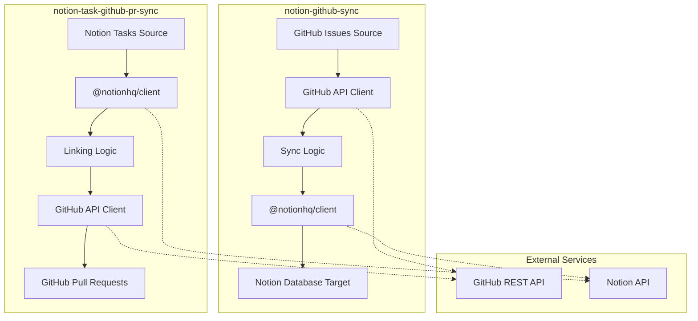
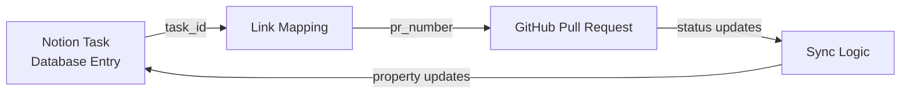
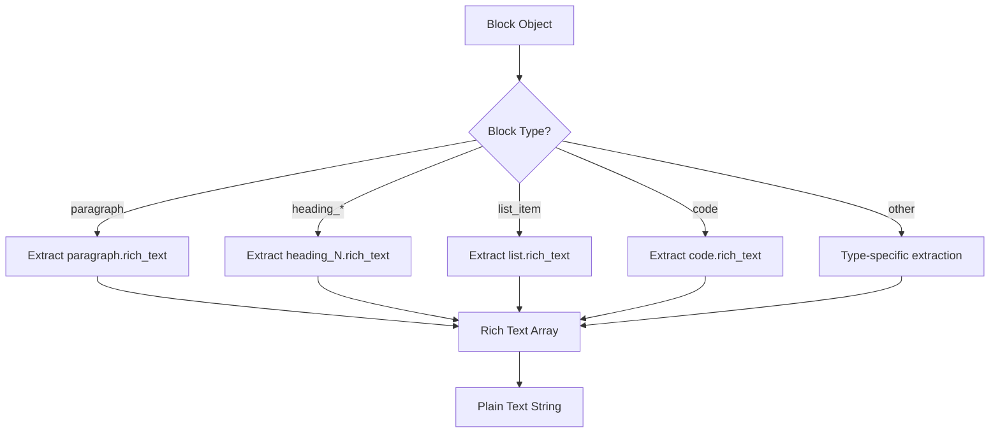
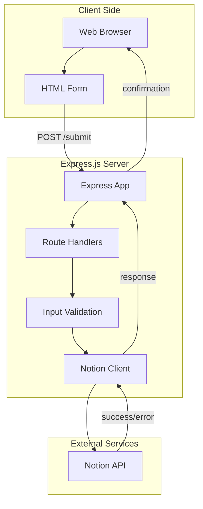
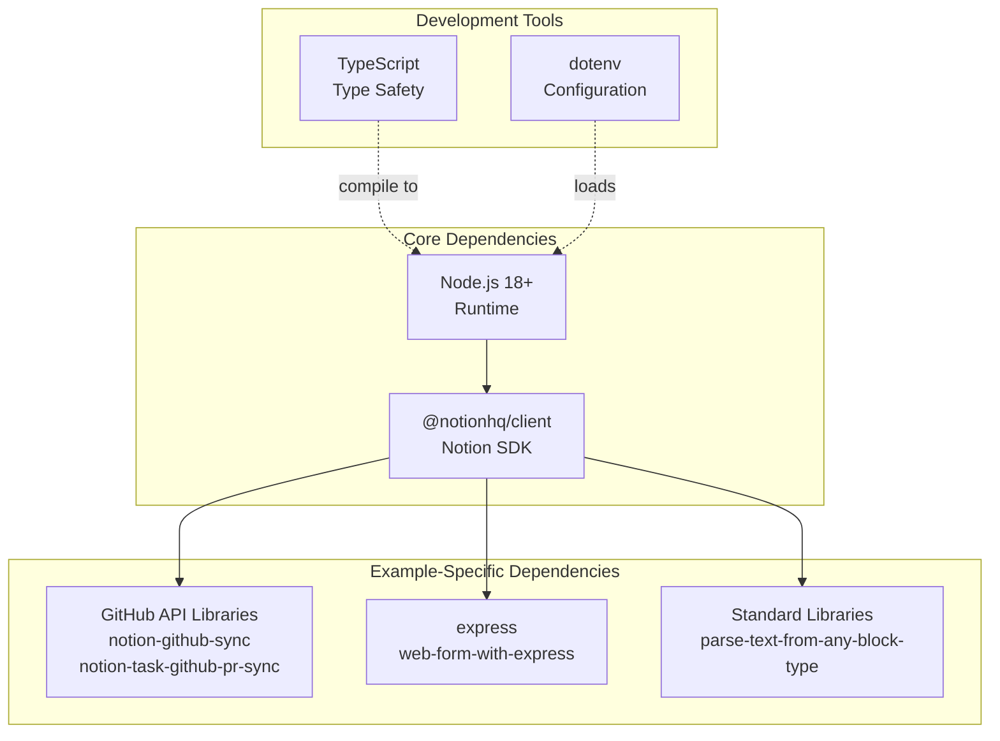

<!-- source: DeepWiki mcp.deepwiki.com · repo makenotion/notion-cookbook · page 3.4 Additional JavaScript Examples · fetched 2026-10-27 -->

# Additional JavaScript Examples

Relevant source files

The following files were used as context for generating this wiki page:

- [examples/README.md](examples/README.md)
- [examples/javascript/README.md](examples/javascript/README.md)

## Purpose and Scope

This document covers the remaining JavaScript examples in the Notion Cookbook repository that demonstrate advanced integration patterns and utility functions. These examples build upon the foundational concepts covered in the Introduction to Notion API ([3.1](#3.1)), Database Email Update ([3.2](#3.2)), and Generate Random Data ([3.3](#3.3)) examples.

The examples documented here include:
- GitHub integration examples for bidirectional synchronization
- Utility functions for text parsing across block types
- Web form integration patterns using Express.js

## Overview of Examples

The following table summarizes the additional JavaScript examples available in the repository:

| Example | Category | Primary Integration | Key Use Case |
|---------|----------|-------------------|--------------|
| `notion-github-sync` | Integration | GitHub API | Sync GitHub issues to Notion database |
| `notion-task-github-pr-sync` | Integration | GitHub API | Link Notion tasks with GitHub pull requests |
| `parse-text-from-any-block-type` | Utility | None | Extract text content from various block types |
| `web-form-with-express` | Integration | Express.js | Create web forms that write to Notion |

**Sources:** [examples/README.md:1-43](), [examples/javascript/README.md:1-62]()

## GitHub Integration Examples

The GitHub integration examples demonstrate bidirectional synchronization patterns between Notion and external services, specifically GitHub's issue tracking and pull request systems.

### Architecture: GitHub Integrations

**Sources:** [examples/README.md:14-15](), [examples/javascript/README.md:21-22]()

### notion-github-sync

The `notion-github-sync` example implements a one-way synchronization pattern from GitHub issues to a Notion database. This pattern is useful for tracking external project items within Notion's workspace environment.

#### Key Features

- Fetches issues from a specified GitHub repository
- Creates or updates corresponding pages in a Notion database
- Maps GitHub issue properties to Notion database properties
- Maintains synchronization state to handle incremental updates

#### Common Use Cases

| Use Case | Description |
|----------|-------------|
| Project Management | Centralize issue tracking across multiple repositories |
| Status Monitoring | Track external dependencies and their progress |
| Reporting | Generate Notion-based reports from GitHub data |
| Cross-team Visibility | Share GitHub issues with non-technical stakeholders |

#### Setup Requirements

The example follows the standard JavaScript example setup pattern:

1. Install dependencies via `npm install`
2. Configure environment variables including `NOTION_API_KEY` and GitHub repository details
3. Share target Notion database with the integration
4. Execute synchronization script

**Sources:** [examples/README.md:14](), [examples/javascript/README.md:21](), [examples/javascript/README.md:29-56]()

### notion-task-github-pr-sync

The `notion-task-github-pr-sync` example demonstrates bidirectional linking between Notion tasks and GitHub pull requests. Unlike the one-way sync pattern, this example creates associations that enable workflow automation.

#### Key Features

- Links Notion database entries to GitHub pull requests
- Enables tracking PR status from within Notion
- Supports workflow automation based on PR state changes
- Maintains relationship mapping between systems

#### Integration Pattern

**Sources:** [examples/README.md:15](), [examples/javascript/README.md:22]()

## Utility Examples

The utility examples provide reusable functions for common Notion API operations that are not specific to external service integrations.

### parse-text-from-any-block-type

The `parse-text-from-any-block-type` example implements text extraction logic that handles the varied structure of different Notion block types.

#### Block Type Coverage

Notion's API represents different content types with distinct block structures. This utility normalizes text extraction across block types including:

| Block Type | Text Location | Special Handling |
|------------|---------------|------------------|
| `paragraph` | `paragraph.rich_text` | Standard rich text array |
| `heading_1`, `heading_2`, `heading_3` | `heading_N.rich_text` | Standard rich text array |
| `bulleted_list_item`, `numbered_list_item` | `TYPE.rich_text` | Standard rich text array |
| `to_do` | `to_do.rich_text` | Includes checked state |
| `toggle` | `toggle.rich_text` | May contain children |
| `quote` | `quote.rich_text` | Standard rich text array |
| `callout` | `callout.rich_text` | Includes icon information |
| `code` | `code.rich_text` | Includes language property |

#### Text Extraction Pattern

#### Usage Scenarios

- **Content Analysis**: Extract text for search indexing or analysis
- **Export Functions**: Generate plain text exports of Notion content
- **Data Migration**: Extract content during database migrations
- **Reporting**: Generate text-based reports from Notion pages

**Sources:** [examples/README.md:16](), [examples/javascript/README.md:27]()

### web-form-with-express

The `web-form-with-express` example demonstrates building a web interface that submits data directly to Notion databases using Express.js as the backend framework.

#### Architecture: Web Form Integration

#### Key Components

The web form example integrates several components working together:

| Component | Technology | Purpose |
|-----------|-----------|---------|
| Frontend | HTML/JavaScript | User interface for data entry |
| Backend | Express.js | Request handling and validation |
| API Client | `@notionhq/client` | Notion API communication |
| Database | Notion Database | Data storage target |

#### Implementation Pattern

The example follows a standard Express.js application structure:

1. **Server Setup**: Initialize Express application with middleware
2. **Route Definition**: Define POST endpoint for form submission
3. **Input Validation**: Validate and sanitize user input
4. **Database Writing**: Transform form data to Notion page properties
5. **Response Handling**: Return success or error responses to client

#### Security Considerations

- **API Key Protection**: Notion API key stored server-side, never exposed to client
- **Input Validation**: Server-side validation prevents malformed data submission
- **CORS Configuration**: Proper CORS headers for cross-origin requests
- **Rate Limiting**: Optional rate limiting to prevent abuse

**Sources:** [examples/README.md:17](), [examples/javascript/README.md:23]()

## Common Patterns Across Examples

### Dependency Management

All JavaScript examples share common dependencies and setup patterns:

**Sources:** [examples/javascript/README.md:5-9](), [examples/javascript/README.md:29-56]()

### Setup Workflow

All examples follow a standardized setup workflow documented in the JavaScript README:

1. **Install Dependencies**: Execute `npm install` to install required packages
2. **Configure Environment**: Copy `.env.example` to `.env` and populate variables
3. **Share Resources**: Add integration connection to target Notion page/database
4. **Execute Example**: Run via `npm start` or example-specific command

**Sources:** [examples/javascript/README.md:29-56]()

### Environment Variable Pattern

Examples requiring configuration use environment variables for sensitive data:

| Variable | Purpose | Examples Using |
|----------|---------|----------------|
| `NOTION_API_KEY` | Notion integration authentication | All examples |
| `NOTION_DATABASE_ID` | Target database identifier | Most examples |
| `GITHUB_TOKEN` | GitHub API authentication | GitHub sync examples |
| `GITHUB_REPO` | Repository identifier | GitHub sync examples |
| `PORT` | Server port number | `web-form-with-express` |

**Sources:** [examples/javascript/README.md:39-46]()

## Running Examples

### General Execution Pattern

The JavaScript examples use npm scripts for execution. Most examples support:

- `npm start`: Run the example in production mode
- `npm run dev`: Run with development features (if available)
- `npm run ts-run`: Direct TypeScript execution via ts-node

### Example-Specific Commands

Some examples may implement custom npm scripts for specific workflows:

- **Sync Examples**: May include `npm run sync` for one-time synchronization
- **Server Examples**: May include `npm run dev` for development with hot reload
- **Utility Examples**: May export functions for programmatic usage

**Sources:** [examples/javascript/README.md:52-55]()

## Integration with Repository Infrastructure

### Type Checking

All JavaScript examples are validated through the CI/CD pipeline's type checking workflow. The `typecheck-javascript-examples` workflow ensures examples maintain type safety.

**Sources:** Diagram 2 from high-level architecture, [examples/javascript/README.md:5]()

### Documentation Standards

Each example includes:

- `README.md`: Setup instructions and usage guide
- `package.json`: Dependency manifest and script definitions
- `tsconfig.json`: TypeScript configuration (for TypeScript examples)
- `.env.example`: Template for required environment variables

**Sources:** [examples/README.md:34-38]()

## Resources and Further Reading

For detailed information about:
- **Basic Notion API operations**: See Introduction to Notion API ([3.1](#3.1))
- **Database monitoring patterns**: See Database Email Update ([3.2](#3.2))
- **Data population strategies**: See Generate Random Data ([3.3](#3.3))
- **Contributing new examples**: See Contributing ([6](#6))
- **Code quality standards**: See Code Style Standards ([6.1](#6.1))

External resources:
- Notion API Reference: https://developers.notion.com/reference
- JavaScript SDK Documentation: https://github.com/makenotion/notion-sdk-js
- Getting Started Guide: https://developers.notion.com/docs/getting-started

**Sources:** [examples/javascript/README.md:58-61]()

---

