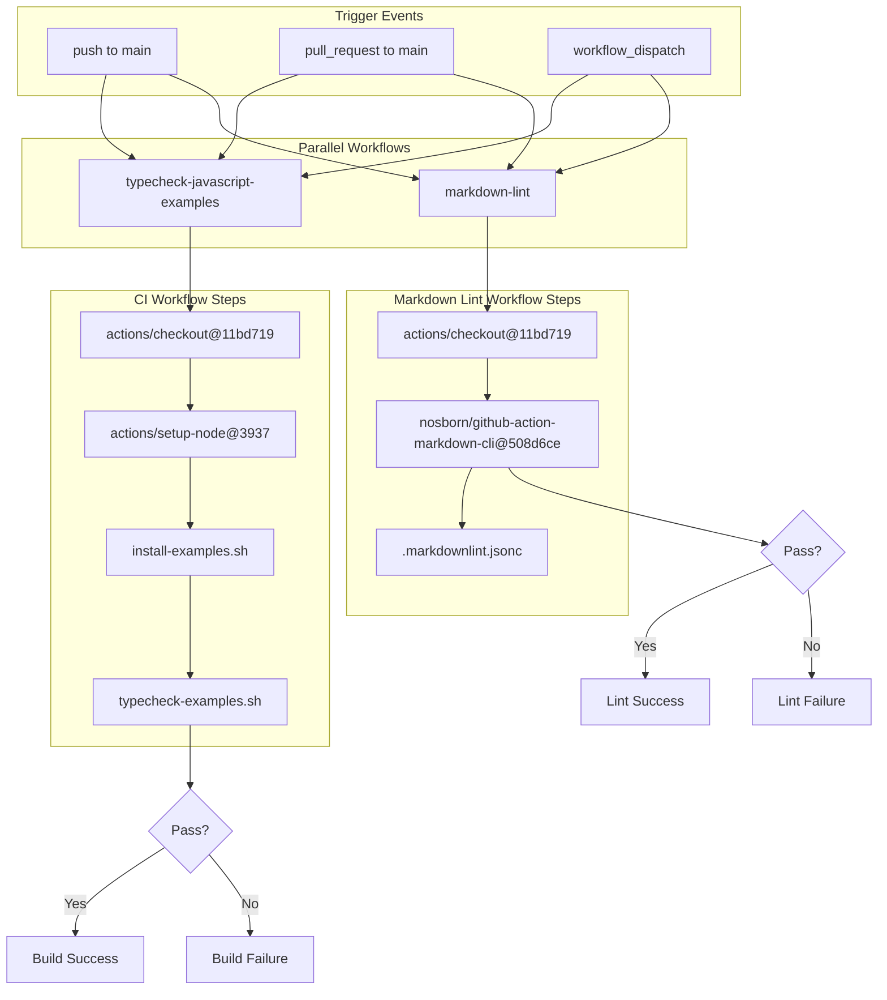
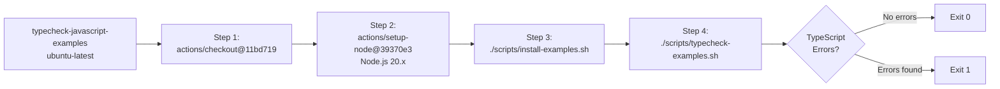
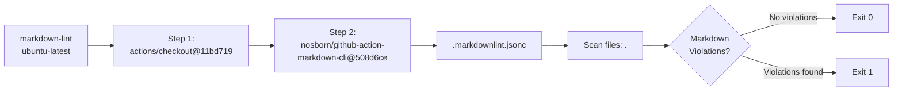
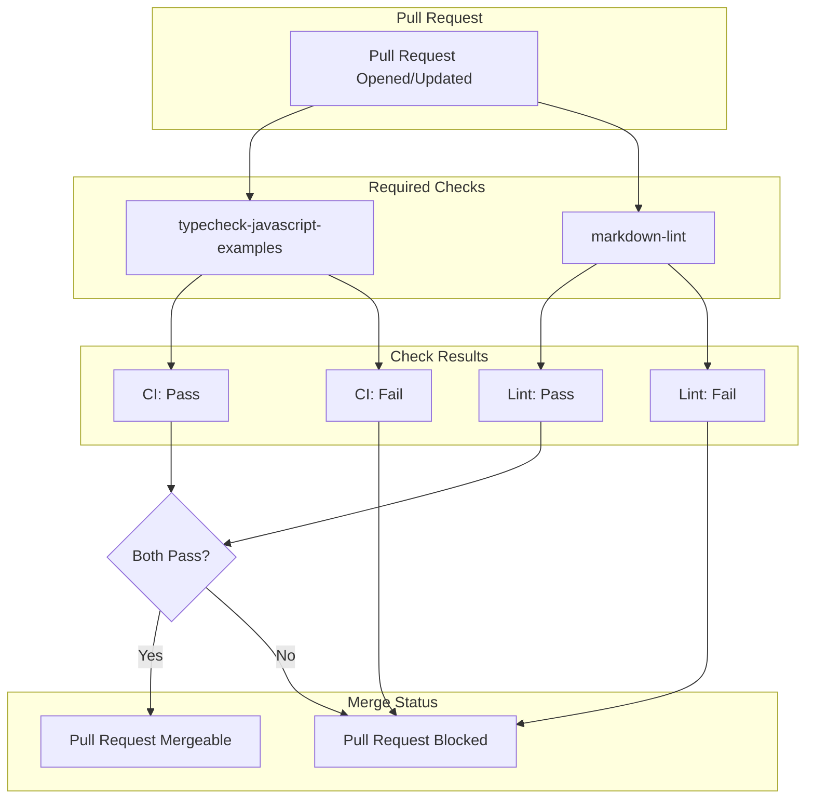

<!-- source: DeepWiki mcp.deepwiki.com · repo makenotion/notion-cookbook · page 7.1 CI/CD Pipeline · fetched 2026-10-27 -->

# CI/CD Pipeline

<details>
<summary>Relevant source files</summary>

The following files were used as context for generating this wiki page:

- [.github/workflows/ci.yml](.github/workflows/ci.yml)
- [.github/workflows/markdown-lint.yml](.github/workflows/markdown-lint.yml)

</details>


## Purpose and Scope

This document details the Continuous Integration and Continuous Deployment (CI/CD) pipeline implemented through GitHub Actions workflows. The pipeline enforces code quality through automated type checking of JavaScript examples and Markdown linting of documentation files.

For local development code quality enforcement before commits, see [Pre-commit Hooks](#7.2). For code formatting and linting configuration standards, see [Code Style Standards](#6.1).

## Overview

The CI/CD pipeline consists of two independent GitHub Actions workflows that run on every push to `main`, pull request to `main`, and manual workflow dispatch:

| Workflow | File | Primary Function | Run Time |
|----------|------|------------------|----------|
| `CI` | `.github/workflows/ci.yml` | TypeScript type checking of JavaScript examples | ~1-2 minutes |
| `Markdown lint` | `.github/workflows/markdown-lint.yml` | Markdown style validation | ~30 seconds |

Both workflows run in parallel and must pass for pull requests to be mergeable. The workflows act as a safety net that catches issues that may have bypassed local pre-commit hooks.

**Sources:** [.github/workflows/ci.yml:1-26](), [.github/workflows/markdown-lint.yml:1-23]()

## Workflow Architecture



**Diagram: CI/CD Workflow Trigger and Execution Flow**

This diagram shows how both workflows are triggered by the same events and execute in parallel. Each workflow has distinct steps but both must succeed for the overall CI to pass.

**Sources:** [.github/workflows/ci.yml:3-8](), [.github/workflows/markdown-lint.yml:3-8]()

## Workflow Triggers

Both workflows are configured with identical trigger events:

```yaml
on:
  push:
    branches: [main]
  pull_request:
    branches: [main]
  workflow_dispatch:
```

### Trigger Event Details

| Event | Branches | Purpose |
|-------|----------|---------|
| `push` | `main` | Validates commits pushed directly to main branch |
| `pull_request` | `main` | Validates proposed changes before merge |
| `workflow_dispatch` | all | Allows manual workflow execution from GitHub UI |

The `workflow_dispatch` trigger enables maintainers to manually re-run checks without creating new commits or pull requests.

**Sources:** [.github/workflows/ci.yml:3-8](), [.github/workflows/markdown-lint.yml:3-8]()

## CI Workflow: typecheck-javascript-examples



**Diagram: CI Workflow Step Sequence**

**Sources:** [.github/workflows/ci.yml:11-25]()

### Job Configuration

The `typecheck-javascript-examples` job runs on `ubuntu-latest` with the following characteristics:

- **Job Name:** `typecheck-javascript-examples`
- **Runner:** `ubuntu-latest` (GitHub-hosted runner)
- **Timeout:** Default (360 minutes, typically completes in 1-2 minutes)

**Sources:** [.github/workflows/ci.yml:11-12]()

### Step-by-Step Execution

#### Step 1: Checkout Repository

```yaml
- uses: actions/checkout@11bd71901bbe5b1630ceea73d27597364c9af683
```

Uses GitHub's `checkout` action (pinned to commit `11bd719`, corresponding to v4.2.2) to clone the repository into the runner's workspace. This provides access to all source files and scripts.

**Sources:** [.github/workflows/ci.yml:16]()

#### Step 2: Setup Node.js Environment

```yaml
- name: Use Node.js 20.x
  uses: actions/setup-node@39370e3970a6d050c480ffad4ff0ed4d3fdee5af
  with:
    node-version: 20.x
```

Installs Node.js version 20.x using the `setup-node` action (pinned to commit `39370e3`, corresponding to v4.1.0). The workflow uses a specific commit SHA for security and reproducibility rather than a mutable tag.

**Sources:** [.github/workflows/ci.yml:17-21]()

#### Step 3: Install Dependencies

```yaml
- name: Install dependencies for JavaScript examples
  run: ./scripts/install-examples.sh
```

Executes the `install-examples.sh` script which iterates through all JavaScript example directories and runs `npm install` in each. This ensures all dependencies are available for type checking.

**Sources:** [.github/workflows/ci.yml:22-23]()

#### Step 4: Type Check Examples

```yaml
- name: Typecheck JavaScript examples
  run: ./scripts/typecheck-examples.sh
```

Executes the `typecheck-examples.sh` script which runs TypeScript type checking across all JavaScript examples. If any type errors are found, the script exits with a non-zero status code, causing the workflow to fail.

**Sources:** [.github/workflows/ci.yml:24-25]()

## Markdown Lint Workflow



**Diagram: Markdown Lint Workflow Step Sequence**

**Sources:** [.github/workflows/markdown-lint.yml:11-22]()

### Job Configuration

The `markdown-lint` job provides fast feedback on documentation quality:

- **Job Name:** `markdown-lint`
- **Runner:** `ubuntu-latest` (GitHub-hosted runner)
- **Target Files:** All Markdown files in repository (`.`)
- **Configuration:** `.markdownlint.jsonc`

**Sources:** [.github/workflows/markdown-lint.yml:11-12]()

### Step-by-Step Execution

#### Step 1: Checkout Repository

```yaml
- uses: actions/checkout@11bd71901bbe5b1630ceea73d27597364c9af683
```

Identical to the CI workflow, this step clones the repository to make all Markdown files available for linting.

**Sources:** [.github/workflows/markdown-lint.yml:16]()

#### Step 2: Lint Markdown Files

```yaml
- name: Lint markdown files
  uses: nosborn/github-action-markdown-cli@508d6cefd8f0cc99eab5d2d4685b1d5f470042c1
  with:
    files: .
    config_file: .markdownlint.jsonc
```

Uses the `github-action-markdown-cli` action (pinned to commit `508d6ce`, corresponding to v3.5.0) to validate all Markdown files in the repository (`.`) against the rules defined in `.markdownlint.jsonc`. This configuration file disables 10 rules to accommodate Notion-flavored Markdown syntax (see [Code Style Standards](#6.1) for details).

**Sources:** [.github/workflows/markdown-lint.yml:17-22]()

## Workflow Status and Pull Request Integration



**Diagram: Pull Request Check Requirements**

When a pull request is opened or updated, both workflows execute automatically. GitHub displays the status of each workflow as a check on the pull request. Both checks must pass for the pull request to be mergeable (assuming branch protection rules are configured).

**Sources:** [.github/workflows/ci.yml:6-7](), [.github/workflows/markdown-lint.yml:6-7]()

## Relationship to Pre-commit Hooks

The CI/CD pipeline serves as a safety net that complements local pre-commit hooks (documented in [Pre-commit Hooks](#7.2)). The relationship follows a defense-in-depth strategy:

| Stage | Tool | Speed | Enforcement | Purpose |
|-------|------|-------|-------------|---------|
| Local (pre-commit) | Husky + lint-staged | Fast (~5-10s) | Soft (can be bypassed with `--no-verify`) | Immediate developer feedback |
| Remote (CI/CD) | GitHub Actions | Moderate (~1-2min) | Hard (cannot be bypassed) | Repository-level quality gate |

Developers receive fast local feedback through pre-commit hooks, but the CI workflows ensure that code quality standards are enforced even if local checks are bypassed or not configured.

**Sources:** [.github/workflows/ci.yml:1-26](), [.github/workflows/markdown-lint.yml:1-23]()

## Security Considerations

Both workflows implement security best practices:

### Pinned Action Versions

All GitHub Actions are pinned to specific commit SHAs rather than mutable tags:

```yaml
# Pinned to commit SHA (corresponds to v4.2.2)
- uses: actions/checkout@11bd71901bbe5b1630ceea73d27597364c9af683

# Pinned to commit SHA (corresponds to v4.1.0)
- uses: actions/setup-node@39370e3970a6d050c480ffad4ff0ed4d3fdee5af

# Pinned to commit SHA (corresponds to v3.5.0)
- uses: nosborn/github-action-markdown-cli@508d6cefd8f0cc99eab5d2d4685b1d5f470042c1
```

This prevents supply chain attacks where a compromised action version could execute malicious code. Comments indicate the semantic version for human readability.

**Sources:** [.github/workflows/ci.yml:16-19](), [.github/workflows/markdown-lint.yml:16-19]()

### Minimal Permissions

Both workflows run with default permissions, which are read-only for the repository contents. No explicit permission grants are required since the workflows only perform static analysis and do not modify the repository.

**Sources:** [.github/workflows/ci.yml:1-26](), [.github/workflows/markdown-lint.yml:1-23]()

## Failure Handling and Debugging

### CI Workflow Failures

When the CI workflow fails, the failure typically originates from one of two steps:

1. **Dependency Installation Failure:** `install-examples.sh` exits non-zero
   - Cause: Network issues, invalid package.json, npm registry problems
   - Resolution: Check workflow logs for npm error messages

2. **Type Check Failure:** `typecheck-examples.sh` exits non-zero
   - Cause: TypeScript compilation errors in example code
   - Resolution: Review type errors in workflow logs, fix locally, and re-push

### Markdown Lint Failures

When the Markdown lint workflow fails, violations are reported inline:

- **Output:** List of files and specific rule violations (e.g., `MD001`, `MD013`)
- **Resolution:** Fix violations locally (pre-commit hook helps catch these early)
- **Reference:** See [Code Style Standards](#6.1) for disabled rules and Markdown conventions

### Viewing Workflow Logs

Workflow execution details are available in the GitHub Actions tab:

1. Navigate to repository → Actions tab
2. Select workflow run (CI or Markdown lint)
3. Click on job name (`typecheck-javascript-examples` or `markdown-lint`)
4. Expand individual steps to view output

**Sources:** [.github/workflows/ci.yml:1-26](), [.github/workflows/markdown-lint.yml:1-23]()

## Summary

The CI/CD pipeline provides automated quality gates through two parallel workflows:

- **`CI` workflow** validates TypeScript type correctness across all JavaScript examples
- **`Markdown lint` workflow** enforces documentation style consistency

Both workflows trigger on pushes to `main`, pull requests to `main`, and manual dispatch. They use pinned action versions for security and run on `ubuntu-latest` runners. The pipeline complements local pre-commit hooks by providing a final, enforceable quality check that cannot be bypassed.

**Sources:** [.github/workflows/ci.yml:1-26](), [.github/workflows/markdown-lint.yml:1-23]()

---

