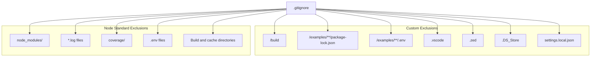
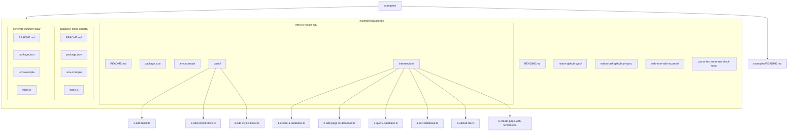
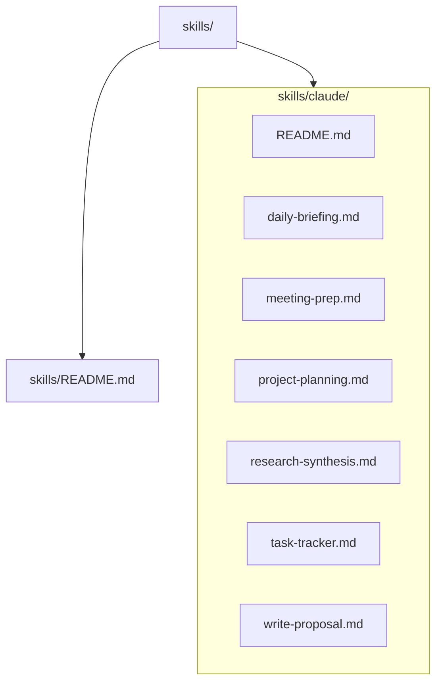
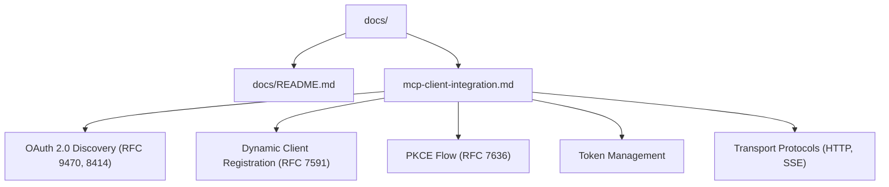
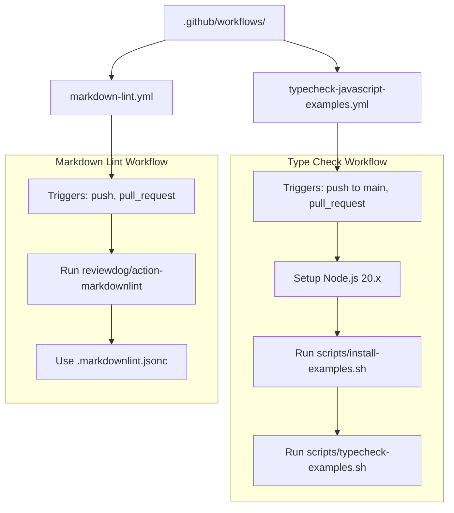
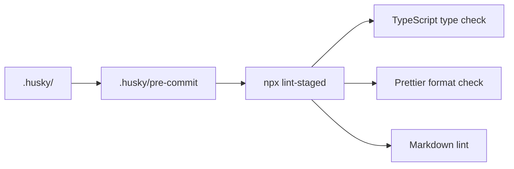

<!-- source: DeepWiki mcp.deepwiki.com · repo makenotion/notion-cookbook · page 8 Repository Structure · fetched 2026-10-27 -->

# Repository Structure

<details>
<summary>Relevant source files</summary>

The following files were used as context for generating this wiki page:

- [.gitignore](.gitignore)
- [README.md](README.md)

</details>


This document explains the physical organization of the Notion Cookbook repository, describing the purpose and contents of each directory, configuration file, and build artifact. This provides a reference for understanding where different types of content are located and how the repository is organized for development and maintenance.

For information about how to contribute new content to this structure, see [Contributing](#6). For details about the development tooling and CI/CD processes that use these files, see [Development Infrastructure](#7).

## Overview

The repository follows a modular structure with clear separation between executable examples, AI skills, documentation, and development tooling. The top-level directories organize content by type and purpose, while configuration files at the root level control code quality, formatting, and build processes.

```mermaid
graph TB
    ROOT["notion-cookbook/"]
    
    subgraph "Primary Content Directories"
        EXAMPLES["examples/"]
        SKILLS["skills/"]
        DOCS["docs/"]
    end
    
    subgraph "Root Configuration Files"
        README["README.md"]
        CONTRIBUTING["CONTRIBUTING.md"]
        LICENSE["LICENSE"]
        GITIGNORE[".gitignore"]
        PRETTIER[".prettierrc"]
        MDLINT[".markdownlint.jsonc"]
        PACKAGE["package.json"]
        PACKAGELOCK["package-lock.json"]
    end
    
    subgraph "Development Infrastructure"
        GITHUB[".github/"]
        HUSKY[".husky/"]
        SCRIPTS["scripts/"]
    end
    
    ROOT --> EXAMPLES
    ROOT --> SKILLS
    ROOT --> DOCS
    ROOT --> README
    ROOT --> CONTRIBUTING
    ROOT --> LICENSE
    ROOT --> GITIGNORE
    ROOT --> PRETTIER
    ROOT --> MDLINT
    ROOT --> PACKAGE
    ROOT --> PACKAGELOCK
    ROOT --> GITHUB
    ROOT --> HUSKY
    ROOT --> SCRIPTS
    
    EXAMPLES --> JSDIR["javascript/"]
    JSDIR --> INTRO["intro-to-notion-api/"]
    JSDIR --> DBEMAIL["database-email-update/"]
    JSDIR --> GENDATA["generate-random-data/"]
    JSDIR --> GHSYNC["notion-github-sync/"]
    JSDIR --> TASKPR["notion-task-github-pr-sync/"]
    JSDIR --> WEBFORM["web-form-with-express/"]
    JSDIR --> PARSETEXT["parse-text-from-any-block-type/"]
    
    SKILLS --> CLAUDEDIR["claude/"]
    
    GITHUB --> WORKFLOWS[".github/workflows/"]
    WORKFLOWS --> TYPECHECK["typecheck-javascript-examples.yml"]
    WORKFLOWS --> MDLINTCI["markdown-lint.yml"]
    
    HUSKY --> PRECOMMIT[".husky/pre-commit"]
    
    SCRIPTS --> INSTALL["install-examples.sh"]
    SCRIPTS --> TYPECHECKSH["typecheck-examples.sh"]
```



**Directory Purpose:**
- `examples/`: Executable code samples demonstrating Notion API integration patterns
- `skills/`: AI-powered automation workflows using Claude and Notion MCP
- `docs/`: Developer documentation and integration guides
- `.github/`: GitHub Actions workflows and repository automation
- `.husky/`: Git hooks for local code quality enforcement
- `scripts/`: Build automation and utility scripts

**Sources:** [README.md:1-57](), [.gitignore:1-160]()

## Top-Level Configuration Files

The repository root contains several configuration files that control code quality, formatting, and development workflows:

| File | Purpose | Related Documentation |
|------|---------|----------------------|
| `README.md` | Main entry point providing repository overview and navigation | [Home](#1) |
| `CONTRIBUTING.md` | Guidelines for contributing examples, skills, and documentation | [Contributing](#6) |
| `LICENSE` | MIT license for the repository | N/A |
| `.gitignore` | Specifies files and directories excluded from version control | See below |
| `.prettierrc` | Code formatting rules for JavaScript/TypeScript | [Code Style Standards](#6.1) |
| `.markdownlint.jsonc` | Markdown linting configuration with Notion-specific rule exceptions | [Code Style Standards](#6.1) |
| `package.json` | Root package configuration with workspace scripts | See below |
| `package-lock.json` | Locked dependency versions for development tooling | See below |

**Sources:** [README.md:1-57](), [.gitignore:1-160]()

### Package Configuration

The root `package.json` serves as a workspace coordinator rather than a distributable package. It defines development scripts that operate across all examples:

**Key Scripts:**
- Installation scripts that traverse example directories
- Type-checking scripts that validate TypeScript across all examples
- Pre-commit hook setup via Husky and lint-staged

The root `package-lock.json` locks versions for development dependencies (Husky, lint-staged, Prettier) but does not include example-specific dependencies. Each example maintains its own `package.json` and `package-lock.json`.

**Sources:** [README.md:30-38]()

### Git Ignore Patterns

The `.gitignore` file excludes several categories of files from version control:



**Notable Exclusions:**
- **Example lock files:** [.gitignore:5]() excludes `/examples/**/package-lock.json` to prevent conflicts when contributors use different npm versions
- **Environment files:** [.gitignore:6]() excludes `/examples/**/.env` containing API keys and secrets, except `.env.example` templates [.gitignore:88]()
- **IDE settings:** [.gitignore:8-9]() excludes `.vscode` and `.zed` directories for personal editor configurations
- **Build artifacts:** [.gitignore:3]() excludes `/build` directory generated during development
- **Claude Code settings:** [.gitignore:14]() excludes `settings.local.json` for local Claude development configurations

**Sources:** [.gitignore:1-160]()

## Examples Directory Structure

The `examples/` directory contains working code samples organized by programming language. Currently, it contains only JavaScript examples, but the structure supports future additions of other languages.



### Standard Example Structure

Each example follows a consistent directory layout:

| File/Directory | Purpose |
|----------------|---------|
| `README.md` | Setup instructions, configuration guide, and usage examples |
| `package.json` | npm package configuration with dependencies and run scripts |
| `.env.example` | Template for required environment variables (API keys, IDs) |
| `index.js` or `*.ts` files | Main executable code for the example |

**Environment Variables:**
- Each example includes `.env.example` showing required configuration
- Actual `.env` files are excluded via [.gitignore:6]()
- Common variables include `NOTION_KEY`, `NOTION_DATABASE_ID`, `NOTION_PAGE_ID`

**Dependencies:**
- All JavaScript examples depend on `@notionhq/client` for Notion API access
- Additional dependencies vary by example (e.g., `@sendgrid/mail`, `express`, `faker`)
- Each example has isolated dependencies in its own `node_modules/` directory

**Sources:** [README.md:9-15](), [.gitignore:5-6]()

### intro-to-notion-api Example Structure

The introductory example has a unique two-tier structure organizing scripts by complexity:

**Directory Layout:**
- `basic/`: Scripts 1-3 demonstrating fundamental block operations
- `intermediate/`: Scripts 1-6 covering databases, files, and templates

Each script is numbered for progressive learning: `1-add-block.ts`, `2-add-linked-block.ts`, etc.

**Sources:** [README.md:13]()

## Skills Directory Structure

The `skills/` directory contains AI-powered automation workflows designed to integrate with AI assistants:



**Skills Structure:**
- Each skill is a standalone Markdown file containing instructions for AI assistants
- Skills use the Notion MCP server to interact with Notion workspaces
- The `claude/` subdirectory is organized for Claude AI, with room for other AI providers

**Skill File Format:**
- Markdown files contain natural language instructions
- Files describe workflows like "generate daily briefing from calendar and tasks"
- Skills rely on Claude's ability to use MCP tools for Notion API calls

**Sources:** [README.md:17-22]()

## Documentation Directory Structure

The `docs/` directory contains developer documentation for advanced integration patterns:



**Current Contents:**
- `mcp-client-integration.md`: Comprehensive guide for implementing OAuth 2.0 + PKCE with Notion MCP

**Future Plans:**
- The `docs/` directory is reserved for Notion's core developer documentation
- Content will be migrated from `developers.notion.com` in the future
- For now, it contains project-specific integration guides

**Sources:** [README.md:25-27]()

## Development Infrastructure Files

### GitHub Workflows

The `.github/workflows/` directory contains CI/CD automation:



**Workflow Files:**
- `typecheck-javascript-examples.yml`: Validates TypeScript types across all JavaScript examples on every push and PR
- `markdown-lint.yml`: Enforces Markdown style rules on documentation files

For detailed workflow operation, see [CI/CD Pipeline](#7.1).

**Sources:** [README.md:1-57]()

### Husky Git Hooks

The `.husky/` directory contains Git hook scripts executed locally before commits:



**Hook Configuration:**
- `.husky/pre-commit`: Executes `npx lint-staged` before each commit
- `lint-staged` configuration in root `package.json` defines file-specific checks
- Hooks block commits that fail quality checks

For hook configuration details, see [Pre-commit Hooks](#7.2).

**Sources:** [.gitignore:1-160]()

### Build Scripts

The `scripts/` directory contains shell scripts for build automation:

| Script | Purpose |
|--------|---------|
| `install-examples.sh` | Iterates through `examples/javascript/*/` and runs `npm install` in each subdirectory |
| `typecheck-examples.sh` | Runs TypeScript type checking on all JavaScript examples |

**Script Usage:**
- Called by CI workflows to prepare and validate examples
- Can be run locally during development
- Use Unix shell syntax (bash/sh)

**Sources:** [README.md:1-57]()

## File Naming Conventions

The repository follows consistent naming patterns for different file types:

| Pattern | Usage | Examples |
|---------|-------|----------|
| `README.md` | Entry point documentation for directories | `README.md`, `examples/README.md`, `examples/javascript/intro-to-notion-api/README.md` |
| `kebab-case.md` | Markdown documentation files | `mcp-client-integration.md`, `daily-briefing.md` |
| `kebab-case/` | Directory names | `intro-to-notion-api/`, `database-email-update/`, `generate-random-data/` |
| `.env.example` | Environment variable templates | `examples/javascript/*/env.example` |
| `[number]-description.ts` | Numbered tutorial scripts | `1-add-block.ts`, `2-add-linked-block.ts` |
| `index.js` | Main entry point for examples | `database-email-update/index.js` |
| `.dotfile` | Configuration files | `.gitignore`, `.prettierrc`, `.markdownlint.jsonc` |

**Sources:** [README.md:1-57](), [.gitignore:1-160]()

## Excluded Files and Build Artifacts

Files and directories excluded from version control fall into several categories:

### Security-Sensitive Files

```
/examples/**/.env              # API keys, tokens, database IDs
.env                           # Root environment variables
.env.*                         # All environment file variants
!.env.example                  # Except templates (included)
```

**Rationale:** Environment files contain secrets that must not be committed. Template files (`.env.example`) are included to guide configuration.

**Sources:** [.gitignore:6](), [.gitignore:86-88]()

### Development Dependencies

```
node_modules/                  # npm packages
/examples/**/package-lock.json # Example lock files
package-lock.json              # Root lock file (included)
```

**Rationale:** Example lock files [.gitignore:5]() are excluded to avoid conflicts between contributors using different npm versions. The root lock file is included because it tracks development tooling dependencies.

**Sources:** [.gitignore:5](), [.gitignore:58]()

### Build Outputs

```
/build                         # Compiled artifacts
coverage/                      # Test coverage reports
*.tsbuildinfo                  # TypeScript build cache
dist/                          # Distribution bundles
```

**Rationale:** Build artifacts are regenerated from source and don't need version control.

**Sources:** [.gitignore:3](), [.gitignore:39-40](), [.gitignore:65](), [.gitignore:100]()

### IDE and Editor Files

```
.vscode/                       # VS Code settings
.zed/                          # Zed editor settings
.DS_Store                      # macOS metadata
settings.local.json            # Claude Code local settings
```

**Rationale:** These files contain personal editor configurations that vary between developers.

**Sources:** [.gitignore:8-9](), [.gitignore:11](), [.gitignore:14]()

### Logs and Temporary Files

```
logs/
*.log
npm-debug.log*
.cache/
*.pid
*.seed
```

**Rationale:** Temporary files and logs are generated during development and should not be committed.

**Sources:** [.gitignore:18-24](), [.gitignore:91-92]()

## Directory Hierarchy Summary

The complete repository structure can be visualized as:

```
notion-cookbook/
├── .github/
│   └── workflows/              # CI/CD automation
│       ├── typecheck-javascript-examples.yml
│       └── markdown-lint.yml
├── .husky/
│   └── pre-commit              # Local quality checks
├── docs/                       # Developer documentation
│   ├── README.md
│   └── mcp-client-integration.md
├── examples/                   # Code samples
│   ├── README.md
│   └── javascript/             # JavaScript/TypeScript examples
│       ├── README.md
│       ├── intro-to-notion-api/
│       ├── database-email-update/
│       ├── generate-random-data/
│       ├── notion-github-sync/
│       ├── notion-task-github-pr-sync/
│       ├── web-form-with-express/
│       └── parse-text-from-any-block-type/
├── scripts/                    # Build automation
│   ├── install-examples.sh
│   └── typecheck-examples.sh
├── skills/                     # AI workflows
│   ├── README.md
│   └── claude/                 # Claude AI skills
│       ├── README.md
│       └── *.md                # Individual skill files
├── .gitignore                  # Version control exclusions
├── .markdownlint.jsonc         # Markdown linting rules
├── .prettierrc                 # Code formatting rules
├── CONTRIBUTING.md             # Contribution guidelines
├── LICENSE                     # MIT license
├── README.md                   # Repository entry point
├── package.json                # Root workspace configuration
└── package-lock.json           # Development dependency locks
```

**Sources:** [README.md:1-57](), [.gitignore:1-160]()