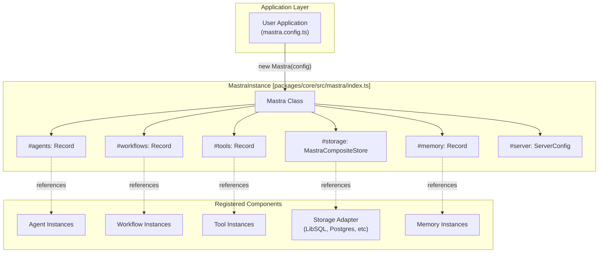
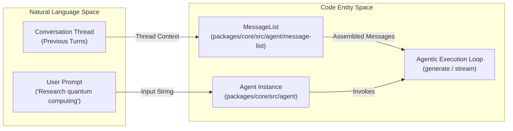
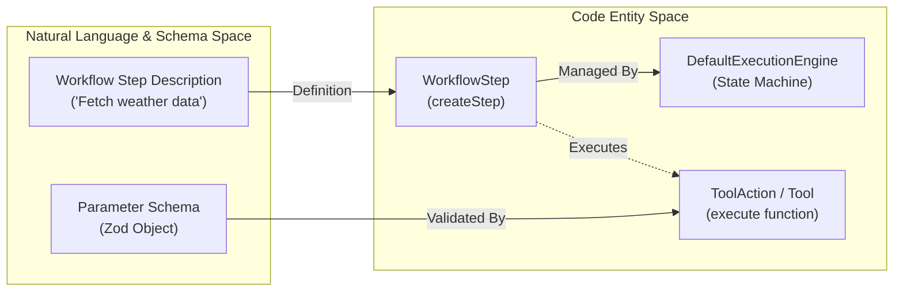
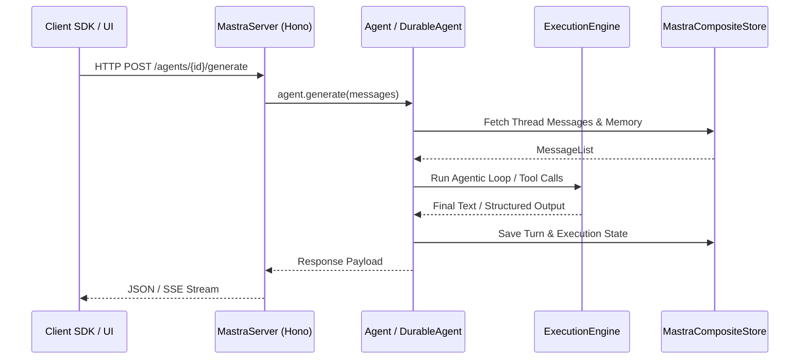

<!-- source: DeepWiki mcp.deepwiki.com · repo mastra-ai/mastra · page 1.2 System Architecture Overview · fetched 2026-10-27 -->

# System Architecture Overview

Relevant source files

The following files were used as context for generating this wiki page:

- [deployers/cloud/package.json](deployers/cloud/package.json)
- [docs/src/content/en/docs/harness/durable-agents.mdx](docs/src/content/en/docs/harness/durable-agents.mdx)
- [docs/src/content/en/reference/agents/durable-agent.mdx](docs/src/content/en/reference/agents/durable-agent.mdx)
- [docs/src/content/en/reference/core/mastra-class.mdx](docs/src/content/en/reference/core/mastra-class.mdx)
- [examples/agent/src/mastra/agents/weather-fs/README.md](examples/agent/src/mastra/agents/weather-fs/README.md)
- [packages/core/package.json](packages/core/package.json)
- [packages/core/src/agent/durable/__tests__/durable-agent-execution-fence.test.ts](packages/core/src/agent/durable/__tests__/durable-agent-execution-fence.test.ts)
- [packages/core/src/agent/durable/__tests__/durable-agent-memory.test.ts](packages/core/src/agent/durable/__tests__/durable-agent-memory.test.ts)
- [packages/core/src/agent/durable/__tests__/evented-split-transport.test.ts](packages/core/src/agent/durable/__tests__/evented-split-transport.test.ts)
- [packages/core/src/agent/durable/__tests__/observe-detach.test.ts](packages/core/src/agent/durable/__tests__/observe-detach.test.ts)
- [packages/core/src/agent/durable/__tests__/recover-active-runs.test.ts](packages/core/src/agent/durable/__tests__/recover-active-runs.test.ts)
- [packages/core/src/agent/durable/__tests__/stream-generation.test.ts](packages/core/src/agent/durable/__tests__/stream-generation.test.ts)
- [packages/core/src/agent/fs-routing/index.test.ts](packages/core/src/agent/fs-routing/index.test.ts)
- [packages/core/src/agent/fs-routing/index.ts](packages/core/src/agent/fs-routing/index.ts)
- [packages/core/src/agent/save-queue/index.ts](packages/core/src/agent/save-queue/index.ts)
- [packages/core/src/agent/save-queue/save-queue.test.ts](packages/core/src/agent/save-queue/save-queue.test.ts)
- [packages/core/src/loop/test-utils/aimock/scenarios/durable-input-persistence.scenario.test.ts](packages/core/src/loop/test-utils/aimock/scenarios/durable-input-persistence.scenario.test.ts)
- [packages/core/src/loop/test-utils/aimock/scenarios/observe-lifecycle.scenario.test.ts](packages/core/src/loop/test-utils/aimock/scenarios/observe-lifecycle.scenario.test.ts)
- [packages/core/src/loop/test-utils/aimock/scenarios/save-per-step-failed-save.scenario.test.ts](packages/core/src/loop/test-utils/aimock/scenarios/save-per-step-failed-save.scenario.test.ts)
- [packages/core/src/mastra/index.ts](packages/core/src/mastra/index.ts)
- [packages/core/src/mastra/recover-all-durable-agents.test.ts](packages/core/src/mastra/recover-all-durable-agents.test.ts)
- [packages/deployer/package.json](packages/deployer/package.json)
- [packages/deployer/src/build/fs-routing/codegen-eval.test.ts](packages/deployer/src/build/fs-routing/codegen-eval.test.ts)
- [packages/deployer/src/build/fs-routing/codegen.ts](packages/deployer/src/build/fs-routing/codegen.ts)
- [packages/deployer/src/build/fs-routing/discover.ts](packages/deployer/src/build/fs-routing/discover.ts)
- [packages/deployer/src/build/fs-routing/fs-routing.test.ts](packages/deployer/src/build/fs-routing/fs-routing.test.ts)
- [packages/deployer/src/build/fs-routing/prepare.ts](packages/deployer/src/build/fs-routing/prepare.ts)
- [packages/deployer/src/build/index.ts](packages/deployer/src/build/index.ts)
- [packages/memory/src/processors/observational-memory/__tests__/inflight-turn-preservation.test.ts](packages/memory/src/processors/observational-memory/__tests__/inflight-turn-preservation.test.ts)
- [packages/server/package.json](packages/server/package.json)
- [server-adapters/express/package.json](server-adapters/express/package.json)
- [server-adapters/fastify/package.json](server-adapters/fastify/package.json)
- [server-adapters/hono/package.json](server-adapters/hono/package.json)
- [server-adapters/koa/package.json](server-adapters/koa/package.json)
- [stores/libsql/src/storage/durable-agent-input-persistence.test.ts](stores/libsql/src/storage/durable-agent-input-persistence.test.ts)

## Purpose and Scope

This document provides a high-level technical overview of Mastra's system architecture, detailing how the major subsystems—`Agent`, `Workflow`, `Memory`, `Tools`, `Server`, and `CLI`—interoperate to form an AI application framework. It describes architectural boundaries, runtime state transitions, and component relationships using core code abstractions.

For deep dives into specific subsystems:
- For monorepo package layout, see [Monorepo Structure and Package Organization](#1.1)
- For `Mastra` class instantiation, see [Configuration Schema and Options](#2.1)
- For agent execution loops, see [Agent Configuration and Execution](#3.1)

Sources: [docs/src/content/en/docs/agents/overview.mdx:1-62](), [docs/src/content/en/docs/workflows/overview.mdx:1-35]()

## Central Orchestration: The `Mastra` Instance

At the center of the architecture is the `Mastra` class (`[packages/core/src/mastra/index.ts:50-162]()`), which functions as the primary dependency injection container and registry for runtime components. When instantiated, it aggregates instances of agents, workflows, tools, storage adapters, loggers, and vector stores, exposing them uniformly to the API server and CLI tools.

Title: "Mastra Instance Architecture"

Sources: [packages/core/src/mastra/index.ts:50-162]()

## Major System Components

Mastra organizes functionality into decoupled packages and classes that communicate through defined interfaces:

| Subsystem | Primary Class / Interface | Role |
|-----------|--------------------------|------|
| **Agent** | `Agent`, `DurableAgent` [docs/src/content/en/docs/harness/durable-agents.mdx:77-85]() | Encapsulates LLM execution loops, prompts, tool selection, and memory bindings. |
| **Workflow** | `Workflow`, `ExecutionEngine` [docs/src/content/en/docs/workflows/overview.mdx:11-29]() | Manages deterministic multi-step state machines, persistence, and execution engines. |
| **Tools** | `ToolAction`, `CoreToolBuilder` [packages/core/src/mastra/index.ts:80-82]() | Exposes typed functions with Zod schema validation for models and workflow steps. |
| **Memory** | `MessageList`, `MastraMemory` [packages/core/src/mastra/index.ts:43-44]() | Handles thread persistence, message histories, and contextual recall. |
| **Server** | `MastraServerBase`, `Hono` [packages/core/src/mastra/index.ts:68-69]() | Exposes HTTP, SSE, and WebSockets endpoints via framework-agnostic adapters. |
| **CLI & Bundler** | `Bundler`, `MastraDeployer` [packages/core/src/mastra/index.ts:10-17]() | Provides project compilation, file watching, and cloud deployment targets. |

Sources: [packages/core/src/mastra/index.ts:10-162](), [docs/src/content/en/docs/agents/overview.mdx:34-45]()

## Bridging Natural Language to Code Entity Space

To understand how user intent becomes executed logic, Mastra maps high-level natural language inputs and declarative definitions onto executable TypeScript classes and functions.

### Bridge 1: Agent Request Translation

Title: "Agent Natural Language to Code Entity Space"

Sources: [docs/src/content/en/docs/agents/overview.mdx:78-105](), [packages/core/src/mastra/index.ts:4-6]()

### Bridge 2: Workflow and Tool Binding

Title: "Workflow and Tool Natural Language to Code Entity Space"

Sources: [docs/src/content/en/docs/workflows/overview.mdx:11-35](), [packages/core/src/mastra/index.ts:80-92]()

## Component Interaction Patterns

### Request Lifecycle and Execution Flow

When an HTTP request hits the API server or an application invokes an agent directly, the request flows through initialization, execution control, persistence, and event broadcasting.

Title: "System Component Interaction Sequence"

Sources: [docs/src/content/en/docs/agents/overview.mdx:78-105](), [packages/core/src/mastra/index.ts:50-95]()

## Observability and Storage Integration

Every execution path—whether an agent turn, tool call, or workflow step—can be intercepted by telemetry and persistence layers:
- **Tracing**: Managed via OpenTelemetry context propagation linked through `ObservabilityEntrypoint` [packages/core/src/mastra/index.ts:50-62]().
- **Persistence**: Abstracted via `MastraCompositeStore` (`[packages/core/src/mastra/index.ts:70-77]()`), which unifies transactional storage across workflows, runs, checkpoints, and conversational threads.

Sources: [packages/core/src/mastra/index.ts:50-77]()

## Summary

Mastra's architecture is anchored by the `Mastra` class orchestrator [packages/core/src/mastra/index.ts:50-162](). It connects autonomous agents [docs/src/content/en/docs/agents/overview.mdx:34-45](), deterministic workflows [docs/src/content/en/docs/workflows/overview.mdx:11-29](), and typed tools [packages/core/src/mastra/index.ts:80-82]() through structured storage adapters and API server wrappers.

Sources: [packages/core/src/mastra/index.ts:50-162](), [docs/src/content/en/docs/agents/overview.mdx:1-130](), [docs/src/content/en/docs/workflows/overview.mdx:1-145]()

---

