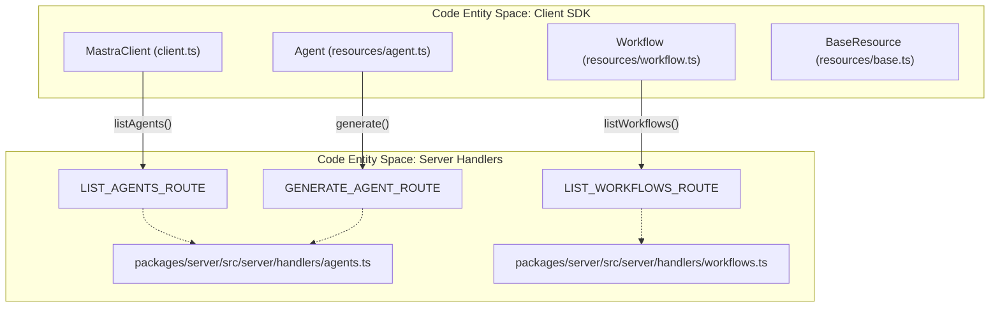
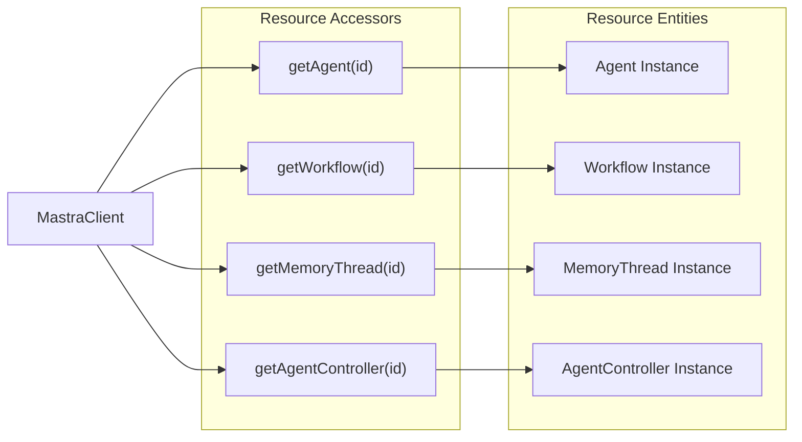
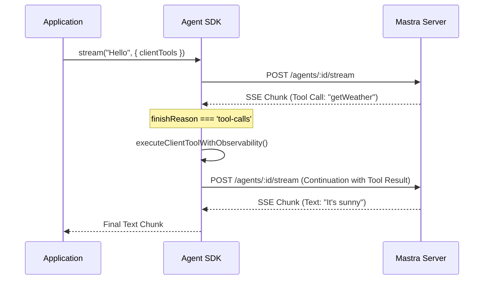

<!-- source: DeepWiki mcp.deepwiki.com · repo mastra-ai/mastra · page 10.1 JavaScript Client SDK · fetched 2026-10-27 -->

# JavaScript Client SDK

Relevant source files

The following files were used as context for generating this wiki page:

- [.changeset/fluffy-hornets-switch.md](.changeset/fluffy-hornets-switch.md)
- [client-sdks/client-js/CHANGELOG.md](client-sdks/client-js/CHANGELOG.md)
- [client-sdks/client-js/package.json](client-sdks/client-js/package.json)
- [client-sdks/client-js/src/client.ts](client-sdks/client-js/src/client.ts)
- [client-sdks/client-js/src/index.ts](client-sdks/client-js/src/index.ts)
- [client-sdks/client-js/src/resources/agent.client-tools.test.ts](client-sdks/client-js/src/resources/agent.client-tools.test.ts)
- [client-sdks/client-js/src/resources/agent.test.ts](client-sdks/client-js/src/resources/agent.test.ts)
- [client-sdks/client-js/src/resources/agent.ts](client-sdks/client-js/src/resources/agent.ts)
- [client-sdks/client-js/src/resources/observability.test.ts](client-sdks/client-js/src/resources/observability.test.ts)
- [client-sdks/client-js/src/resources/observability.ts](client-sdks/client-js/src/resources/observability.ts)
- [client-sdks/client-js/src/route-types.generated.ts](client-sdks/client-js/src/route-types.generated.ts)
- [client-sdks/client-js/src/types.ts](client-sdks/client-js/src/types.ts)
- [client-sdks/client-js/src/utils/ai-sdk-v4/ai-sdk-v4.test.ts](client-sdks/client-js/src/utils/ai-sdk-v4/ai-sdk-v4.test.ts)
- [client-sdks/client-js/src/utils/ai-sdk-v4/data-stream-parts.ts](client-sdks/client-js/src/utils/ai-sdk-v4/data-stream-parts.ts)
- [client-sdks/client-js/src/utils/ai-sdk-v4/fix-json.ts](client-sdks/client-js/src/utils/ai-sdk-v4/fix-json.ts)
- [client-sdks/client-js/src/utils/ai-sdk-v4/index.ts](client-sdks/client-js/src/utils/ai-sdk-v4/index.ts)
- [client-sdks/client-js/src/utils/ai-sdk-v4/parse-partial-json.ts](client-sdks/client-js/src/utils/ai-sdk-v4/parse-partial-json.ts)
- [client-sdks/react/src/agent/hooks.test.ts](client-sdks/react/src/agent/hooks.test.ts)
- [client-sdks/react/src/agent/hooks.ts](client-sdks/react/src/agent/hooks.ts)
- [docs/src/content/en/reference/client-js/agents.mdx](docs/src/content/en/reference/client-js/agents.mdx)
- [packages/cli/src/commands/api/route-metadata.generated.ts](packages/cli/src/commands/api/route-metadata.generated.ts)
- [packages/server/src/server/handlers/agent.test.ts](packages/server/src/server/handlers/agent.test.ts)
- [packages/server/src/server/handlers/agents.test.ts](packages/server/src/server/handlers/agents.test.ts)
- [packages/server/src/server/handlers/agents.ts](packages/server/src/server/handlers/agents.ts)
- [packages/server/src/server/handlers/observability-new-endpoints.ts](packages/server/src/server/handlers/observability-new-endpoints.ts)
- [packages/server/src/server/handlers/observability-shared.ts](packages/server/src/server/handlers/observability-shared.ts)
- [packages/server/src/server/handlers/observability-storage-schemas.ts](packages/server/src/server/handlers/observability-storage-schemas.ts)
- [packages/server/src/server/handlers/observability.test.ts](packages/server/src/server/handlers/observability.test.ts)
- [packages/server/src/server/handlers/observability.ts](packages/server/src/server/handlers/observability.ts)
- [packages/server/src/server/handlers/system.test.ts](packages/server/src/server/handlers/system.test.ts)
- [packages/server/src/server/handlers/system.ts](packages/server/src/server/handlers/system.ts)
- [packages/server/src/server/schemas/agents.ts](packages/server/src/server/schemas/agents.ts)
- [packages/server/src/server/schemas/system.ts](packages/server/src/server/schemas/system.ts)
- [packages/server/src/server/server-adapter/routes/agents.ts](packages/server/src/server/server-adapter/routes/agents.ts)
- [packages/server/src/server/server-adapter/routes/observability.ts](packages/server/src/server/server-adapter/routes/observability.ts)

The JavaScript Client SDK (`@mastra/client-js`) provides a strongly typed HTTP client interface to interact with Mastra servers. It enables frontend applications or other JavaScript environments to seamlessly communicate with Mastra backend APIs, supporting features such as retry/backoff for reliability, streaming results via Server-Sent Events (SSE), request context propagation for multi-tenant isolation, and client-side execution of agent tools.

This page documents:

- Initialization and configuration of `MastraClient`.
- The `BaseResource` pattern for SDK resource classes.
- Retry and exponential backoff strategies in HTTP requests.
- Agent resource functionality including generation, streaming, signals, and client tool execution.
- Workflow resource capabilities.
- Stream processing of server SSE responses.
- Error handling and `RequestContext` propagation.

For related information on server endpoints and React SDK integration, see the [Server and API Layer](9) and [React SDK and Hooks](10.5).

---

## Architecture Overview

The SDK is designed around resource classes representing key Mastra concepts such as agents, workflows, memory threads, and tools. These resources extend a shared abstract base class called `BaseResource` which implements HTTP request handling with retries, request context injection, and streaming.

At the top level, the `MastraClient` class acts as a factory and root container exposing instances of the resource classes including `Agent`, `Workflow`, `MemoryThread`, `Conversations`, `Responses`, `Channels`, and `AgentController`.

### Code Entity Mapping: SDK to Server

This diagram bridges the client-side resource names to the server-side route handlers they interact with.

**Sources:**
[client-sdks/client-js/src/client.ts:28-29](),
[client-sdks/client-js/src/client.ts:260-262](),
[client-sdks/client-js/src/client.ts:330-332](),
[client-sdks/client-js/src/client.ts:220-220]()

---

## Client Configuration

### `ClientOptions` Interface

The client SDK is configured via a `ClientOptions` object passed to the `MastraClient` constructor.

| Option          | Type                                              | Description                                                                                           | Default                      |
|-----------------|---------------------------------------------------|---------------------------------------------------------------------------------------------------|------------------------------|
| `baseUrl`       | `string`                                          | Base URL for API requests                                                                           | **Required**                 |
| `apiPrefix`     | `string`                                          | API route prefix. Defaults to `/api`. Should match the Mastra server's configuration              | `/api`                      |
| `retries`       | `number`                                          | Number of retry attempts for failed requests                                                       | `3`                         |
| `backoffMs`     | `number`                                          | Initial delay in milliseconds between retries                                                     | `100`                       |
| `maxBackoffMs`  | `number`                                          | Maximum delay in milliseconds between retries                                                     | `1000`                      |
| `headers`       | `Record<string, string>`                          | Custom HTTP headers to include with requests                                                      | `{}`                        |
| `fetch`         | `typeof fetch`                                    | Custom fetch function implementation useful for runtime environments (e.g. Tauri)                  | Global `fetch`              |
| `credentials`   | `'omit' \| 'same-origin' \| 'include'`            | Credentials mode for requests.                                                                     | `undefined`                 |

**Sources:**
[client-sdks/client-js/src/types.ts:107-126]()

---

## MastraClient Class

`MastraClient` is the root entry point to the SDK. It manages instances of specialized resources and provides high-level list and factory methods.

### Resource Factory Pattern

The client uses a factory pattern to provide access to specific resources by ID.

**Sources:**
[client-sdks/client-js/src/client.ts:28-29](),
[client-sdks/client-js/src/client.ts:260-262](),
[client-sdks/client-js/src/client.ts:330-332](),
[client-sdks/client-js/src/client.ts:220-220]()

---

## `BaseResource` Pattern

All resource classes extend the abstract `BaseResource` class which centralizes common HTTP request functionality.

### Retry and Backoff Logic

The SDK implements an exponential backoff strategy for failed requests within the `request` method. It retries on network errors or 5xx server errors, but throws immediately on 4xx client errors.

- **Initial Delay**: Set by `backoffMs`.
- **Multiplier**: The delay doubles on each attempt (`currentBackoff *= 2`).
- **Cap**: The delay never exceeds `maxBackoffMs`.

**Sources:**
[client-sdks/client-js/src/types.ts:113-118]()

---

## Agent Resource

The `Agent` class provides client-side primitives for running Mastra agents remotely, including `generate()`, `stream()`, and signal management.

### Client-Side Tool Execution Loop

Agents can delegate tool execution to the client. If the server response indicates a `finishReason` of `tool-calls`, the SDK intercepts the call, executes the tool locally using `executeClientToolWithObservability`, and sends the result back to the server via `respondFn` to continue the generation.

**Sources:**
[client-sdks/client-js/src/resources/agent.ts:159-196](),
[client-sdks/client-js/src/resources/agent.ts:196-273](),
[client-sdks/client-js/src/resources/agent.ts:1100-1224]()

### Signals and Messaging

The SDK supports asynchronous communication via `sendMessage`, `queueMessage`, and `sendSignal`. These allow interacting with active runs or waking idle threads based on configured behaviors (`deliver`, `persist`, `wake`, `discard`).

- **`sendMessage`**: Sends user-authored input to an active run or idle thread [client-sdks/client-js/src/resources/agent.ts:742-763]().
- **`queueMessage`**: Queues input for the next thread turn [client-sdks/client-js/src/resources/agent.ts:771-791]().
- **`sendSignal`**: Sends lower-level reactive or notification signals [client-sdks/client-js/src/resources/agent.ts:799-821]().

**Sources:**
[client-sdks/client-js/src/types.ts:133-143](),
[client-sdks/client-js/src/resources/agent.ts:107-132]()

---

## Stream Processing and SSE

Mastra uses Server-Sent Events (SSE) for real-time data. The SDK utility `processMastraStream` handles the complexity of decoding the `ReadableStream`, splitting events by the `data:` prefix, and parsing the JSON payloads.

**Key Components:**
- `processMastraStream`: Standard stream processor for agent and workflow outputs [client-sdks/client-js/src/utils/process-mastra-stream.ts:30-80]().
- `processMastraNetworkStream`: Specialized processor for multi-agent network interactions [client-sdks/client-js/src/utils/process-mastra-stream.ts:82-88]().
- `processDataStream`: Underlying utility from `@ai-sdk/ui-utils` used for chunk processing [client-sdks/client-js/src/utils/ai-sdk-v4/data-stream-parts.ts:1-1]().

**Sources:**
[client-sdks/client-js/src/utils/ai-sdk-v4/data-stream-parts.ts:1-1]()

---

## Error Handling

Errors from the Mastra server are captured and wrapped in a structured format. The `request` method in `BaseResource` distinguishes between:
1. **Network Errors**: Retried automatically.
2. **Server Errors (5xx)**: Retried with exponential backoff.
3. **Validation/Auth Errors (4xx)**: Thrown immediately to the caller as an `Error`.

**Sources:**
[packages/server/src/server/handlers/agents.ts:14-14]()

---

## RequestContext Propagation

To support multi-tenancy and dynamic configuration, the SDK propagates `RequestContext` in every API call. The context is Base64 encoded and sent as a query parameter (`requestContext`) or within the request body.

- **`base64RequestContext`**: Utility to encode context for query strings [client-sdks/client-js/src/utils/index.ts:110-125]().
- **`parseClientRequestContext`**: Normalizes context inputs [client-sdks/client-js/src/resources/agent.ts:64-64]().
- **Server-side Merging**: The server handler merges body-provided context with the server-derived context [packages/server/src/server/handlers/agents.ts:142-153]().

**Sources:**
[client-sdks/client-js/src/client.ts:1-1](),
[client-sdks/client-js/src/resources/agent.ts:64-64](),
[packages/server/src/server/handlers/agents.ts:142-153]()

---

