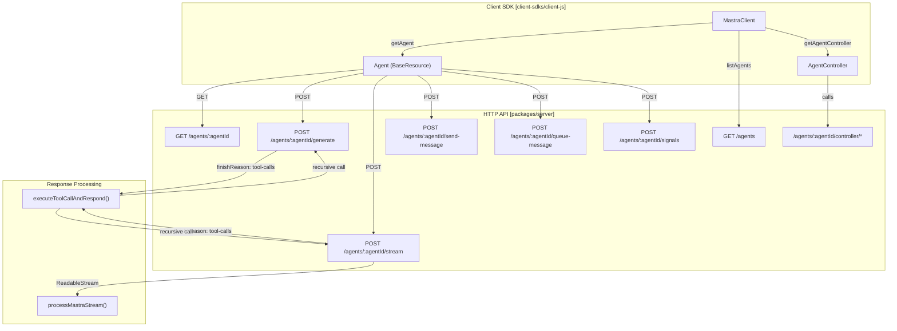
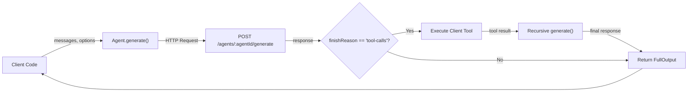
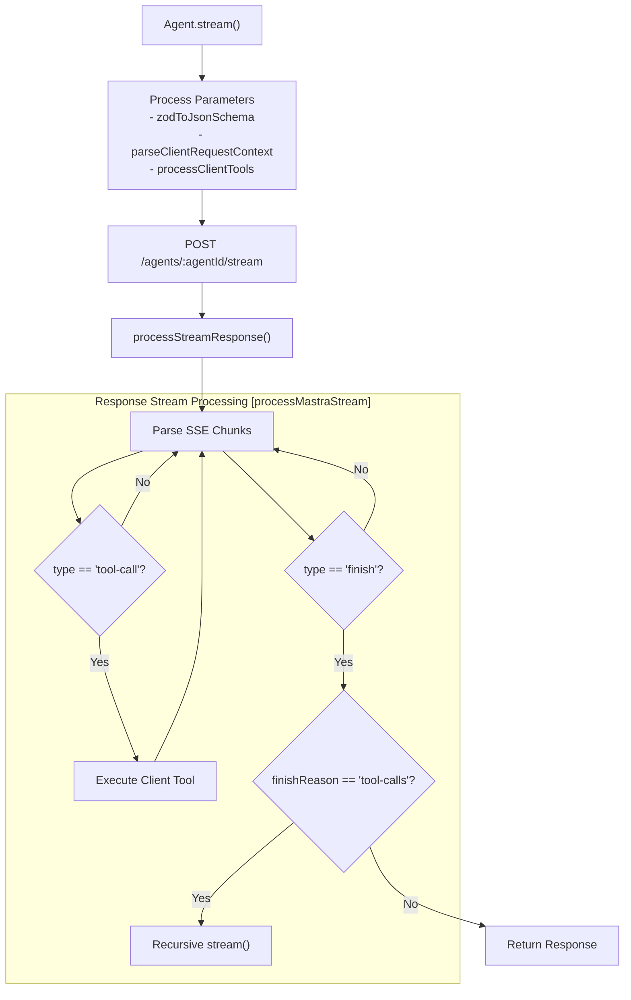
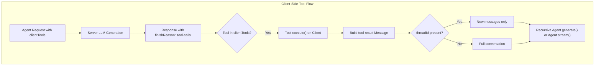
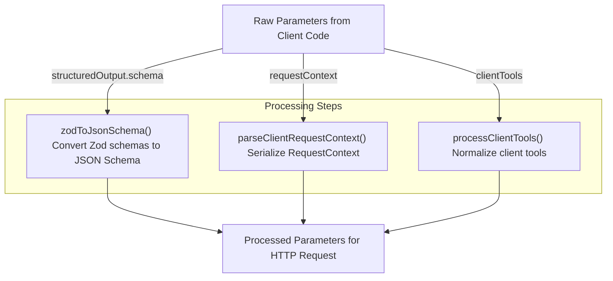

<!-- source: DeepWiki mcp.deepwiki.com · repo mastra-ai/mastra · page 10.2 Agent Client Operations · fetched 2026-10-27 -->

# Agent Client Operations

Relevant source files

The following files were used as context for generating this wiki page:

- [.changeset/fluffy-hornets-switch.md](.changeset/fluffy-hornets-switch.md)
- [client-sdks/client-js/src/client.ts](client-sdks/client-js/src/client.ts)
- [client-sdks/client-js/src/index.ts](client-sdks/client-js/src/index.ts)
- [client-sdks/client-js/src/resources/agent.client-tools.test.ts](client-sdks/client-js/src/resources/agent.client-tools.test.ts)
- [client-sdks/client-js/src/resources/agent.test.ts](client-sdks/client-js/src/resources/agent.test.ts)
- [client-sdks/client-js/src/resources/agent.ts](client-sdks/client-js/src/resources/agent.ts)
- [client-sdks/client-js/src/resources/observability.test.ts](client-sdks/client-js/src/resources/observability.test.ts)
- [client-sdks/client-js/src/resources/observability.ts](client-sdks/client-js/src/resources/observability.ts)
- [client-sdks/client-js/src/route-types.generated.ts](client-sdks/client-js/src/route-types.generated.ts)
- [client-sdks/client-js/src/types.ts](client-sdks/client-js/src/types.ts)
- [client-sdks/client-js/src/utils/ai-sdk-v4/ai-sdk-v4.test.ts](client-sdks/client-js/src/utils/ai-sdk-v4/ai-sdk-v4.test.ts)
- [client-sdks/client-js/src/utils/ai-sdk-v4/data-stream-parts.ts](client-sdks/client-js/src/utils/ai-sdk-v4/data-stream-parts.ts)
- [client-sdks/client-js/src/utils/ai-sdk-v4/fix-json.ts](client-sdks/client-js/src/utils/ai-sdk-v4/fix-json.ts)
- [client-sdks/client-js/src/utils/ai-sdk-v4/index.ts](client-sdks/client-js/src/utils/ai-sdk-v4/index.ts)
- [client-sdks/client-js/src/utils/ai-sdk-v4/parse-partial-json.ts](client-sdks/client-js/src/utils/ai-sdk-v4/parse-partial-json.ts)
- [client-sdks/react/src/agent/hooks.test.ts](client-sdks/react/src/agent/hooks.test.ts)
- [client-sdks/react/src/agent/hooks.ts](client-sdks/react/src/agent/hooks.ts)
- [docs/src/content/en/reference/client-js/agents.mdx](docs/src/content/en/reference/client-js/agents.mdx)
- [packages/cli/src/commands/api/route-metadata.generated.ts](packages/cli/src/commands/api/route-metadata.generated.ts)
- [packages/server/src/server/handlers/agent.test.ts](packages/server/src/server/handlers/agent.test.ts)
- [packages/server/src/server/handlers/agents.test.ts](packages/server/src/server/handlers/agents.test.ts)
- [packages/server/src/server/handlers/agents.ts](packages/server/src/server/handlers/agents.ts)
- [packages/server/src/server/handlers/observability-new-endpoints.ts](packages/server/src/server/handlers/observability-new-endpoints.ts)
- [packages/server/src/server/handlers/observability-shared.ts](packages/server/src/server/handlers/observability-shared.ts)
- [packages/server/src/server/handlers/observability-storage-schemas.ts](packages/server/src/server/handlers/observability-storage-schemas.ts)
- [packages/server/src/server/handlers/observability.test.ts](packages/server/src/server/handlers/observability.test.ts)
- [packages/server/src/server/handlers/observability.ts](packages/server/src/server/handlers/observability.ts)
- [packages/server/src/server/handlers/system.test.ts](packages/server/src/server/handlers/system.test.ts)
- [packages/server/src/server/handlers/system.ts](packages/server/src/server/handlers/system.ts)
- [packages/server/src/server/schemas/agents.ts](packages/server/src/server/schemas/agents.ts)
- [packages/server/src/server/schemas/system.ts](packages/server/src/server/schemas/system.ts)
- [packages/server/src/server/server-adapter/routes/agents.ts](packages/server/src/server/server-adapter/routes/agents.ts)
- [packages/server/src/server/server-adapter/routes/observability.ts](packages/server/src/server/server-adapter/routes/observability.ts)

This document details the client-side operations available in the `@mastra/client-js` SDK for interacting with Agents hosted on a Mastra server. It covers the main `Agent` resource including its generation and streaming capabilities, client-side tool execution, signal handling, and message management.

## Agent Resource Class

The `Agent` class is the fundamental client-side abstraction used to interact with Mastra agents via HTTP endpoints. It extends the `BaseResource` class and encapsulates calls to REST API routes such as `/agents/:agentId/generate` and `/agents/:agentId/stream`. It also manages client-side execution for approved client-defined tools, observability integration, recursive execution looping with tools, and message/signal operations.

### Agent Client Architecture

Clients typically instantiate an `Agent` object via the `MastraClient` method `getAgent(agentId)` to connect to a specific agent deployed on the server [client-sdks/client-js/src/client.ts:246-250](). The `MastraClient` also provides `listAgents()` to retrieve all available agents [client-sdks/client-js/src/client.ts:243-246]().

Sources:
- [client-sdks/client-js/src/resources/agent.ts:65-65]()
- [client-sdks/client-js/src/client.ts:225-236]()
- [client-sdks/client-js/src/client.ts:243-246]()
- [client-sdks/client-js/src/client.ts:246-250]()

---

## Core Generation Methods

The `Agent` class implements two main interfaces for generating responses:

- `generate()`: Sends a discrete request to generate a full response object.
- `stream()`: Opens a streaming connection to receive incremental response chunks.

### Generate API

The `generate()` method performs a single request-response cycle with the server's `/agents/:agentId/generate` endpoint [client-sdks/client-js/src/resources/agent.ts:327-380](). It takes an input message list and execution options, supports structured output validation, and optionally client-side tool execution.

#### Generate Flow with Client Tools

**Features:**

- **Structured output**: `generate()` accepts an optional `structuredOutput` option with Zod schemas for typed, validated results [client-sdks/client-js/src/resources/agent.ts:339-355]().
- **Client Tools**: If the server responds with a `finishReason` of `'tool-calls'`, the SDK runs matching tools client-side via `executeToolCallAndRespond` and recursively invokes `generate()` with updated messages to continue the run [client-sdks/client-js/src/resources/agent.ts:196-255]().
- **RequestContext support**: Per-call execution context can be passed and serialized for multi-tenant or session specific state [client-sdks/client-js/src/resources/agent.ts:353-366]().

Sources:
- [client-sdks/client-js/src/resources/agent.ts:327-380]()
- [client-sdks/client-js/src/resources/agent.ts:196-255]()
- [client-sdks/client-js/src/types.ts:64-69]()

---

### Stream API

The `stream()` method establishes a connection to incrementally receive outputs from the `/agents/:agentId/stream` endpoint [client-sdks/client-js/src/resources/agent.ts:832-1139](). It provides efficient real-time UI updates and also supports client-tool execution within the stream.

#### Stream Processing Loop

**Details:**

- Response chunks are parsed with `processMastraStream` which listens for tool call chunks [client-sdks/client-js/src/utils/process-mastra-stream.ts:63-63]().
- Tool calls are executed locally if matching client tools are registered [client-sdks/client-js/src/resources/agent.ts:196-255]().
- When the stream signals finish with tool calls pending, it recursively calls `stream()` with updated messages [client-sdks/client-js/src/resources/agent.ts:240-255]().

Sources:
- [client-sdks/client-js/src/resources/agent.ts:832-1139]()
- [client-sdks/client-js/src/utils/process-mastra-stream.ts:63-63]()
- [client-sdks/client-js/src/resources/agent.ts:196-255]()

---

## Client Tool Execution

Client tools are tools provided on the client-side, executed directly within the SDK instead of being invoked remotely on the server. This enables local environment access and custom integration within the client environment.

### Client Tool Execution Data Flow

**Key Behaviors:**

1. The agent request to the server may respond with a "tool-calls" finish reason indicating tools to execute.
2. SDK checks if the tool invoked is registered in the passed `clientTools` map [client-sdks/client-js/src/resources/agent.ts:213-216]().
3. Matching tools are executed locally with provided arguments and observability context using `executeClientToolWithObservability` [client-sdks/client-js/src/resources/agent.ts:150-194]().
4. Resulting tool outputs are transformed into LLM message format [client-sdks/client-js/src/resources/agent.ts:221-222]().
5. If a `threadId` exists, only new messages since the last tool call are sent back recursively; otherwise, the full message history is sent [client-sdks/client-js/src/resources/agent.ts:224-238]().

Sources:
- [client-sdks/client-js/src/resources/agent.ts:196-255]()
- [client-sdks/client-js/src/resources/agent.ts:150-194]()
- [client-sdks/client-js/src/resources/agent.ts:213-216]()

---

## Agent Signals and Messaging

Mastra supports asynchronous interactions with agent threads including signals and message queuing.

- **`sendMessage()`**: Sends a message to a thread of an agent, optionally triggering an immediate agent run [client-sdks/client-js/src/resources/agent.ts:1244-1262](). The `message` parameter can be a string, an array of text/file parts, or an object with `contents`, `attributes`, `metadata`, and `providerOptions` [packages/server/src/server/schemas/agents.ts:97-104]().
- **`queueMessage()`**: Queues a message for future processing [client-sdks/client-js/src/resources/agent.ts:1264-1282]().
- **`sendSignal()`**: Sends signals that affect an agent's run state (e.g., wake, reactive updates) [client-sdks/client-js/src/resources/agent.ts:1216-1242](). Signals can have a `type` (e.g., 'reactive', 'state'), `tagName`, `attributes`, and `contents` [packages/server/src/server/schemas/agents.ts:112-121]().

The SDK manages a cache (`signalRuntimeOptionsByRunId`) to store runtime options for signals that can re-activate idle threads [client-sdks/client-js/src/resources/agent.ts:104-104]().

Sources:
- [client-sdks/client-js/src/resources/agent.ts:1216-1282]()
- [client-sdks/client-js/src/resources/agent.ts:104-104]()
- [packages/server/src/server/schemas/agents.ts:97-104]()
- [packages/server/src/server/schemas/agents.ts:112-121]()

---

## Parameter Processing Pipeline

Before dispatching requests, the SDK preprocesses parameters to convert schemas, serialize contexts, and normalize tools.

### Client Request Pre-processing

- `structuredOutput.schema` uses `zodToJsonSchema()` to convert Zod schemas to JSON Schema format compatible with server-side validation [client-sdks/client-js/src/utils/zod-to-json-schema.ts:1-31]().
- `requestContext` is parsed and encoded for transmission with `parseClientRequestContext()` [client-sdks/client-js/src/utils.ts:222-222]().
- `clientTools` are normalized using `processClientTools()` [client-sdks/client-js/src/utils/process-client-tools.ts:1-26]().

Sources:
- [client-sdks/client-js/src/utils/zod-to-json-schema.ts:1-31]()
- [client-sdks/client-js/src/utils.ts:222-222]()
- [client-sdks/client-js/src/utils/process-client-tools.ts:1-26]()

---

## Error Handling and Observability

The `Agent` class employs the common error utility `getErrorFromUnknown()` to transform uncaught errors into structured instances [client-sdks/client-js/src/resources/agent.ts:13](). The networking layer handles retries and backoff based on client options [client-sdks/client-js/src/types.ts:108-127]().

Observability for client tool execution is integrated to collect telemetry spans with `createObservabilityCollector()` [client-sdks/client-js/src/resources/agent.ts:163-169](), enhancing debugging and monitoring during tool calls.

Sources:
- [client-sdks/client-js/src/resources/agent.ts:13-13]()
- [client-sdks/client-js/src/types.ts:108-127]()
- [client-sdks/client-js/src/resources/agent.ts:163-169]()

---

