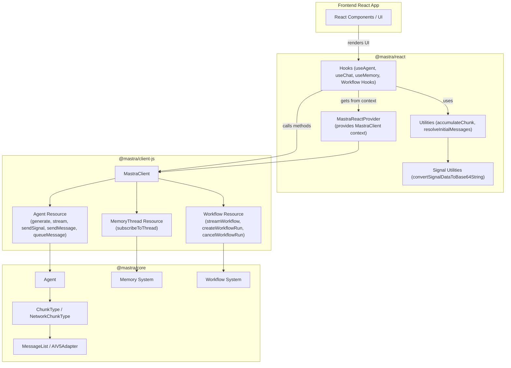
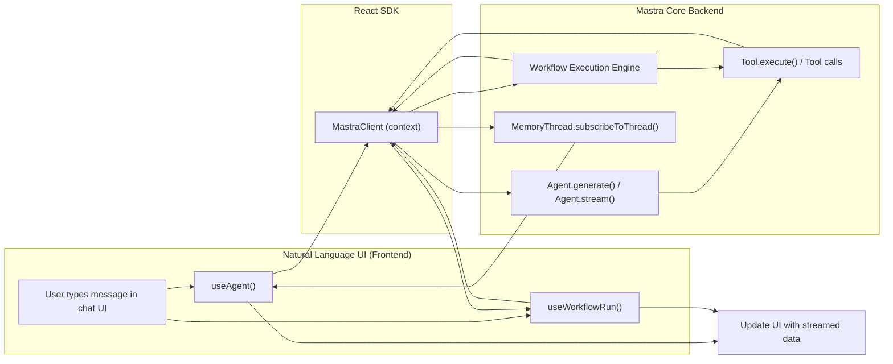
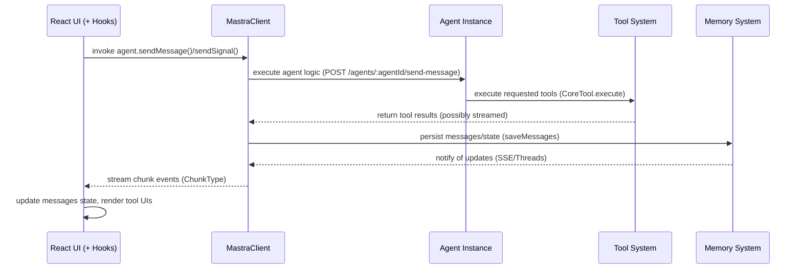

<!-- source: DeepWiki mcp.deepwiki.com · repo mastra-ai/mastra · page 10.5 React SDK and Hooks · fetched 2026-10-27 -->

# React SDK and Hooks

<details>
<summary>Relevant source files</summary>

The following files were used as context for generating this wiki page:

- [.changeset/fluffy-hornets-switch.md](.changeset/fluffy-hornets-switch.md)
- [.changeset/pre.json](.changeset/pre.json)
- [client-sdks/client-js/src/client.ts](client-sdks/client-js/src/client.ts)
- [client-sdks/client-js/src/index.ts](client-sdks/client-js/src/index.ts)
- [client-sdks/client-js/src/resources/agent.client-tools.test.ts](client-sdks/client-js/src/resources/agent.client-tools.test.ts)
- [client-sdks/client-js/src/resources/agent.test.ts](client-sdks/client-js/src/resources/agent.test.ts)
- [client-sdks/client-js/src/resources/agent.ts](client-sdks/client-js/src/resources/agent.ts)
- [client-sdks/client-js/src/resources/observability.test.ts](client-sdks/client-js/src/resources/observability.test.ts)
- [client-sdks/client-js/src/resources/observability.ts](client-sdks/client-js/src/resources/observability.ts)
- [client-sdks/client-js/src/route-types.generated.ts](client-sdks/client-js/src/route-types.generated.ts)
- [client-sdks/client-js/src/types.ts](client-sdks/client-js/src/types.ts)
- [client-sdks/client-js/src/utils/ai-sdk-v4/ai-sdk-v4.test.ts](client-sdks/client-js/src/utils/ai-sdk-v4/ai-sdk-v4.test.ts)
- [client-sdks/client-js/src/utils/ai-sdk-v4/data-stream-parts.ts](client-sdks/client-js/src/utils/ai-sdk-v4/data-stream-parts.ts)
- [client-sdks/client-js/src/utils/ai-sdk-v4/fix-json.ts](client-sdks/client-js/src/utils/ai-sdk-v4/fix-json.ts)
- [client-sdks/client-js/src/utils/ai-sdk-v4/index.ts](client-sdks/client-js/src/utils/ai-sdk-v4/index.ts)
- [client-sdks/client-js/src/utils/ai-sdk-v4/parse-partial-json.ts](client-sdks/client-js/src/utils/ai-sdk-v4/parse-partial-json.ts)
- [client-sdks/react/CHANGELOG.md](client-sdks/react/CHANGELOG.md)
- [client-sdks/react/package.json](client-sdks/react/package.json)
- [client-sdks/react/src/agent/hooks.test.ts](client-sdks/react/src/agent/hooks.test.ts)
- [client-sdks/react/src/agent/hooks.ts](client-sdks/react/src/agent/hooks.ts)
- [docs/src/content/en/reference/client-js/agents.mdx](docs/src/content/en/reference/client-js/agents.mdx)
- [explorations/longmemeval/CHANGELOG.md](explorations/longmemeval/CHANGELOG.md)
- [explorations/longmemeval/package.json](explorations/longmemeval/package.json)
- [integrations/opencode/CHANGELOG.md](integrations/opencode/CHANGELOG.md)
- [integrations/opencode/package.json](integrations/opencode/package.json)
- [packages/cli/CHANGELOG.md](packages/cli/CHANGELOG.md)
- [packages/cli/package.json](packages/cli/package.json)
- [packages/cli/src/commands/api/route-metadata.generated.ts](packages/cli/src/commands/api/route-metadata.generated.ts)
- [packages/create-mastra/CHANGELOG.md](packages/create-mastra/CHANGELOG.md)
- [packages/create-mastra/package.json](packages/create-mastra/package.json)
- [packages/mcp-docs-server/CHANGELOG.md](packages/mcp-docs-server/CHANGELOG.md)
- [packages/mcp-docs-server/package.json](packages/mcp-docs-server/package.json)
- [packages/playground-ui/CHANGELOG.md](packages/playground-ui/CHANGELOG.md)
- [packages/playground-ui/package.json](packages/playground-ui/package.json)
- [packages/playground/CHANGELOG.md](packages/playground/CHANGELOG.md)
- [packages/playground/package.json](packages/playground/package.json)
- [packages/server/src/server/handlers/agent.test.ts](packages/server/src/server/handlers/agent.test.ts)
- [packages/server/src/server/handlers/agents.test.ts](packages/server/src/server/handlers/agents.test.ts)
- [packages/server/src/server/handlers/agents.ts](packages/server/src/server/handlers/agents.ts)
- [packages/server/src/server/handlers/observability-new-endpoints.ts](packages/server/src/server/handlers/observability-new-endpoints.ts)
- [packages/server/src/server/handlers/observability-shared.ts](packages/server/src/server/handlers/observability-shared.ts)
- [packages/server/src/server/handlers/observability-storage-schemas.ts](packages/server/src/server/handlers/observability-storage-schemas.ts)
- [packages/server/src/server/handlers/observability.test.ts](packages/server/src/server/handlers/observability.test.ts)
- [packages/server/src/server/handlers/observability.ts](packages/server/src/server/handlers/observability.ts)
- [packages/server/src/server/handlers/system.test.ts](packages/server/src/server/handlers/system.test.ts)
- [packages/server/src/server/handlers/system.ts](packages/server/src/server/handlers/system.ts)
- [packages/server/src/server/schemas/agents.ts](packages/server/src/server/schemas/agents.ts)
- [packages/server/src/server/schemas/system.ts](packages/server/src/server/schemas/system.ts)
- [packages/server/src/server/server-adapter/routes/agents.ts](packages/server/src/server/server-adapter/routes/agents.ts)
- [packages/server/src/server/server-adapter/routes/observability.ts](packages/server/src/server/server-adapter/routes/observability.ts)

</details>


The `@mastra/react` package offers React hooks and utilities designed to seamlessly integrate the Mastra framework’s agent and memory capabilities into React frontends. It encapsulates complexities such as agent execution, streaming state management, tool invocation, and observability within idiomatic React abstractions. This page documents the implementation, key APIs, integration patterns, and data flow relevant to the React SDK.

---

## Architecture and Data Flow

The React SDK is structured as a bridge between Natural Language interfaces in React UI and the core Mastra entities including agents, memory, and tools. It uses React context for dependency injection and provides stateful hooks that manage asynchronous data streams and event lifecycles.

### React SDK Architecture Overview



**Explanation:**

- The React app compiles components that use React hooks from `@mastra/react`.
- `MastraReactProvider` wraps the component tree and supplies a shared `MastraClient` instance.
- The hooks call methods on `MastraClient` resources (`Agent`, `MemoryThread`, and `Workflow`) [client-sdks/react/src/agent/hooks.ts:1-21](), [client-sdks/react/src/workflows/hooks.ts:1-21]().
- These resources interact with the core Mastra runtime classes and stream APIs [client-sdks/client-js/src/client.ts:225-236]().
- Streamed chunk data is transformed via utility functions like `accumulateChunk` and `resolveInitialMessages` before being consumed in UI state [client-sdks/react/src/lib/mastra-db/index.ts:1-17]().

**Sources:** [client-sdks/react/src/agent/hooks.ts:1-21](), [client-sdks/react/src/workflows/hooks.ts:1-21](), [client-sdks/react/src/lib/mastra-db/index.ts:1-17](), [client-sdks/client-js/src/client.ts:225-236]()

---

## React Hooks API

### 1. MastraReactProvider

The `MastraReactProvider` component wraps part or all of the React component tree and provides a `MastraClient` instance via React context.

- It initializes a `MastraClient` from configuration options and makes it available through the `useMastraClient` hook [client-sdks/react/src/agent/hooks.ts:19-19]().
- Promotes singleton client usage to avoid unnecessary network resources.
- Supports passing custom configurations for API base URL, headers, retries, and backoff [client-sdks/client-js/src/types.ts:108-127]().

This injection mechanism is fundamental for hooks downstream to access the core client instance.

**Sources:** [client-sdks/react/src/agent/hooks.ts:19-19](), [client-sdks/client-js/src/types.ts:108-127]()

---

### 2. useAgent Hook

**Purpose:** Hook for interacting with Mastra agents within React components.

- Returns the agent instance and utilities to generate or stream responses.
- Manages the agent lifecycle bound to component mount/unmount.
- Supports passing explicit `requestContext` and `clientTools` for tool execution [client-sdks/react/src/agent/hooks.ts:169-176]().
- Enables handling of live streaming updates, chunk accumulation, and error handling.

Key functions and state management include:

- `sendMessage`: Send a user or system message, initiating a streaming agent response [client-sdks/react/src/agent/hooks.ts:179-179]().
- `queueMessage`: Queue a message for the agent to process when idle [client-sdks/react/src/agent/hooks.ts:182-182]().
- `sendSignal`: Send an agent signal event for reactive context [client-sdks/react/src/agent/hooks.ts:177-177]().
- Internal refs to manage aborting concurrent streams and subscriptions for race condition safety.

```typescript
const { agent, messages, sendMessage, isLoading, toolCallApprovals } = useAgent({ agentId: "weather-agent" });
```

This hook encapsulates complex patterns like tool approval UI, thread subscription, and streaming convergence.

**Sources:** [client-sdks/react/src/agent/hooks.ts:164-182]()

---

### 3. useChat Hook

**Purpose:** A higher-level hook built on `useAgent` for managing chat-like interactions.

- Provides a simplified API for common chat functionalities.
- Manages message history, user input, and streaming responses.
- Integrates with the AI SDK's `useChat` options for compatibility.

This hook is designed for building conversational UIs with less boilerplate.

**Sources:** [client-sdks/react/src/agent/hooks.ts:1-1430]() (implicitly, as `useAgent` is the foundation for chat-like interactions)

---

### 4. useMemory Hook

**Purpose:** Hook to subscribe and manage agent memory threads within React.

- Subscribes to a memory thread by resource and thread ID.
- Provides the thread's message state, loading, and error status.
- Supports resuming workloads and persistent chat state reconstruction.
- Integrates with client tools for UI tool execution driven by memory updates.

Underlying mechanisms:

- Uses `MastraClient` resources to interact with the backend `/memory` endpoints [client-sdks/client-js/src/client.ts:225-250]().
- Processes incoming memory update chunks and merges them into React state.
- Handles paging, threading, and message normalization for UI display via `resolveInitialMessages` [client-sdks/react/src/agent/hooks.ts:76-139]().

**Sources:** [client-sdks/react/src/agent/hooks.ts:76-139](), [client-sdks/client-js/src/client.ts:225-250]()

---

### 5. Workflow Hooks

The `@mastra/react` package also provides hooks for interacting with Mastra Workflows. These hooks allow React components to initiate, stream, and manage workflow executions.

#### `useWorkflow` Hook

**Purpose:** Provides access to a specific workflow's details and methods to interact with it.

- Fetches workflow metadata and configuration.
- Returns an object with the workflow details and functions to trigger runs.

#### `useStreamWorkflow` Hook

**Purpose:** Streams the execution of a workflow, providing real-time updates on its status and output.

- Manages the streaming connection to the workflow execution.
- Updates the component state with incoming chunks, including step results, status changes, and errors.
- Handles pausing, resuming, and cancelling workflow runs.
- Integrates with `WorkflowRunContext` for shared state management across workflow-related components [packages/playground-ui/src/domains/workflows/context/workflow-run-context.tsx:1-77]().

#### `useWorkflowRun` Hook

**Purpose:** Manages the state and actions for a single workflow run.

- Provides the current status, result, and any errors for a specific workflow run.
- Offers functions to `createWorkflowRun`, `streamWorkflow`, `resumeWorkflow`, and `cancelWorkflowRun` [packages/playground-ui/src/domains/workflows/workflow/workflow-trigger.tsx:28-36]().
- Tracks suspended steps and tool approvals within the workflow run [packages/playground-ui/src/domains/workflows/workflow/workflow-trigger.tsx:91-91]().

These hooks are often used in conjunction with the `WorkflowRunContext` to provide a comprehensive UI for monitoring and interacting with workflows.

**Sources:** [client-sdks/react/src/workflows/hooks.ts:1-21](), [client-sdks/react/src/workflows/use-stream-workflow.ts:1-100](), [packages/playground-ui/src/domains/workflows/workflow/workflow-trigger.tsx:28-36](), [packages/playground-ui/src/domains/workflows/workflow/workflow-trigger.tsx:91-91](), [packages/playground-ui/src/domains/workflows/context/workflow-run-context.tsx:1-77]()

---

## Tool Approval State and Signal Handling

Mastra's React SDK accommodates human-in-the-loop workflows with support for multiple types of tool calls and approvals:

- `pendingToolApprovalIds`: Tracks IDs of tool calls requiring user interaction, derived from message metadata [client-sdks/react/src/agent/hooks.ts:29-55]().
- `toolCallHasOutput`: Utility to check if a tool call has already produced a result, preventing duplicate UI prompts [client-sdks/react/src/agent/hooks.ts:57-63]().
- `convertSignalDataToBase64String`: Helper for sending binary or complex data via agent signals [client-sdks/react/src/agent/hooks.ts:26-26]().

**Sources:** [client-sdks/react/src/agent/hooks.ts:26-63]()

---

## Integration Patterns and Data Flow

### Bridging Natural Language UI to Code Entities



- User inputs routed through `useAgent` hooks are passed to `MastraClient`.
- `MastraClient` coordinates agent execution via endpoints like `POST /agents/:agentId/send-message` [packages/server/src/server/handlers/agents.ts:161-174]().
- Workflow actions from `useWorkflowRun` are sent to endpoints like `POST /workflows/:workflowId/run` or `POST /workflows/:workflowId/stream` [packages/playground-ui/src/domains/workflows/workflow/workflow-trigger.tsx:120-127]().
- Streaming chunk data is processed via `processMastraStream` and exposed back to UI state [client-sdks/client-js/src/resources/agent.ts:63-63]().

**Sources:** [packages/server/src/server/handlers/agents.ts:161-174](), [packages/playground-ui/src/domains/workflows/workflow/workflow-trigger.tsx:120-127](), [client-sdks/client-js/src/resources/agent.ts:63-63]()

---

### Lifecycle of a Streamed Agent Interaction with Tool Calls



**Sources:** [client-sdks/client-js/src/resources/agent.ts:196-212](), [client-sdks/react/src/agent/hooks.ts:164-182]()

---

## Summary of Core Message Normalization

The React SDK uses `resolveInitialMessages` to ensure that reloaded threads or persisted state render correctly in the UI.

| Feature | Implementation Detail | Source |
| :--- | :--- | :--- |
| **Pending Approvals** | Converts `pendingToolApprovals` to `requireApprovalMetadata`. | [client-sdks/react/src/agent/hooks.ts:135-135]() |
| **Optimistic UI** | Strips `CLIENT_MESSAGE_ID_KEY` to avoid "stuck" sending states on reload. | [client-sdks/react/src/agent/hooks.ts:94-107]() |
| **Feedback Suppression** | Filters messages with `suppressFeedback` flags (e.g., from supervisor agents). | [client-sdks/react/src/agent/hooks.ts:78-84]() |
| **Stream Mode** | Marks reloaded messages with `mode: 'stream'` to enable interactive elements. | [client-sdks/react/src/agent/hooks.ts:134-134]() |

**Sources:** [client-sdks/react/src/agent/hooks.ts:76-139]()

---

## Example Hook Usage and Configuration

### useAgent Example

```tsx
import { useAgent } from '@mastra/react';

function Chat() {
  const { messages, sendMessage, isLoading } = useAgent({
    agentId: "weather-agent",
    resourceId: "resource-123",
    threadId: "thread-456",
  });

  return (
    <div>
      {messages.map(msg => (
        <div key={msg.id}>{msg.content.text}</div>
      ))}
      <button onClick={() => sendMessage("What is the weather?")} disabled={isLoading}>
        Send
      </button>
    </div>
  );
}
```

### useWorkflowRun Example

```tsx
import { useWorkflowRun } from '@mastra/react';

function WorkflowRunner({ workflowId }) {
  const {
    result,
    createWorkflowRun,
    streamWorkflow,
    isStreamingWorkflow,
    workflowError,
  } = useWorkflowRun({ workflowId });

  const handleExecute = async (inputData) => {
    const run = await createWorkflowRun({ workflowId });
    await streamWorkflow({
      workflowId,
      runId: run.runId,
      inputData,
    });
  };

  return (
    <div>
      <button onClick={() => handleExecute({ someInput: "value" })} disabled={isStreamingWorkflow}>
        Run Workflow
      </button>
      {isStreamingWorkflow && <p>Workflow running...</p>}
      {workflowError && <p>Error: {workflowError.message}</p>}
      {result && <pre>{JSON.stringify(result, null, 2)}</pre>}
    </div>
  );
}
```

### Managing Model Settings and Request Context

The React SDK supports passing extended options such as request context and model settings:

- `requestContext`: Allows passing tenant/user context and agent versioning [client-sdks/client-js/src/types.ts:101-103]().
- `clientTools`: Enables client-side defined tools to be executed within the agent loop [client-sdks/client-js/src/resources/agent.ts:62-62]().
- `modelSettings`: Fine-grained control over `temperature`, `maxTokens`, `topP`, `frequencyPenalty`, and `presencePenalty` [client-sdks/react/src/agent/hooks.ts:144-152]().

**Sources:** [client-sdks/client-js/src/types.ts:101-103](), [client-sdks/client-js/src/resources/agent.ts:62-62](), [client-sdks/react/src/agent/hooks.ts:144-152]()

---

