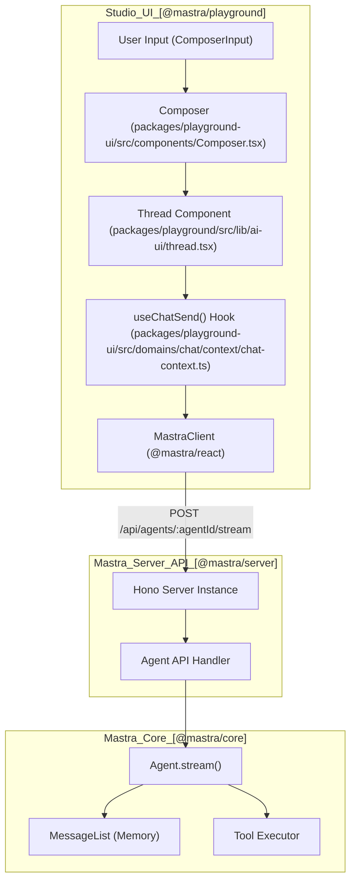
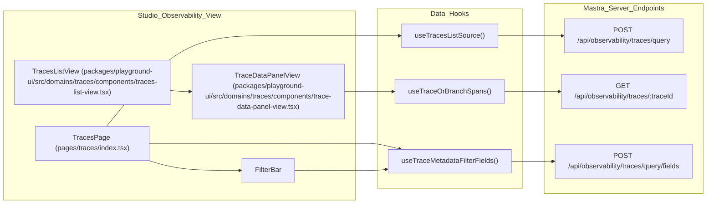

<!-- source: DeepWiki mcp.deepwiki.com · repo mastra-ai/mastra · page 10.6 Studio UI and Playground · fetched 2026-10-27 -->

# Studio UI and Playground

Relevant source files

The following files were used as context for generating this wiki page:

- [.changeset/early-points-flow.md](.changeset/early-points-flow.md)
- [.changeset/true-crews-look.md](.changeset/true-crews-look.md)
- [mastracode/factory-ui/e2e/board-virtualization.spec.ts](mastracode/factory-ui/e2e/board-virtualization.spec.ts)
- [mastracode/factory-ui/src/ui/__tests__/BoardListRowActions.msw.test.tsx](mastracode/factory-ui/src/ui/__tests__/BoardListRowActions.msw.test.tsx)
- [mastracode/factory-ui/src/ui/domains/chat/components/__tests__/TranscriptMessageMeta.msw.test.tsx](mastracode/factory-ui/src/ui/domains/chat/components/__tests__/TranscriptMessageMeta.msw.test.tsx)
- [mastracode/factory-ui/src/ui/domains/factory/components/BoardList.tsx](mastracode/factory-ui/src/ui/domains/factory/components/BoardList.tsx)
- [mastracode/factory-ui/src/ui/domains/factory/components/BoardListRow.tsx](mastracode/factory-ui/src/ui/domains/factory/components/BoardListRow.tsx)
- [mastracode/factory-ui/src/ui/domains/settings/components/ModelCombobox.tsx](mastracode/factory-ui/src/ui/domains/settings/components/ModelCombobox.tsx)
- [packages/playground-ui/.storybook/fixtures/composer.tsx](packages/playground-ui/.storybook/fixtures/composer.tsx)
- [packages/playground-ui/README.md](packages/playground-ui/README.md)
- [packages/playground-ui/src/components/fluid-hover-highlight.tsx](packages/playground-ui/src/components/fluid-hover-highlight.tsx)
- [packages/playground-ui/src/domains/spans/__tests__/fixtures/spans.ts](packages/playground-ui/src/domains/spans/__tests__/fixtures/spans.ts)
- [packages/playground-ui/src/domains/spans/components/__tests__/span-detail-panel.msw.test.tsx](packages/playground-ui/src/domains/spans/components/__tests__/span-detail-panel.msw.test.tsx)
- [packages/playground-ui/src/domains/spans/components/__tests__/spans-filter-bar.msw.test.tsx](packages/playground-ui/src/domains/spans/components/__tests__/spans-filter-bar.msw.test.tsx)
- [packages/playground-ui/src/domains/spans/components/span-detail-panel.tsx](packages/playground-ui/src/domains/spans/components/span-detail-panel.tsx)
- [packages/playground-ui/src/domains/spans/components/spans-filter-bar.tsx](packages/playground-ui/src/domains/spans/components/spans-filter-bar.tsx)
- [packages/playground-ui/src/domains/spans/hooks/__tests__/use-spans-filter-bar.msw.test.tsx](packages/playground-ui/src/domains/spans/hooks/__tests__/use-spans-filter-bar.msw.test.tsx)
- [packages/playground-ui/src/domains/spans/hooks/index.ts](packages/playground-ui/src/domains/spans/hooks/index.ts)
- [packages/playground-ui/src/domains/spans/hooks/use-spans-filter-bar.ts](packages/playground-ui/src/domains/spans/hooks/use-spans-filter-bar.ts)
- [packages/playground-ui/src/domains/traces/components/__tests__/traces-spans-switch.test.tsx](packages/playground-ui/src/domains/traces/components/__tests__/traces-spans-switch.test.tsx)
- [packages/playground-ui/src/domains/traces/components/index.ts](packages/playground-ui/src/domains/traces/components/index.ts)
- [packages/playground-ui/src/domains/traces/components/span-timing-hover-card.tsx](packages/playground-ui/src/domains/traces/components/span-timing-hover-card.tsx)
- [packages/playground-ui/src/ds/components/Button/Button.tsx](packages/playground-ui/src/ds/components/Button/Button.tsx)
- [packages/playground-ui/src/ds/components/Button/button.stories.tsx](packages/playground-ui/src/ds/components/Button/button.stories.tsx)
- [packages/playground-ui/src/ds/components/Button/button.test.tsx](packages/playground-ui/src/ds/components/Button/button.test.tsx)
- [packages/playground-ui/src/ds/components/ButtonsGroup/buttons-group.stories.tsx](packages/playground-ui/src/ds/components/ButtonsGroup/buttons-group.stories.tsx)
- [packages/playground-ui/src/ds/components/ButtonsGroup/buttons-group.tsx](packages/playground-ui/src/ds/components/ButtonsGroup/buttons-group.tsx)
- [packages/playground-ui/src/ds/components/Combobox/combobox-styles.ts](packages/playground-ui/src/ds/components/Combobox/combobox-styles.ts)
- [packages/playground-ui/src/ds/components/Combobox/combobox.stories.tsx](packages/playground-ui/src/ds/components/Combobox/combobox.stories.tsx)
- [packages/playground-ui/src/ds/components/Combobox/combobox.test.tsx](packages/playground-ui/src/ds/components/Combobox/combobox.test.tsx)
- [packages/playground-ui/src/ds/components/Combobox/combobox.tsx](packages/playground-ui/src/ds/components/Combobox/combobox.tsx)
- [packages/playground-ui/src/ds/components/ContextMenu/context-menu.stories.tsx](packages/playground-ui/src/ds/components/ContextMenu/context-menu.stories.tsx)
- [packages/playground-ui/src/ds/components/ContextMenu/context-menu.tsx](packages/playground-ui/src/ds/components/ContextMenu/context-menu.tsx)
- [packages/playground-ui/src/ds/components/CopyButton/copy-button.stories.tsx](packages/playground-ui/src/ds/components/CopyButton/copy-button.stories.tsx)
- [packages/playground-ui/src/ds/components/DataCodeSection/data-code-section.tsx](packages/playground-ui/src/ds/components/DataCodeSection/data-code-section.tsx)
- [packages/playground-ui/src/ds/components/DataDetailsPanel/data-details-panel-code-section.tsx](packages/playground-ui/src/ds/components/DataDetailsPanel/data-details-panel-code-section.tsx)
- [packages/playground-ui/src/ds/components/DataList/data-list-cells.test.tsx](packages/playground-ui/src/ds/components/DataList/data-list-cells.test.tsx)
- [packages/playground-ui/src/ds/components/DataList/data-list-cells.tsx](packages/playground-ui/src/ds/components/DataList/data-list-cells.tsx)
- [packages/playground-ui/src/ds/components/DataList/data-list-fluid-hover.test.tsx](packages/playground-ui/src/ds/components/DataList/data-list-fluid-hover.test.tsx)
- [packages/playground-ui/src/ds/components/DataList/data-list-root.test.tsx](packages/playground-ui/src/ds/components/DataList/data-list-root.test.tsx)
- [packages/playground-ui/src/ds/components/DataList/data-list-root.tsx](packages/playground-ui/src/ds/components/DataList/data-list-root.tsx)
- [packages/playground-ui/src/ds/components/DataList/data-list-row-button.tsx](packages/playground-ui/src/ds/components/DataList/data-list-row-button.tsx)
- [packages/playground-ui/src/ds/components/DataList/data-list-row-link.tsx](packages/playground-ui/src/ds/components/DataList/data-list-row-link.tsx)
- [packages/playground-ui/src/ds/components/DataList/data-list-row-static.tsx](packages/playground-ui/src/ds/components/DataList/data-list-row-static.tsx)
- [packages/playground-ui/src/ds/components/DataList/data-list-row-wrapper.tsx](packages/playground-ui/src/ds/components/DataList/data-list-row-wrapper.tsx)
- [packages/playground-ui/src/ds/components/DataList/data-list-sortable-top-cell.tsx](packages/playground-ui/src/ds/components/DataList/data-list-sortable-top-cell.tsx)
- [packages/playground-ui/src/ds/components/DataList/data-list-spacer.tsx](packages/playground-ui/src/ds/components/DataList/data-list-spacer.tsx)
- [packages/playground-ui/src/ds/components/DataList/data-list-subheader.tsx](packages/playground-ui/src/ds/components/DataList/data-list-subheader.tsx)
- [packages/playground-ui/src/ds/components/DataList/data-list-top-cell.tsx](packages/playground-ui/src/ds/components/DataList/data-list-top-cell.tsx)
- [packages/playground-ui/src/ds/components/DataList/data-list-top.tsx](packages/playground-ui/src/ds/components/DataList/data-list-top.tsx)
- [packages/playground-ui/src/ds/components/DataList/data-list.stories.tsx](packages/playground-ui/src/ds/components/DataList/data-list.stories.tsx)
- [packages/playground-ui/src/ds/components/DataList/data-list.tsx](packages/playground-ui/src/ds/components/DataList/data-list.tsx)
- [packages/playground-ui/src/ds/components/DataList/shared.ts](packages/playground-ui/src/ds/components/DataList/shared.ts)
- [packages/playground-ui/src/ds/components/DropdownMenu/dropdown-menu.stories.tsx](packages/playground-ui/src/ds/components/DropdownMenu/dropdown-menu.stories.tsx)
- [packages/playground-ui/src/ds/components/DropdownMenu/dropdown-menu.test.tsx](packages/playground-ui/src/ds/components/DropdownMenu/dropdown-menu.test.tsx)
- [packages/playground-ui/src/ds/components/DropdownMenu/dropdown-menu.tsx](packages/playground-ui/src/ds/components/DropdownMenu/dropdown-menu.tsx)
- [packages/playground-ui/src/ds/components/Header/header.stories.tsx](packages/playground-ui/src/ds/components/Header/header.stories.tsx)
- [packages/playground-ui/src/ds/components/HoverCard/hover-card.stories.tsx](packages/playground-ui/src/ds/components/HoverCard/hover-card.stories.tsx)
- [packages/playground-ui/src/ds/components/HoverCard/hover-card.tsx](packages/playground-ui/src/ds/components/HoverCard/hover-card.tsx)
- [packages/playground-ui/src/ds/components/HoverCard/index.ts](packages/playground-ui/src/ds/components/HoverCard/index.ts)
- [packages/playground-ui/src/ds/components/Input/input.stories.tsx](packages/playground-ui/src/ds/components/Input/input.stories.tsx)
- [packages/playground-ui/src/ds/components/Input/input.tsx](packages/playground-ui/src/ds/components/Input/input.tsx)
- [packages/playground-ui/src/ds/components/InputGroup/input-group.stories.tsx](packages/playground-ui/src/ds/components/InputGroup/input-group.stories.tsx)
- [packages/playground-ui/src/ds/components/InputGroup/input-group.test.tsx](packages/playground-ui/src/ds/components/InputGroup/input-group.test.tsx)
- [packages/playground-ui/src/ds/components/InputGroup/input-group.tsx](packages/playground-ui/src/ds/components/InputGroup/input-group.tsx)
- [packages/playground-ui/src/ds/components/InputNumber/index.ts](packages/playground-ui/src/ds/components/InputNumber/index.ts)
- [packages/playground-ui/src/ds/components/InputNumber/input-number.stories.tsx](packages/playground-ui/src/ds/components/InputNumber/input-number.stories.tsx)
- [packages/playground-ui/src/ds/components/InputNumber/input-number.test.tsx](packages/playground-ui/src/ds/components/InputNumber/input-number.test.tsx)
- [packages/playground-ui/src/ds/components/InputNumber/input-number.tsx](packages/playground-ui/src/ds/components/InputNumber/input-number.tsx)
- [packages/playground-ui/src/ds/components/KeyValueList/key-value-list.stories.tsx](packages/playground-ui/src/ds/components/KeyValueList/key-value-list.stories.tsx)
- [packages/playground-ui/src/ds/components/KeyValueList/key-value-list.tsx](packages/playground-ui/src/ds/components/KeyValueList/key-value-list.tsx)
- [packages/playground-ui/src/ds/components/Popover/popover.tsx](packages/playground-ui/src/ds/components/Popover/popover.tsx)
- [packages/playground-ui/src/ds/components/Select/select.stories.tsx](packages/playground-ui/src/ds/components/Select/select.stories.tsx)
- [packages/playground-ui/src/ds/components/Select/select.tsx](packages/playground-ui/src/ds/components/Select/select.tsx)
- [packages/playground-ui/src/ds/components/SideDialog/side-dialog-code-section.tsx](packages/playground-ui/src/ds/components/SideDialog/side-dialog-code-section.tsx)
- [packages/playground-ui/src/ds/components/SideDialog/side-dialog.stories.tsx](packages/playground-ui/src/ds/components/SideDialog/side-dialog.stories.tsx)
- [packages/playground-ui/src/ds/components/Textarea/textarea.test.tsx](packages/playground-ui/src/ds/components/Textarea/textarea.test.tsx)
- [packages/playground-ui/src/ds/components/Textarea/textarea.tsx](packages/playground-ui/src/ds/components/Textarea/textarea.tsx)
- [packages/playground-ui/src/ds/components/ThreadList/thread-list.stories.tsx](packages/playground-ui/src/ds/components/ThreadList/thread-list.stories.tsx)
- [packages/playground-ui/src/ds/components/ThreadList/thread-list.test.tsx](packages/playground-ui/src/ds/components/ThreadList/thread-list.test.tsx)
- [packages/playground-ui/src/ds/components/ThreadList/thread-list.tsx](packages/playground-ui/src/ds/components/ThreadList/thread-list.tsx)
- [packages/playground-ui/src/ds/components/Tooltip/tooltip.tsx](packages/playground-ui/src/ds/components/Tooltip/tooltip.tsx)
- [packages/playground-ui/src/ds/components/Txt/txt.stories.tsx](packages/playground-ui/src/ds/components/Txt/txt.stories.tsx)
- [packages/playground-ui/src/ds/primitives/fluid-menu.test.tsx](packages/playground-ui/src/ds/primitives/fluid-menu.test.tsx)
- [packages/playground-ui/src/ds/primitives/fluid-menu.tsx](packages/playground-ui/src/ds/primitives/fluid-menu.tsx)
- [packages/playground-ui/src/ds/primitives/form-element.ts](packages/playground-ui/src/ds/primitives/form-element.ts)
- [packages/playground-ui/src/ds/primitives/menu-item.ts](packages/playground-ui/src/ds/primitives/menu-item.ts)
- [packages/playground-ui/src/ds/primitives/text.ts](packages/playground-ui/src/ds/primitives/text.ts)
- [packages/playground-ui/src/ds/tokens/fonts.ts](packages/playground-ui/src/ds/tokens/fonts.ts)
- [packages/playground-ui/src/ds/tokens/sizes.ts](packages/playground-ui/src/ds/tokens/sizes.ts)
- [packages/playground-ui/src/ds/tokens/typography-foundations.stories.tsx](packages/playground-ui/src/ds/tokens/typography-foundations.stories.tsx)
- [packages/playground-ui/src/hooks/__tests__/use-expiring-local-storage-state.test.tsx](packages/playground-ui/src/hooks/__tests__/use-expiring-local-storage-state.test.tsx)
- [packages/playground-ui/src/hooks/use-fluid-hover.test.tsx](packages/playground-ui/src/hooks/use-fluid-hover.test.tsx)
- [packages/playground-ui/src/hooks/use-fluid-hover.ts](packages/playground-ui/src/hooks/use-fluid-hover.ts)
- [packages/playground-ui/src/hooks/use-local-storage-state.ts](packages/playground-ui/src/hooks/use-local-storage-state.ts)
- [packages/playground-ui/src/lib/resize/collapsible-panel.test.tsx](packages/playground-ui/src/lib/resize/collapsible-panel.test.tsx)
- [packages/playground-ui/src/lib/resize/collapsible-panel.tsx](packages/playground-ui/src/lib/resize/collapsible-panel.tsx)
- [packages/playground-ui/theme/typography.css](packages/playground-ui/theme/typography.css)
- [packages/playground/e2e/tests/agents/$agentId/session.spec.ts](packages/playground/e2e/tests/agents/$agentId/session.spec.ts)
- [packages/playground/e2e/tests/auth/infrastructure.spec.ts](packages/playground/e2e/tests/auth/infrastructure.spec.ts)
- [packages/playground/src/components/layout.tsx](packages/playground/src/components/layout.tsx)
- [packages/playground/src/components/ui/__tests__/app-sidebar-agent-builder-link.test.tsx](packages/playground/src/components/ui/__tests__/app-sidebar-agent-builder-link.test.tsx)
- [packages/playground/src/components/ui/__tests__/app-sidebar-more-menu.test.tsx](packages/playground/src/components/ui/__tests__/app-sidebar-more-menu.test.tsx)
- [packages/playground/src/components/ui/__tests__/app-sidebar-shell.test.tsx](packages/playground/src/components/ui/__tests__/app-sidebar-shell.test.tsx)
- [packages/playground/src/components/ui/__tests__/fixtures/nav-more.ts](packages/playground/src/components/ui/__tests__/fixtures/nav-more.ts)
- [packages/playground/src/components/ui/__tests__/render-sidebar.tsx](packages/playground/src/components/ui/__tests__/render-sidebar.tsx)
- [packages/playground/src/components/ui/app-sidebar.tsx](packages/playground/src/components/ui/app-sidebar.tsx)
- [packages/playground/src/domains/agents/agent-sidebar.tsx](packages/playground/src/domains/agents/agent-sidebar.tsx)
- [packages/playground/src/domains/agents/components/__tests__/chat-threads.test.tsx](packages/playground/src/domains/agents/components/__tests__/chat-threads.test.tsx)
- [packages/playground/src/domains/agents/components/__tests__/composer-model-switcher.msw.test.tsx](packages/playground/src/domains/agents/components/__tests__/composer-model-switcher.msw.test.tsx)
- [packages/playground/src/domains/agents/components/__tests__/fixtures/threads.ts](packages/playground/src/domains/agents/components/__tests__/fixtures/threads.ts)
- [packages/playground/src/domains/agents/components/__tests__/resizable-layouts.test.tsx](packages/playground/src/domains/agents/components/__tests__/resizable-layouts.test.tsx)
- [packages/playground/src/domains/agents/components/__tests__/threads-panel-shortcuts.test.tsx](packages/playground/src/domains/agents/components/__tests__/threads-panel-shortcuts.test.tsx)
- [packages/playground/src/domains/agents/components/agent-chat.tsx](packages/playground/src/domains/agents/components/agent-chat.tsx)
- [packages/playground/src/domains/agents/components/agent-layout.tsx](packages/playground/src/domains/agents/components/agent-layout.tsx)
- [packages/playground/src/domains/agents/components/agent-loading-skeletons.tsx](packages/playground/src/domains/agents/components/agent-loading-skeletons.tsx)
- [packages/playground/src/domains/agents/components/agent-unavailable.tsx](packages/playground/src/domains/agents/components/agent-unavailable.tsx)
- [packages/playground/src/domains/agents/components/chat-threads.tsx](packages/playground/src/domains/agents/components/chat-threads.tsx)
- [packages/playground/src/domains/agents/components/composer-model-switcher.tsx](packages/playground/src/domains/agents/components/composer-model-switcher.tsx)
- [packages/playground/src/domains/agents/components/memory-sidebar/__tests__/memory-sidebar.test.tsx](packages/playground/src/domains/agents/components/memory-sidebar/__tests__/memory-sidebar.test.tsx)
- [packages/playground/src/domains/agents/components/memory-sidebar/agent-memory.tsx](packages/playground/src/domains/agents/components/memory-sidebar/agent-memory.tsx)
- [packages/playground/src/domains/agents/components/memory-sidebar/memory-sidebar.tsx](packages/playground/src/domains/agents/components/memory-sidebar/memory-sidebar.tsx)
- [packages/playground/src/domains/agents/components/thread-actions-menu.tsx](packages/playground/src/domains/agents/components/thread-actions-menu.tsx)
- [packages/playground/src/domains/agents/components/threads-panel-shortcuts.tsx](packages/playground/src/domains/agents/components/threads-panel-shortcuts.tsx)
- [packages/playground/src/domains/agents/context/index.tsx](packages/playground/src/domains/agents/context/index.tsx)
- [packages/playground/src/domains/agents/context/playground-model-context.tsx](packages/playground/src/domains/agents/context/playground-model-context.tsx)
- [packages/playground/src/domains/agents/context/thread-preferences-provider.tsx](packages/playground/src/domains/agents/context/thread-preferences-provider.tsx)
- [packages/playground/src/domains/agents/context/threads-panel-context.tsx](packages/playground/src/domains/agents/context/threads-panel-context.tsx)
- [packages/playground/src/domains/agents/hooks/use-collapsed-thread-sections.ts](packages/playground/src/domains/agents/hooks/use-collapsed-thread-sections.ts)
- [packages/playground/src/domains/agents/hooks/use-pinned-threads.ts](packages/playground/src/domains/agents/hooks/use-pinned-threads.ts)
- [packages/playground/src/domains/agents/utils/__tests__/agent-suggested-prompts.test.ts](packages/playground/src/domains/agents/utils/__tests__/agent-suggested-prompts.test.ts)
- [packages/playground/src/domains/agents/utils/agent-suggested-prompts.ts](packages/playground/src/domains/agents/utils/agent-suggested-prompts.ts)
- [packages/playground/src/domains/conversation/context/ThreadInputContext.tsx](packages/playground/src/domains/conversation/context/ThreadInputContext.tsx)
- [packages/playground/src/domains/conversation/context/thread-input-context.ts](packages/playground/src/domains/conversation/context/thread-input-context.ts)
- [packages/playground/src/domains/conversation/context/useThreadInput.ts](packages/playground/src/domains/conversation/context/useThreadInput.ts)
- [packages/playground/src/domains/conversation/index.ts](packages/playground/src/domains/conversation/index.ts)
- [packages/playground/src/domains/llm/components/llm-providers.tsx](packages/playground/src/domains/llm/components/llm-providers.tsx)
- [packages/playground/src/domains/review/components/review-item-card.tsx](packages/playground/src/domains/review/components/review-item-card.tsx)
- [packages/playground/src/index.css](packages/playground/src/index.css)
- [packages/playground/src/lib/ai-ui/__tests__/thread.test.tsx](packages/playground/src/lib/ai-ui/__tests__/thread.test.tsx)
- [packages/playground/src/lib/ai-ui/suggested-prompt-list.tsx](packages/playground/src/lib/ai-ui/suggested-prompt-list.tsx)
- [packages/playground/src/lib/ai-ui/thread.tsx](packages/playground/src/lib/ai-ui/thread.tsx)
- [packages/playground/src/pages/agents/__tests__/index.msw.test.tsx](packages/playground/src/pages/agents/__tests__/index.msw.test.tsx)
- [packages/playground/src/pages/agents/agent/__tests__/suggested-prompts.msw.test.tsx](packages/playground/src/pages/agents/agent/__tests__/suggested-prompts.msw.test.tsx)
- [packages/playground/src/pages/agents/agent/__tests__/thread-page.msw.test.tsx](packages/playground/src/pages/agents/agent/__tests__/thread-page.msw.test.tsx)
- [packages/playground/src/pages/agents/agent/session.tsx](packages/playground/src/pages/agents/agent/session.tsx)
- [packages/playground/src/pages/agents/agent/thread.tsx](packages/playground/src/pages/agents/agent/thread.tsx)
- [packages/playground/src/pages/spans/index.tsx](packages/playground/src/pages/spans/index.tsx)
- [packages/playground/src/pages/spans/span-detail-side-panel.tsx](packages/playground/src/pages/spans/span-detail-side-panel.tsx)
- [packages/playground/src/pages/spans/spans-page-content.tsx](packages/playground/src/pages/spans/spans-page-content.tsx)
- [packages/playground/src/pages/traces/traces-page-content.tsx](packages/playground/src/pages/traces/traces-page-content.tsx)

The Mastra Studio UI and Playground provide a comprehensive visual interface for building, testing, and managing agents, workflows, datasets, and observability traces. It is implemented as a React Single Page Application (SPA) that interacts with the Mastra server via the JavaScript Client SDK and custom domain hooks, facilitating seamless AI project development and analysis.

---

## Architecture and Package Structure

The Studio ecosystem is architected into key packages that separate concerns of UX/UI components from application logic and deployment configuration.

### @mastra/playground-ui

This package houses the foundational design system and UI components utilized across the Studio. It relies on a modern stack including Radix UI, TanStack React Query, and CodeMirror.

- **UI Primitives and Components:** Offers a suite of reusable React components such as `Button` [packages/playground-ui/src/ds/components/Button/Button.tsx:1-120](), `Combobox` [packages/playground-ui/src/ds/components/Combobox/combobox.tsx:1-185](), `Select` [packages/playground-ui/src/ds/components/Select/select.tsx:1-153](), `DropdownMenu` [packages/playground-ui/src/ds/components/DropdownMenu/dropdown-menu.tsx:1-206](), `ContextMenu` [packages/playground-ui/src/ds/components/ContextMenu/context-menu.tsx:1-186](), and `DataList` [packages/playground-ui/src/ds/components/DataList/data-list.stories.tsx:1-199](). It includes specialized editors like `@uiw/react-codemirror` for code and JSON manipulation.
- **Observability Components:** Specialized components for trace visualization, including `TraceDataPanelView` [packages/playground-ui/src/domains/traces/components/index.ts:1](), `TracesListView` [packages/playground-ui/src/domains/traces/components/index.ts:1](), and timeline components.
- **Styling and Tokens:** The package exports a core `style.css` and a `theme.css` file, alongside design tokens for consistent branding.

### @mastra/playground

This package defines the SPA shell, routing, and application-specific logic.

- **Routing and Navigation:** Uses `react-router` to manage navigation for agents, workflows, and observability features [packages/playground/src/components/layout.tsx:19](). The main layout is defined in `Layout` [packages/playground/src/components/layout.tsx:150-162]() and `AppSidebar` [packages/playground/src/components/ui/app-sidebar.tsx:36-162]().
- **State Management:** Utilizes `zustand` for global UI state and `react-hook-form` for complex agent and tool configurations.
- **Integration Layer:** Bridges `@mastra/client-js` and `@mastra/react` to perform live API calls against the Mastra server [packages/playground/src/pages/agents/agent/thread.tsx:10]().

Sources:
[packages/playground-ui/src/ds/components/Button/Button.tsx:1-120](), [packages/playground-ui/src/ds/components/Combobox/combobox.tsx:1-185](), [packages/playground-ui/src/ds/components/Select/select.tsx:1-153](), [packages/playground-ui/src/ds/components/DropdownMenu/dropdown-menu.tsx:1-206](), [packages/playground-ui/src/ds/components/ContextMenu/context-menu.tsx:1-186](), [packages/playground-ui/src/ds/components/DataList/data-list.stories.tsx:1-199](), [packages/playground-ui/src/domains/traces/components/index.ts:1](), [packages/playground/src/components/layout.tsx:19](), [packages/playground/src/components/layout.tsx:150-162](), [packages/playground/src/components/ui/app-sidebar.tsx:36-162](), [packages/playground/src/pages/agents/agent/thread.tsx:10]()

---

## Studio Deployment and Dynamic HTML Injection

The Studio is deployed as a static React SPA with dynamic HTML injection to configure its runtime environment and backend connectivity.

### HTML Shell and Runtime Configuration

- **CLI-Driven Serving:** The `mastra studio` command (via `@mastra/cli`) serves the built assets. During this process, it injects environment-specific configuration into the `index.html` shell.
- **Placeholder Replacement:** The CLI and deployers replace placeholders like `%%MASTRA_SERVER_HOST%%` with actual values, enabling the SPA to connect to the correct API endpoint regardless of where it is hosted.
- **Vercel and Cloud Deployments:** The `@mastra/deployer` package handles the bundling and static asset preparation for platforms like Vercel, Netlify, and Cloudflare.

Sources:
[packages/playground/src/index.css:1-1]()

---

## Data Flow: Natural Language to Code Entities

The Studio chat interface bridges user intent to the underlying Mastra `Agent` and `Thread` abstractions. The `Thread` component [packages/playground/src/lib/ai-ui/thread.tsx:133]() is central to this interaction, managing message display, user input, and communication with the Mastra backend.

**Diagram: Studio Chat Interaction and Agent Execution Flow**

This flow illustrates how the UI utilizes the `@mastra/react` hooks to communicate with the `@mastra/server`, which in turn invokes the core `Agent` logic. The `Composer` [packages/playground-ui/src/ds/components/Combobox/combobox.tsx:1-185]() component handles user input, and `useChatSend` [packages/playground/src/lib/ai-ui/thread.tsx:25]() dispatches messages.

Sources:
[packages/playground/src/lib/ai-ui/thread.tsx:133](), [packages/playground-ui/src/ds/components/Combobox/combobox.tsx:1-185](), [packages/playground/src/lib/ai-ui/thread.tsx:25]()

---

## Observability and Evaluation Features

Mastra Studio integrates advanced observability to provide monitoring, debugging, and evaluation capabilities. The `TracesPage` is the entry point for viewing traces.

- **Trace Visualization:** The Studio displays execution spans using data fetched from the observability endpoints. It supports visualizing nested spans and logs through `TraceDataPanelView` and `TraceSpanTimeline`.
- **Log Inspection:** A dedicated logs view allows developers to inspect system and agent logs in real-time.
- **Telemetry Integration:** The system uses OpenTelemetry (OTEL) via `@mastra/observability` to capture performance and execution data, which is then surfaced in the Studio UI.
- **Trace Filtering:** The `FilterBar` component allows users to filter traces based on various criteria, including entity type, status, and custom metadata.

**Diagram: Studio UI Data Mapping for Observability**

Sources:
[packages/playground-ui/src/domains/traces/components/index.ts:1]()

---

## Key Studio UI Components and Utilities

| Component / Utility | Package | Description |
| :--- | :--- | :--- |
| `MastraReactProvider` | `@mastra/react` | Provides the necessary context for hooks to interact with the Mastra API. |
| `TraceDataPanelView` | `@mastra/playground-ui` | Detailed view for inspecting OTEL spans and metadata. |
| `TracesListView` | `@mastra/playground-ui` | Virtualized list component for displaying traces. |
| `Thread` | `@mastra/playground` | The core chat UI component for agent interactions [packages/playground/src/lib/ai-ui/thread.tsx:133](). |
| `useAgent` | `@mastra/react` | Hook for managing agent generation and streaming states [packages/playground/src/pages/agents/agent/thread.tsx:53](). |
| `FilterBar` | `@mastra/playground-ui` | Component for applying and managing filters on lists of data, such as traces. |
| `Combobox` | `@mastra/playground-ui` | A flexible input component with a dropdown list for selection and search [packages/playground-ui/src/ds/components/Combobox/combobox.tsx:90](). |
| `Select` | `@mastra/playground-ui` | A styled dropdown select component for single or multiple value selection [packages/playground-ui/src/ds/components/Select/select.tsx:69](). |
| `Button` | `@mastra/playground-ui` | A versatile button component with various styles and sizes [packages/playground-ui/src/ds/components/Button/Button.tsx:108](). |
| `DataList` | `@mastra/playground-ui` | A component for displaying tabular data with features like reordering and selection [packages/playground-ui/src/ds/components/DataList/data-list.tsx:1](). |

Sources:
[packages/playground/src/lib/ai-ui/thread.tsx:133](), [packages/playground/src/pages/agents/agent/thread.tsx:53](), [packages/playground-ui/src/ds/components/Combobox/combobox.tsx:90](), [packages/playground-ui/src/ds/components/Select/select.tsx:69](), [packages/playground-ui/src/ds/components/Button/Button.tsx:108](), [packages/playground-ui/src/ds/components/DataList/data-list.tsx:1]()

---

