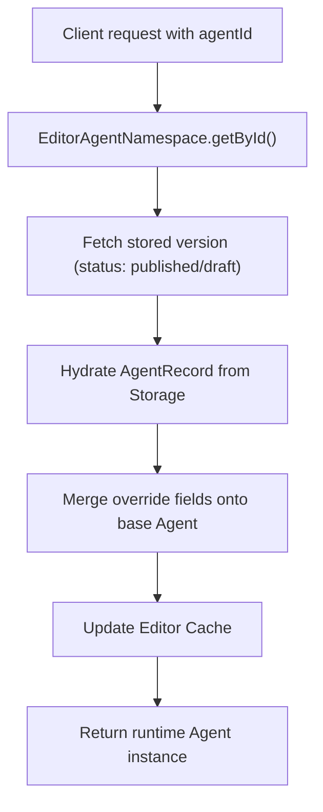
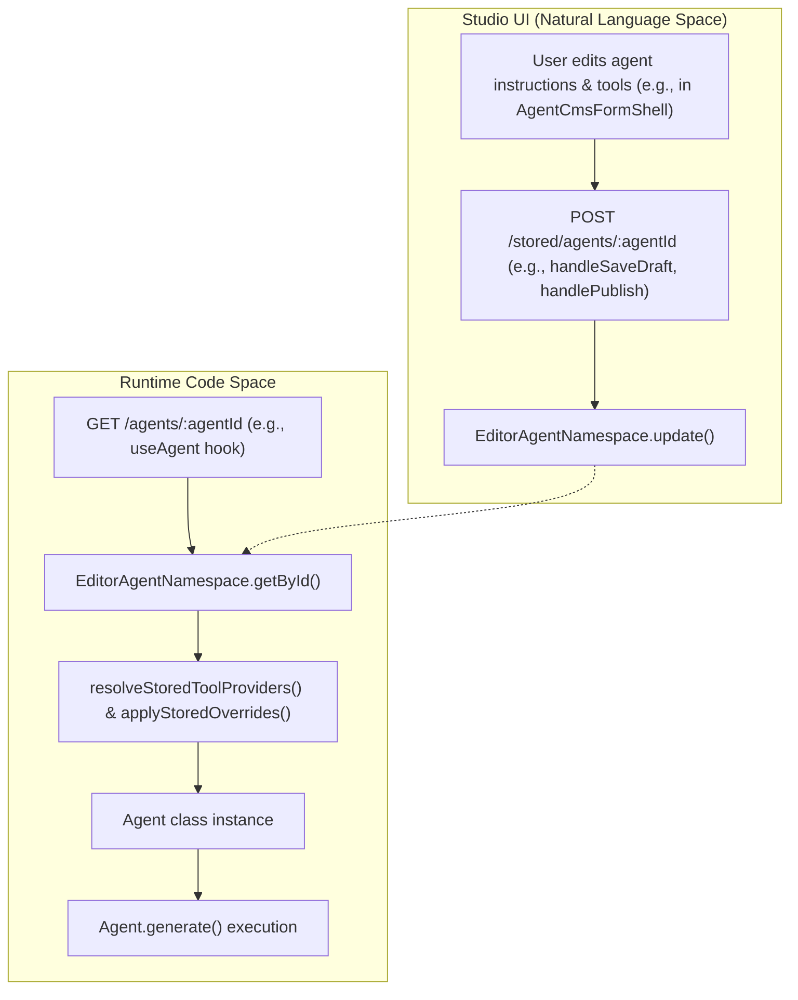

<!-- source: DeepWiki mcp.deepwiki.com · repo mastra-ai/mastra · page 10.7 Editor System (MastraEditor) and Stored Overrides · fetched 2026-10-27 -->

# Editor System (MastraEditor) and Stored Overrides

<details>
<summary>Relevant source files</summary>

The following files were used as context for generating this wiki page:

- [.changeset/fs-agent-override-files.md](.changeset/fs-agent-override-files.md)
- [.changeset/fs-agent-override-ownership.md](.changeset/fs-agent-override-ownership.md)
- [.changeset/studio-fs-agent-overrides.md](.changeset/studio-fs-agent-overrides.md)
- [packages/agent-builder/CHANGELOG.md](packages/agent-builder/CHANGELOG.md)
- [packages/agent-builder/package.json](packages/agent-builder/package.json)
- [packages/core/src/editor/index.ts](packages/core/src/editor/index.ts)
- [packages/core/src/editor/types.ts](packages/core/src/editor/types.ts)
- [packages/core/src/storage/domains/agents/filesystem.ts](packages/core/src/storage/domains/agents/filesystem.ts)
- [packages/core/src/storage/domains/agents/source.test.ts](packages/core/src/storage/domains/agents/source.test.ts)
- [packages/core/src/storage/domains/agents/source.ts](packages/core/src/storage/domains/agents/source.ts)
- [packages/core/src/storage/filesystem.test.ts](packages/core/src/storage/filesystem.test.ts)
- [packages/editor/CHANGELOG.md](packages/editor/CHANGELOG.md)
- [packages/editor/package.json](packages/editor/package.json)
- [packages/editor/src/apply-stored-overrides.test.ts](packages/editor/src/apply-stored-overrides.test.ts)
- [packages/editor/src/editor.test.ts](packages/editor/src/editor.test.ts)
- [packages/editor/src/index.ts](packages/editor/src/index.ts)
- [packages/editor/src/namespaces/agent.test.ts](packages/editor/src/namespaces/agent.test.ts)
- [packages/editor/src/namespaces/agent.ts](packages/editor/src/namespaces/agent.ts)
- [packages/editor/src/namespaces/index.ts](packages/editor/src/namespaces/index.ts)
- [packages/editor/src/namespaces/versioned-update.ts](packages/editor/src/namespaces/versioned-update.ts)
- [packages/memory/CHANGELOG.md](packages/memory/CHANGELOG.md)
- [packages/memory/package.json](packages/memory/package.json)
- [packages/playground/src/domains/agents/hooks/__tests__/fixtures/use-agent-cms-form.ts](packages/playground/src/domains/agents/hooks/__tests__/fixtures/use-agent-cms-form.ts)
- [packages/playground/src/domains/agents/hooks/__tests__/use-agent-cms-form.msw.test.tsx](packages/playground/src/domains/agents/hooks/__tests__/use-agent-cms-form.msw.test.tsx)
- [packages/playground/src/domains/agents/hooks/use-agent-cms-form.ts](packages/playground/src/domains/agents/hooks/use-agent-cms-form.ts)
- [packages/playground/src/domains/agents/utils/__tests__/agent-form-mappers.test.ts](packages/playground/src/domains/agents/utils/__tests__/agent-form-mappers.test.ts)
- [packages/playground/src/domains/agents/utils/agent-form-mappers.ts](packages/playground/src/domains/agents/utils/agent-form-mappers.ts)
- [packages/playground/src/pages/agents/agent-playground/index.tsx](packages/playground/src/pages/agents/agent-playground/index.tsx)
- [packages/playground/src/pages/cms/agents/edit-layout.tsx](packages/playground/src/pages/cms/agents/edit-layout.tsx)
- [packages/server/src/server/handlers/stored-agent-favorites.ts](packages/server/src/server/handlers/stored-agent-favorites.ts)
- [packages/server/src/server/handlers/stored-agents.test.ts](packages/server/src/server/handlers/stored-agents.test.ts)
- [packages/server/src/server/handlers/stored-agents.ts](packages/server/src/server/handlers/stored-agents.ts)
- [packages/server/src/server/handlers/stored-skill-favorites.ts](packages/server/src/server/handlers/stored-skill-favorites.ts)
- [packages/server/src/server/handlers/stored-skills.ts](packages/server/src/server/handlers/stored-skills.ts)
- [packages/server/src/server/schemas/agent-versions.ts](packages/server/src/server/schemas/agent-versions.ts)
- [packages/server/src/server/schemas/stored-agents.ts](packages/server/src/server/schemas/stored-agents.ts)

</details>


The Editor System in Mastra provides a CMS-style management layer that enables runtime creation, modification, and versioning of AI entities. It empowers developers and users to safely override code-defined agents, prompts, workflows, and other components through a structured editor interface and underlying storage system, without requiring re-deployment of code. This system is centered on the `MastraEditor` class and its various namespaces, which map seamlessly to runtime objects and persistent storage domains.

---

## Overview of MastraEditor

The `MastraEditor` class [packages/editor/src/index.ts:59-172]() is the central coordination point responsible for CRUD operations, configuration hydration, and runtime integration of editable AI entities. It bridges the code-based agent/workflow definitions with stored overrides that can be persisted either in a database or a source-controlled filesystem, enabling a flexible "CMS" experience.

Key capabilities include:

- **Provider Configuration**: Supports multiple provider types to hydrate stored configurations into runtime instances.
- **CRUD Namespaces**: Organizes different editable entity types into dedicated namespaces that manage access, validation, and storage.
- **Versioning & Overrides**: Supports storing multiple versions, drafts, published, and archived states, with controlled merge semantics.
- **Runtime Integration**: Dynamically resolves stored overrides into runtime objects used by Mastra server APIs and Studio UI.

### Provider Configuration

The `MastraEditor` is configured with the following provider categories to translate stored configurations into runtime instances:

| Provider Type        | Purpose                                                                                   | Interface / Examples                            |
|----------------------|-------------------------------------------------------------------------------------------|------------------------------------|
| **FilesystemProvider** | Creates `WorkspaceFilesystem` instances from stored filesystem configs                    | `FilesystemProvider` / `local`, `s3` |
| **SandboxProvider**    | Creates `WorkspaceSandbox` instances from stored sandbox configs                          | `SandboxProvider` / `local`, `e2b`   |
| **BlobStoreProvider**  | Manages content-addressable blobs used by skills to store versioned files                | `BlobStoreProvider` / `storage`, `s3`|
| **BrowserProvider**    | Hydrates stored browser configurations into `MastraBrowser` instances                     | `BrowserProvider` / `stagehand`      |
| **WorkspaceProvider**  | Creates complete `Workspace` instances from stored workspace configs                      | `WorkspaceProvider` / custom cloud   |

These providers enable the editor to hydrate complex workspace and skill configurations transparently regardless of the underlying infrastructure. They are configured via the `MastraEditorConfig` interface and registered at editor construction.
Sources: [packages/core/src/editor/types.ts:72-162](), [packages/editor/src/index.ts:130-159]()

### Source Modes: Code vs. DB

`MastraEditor` supports two primary storage "source" modes for overrides:

- **Code Mode (`source: 'code'`)** —
  - Uses a `FilesystemStore` to persist overrides as JSON files in a local or remote file system (default path: `./mastra/editor`).
  - Enables git-based version control and code review workflows for "CMS" style edits.
  - When `source: 'code'` is enabled, the `agents` and `promptBlocks` domains are routed through a `SourceAgentsSourceControl` store, which uses the configured `SourceControlProvider` to read/write JSON files. [packages/core/src/storage/domains/agents/filesystem.ts]()
  - The `source` field on an agent indicates if it's code-backed (`'code'` or `'fs'`). [packages/server/src/server/handlers/stored-agents.ts:107-109]()

- **DB Mode (`source: 'db'` or default)** —
  - Stores overrides directly in the configured storage backend (e.g., PostgreSQL, LibSQL).
  - Enables fully dynamic runtime editing without touching source code files.

Sources: [packages/editor/src/index.ts:123-128]()

---

## CRUD Namespaces and Data Flow

`MastraEditor` exposes dedicated namespaces based on `CrudEditorNamespace` for distinct entity types. These namespaces internally communicate with the `StorageAdapter` to persist data.

| Namespace       | Responsibility                                            | Storage Domain          |
|-----------------|-----------------------------------------------------------|------------------------|
| **agent**       | Agents, metadata, instructions, tool overrides            | `agents`               |
| **prompt**      | Prompt blocks used for dynamic instructions               | `promptBlocks`         |
| **scorer**      | Evaluation scorers and scoring configurations             | `scorerDefinitions`    |
| **workspace**   | Workspace configs: filesystems, sandboxes                 | `workspaces`           |
| **skill**       | Skills and versioned skill blobs                           | `skills`               |
| **mcp**         | MCP (Model Context Protocol) client configurations        | `mcpClients`           |
| **mcpServer**   | MCP server configurations                                 | `mcpServers`           |
| **favorites**   | User favorites for editor entities                        | `favorites`            |

Sources: [packages/editor/src/namespaces/index.ts:10](), [packages/editor/src/namespaces/index.ts:10]()

---

## Stored Overrides and Versioning Interaction

A core feature of the editor system is how stored overrides interact with the runtime agent and server APIs.

- **Selective Overrides**: The editor enforces an `editor` configuration per agent to specify which fields are editable. For example, `editor: { tools: { description: true } }` only allows overriding tool descriptions while keeping the code-defined implementation. The `getCodeAgentOwnership` function determines which fields of a code-backed agent can be owned by the editor based on its `editor` configuration. [packages/server/src/server/handlers/stored-agents.ts:117-139]()
- **Draft/Published Workflow**: Changes to agent snapshots (instructions, model, tools) are kept as drafts until explicitly published. This allows developers to test changes without affecting production traffic. The `handleAutoVersioning` utility manages this process. [packages/editor/src/namespaces/agent.test.ts:60-90](), [packages/server/src/server/handlers/stored-agents.ts:42]()
- **Versioning**: The system tracks `versionNumber` and `changedFields` for each update. Updating a record field like `metadata` does not necessarily trigger a new version, whereas changing `instructions` does. The `createVersionFromSnapshotUpdate` function is responsible for creating new versions and identifying changed fields. [packages/editor/src/namespaces/agent.test.ts:22-58](), [packages/editor/src/namespaces/versioned-update.ts]()

Sources: [packages/editor/src/namespaces/agent.ts:52-75]()

---

## Internal Implementation Details

### MastraEditor Class Architecture

The `MastraEditor` class [packages/editor/src/index.ts:59-172]() manages:
- Provider registries for filesystems, sandboxes, and browsers.
- Namespace instances for specialized CRUD operations.
- Integration with the main `Mastra` instance via the `__mastra` property.

### EditorAgentNamespace

This namespace handles the complex logic of merging code and storage:
- **`applyStoredOverrides`**: Merges stored JSON configurations onto a runtime `Agent` instance. This function is crucial for applying editor-managed changes to code-defined agents. [packages/editor/src/namespaces/agent.ts:490-500]()
- **`applyBuilderDefaults`**: Applies baseline defaults (e.g., `memory: { observationalMemory: true }`) when a user creates an agent through the builder but omits specific config. [packages/editor/src/namespaces/agent.ts:129-160]()
- **`clearCache`**: Removes an agent from the editor's internal cache and the `Mastra` registry, ensuring the next access re-hydrates from storage. [packages/editor/src/namespaces/agent.test.ts:129-143]()

### Flow of Stored Agent Retrieval:


Sources: [packages/editor/src/namespaces/agent.ts:490-500](), [packages/editor/src/namespaces/agent.test.ts:172-186]()

---

## Bridging Natural Language to Code Entity Space

### Diagram: Studio UI to Runtime Agent Hydration

This diagram illustrates how user interactions in the Studio UI, which operates in a "natural language space" of editable fields, translate into updates and retrieval of `Agent` instances in the "runtime code space".


Sources: [packages/editor/src/namespaces/agent.ts:41-43](), [packages/editor/src/namespaces/agent.ts:490-500](), [packages/playground/src/pages/cms/agents/edit-layout.tsx:108-109](), [packages/playground/src/domains/agents/hooks/use-agent-cms-form.ts:100-101]()

### Diagram: Agent Configuration and Override Flow

This diagram details the various sources and mechanisms involved in configuring an `Agent` instance, highlighting how code-defined agents can be selectively overridden by stored configurations.

```mermaid
graph TD
    subgraph "Agent Definition Sources"
        A[Agent Code Definition (e.g., new Agent({...}))]
        B[Builder Configuration (editor.builder.configuration.agent)]
        C[Stored Agent Record (DB/Filesystem)]
    end

    subgraph "Configuration Resolution Pipeline"
        A --> R1[Mastra.getAgentById()]
        B --> R2[applyBuilderDefaults()]
        C --> R3[applyStoredOverrides()]
        R1 --> R_Agent[Runtime Agent Instance]
        R2 --> R_Agent
        R3 --> R_Agent
    end

    subgraph "Override Control"
        EditorConfig[Agent.editor config (e.g., { instructions: true, tools: { description: true } })]
        EditorConfig --> getCodeAgentOwnership[getCodeAgentOwnership()]
        getCodeAgentOwnership --> R3
    end

    R_Agent --> AgentExecution[Agent.generate() / Agent.stream()]
```
Sources: [packages/editor/src/namespaces/agent.ts:129-160](), [packages/editor/src/namespaces/agent.ts:490-500](), [packages/server/src/server/handlers/stored-agents.ts:117-139](), [packages/editor/src/namespaces/agent.ts:52-75]()

---

## Recommended Patterns for Safe Runtime Changes

1.  **Explicit Publication**: Always test changes using `status: 'draft'` in the Studio or via API before publishing. The `Agent` will throw an error if configured with `editor: { instructions: true }` but no published version exists. [packages/editor/src/namespaces/agent.test.ts:60-90]()
2.  **Field Level Security**: Use the `editor` configuration object to lock down sensitive fields (like `tools`) while allowing non-technical users to edit `instructions`. The `CODE_AGENT_OVERRIDE_FIELDS` constant defines fields that can be overridden for code-backed agents. [packages/server/src/server/handlers/stored-agents.ts:94-100](), [packages/server/src/server/handlers/stored-agents.ts:117-139]()
3.  **Cache Invalidation**: When manually updating the database, call `editor.agent.clearCache(agentId)` to ensure the running server picks up the changes. [packages/editor/src/namespaces/agent.test.ts:129-143]()
4.  **Builder Defaults**: Leverage `BUILDER_BASELINE_DEFAULTS` to ensure all new agents created via the editor have sane defaults for memory and workspaces. [packages/editor/src/namespaces/agent.ts:108-110]()

---

## Sources
- [packages/editor/src/index.ts:59-172]()
- [packages/editor/src/namespaces/agent.ts:52-75]()
- [packages/editor/src/namespaces/agent.ts:129-160]()
- [packages/editor/src/namespaces/agent.ts:490-500]()
- [packages/editor/src/namespaces/agent.test.ts:60-90]()
- [packages/editor/src/namespaces/agent.test.ts:129-143]()
- [packages/core/src/editor/types.ts:72-162]()
- [packages/server/src/server/handlers/stored-agents.ts:42]()
- [packages/server/src/server/handlers/stored-agents.ts:94-100]()
- [packages/server/src/server/handlers/stored-agents.ts:107-109]()
- [packages/server/src/server/handlers/stored-agents.ts:117-139]()
- [packages/editor/src/namespaces/versioned-update.ts]()
- [packages/editor/src/namespaces/index.ts:10]()
- [packages/editor/src/namespaces/index.ts:10]()
- [packages/core/src/storage/domains/agents/filesystem.ts]()
- [packages/playground/src/pages/cms/agents/edit-layout.tsx:108-109]()
- [packages/playground/src/domains/agents/hooks/use-agent-cms-form.ts:100-101]()

---

