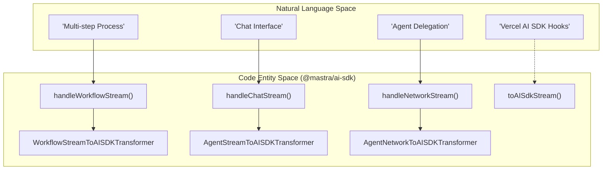
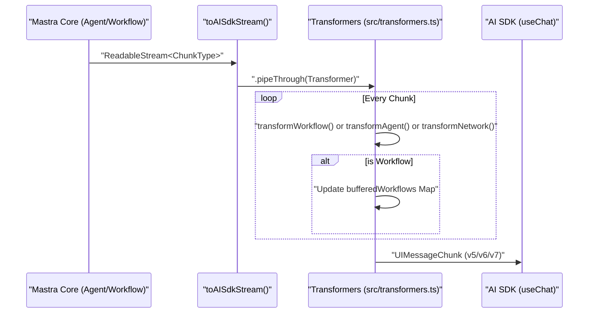

<!-- source: DeepWiki mcp.deepwiki.com · repo mastra-ai/mastra · page 10.8 AI SDK Adapter and Chat Routes · fetched 2026-10-27 -->

# AI SDK Adapter and Chat Routes

<details>
<summary>Relevant source files</summary>

The following files were used as context for generating this wiki page:

- [client-sdks/ai-sdk/README.md](client-sdks/ai-sdk/README.md)
- [client-sdks/ai-sdk/__recordings__/ai-sdk-src-__tests__-tool-call-approval.e2e.json](client-sdks/ai-sdk/__recordings__/ai-sdk-src-__tests__-tool-call-approval.e2e.json)
- [client-sdks/ai-sdk/src/__tests__/chat-route-sub-agent-metadata.test.ts](client-sdks/ai-sdk/src/__tests__/chat-route-sub-agent-metadata.test.ts)
- [client-sdks/ai-sdk/src/__tests__/message-metadata.test.ts](client-sdks/ai-sdk/src/__tests__/message-metadata.test.ts)
- [client-sdks/ai-sdk/src/__tests__/nested-sub-agent-streaming.test.ts](client-sdks/ai-sdk/src/__tests__/nested-sub-agent-streaming.test.ts)
- [client-sdks/ai-sdk/src/__tests__/tool-call-approval.e2e.test.ts](client-sdks/ai-sdk/src/__tests__/tool-call-approval.e2e.test.ts)
- [client-sdks/ai-sdk/src/__tests__/tool-call-approval.test.ts](client-sdks/ai-sdk/src/__tests__/tool-call-approval.test.ts)
- [client-sdks/ai-sdk/src/__tests__/transform-agent-cumulative-growth.test.ts](client-sdks/ai-sdk/src/__tests__/transform-agent-cumulative-growth.test.ts)
- [client-sdks/ai-sdk/src/__tests__/transform-agent-tool-error.test.ts](client-sdks/ai-sdk/src/__tests__/transform-agent-tool-error.test.ts)
- [client-sdks/ai-sdk/src/__tests__/transform-agent-tool-input-streaming.test.ts](client-sdks/ai-sdk/src/__tests__/transform-agent-tool-input-streaming.test.ts)
- [client-sdks/ai-sdk/src/__tests__/transformers.test.ts](client-sdks/ai-sdk/src/__tests__/transformers.test.ts)
- [client-sdks/ai-sdk/src/chat-route.ts](client-sdks/ai-sdk/src/chat-route.ts)
- [client-sdks/ai-sdk/src/convert-streams.ts](client-sdks/ai-sdk/src/convert-streams.ts)
- [client-sdks/ai-sdk/src/helpers.test.ts](client-sdks/ai-sdk/src/helpers.test.ts)
- [client-sdks/ai-sdk/src/helpers.ts](client-sdks/ai-sdk/src/helpers.ts)
- [client-sdks/ai-sdk/src/index.ts](client-sdks/ai-sdk/src/index.ts)
- [client-sdks/ai-sdk/src/network-route.ts](client-sdks/ai-sdk/src/network-route.ts)
- [client-sdks/ai-sdk/src/public-types.ts](client-sdks/ai-sdk/src/public-types.ts)
- [client-sdks/ai-sdk/src/transformers.ts](client-sdks/ai-sdk/src/transformers.ts)
- [client-sdks/ai-sdk/src/utils.test.ts](client-sdks/ai-sdk/src/utils.test.ts)
- [client-sdks/ai-sdk/src/utils.ts](client-sdks/ai-sdk/src/utils.ts)
- [docs/src/content/en/docs/agents/networks.mdx](docs/src/content/en/docs/agents/networks.mdx)
- [docs/src/content/en/docs/deployment/mastra-server.mdx](docs/src/content/en/docs/deployment/mastra-server.mdx)
- [docs/src/content/en/docs/deployment/monorepo.mdx](docs/src/content/en/docs/deployment/monorepo.mdx)
- [docs/src/content/en/docs/server/custom-api-routes.mdx](docs/src/content/en/docs/server/custom-api-routes.mdx)
- [docs/src/content/en/integrations/agentic-ui/ai-sdk-ui.mdx](docs/src/content/en/integrations/agentic-ui/ai-sdk-ui.mdx)
- [docs/src/content/en/reference/agents/network.mdx](docs/src/content/en/reference/agents/network.mdx)
- [docs/src/content/en/reference/ai-sdk/chat-route.mdx](docs/src/content/en/reference/ai-sdk/chat-route.mdx)
- [docs/src/content/en/reference/ai-sdk/handle-chat-stream.mdx](docs/src/content/en/reference/ai-sdk/handle-chat-stream.mdx)
- [docs/src/content/en/reference/ai-sdk/handle-network-stream.mdx](docs/src/content/en/reference/ai-sdk/handle-network-stream.mdx)
- [docs/src/content/en/reference/ai-sdk/network-route.mdx](docs/src/content/en/reference/ai-sdk/network-route.mdx)
- [docs/src/content/en/reference/ai-sdk/to-ai-sdk-stream.mdx](docs/src/content/en/reference/ai-sdk/to-ai-sdk-stream.mdx)
- [packages/core/src/tools/tool-title.test.ts](packages/core/src/tools/tool-title.test.ts)
- [packages/core/src/tools/tool-title.ts](packages/core/src/tools/tool-title.ts)

</details>


The `@mastra/ai-sdk` package serves as a bridge between the Mastra framework and the Vercel AI SDK. It enables applications using Mastra agents, workflows, and agent networks to produce streamed outputs in the format expected by Vercel AI SDK UI hooks such as `useChat`, `useCompletion`, and `useObject`.

This page documents the implementation of the adapter package, focusing on the core streaming transformers (`handleChatStream`, `handleWorkflowStream`, `handleNetworkStream`) and how these transform Mastra's internal streaming chunk types into the AI SDK's `UIMessage` format across versions v5, v6, and v7.

---

## Purpose and Scope

Mastra's internal streaming output consists of `ChunkType` objects, which encapsulate granular data like text deltas, tool call events, workflow state changes, and agent network delegation steps. The AI SDK, meanwhile, expects streams of `UIMessage` objects, suitable for frontend rendering and UI interactivity. The adapter package transforms between these representations and provides route handlers to serve these streams in a standards-compliant way.

This document explains:

- The core stream transformers used for each Mastra execution context (Agent, Workflow, Network).
- How streaming data flows through these transformers.
- The route handler functions exposed by the package.
- Integration with Vercel AI SDK's `useChat` and related hooks, including handling of tool approval/resumption flows.
- Relevant helper utilities facilitating translation and metadata handling.

---

## System Architecture

The adapter functions as a transformation layer receiving Mastra streaming outputs as `ReadableStream<ChunkType>`, transforming them through `TransformStream` pipelines into AI SDK compatible streams usable by frontend hooks.

### Natural Language Space to Code Entity Mapping

The diagram below outlines how common UI concepts correspond to code entities inside the `@mastra/ai-sdk` package:

**UI to Code Mapping**

- `handleChatStream()` handles agent chat messaging (single-agent). [client-sdks/ai-sdk/src/chat-route.ts:270-271]()
- `handleWorkflowStream()` handles streaming multi-step workflow executions. [client-sdks/ai-sdk/src/workflow-route.ts:93-101]()
- `handleNetworkStream()` manages streams for multi-agent delegation networks. [client-sdks/ai-sdk/src/network-route.ts:104-111]()
- `toAISdkStream()` is the core function that detects the stream type and applies the correct transformer. [client-sdks/ai-sdk/src/convert-streams.ts:176-200]()
- Transformers convert Mastra `ChunkType` streams into `UIMessage`-compatible streams. [client-sdks/ai-sdk/src/transformers.ts:260-270]()

Sources: [client-sdks/ai-sdk/src/chat-route.ts:270-271](), [client-sdks/ai-sdk/src/workflow-route.ts:93-101](), [client-sdks/ai-sdk/src/network-route.ts:104-111](), [client-sdks/ai-sdk/src/convert-streams.ts:176-200](), [client-sdks/ai-sdk/src/transformers.ts:260-270]()

---

## Core Stream Transformers

Mastra represents runtime step outputs and internal transitions as streams of `ChunkType` objects. These need to be mapped to the AI SDK stream formats expected by UI libraries.

### Agent Stream Transformation

The `AgentStreamToAISDKTransformer` covers individual agent runs, streaming text deltas, tool calls, tool results, and tool approval states into `UIMessage` chunks consumable by the frontend client. [client-sdks/ai-sdk/src/convert-streams.ts:162-173]()

Features:
- Maps Mastra `text-delta` and related chunk types into AI SDK `text` and `tool` parts. [client-sdks/ai-sdk/src/helpers.ts:173-196]()
- Supports structured output mode, emitting final objects as `data-structured-output`. [client-sdks/ai-sdk/src/helpers.ts:206-211]()
- Handles tool call approvals and suspended states, emitting special UI parts for user interactions. [client-sdks/ai-sdk/src/helpers.ts:214-232]()
- Includes a `state` field in `data-tool-call-approval` and `data-tool-call-suspended` chunks to ensure consistent identification on the frontend. [client-sdks/ai-sdk/src/__tests__/tool-call-approval.test.ts:86-90]()

Sources: [client-sdks/ai-sdk/src/convert-streams.ts:162-173](), [client-sdks/ai-sdk/src/helpers.ts:173-196](), [client-sdks/ai-sdk/src/helpers.ts:206-211](), [client-sdks/ai-sdk/src/helpers.ts:214-232](), [client-sdks/ai-sdk/src/__tests__/tool-call-approval.test.ts:86-90]()

### Workflow Stream Transformation

The `WorkflowStreamToAISDKTransformer` manages the complexity of streaming multi-step workflows:

- Buffers entire workflow state (`bufferedWorkflows` Map) to track progress and step results. [client-sdks/ai-sdk/src/transformers.ts:175-178]()
- Emits incremental workflow updates with `data-workflow-step` parts to reduce redundant payload. [client-sdks/ai-sdk/src/transformers.ts:220-226]()
- Processes `workflow-start`, `workflow-step-start`, and `workflow-finish` events. [client-sdks/ai-sdk/src/transformers.ts:235-256]()
- Converts workflow state snapshots and changes into AI SDK UI message parts using `createWorkflowDataPart`. [client-sdks/ai-sdk/src/transformers.ts:198-217]()

Sources: [client-sdks/ai-sdk/src/transformers.ts:175-178](), [client-sdks/ai-sdk/src/transformers.ts:220-226](), [client-sdks/ai-sdk/src/transformers.ts:235-256](), [client-sdks/ai-sdk/src/transformers.ts:198-217]()

### Network Stream Transformation

The `AgentNetworkToAISDKTransformer` handles the agent-to-agent delegation stream pattern:

- Transforms agent network recursive calls and returns into linear streams of UI messages. [client-sdks/ai-sdk/src/convert-streams.ts:155-157]()
- Includes `NetworkDataPart` chunks representing network steps and aggregated usage. [client-sdks/ai-sdk/src/transformers.ts:93-103]()
- Coordinates flattening of nested agent executions into a single continuous stream. [client-sdks/ai-sdk/src/convert-streams.ts:155-157]()

Sources: [client-sdks/ai-sdk/src/convert-streams.ts:155-157](), [client-sdks/ai-sdk/src/transformers.ts:93-103]()

---

### Stream Transformation Pipeline

The typical data flow from Mastra core through the AI SDK adapter is:

**Stream Data Flow**

- The Mastra core emits internal `ChunkType` streams representing stepwise output. [client-sdks/ai-sdk/src/convert-streams.ts:125-130]()
- The adapter's `toAISdkStream()` routes chunks to appropriate transformers based on the source. [client-sdks/ai-sdk/src/convert-streams.ts:176-200]()
- Transformers apply logic to convert to a unified AI SDK `UIMessage` stream. [client-sdks/ai-sdk/src/transformers.ts:235-256]()
- The stream conversion utility `toAISdkV5Stream`, `toAISdkV6Stream`, or `toAISdkV7Stream` (wrapped by `toAISdkStream`) handles the pipeThrough logic. [client-sdks/ai-sdk/src/convert-streams.ts:98-173]()

Sources: [client-sdks/ai-sdk/src/convert-streams.ts:125-130](), [client-sdks/ai-sdk/src/convert-streams.ts:176-200](), [client-sdks/ai-sdk/src/transformers.ts:235-256](), [client-sdks/ai-sdk/src/convert-streams.ts:98-173]()

---

## Route Handlers

To facilitate integration with web servers and UI frameworks, the adapter exports framework-neutral async handler functions that produce these AI SDK streams.

### Framework-Agnostic Handlers

| Function | Purpose | Key Parameters |
|---|---|---|
| `handleChatStream` | Stream single-agent chat conversations | `agentId`, `messages`, optional `resumeData` for resuming suspended tool calls |
| `handleWorkflowStream` | Stream multi-step workflow execution | `workflowId`, `inputData`, `runId` for workflow resuming |
| `handleNetworkStream` | Stream multi-agent "routing network" execution | `agentId`, `messages`, network execution options |

Usage example for Next.js App Router with `handleChatStream`:
```typescript title="app/api/chat/route.ts"
import { handleChatStream } from '@mastra/ai-sdk'
import { createUIMessageStreamResponse } from 'ai'
import { mastra } from '@/src/mastra'

export async function POST(req: Request) {
  const params = await req.json()
  const stream = await handleChatStream({
    mastra,
    agentId: 'weatherAgent',
    version: 'v7',
    params,
  })
  return createUIMessageStreamResponse({ stream })
}
```
Sources: [client-sdks/ai-sdk/src/chat-route.ts:270-271](), [client-sdks/ai-sdk/src/workflow-route.ts:93-169](), [client-sdks/ai-sdk/src/network-route.ts:104-171](), [docs/src/content/en/reference/ai-sdk/handle-chat-stream.mdx:41-57]()

### Native Mastra Routes

Mastra's server registration system can mount these handler streams directly as API routes with rich OpenAPI metadata:

- `chatRoute()` handles `/chat` agent streaming. [client-sdks/ai-sdk/src/chat-route.ts:369-426]()
- `workflowRoute()` handles `/workflow` execution streaming. [client-sdks/ai-sdk/src/workflow-route.ts:203-252]()
- `networkRoute()` handles `/network` multi-agent streams. [client-sdks/ai-sdk/src/network-route.ts:173-246]()

These use `registerApiRoute()` internally to attach endpoints to the Mastra server. [client-sdks/ai-sdk/src/chat-route.ts:20]()

Sources: [client-sdks/ai-sdk/src/chat-route.ts:369-426](), [client-sdks/ai-sdk/src/workflow-route.ts:203-252](), [client-sdks/ai-sdk/src/network-route.ts:173-246](), [client-sdks/ai-sdk/src/chat-route.ts:20]()

---

## AI SDK v6/v7 and Native Approvals

The adapter fully supports AI SDK version 6 and 7 message streams and its native tool approval mechanism, enabling the UI to send back explicit user approvals for suspended tool calls.

### Approval Detection and Resumption Flow

- `extractV6NativeApprovals()` scans assistant message parts for a `tool` interaction with `state === 'approval-responded'` indicating user approval. [client-sdks/ai-sdk/src/chat-route.ts:46-78]()
- The composite `approval.id` (formatted as `"runId::toolCallId"`) is split using `APPROVAL_ID_SEPARATOR` to recover the `runId` and `toolCallId`. [client-sdks/ai-sdk/src/chat-route.ts:56-59]()
- When detected, `handleChatStream` routes to `agent.resumeStream()` (resuming a suspended tool call) instead of a fresh `agent.stream()`. [client-sdks/ai-sdk/src/chat-route.ts:270-271]()

This mechanism allows seamless tool call approval interactions modeled directly in the AI SDK conversation stream. The `streamV6ApprovalResumes` function handles the sequential execution of these approvals. [client-sdks/ai-sdk/src/chat-route.ts:81-179]()

Sources: [client-sdks/ai-sdk/src/chat-route.ts:46-78](), [client-sdks/ai-sdk/src/chat-route.ts:81-179]()

---

## Helper Utilities

- `toAISdkStream()`
  Entrypoint converting any Mastra stream to AI SDK format. Automatically detects if the input is from an agent, workflow, or network stream and applies the corresponding transformer. [client-sdks/ai-sdk/src/convert-streams.ts:176-200]()

- `convertMastraChunkToAISDKBase`
  Low-level converter transforming Mastra chunk types to specific AI SDK message parts compatible with the respective SDK versions. [client-sdks/ai-sdk/src/helpers.ts:157-196]()

- `toAISDKFinishReason()`
  Maps Mastra extended finish reasons such as `"tripwire"` and `"retry"` to standard AI SDK finish reasons (typically `"other"`), ensuring protocol compatibility. [client-sdks/ai-sdk/src/helpers.ts:35-40]()

- `APPROVAL_ID_SEPARATOR`
  The constant separator `"::"` used to encode composite approval IDs combining `runId` and `toolCallId`. [client-sdks/ai-sdk/src/helpers.ts:28]()

- `safeParseErrorObject()`
  Redacts sensitive fields (like `requestBodyValues` which may contain system prompts) from error objects before serialization to the client. [client-sdks/ai-sdk/src/utils.ts:55-71]()

Sources: [client-sdks/ai-sdk/src/convert-streams.ts:176-200](), [client-sdks/ai-sdk/src/helpers.ts:157-196](), [client-sdks/ai-sdk/src/helpers.ts:35-40](), [client-sdks/ai-sdk/src/helpers.ts:28](), [client-sdks/ai-sdk/src/utils.ts:55-71]()

---

# Summary Table of Key Exports

| Export | Description | Source Location |
|---|---|---|
| `handleChatStream` | Handler for streaming agent chat outputs as AI SDK UIMessage streams | [client-sdks/ai-sdk/src/chat-route.ts:270-271]() |
| `handleWorkflowStream` | Handler for streaming multi-step workflow executions | [client-sdks/ai-sdk/src/workflow-route.ts:93-169]() |
| `handleNetworkStream` | Handler for streaming multi-agent network executions | [client-sdks/ai-sdk/src/network-route.ts:104-171]() |
| `toAISdkStream` | Core function converting Mastra `ChunkType` streams to AI SDK streams | [client-sdks/ai-sdk/src/convert-streams.ts:176-200]() |
| `AgentStreamToAISDKTransformer` | TransformStream for converting agent streams | [client-sdks/ai-sdk/src/convert-streams.ts:24-25]() |
| `WorkflowStreamToAISDKTransformer` | TransformStream for converting workflow streams | [client-sdks/ai-sdk/src/convert-streams.ts:24-25]() |
| `AgentNetworkToAISDKTransformer` | TransformStream for agent network streams | [client-sdks/ai-sdk/src/convert-streams.ts:24-25]()

Sources: [client-sdks/ai-sdk/src/index.ts:1-24]()

---

