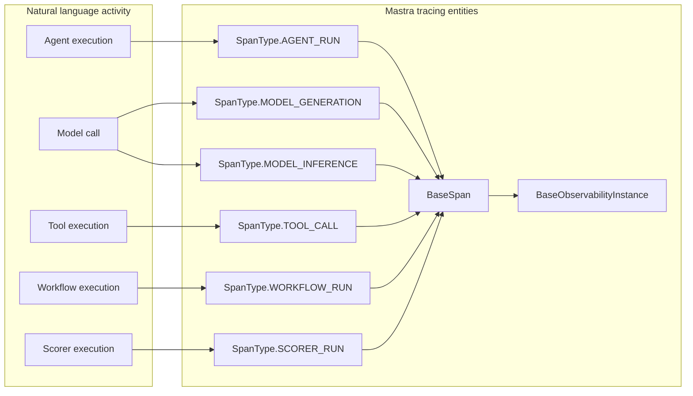
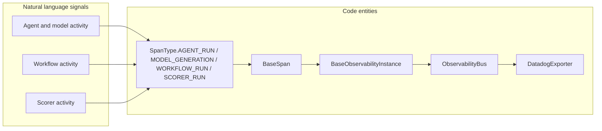

<!-- source: DeepWiki mcp.deepwiki.com · repo mastra-ai/mastra · page 11 Observability and Evaluation · fetched 2026-10-27 -->

# Observability and Evaluation

Relevant source files

The following files were used as context for generating this wiki page:

- [docs/src/content/en/reference/observability/tracing/bridges/datadog.mdx](docs/src/content/en/reference/observability/tracing/bridges/datadog.mdx)
- [docs/src/content/en/reference/observability/tracing/exporters/datadog.mdx](docs/src/content/en/reference/observability/tracing/exporters/datadog.mdx)
- [docs/src/content/en/reference/observability/tracing/interfaces.mdx](docs/src/content/en/reference/observability/tracing/interfaces.mdx)
- [observability/datadog/src/bridge.test.ts](observability/datadog/src/bridge.test.ts)
- [observability/datadog/src/bridge.ts](observability/datadog/src/bridge.ts)
- [observability/datadog/src/index.ts](observability/datadog/src/index.ts)
- [observability/datadog/src/tracing.test.ts](observability/datadog/src/tracing.test.ts)
- [observability/datadog/src/tracing.ts](observability/datadog/src/tracing.ts)
- [observability/datadog/src/utils.test.ts](observability/datadog/src/utils.test.ts)
- [observability/datadog/src/utils.ts](observability/datadog/src/utils.ts)
- [observability/mastra/src/agent-terminal-tracing.test.ts](observability/mastra/src/agent-terminal-tracing.test.ts)
- [observability/mastra/src/instances/base.ts](observability/mastra/src/instances/base.ts)
- [observability/mastra/src/span-filtering.test.ts](observability/mastra/src/span-filtering.test.ts)
- [observability/mastra/src/spans/base.test.ts](observability/mastra/src/spans/base.test.ts)
- [observability/mastra/src/spans/base.ts](observability/mastra/src/spans/base.ts)
- [observability/mastra/src/spans/default.ts](observability/mastra/src/spans/default.ts)
- [observability/mastra/src/spans/end-tree.test.ts](observability/mastra/src/spans/end-tree.test.ts)
- [observability/mastra/src/spans/serialization.ts](observability/mastra/src/spans/serialization.ts)
- [observability/mastra/src/tracing.test.ts](observability/mastra/src/tracing.test.ts)
- [packages/core/src/agent/__tests__/resume-span-tracing.test.ts](packages/core/src/agent/__tests__/resume-span-tracing.test.ts)
- [packages/core/src/observability/types/tracing.ts](packages/core/src/observability/types/tracing.ts)

## Purpose and scope

Mastra’s observability and evaluation area provides a way to represent runtime activity as typed spans and route observability signals to exporters and bridges. This page introduces how tracing, integrations, and evaluation relate; implementation details are covered in the child pages. [packages/core/src/observability/types/tracing.ts:35-128](), [observability/mastra/src/instances/base.ts:83-159]()

Sources: [packages/core/src/observability/types/tracing.ts:35-128](), [observability/mastra/src/instances/base.ts:83-159]()

For details, see:

- [Observability System and Tracing](#11.1) — OpenTelemetry integration, trace and span IDs, observability endpoints, trace query storage, and telemetry configuration.
- [Observability Integration and Exporters](#11.2) — Vendor integrations, bridges, and custom telemetry.
- [Evaluation System and Scorers](#11.3) — `@mastra/evals`, prebuilt scorers, scorer utilities, and custom metrics.
- [Datasets and Experiments](#11.4) — Evaluation datasets, experiments, result comparison, and failure clustering.

Sources: [packages/core/src/observability/types/tracing.ts:35-128]()

---

## Observability system overview

The observability model uses `SpanType` to classify runtime operations, including agent runs, model activity, tool calls, workflow execution, memory operations, RAG work, and scorer execution. A span carries identifiers and other execution data; child spans can represent work nested beneath a parent. [packages/core/src/observability/types/tracing.ts:35-128](), [observability/mastra/src/spans/base.ts:131-170]()

`BaseObservabilityInstance` holds configuration, initializes an `ObservabilityBus`, registers configured exporters, and registers an optional bridge. For lifecycle and configuration details, see [Observability System and Tracing](#11.1); for backend integrations, see [Observability Integration and Exporters](#11.2). [observability/mastra/src/instances/base.ts:83-159]()

Sources: [packages/core/src/observability/types/tracing.ts:35-128](), [observability/mastra/src/instances/base.ts:83-159](), [observability/mastra/src/spans/base.ts:131-170]()

### Span coverage

| Runtime area | Representative span types |
| --- | --- |
| Agent and evaluation | `AGENT_RUN`, `SCORER_RUN`, `SCORER_STEP`, `CLASSIFIER_EVALUATION` |
| Model | `MODEL_GENERATION`, `MODEL_STEP`, `MODEL_INFERENCE`, `MODEL_CHUNK` |
| Tools and processors | `TOOL_CALL`, `CLIENT_TOOL_CALL`, `MCP_TOOL_CALL`, `PROCESSOR_RUN` |
| Workflow | `WORKFLOW_RUN`, `WORKFLOW_STEP`, `WORKFLOW_LOOP`, `WORKFLOW_WAIT_EVENT` |
| Memory and retrieval | `MEMORY_OPERATION`, `RAG_INGESTION`, `RAG_EMBEDDING`, `RAG_VECTOR_OPERATION` |
| Other runtime activity | `WORKSPACE_ACTION`, `SKILL_ACTION`, `AGENT_SIGNAL`, `GENERIC` |

The enum includes additional span types; consult its definition for the full list. [packages/core/src/observability/types/tracing.ts:35-128]()

Sources: [packages/core/src/observability/types/tracing.ts:35-128]()

### From runtime activity to tracing entities

This diagram connects common descriptions of runtime activity to identifiers used in Mastra’s tracing code. The diagram shows span types and tracing classes, not every runtime call site that creates those spans. [packages/core/src/observability/types/tracing.ts:35-128](), [observability/mastra/src/instances/base.ts:83-159](), [observability/mastra/src/spans/base.ts:131-170]()

Sources: [packages/core/src/observability/types/tracing.ts:35-128](), [observability/mastra/src/instances/base.ts:83-159](), [observability/mastra/src/spans/base.ts:131-170]()

---

## Integrations and exporters

The observability instance provides the routing layer for exporters and an optional bridge. This separates Mastra’s span model from the systems that receive observability data. The child page on integrations and exporters covers supported vendors and custom telemetry; the parent overview does not prescribe a particular backend. [observability/mastra/src/instances/base.ts:83-159]()

For a concrete example, `DatadogExporter` extends `BaseExporter` and maps Mastra span types to Datadog span kinds. See [Observability Integration and Exporters](#11.2) for this and other integrations. [observability/datadog/src/tracing.ts:15-30](), [observability/datadog/src/utils.ts:24-83]()

Sources: [observability/mastra/src/instances/base.ts:83-159](), [observability/datadog/src/tracing.ts:15-30](), [observability/datadog/src/utils.ts:24-83]()

### From runtime signals to an exporter

This diagram maps the general flow from runtime activity to code entities. `ObservabilityBus` is initialized by `BaseObservabilityInstance`, which registers configured exporters; the Datadog example is one exporter implementation. [observability/mastra/src/instances/base.ts:83-159](), [observability/datadog/src/tracing.ts:15-30]()

Sources: [packages/core/src/observability/types/tracing.ts:35-128](), [observability/mastra/src/instances/base.ts:83-159](), [observability/mastra/src/spans/base.ts:131-170](), [observability/datadog/src/tracing.ts:15-30]()

---

## Evaluation and experiments

Tracing defines span types for scorer execution and classifier evaluation, so evaluation activity can be represented alongside agent, model, and workflow activity. The evaluation system and dataset/experiment APIs are documented separately; see [Evaluation System and Scorers](#11.3) and [Datasets and Experiments](#11.4) for their details. [packages/core/src/observability/types/tracing.ts:35-45]()

Sources: [packages/core/src/observability/types/tracing.ts:35-45]()

---

## Child pages

### 11.1 [Observability System and Tracing](#11.1)

OpenTelemetry integration, trace and span IDs, observability endpoints, trace query storage, and telemetry configuration.

### 11.2 [Observability Integration and Exporters](#11.2)

Vendor integrations, bridges, exporter configuration, and custom telemetry.

### 11.3 [Evaluation System and Scorers](#11.3)

`@mastra/evals`, scorer implementations and utilities, experiment gates, and custom metrics.

### 11.4 [Datasets and Experiments](#11.4)

Evaluation datasets, running experiments, comparing results, and clustering failures.

Sources: [packages/core/src/observability/types/tracing.ts:35-45](), [observability/mastra/src/instances/base.ts:83-159]()

---

