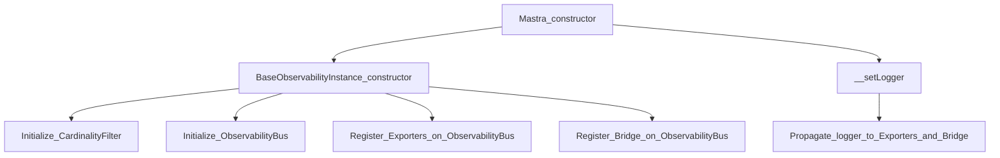
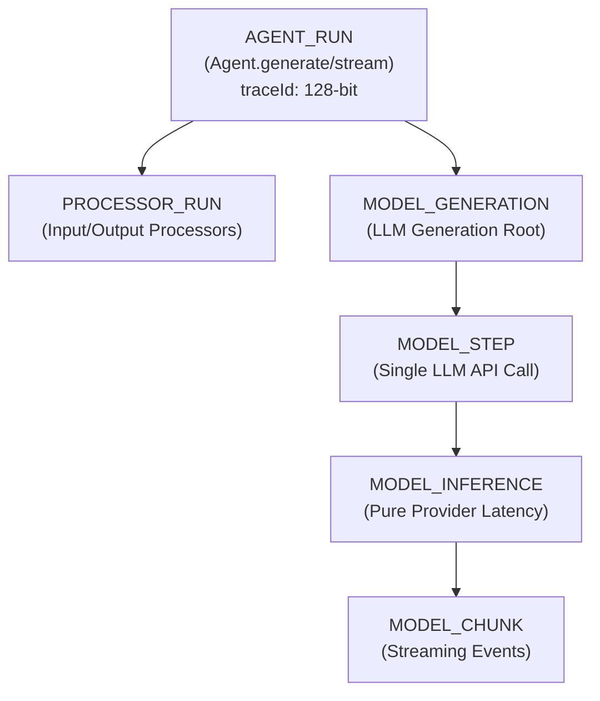
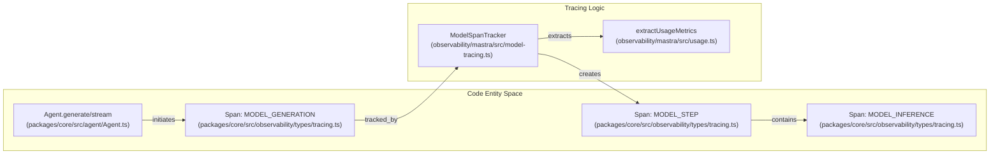
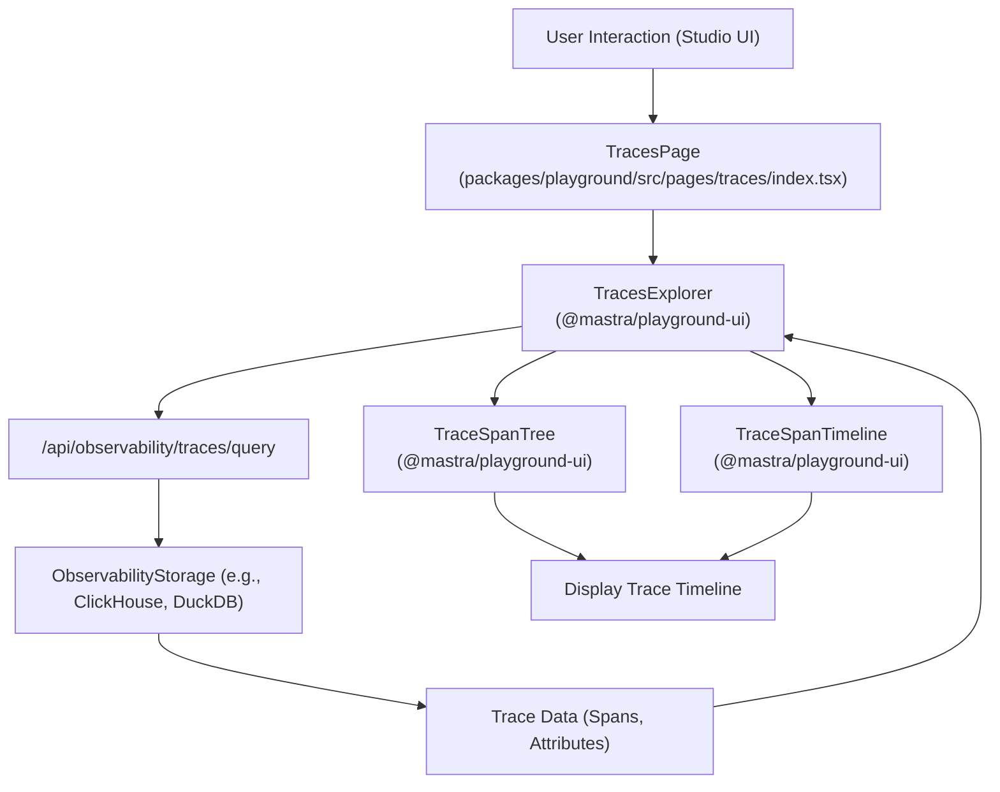
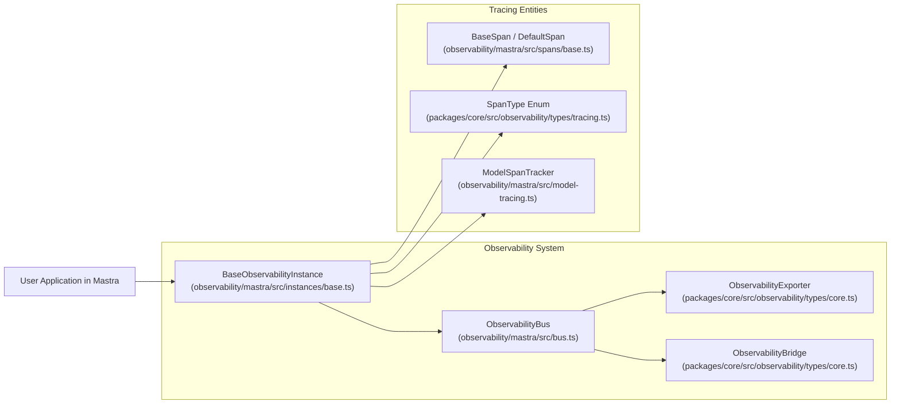
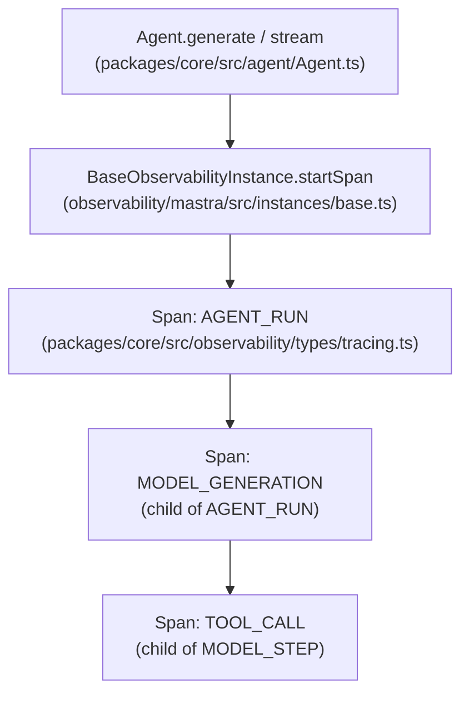

<!-- source: DeepWiki mcp.deepwiki.com · repo mastra-ai/mastra · page 11.1 Observability System and Tracing · fetched 2026-10-27 -->

# Observability System and Tracing

<details>
<summary>Relevant source files</summary>

The following files were used as context for generating this wiki page:

- [.changeset/clickhouse-span-aggregate.md](.changeset/clickhouse-span-aggregate.md)
- [.changeset/duckdb-span-aggregate.md](.changeset/duckdb-span-aggregate.md)
- [.changeset/fine-rivers-ring.md](.changeset/fine-rivers-ring.md)
- [.changeset/pg-span-aggregate.md](.changeset/pg-span-aggregate.md)
- [.changeset/wicked-suits-draw.md](.changeset/wicked-suits-draw.md)
- [client-sdks/react/src/hooks/capabilities/__tests__/fixtures/observability-capabilities.ts](client-sdks/react/src/hooks/capabilities/__tests__/fixtures/observability-capabilities.ts)
- [client-sdks/react/src/hooks/capabilities/index.ts](client-sdks/react/src/hooks/capabilities/index.ts)
- [docs/src/content/en/docs/auth/composite-auth.mdx](docs/src/content/en/docs/auth/composite-auth.mdx)
- [docs/src/content/en/docs/auth/custom-auth-provider.mdx](docs/src/content/en/docs/auth/custom-auth-provider.mdx)
- [docs/src/content/en/docs/auth/jwt.mdx](docs/src/content/en/docs/auth/jwt.mdx)
- [docs/src/content/en/docs/auth/overview.mdx](docs/src/content/en/docs/auth/overview.mdx)
- [docs/src/content/en/docs/auth/simple-auth.mdx](docs/src/content/en/docs/auth/simple-auth.mdx)
- [docs/src/content/en/docs/browser.mdx](docs/src/content/en/docs/browser.mdx)
- [docs/src/content/en/docs/deployment/web-framework.mdx](docs/src/content/en/docs/deployment/web-framework.mdx)
- [docs/src/content/en/docs/mastra-platform/api.mdx](docs/src/content/en/docs/mastra-platform/api.mdx)
- [docs/src/content/en/docs/mastra-platform/observability.mdx](docs/src/content/en/docs/mastra-platform/observability.mdx)
- [docs/src/content/en/docs/observability/feedback.mdx](docs/src/content/en/docs/observability/feedback.mdx)
- [docs/src/content/en/docs/observability/integrations/exporters/mastra-storage.mdx](docs/src/content/en/docs/observability/integrations/exporters/mastra-storage.mdx)
- [docs/src/content/en/docs/observability/overview.mdx](docs/src/content/en/docs/observability/overview.mdx)
- [docs/src/content/en/docs/observability/tracing/overview.mdx](docs/src/content/en/docs/observability/tracing/overview.mdx)
- [docs/src/content/en/docs/studio/observability.mdx](docs/src/content/en/docs/studio/observability.mdx)
- [docs/src/content/en/docs/studio/overview.mdx](docs/src/content/en/docs/studio/overview.mdx)
- [docs/src/content/en/integrations/databases/clickhouse.mdx](docs/src/content/en/integrations/databases/clickhouse.mdx)
- [docs/src/content/en/reference/agents/createSkill.mdx](docs/src/content/en/reference/agents/createSkill.mdx)
- [docs/src/content/en/reference/agents/getModel.mdx](docs/src/content/en/reference/agents/getModel.mdx)
- [docs/src/content/en/reference/agents/getSkill.mdx](docs/src/content/en/reference/agents/getSkill.mdx)
- [docs/src/content/en/reference/agents/listSkills.mdx](docs/src/content/en/reference/agents/listSkills.mdx)
- [docs/src/content/en/reference/client-js/observability.mdx](docs/src/content/en/reference/client-js/observability.mdx)
- [docs/src/content/en/reference/editor/processor-provider.mdx](docs/src/content/en/reference/editor/processor-provider.mdx)
- [docs/src/content/en/reference/memory/deleteMessages.mdx](docs/src/content/en/reference/memory/deleteMessages.mdx)
- [docs/src/content/en/reference/migrations/upgrade-to-v1/memory.mdx](docs/src/content/en/reference/migrations/upgrade-to-v1/memory.mdx)
- [docs/src/content/en/reference/observability/feedback.mdx](docs/src/content/en/reference/observability/feedback.mdx)
- [docs/src/content/en/reference/observability/tracing/advanced-queries.mdx](docs/src/content/en/reference/observability/tracing/advanced-queries.mdx)
- [docs/src/content/en/reference/observability/tracing/bridges/datadog.mdx](docs/src/content/en/reference/observability/tracing/bridges/datadog.mdx)
- [docs/src/content/en/reference/observability/tracing/exporters/datadog.mdx](docs/src/content/en/reference/observability/tracing/exporters/datadog.mdx)
- [docs/src/content/en/reference/observability/tracing/interfaces.mdx](docs/src/content/en/reference/observability/tracing/interfaces.mdx)
- [observability/datadog/src/bridge.test.ts](observability/datadog/src/bridge.test.ts)
- [observability/datadog/src/bridge.ts](observability/datadog/src/bridge.ts)
- [observability/datadog/src/index.ts](observability/datadog/src/index.ts)
- [observability/datadog/src/tracing.test.ts](observability/datadog/src/tracing.test.ts)
- [observability/datadog/src/tracing.ts](observability/datadog/src/tracing.ts)
- [observability/datadog/src/utils.test.ts](observability/datadog/src/utils.test.ts)
- [observability/datadog/src/utils.ts](observability/datadog/src/utils.ts)
- [observability/mastra/src/agent-terminal-tracing.test.ts](observability/mastra/src/agent-terminal-tracing.test.ts)
- [observability/mastra/src/instances/base.ts](observability/mastra/src/instances/base.ts)
- [observability/mastra/src/span-filtering.test.ts](observability/mastra/src/span-filtering.test.ts)
- [observability/mastra/src/spans/base.test.ts](observability/mastra/src/spans/base.test.ts)
- [observability/mastra/src/spans/base.ts](observability/mastra/src/spans/base.ts)
- [observability/mastra/src/spans/default.ts](observability/mastra/src/spans/default.ts)
- [observability/mastra/src/spans/end-tree.test.ts](observability/mastra/src/spans/end-tree.test.ts)
- [observability/mastra/src/spans/serialization.ts](observability/mastra/src/spans/serialization.ts)
- [observability/mastra/src/tracing.test.ts](observability/mastra/src/tracing.test.ts)
- [packages/core/src/agent/__tests__/resume-span-tracing.test.ts](packages/core/src/agent/__tests__/resume-span-tracing.test.ts)
- [packages/core/src/observability/types/tracing.ts](packages/core/src/observability/types/tracing.ts)
- [packages/core/src/storage/domains/observability/index.ts](packages/core/src/storage/domains/observability/index.ts)
- [packages/core/src/storage/domains/observability/trace-aggregate-planner.test-d.ts](packages/core/src/storage/domains/observability/trace-aggregate-planner.test-d.ts)
- [packages/core/src/storage/domains/observability/trace-aggregate-planner.test.ts](packages/core/src/storage/domains/observability/trace-aggregate-planner.test.ts)
- [packages/core/src/storage/domains/observability/trace-aggregate-planner.ts](packages/core/src/storage/domains/observability/trace-aggregate-planner.ts)
- [packages/core/src/storage/domains/observability/trace-aggregate-registry.test.ts](packages/core/src/storage/domains/observability/trace-aggregate-registry.test.ts)
- [packages/core/src/storage/domains/observability/trace-aggregate-registry.ts](packages/core/src/storage/domains/observability/trace-aggregate-registry.ts)
- [packages/playground-ui/src/domains/capabilities/index.ts](packages/playground-ui/src/domains/capabilities/index.ts)
- [packages/playground-ui/src/domains/traces/components/__tests__/span-data-panel-view.test.tsx](packages/playground-ui/src/domains/traces/components/__tests__/span-data-panel-view.test.tsx)
- [packages/playground-ui/src/domains/traces/components/__tests__/trace-data-panel-view.test.tsx](packages/playground-ui/src/domains/traces/components/__tests__/trace-data-panel-view.test.tsx)
- [packages/playground-ui/src/domains/traces/components/span-data-panel-view.tsx](packages/playground-ui/src/domains/traces/components/span-data-panel-view.tsx)
- [packages/playground-ui/src/domains/traces/components/span-details-view.tsx](packages/playground-ui/src/domains/traces/components/span-details-view.tsx)
- [packages/playground-ui/src/domains/traces/components/span-payload/__tests__/span-payload-renderers.test.tsx](packages/playground-ui/src/domains/traces/components/span-payload/__tests__/span-payload-renderers.test.tsx)
- [packages/playground-ui/src/domains/traces/components/span-payload/__tests__/span-payload-section.test.tsx](packages/playground-ui/src/domains/traces/components/span-payload/__tests__/span-payload-section.test.tsx)
- [packages/playground-ui/src/domains/traces/components/span-payload/span-input-renderers.tsx](packages/playground-ui/src/domains/traces/components/span-payload/span-input-renderers.tsx)
- [packages/playground-ui/src/domains/traces/components/span-payload/span-output-renderers.tsx](packages/playground-ui/src/domains/traces/components/span-payload/span-output-renderers.tsx)
- [packages/playground-ui/src/domains/traces/components/span-payload/span-payload-json.tsx](packages/playground-ui/src/domains/traces/components/span-payload/span-payload-json.tsx)
- [packages/playground-ui/src/domains/traces/components/span-payload/span-payload-section.tsx](packages/playground-ui/src/domains/traces/components/span-payload/span-payload-section.tsx)
- [packages/playground-ui/src/domains/traces/components/span-payload/span-payload.stories.tsx](packages/playground-ui/src/domains/traces/components/span-payload/span-payload.stories.tsx)
- [packages/playground-ui/src/domains/traces/components/span-payload/span-processor-attributes.tsx](packages/playground-ui/src/domains/traces/components/span-payload/span-processor-attributes.tsx)
- [packages/playground-ui/src/domains/traces/components/trace-data-panel-view.stories.tsx](packages/playground-ui/src/domains/traces/components/trace-data-panel-view.stories.tsx)
- [packages/playground-ui/src/domains/traces/components/trace-data-panel-view.tsx](packages/playground-ui/src/domains/traces/components/trace-data-panel-view.tsx)
- [packages/playground-ui/src/domains/traces/components/trace-details-view.tsx](packages/playground-ui/src/domains/traces/components/trace-details-view.tsx)
- [packages/playground-ui/src/domains/traces/components/trace-id-button.tsx](packages/playground-ui/src/domains/traces/components/trace-id-button.tsx)
- [packages/playground-ui/src/domains/traces/trace-filters.test.ts](packages/playground-ui/src/domains/traces/trace-filters.test.ts)
- [packages/playground-ui/src/domains/traces/trace-filters.ts](packages/playground-ui/src/domains/traces/trace-filters.ts)
- [packages/playground-ui/src/domains/traces/trace-query-filters.test.ts](packages/playground-ui/src/domains/traces/trace-query-filters.test.ts)
- [packages/playground-ui/src/domains/traces/trace-query-filters.ts](packages/playground-ui/src/domains/traces/trace-query-filters.ts)
- [packages/playground-ui/src/domains/traces/utils/span-utils.test.ts](packages/playground-ui/src/domains/traces/utils/span-utils.test.ts)
- [packages/playground-ui/src/domains/traces/utils/span-utils.ts](packages/playground-ui/src/domains/traces/utils/span-utils.ts)
- [packages/playground/src/domains/traces/components/trace-span-panel.tsx](packages/playground/src/domains/traces/components/trace-span-panel.tsx)
- [packages/playground/src/pages/traces/__tests__/fixtures/trace-query.ts](packages/playground/src/pages/traces/__tests__/fixtures/trace-query.ts)
- [packages/playground/src/pages/traces/__tests__/index.msw.test.tsx](packages/playground/src/pages/traces/__tests__/index.msw.test.tsx)
- [packages/playground/src/pages/traces/index.tsx](packages/playground/src/pages/traces/index.tsx)
- [stores/_test-utils/src/domains/observability-vnext/span-aggregate.ts](stores/_test-utils/src/domains/observability-vnext/span-aggregate.ts)
- [stores/_test-utils/src/domains/observability-vnext/trace-aggregate.test.ts](stores/_test-utils/src/domains/observability-vnext/trace-aggregate.test.ts)
- [stores/_test-utils/src/domains/observability-vnext/trace-aggregate.ts](stores/_test-utils/src/domains/observability-vnext/trace-aggregate.ts)
- [stores/clickhouse/src/storage/domains/observability/v-next/span-query.ts](stores/clickhouse/src/storage/domains/observability/v-next/span-query.ts)
- [stores/clickhouse/src/storage/domains/observability/v-next/trace-aggregate.test.ts](stores/clickhouse/src/storage/domains/observability/v-next/trace-aggregate.test.ts)
- [stores/clickhouse/src/storage/domains/observability/v-next/trace-aggregate.ts](stores/clickhouse/src/storage/domains/observability/v-next/trace-aggregate.ts)
- [stores/duckdb/src/storage/domains/observability/trace-aggregate.test.ts](stores/duckdb/src/storage/domains/observability/trace-aggregate.test.ts)
- [stores/duckdb/src/storage/domains/observability/trace-aggregate.ts](stores/duckdb/src/storage/domains/observability/trace-aggregate.ts)
- [stores/pg/src/storage/domains/observability/v-next/trace-aggregate.test.ts](stores/pg/src/storage/domains/observability/v-next/trace-aggregate.test.ts)
- [stores/pg/src/storage/domains/observability/v-next/trace-aggregate.ts](stores/pg/src/storage/domains/observability/v-next/trace-aggregate.ts)

</details>


The observability system in Mastra provides comprehensive distributed tracing and telemetry across agent executions, LLM calls, tool invocations, and workflow runs. It is built following OpenTelemetry standards, capturing hierarchical execution paths via spans grouped into traces. This allows detailed inspection of the full execution lifecycle, including token usage, latency, errors, and cost estimates. The system enables debugging, performance tuning, and integration with third-party monitoring tools. [packages/core/src/observability/types/tracing.ts:1-7](), [observability/mastra/src/spans/base.ts:117-145]()

---

## Key System Components

- **Trace and Span Collection**: Records operations as spans organized into traces identified with 128-bit trace IDs and 64-bit span IDs. [observability/mastra/src/tracing.test.ts:19-51](), [observability/mastra/src/spans/base.ts:119-121]()
- **Unified ObservabilityBus**: An internal event bus routes tracing, logs, metrics, scores, and feedback to registered exporters. [observability/mastra/src/instances/base.ts:88-91](), [observability/mastra/src/instances/base.ts:134-137]()
- **Exporters and Bridges**: Pluggable backends for persistence in storage systems (PostgreSQL, LibSQL, ClickHouse, DuckDB) and third-party observability vendors. [observability/mastra/src/instances/base.ts:139-151](), [stores/clickhouse/src/storage/domains/observability/v-next/index.ts:1-8]()

Sources: [observability/mastra/src/instances/base.ts:88-91](), [observability/mastra/src/instances/base.ts:134-137](), [observability/mastra/src/instances/base.ts:139-151](), [packages/core/src/observability/types/tracing.ts:1-7](), [observability/mastra/src/spans/base.ts:117-145](), [observability/mastra/src/tracing.test.ts:19-51](), [observability/mastra/src/spans/base.ts:119-121](), [stores/clickhouse/src/storage/domains/observability/v-next/index.ts:1-8]()

---

## Configuration and Setup

Observability is configured by initializing an `ObservabilityInstance` (usually a subclass named `DefaultObservabilityInstance`). The instance holds an `ObservabilityInstanceConfig` object that specifies the service name, sampling strategy, exporters, and other settings. The configured instance is passed as the `observability` property in the main `Mastra` class constructor. [observability/mastra/src/instances/base.ts:112-130]()

### Example Mastra Initialization with Observability

```ts title="src/mastra/index.ts"
import { Mastra } from '@mastra/core/mastra'
import { Observability, MastraStorageExporter } from '@mastra/observability'

export const mastra = new Mastra({
  observability: new Observability({
    configs: {
      default: {
        serviceName: 'my-service',
        exporters: [new MastraStorageExporter()],
        requestContextKeys: ['userId', 'tenantId'], // Auto-extract from RequestContext
      },
    },
  }),
})
```

The `Observability` class manages initialization workflows, event bus registration, exporting logic, and sampling decisions. It also configures a `CardinalityFilter` for metrics label cardinality control. [observability/mastra/src/instances/base.ts:84-152](), [observability/mastra/src/instances/base.ts:131-132]()

### Observability Initialization Flow

Title: Observability Initialization Sequence

Sources: [observability/mastra/src/instances/base.ts:84-152](), [observability/mastra/src/instances/base.ts:158-177]()

---

## Core Concepts

### Trace and Span Model

Mastra implements a hierarchical span model for representing the execution of AI applications:

- **Root spans**: No parent span; sampling decision is made here using the configured strategy. [observability/mastra/src/instances/base.ts:198-200]()
- **Child spans**: Inherit their parent’s trace ID and sampling decision. If a parent is not sampled (`NoOpSpan`), children are also not sampled. [observability/mastra/src/instances/base.ts:202-205]()
- **Span IDs**: 64-bit hex string (16 characters). [observability/mastra/src/tracing.test.ts:19-21]()
- **Trace IDs**: 128-bit hex string (32 characters). [observability/mastra/src/tracing.test.ts:36-38]()

Sources: [docs/src/content/en/docs/observability/tracing/overview.mdx:8-12](), [observability/mastra/src/instances/base.ts:192-205](), [observability/mastra/src/tracing.test.ts:19-21](), [observability/mastra/src/tracing.test.ts:36-38]()

### AI Execution Hierarchy

Mastra tracks the execution of AI tasks through specialized span types that isolate model inference from framework overhead.

Title: Typical Agent Execution Span Tree

Sources: [packages/core/src/observability/types/tracing.ts:35-111](), [observability/mastra/src/model-tracing.ts:1-13]()

---

### Span Types

The `SpanType` enumeration defines the categories of traced operations throughout Mastra:

| SpanType | Description | Code Pointer |
|---|---|---|
| `AGENT_RUN` | Root span for agent processes | [packages/core/src/observability/types/tracing.ts:37]() |
| `SCORER_RUN` | Scorer execution | [packages/core/src/observability/types/tracing.ts:39]() |
| `CLASSIFIER_EVALUATION` | Classifier evaluation | [packages/core/src/observability/types/tracing.ts:41]() |
| `SCORER_STEP` | Individual scorer pipeline step | [packages/core/src/observability/types/tracing.ts:43]() |
| `GENERIC` | Generic span for custom operations | [packages/core/src/observability/types/tracing.ts:45]() |
| `MODEL_GENERATION` | Model generation with model calls, token usage, prompts, completions | [packages/core/src/observability/types/tracing.ts:47]() |
| `MODEL_STEP` | Single model execution step within a generation (one API call) | [packages/core/src/observability/types/tracing.ts:49]() |
| `MODEL_INFERENCE` | Model provider call within a step - wraps only the inference, excluding processors and tool executions | [packages/core/src/observability/types/tracing.ts:51]() |
| `MODEL_CHUNK` | Individual model streaming chunk/event | [packages/core/src/observability/types/tracing.ts:54]() |
| `MCP_TOOL_CALL` | MCP (Model Context Protocol) tool execution | [packages/core/src/observability/types/tracing.ts:56]() |
| `MCP_SERVER_REQUEST` | A request served by a Mastra MCPServer (the server side of an MCP edge) | [packages/core/src/observability/types/tracing.ts:58]() |
| `PROCESSOR_RUN` | Input or Output Processor execution | [packages/core/src/observability/types/tracing.ts:60]() |
| `TOOL_CALL` | Function/tool execution with inputs, outputs, errors | [packages/core/src/observability/types/tracing.ts:62]() |
| `CLIENT_TOOL_CALL` | Client-side tool execution marker | [packages/core/src/observability/types/tracing.ts:72]() |
| `PROVIDER_TOOL_CALL` | Provider-executed (server-side) tool span | [packages/core/src/observability/types/tracing.ts:80]() |
| `WORKFLOW_RUN` | Root span for workflow processes | [packages/core/src/observability/types/tracing.ts:83]() |
| `WORKFLOW_STEP` | Workflow step execution with step status, data flow | [packages/core/src/observability/types/tracing.ts:85]() |
| `WORKFLOW_CONDITIONAL` | Workflow conditional execution with condition evaluation | [packages/core/src/observability/types/tracing.ts:87]() |
| `WORKFLOW_CONDITIONAL_EVAL` | Individual condition evaluation within conditional | [packages/core/src/observability/types/tracing.ts:89]() |
| `WORKFLOW_PARALLEL` | Workflow parallel execution | [packages/core/src/observability/types/tracing.ts:91]() |
| `WORKFLOW_LOOP` | Workflow loop execution | [packages/core/src/observability/types/tracing.ts:93]() |
| `WORKFLOW_SLEEP` | Workflow sleep operation | [packages/core/src/observability/types/tracing.ts:95]() |
| `WORKFLOW_WAIT_EVENT` | Workflow wait for event operation | [packages/core/src/observability/types/tracing.ts:97]() |
| `MEMORY_OPERATION` | Memory operation (recall, save, delete, update working memory) | [packages/core/src/observability/types/tracing.ts:99]() |
| `WORKSPACE_ACTION` | Workspace action (filesystem, sandbox, search, skill, mount operations) | [packages/core/src/observability/types/tracing.ts:101]() |
| `RAG_INGESTION` | RAG ingestion - root span for an ingestion pipeline run | [packages/core/src/observability/types/tracing.ts:103]() |
| `RAG_EMBEDDING` | Embedding call (used by both RAG ingestion and query) | [packages/core/src/observability/types/tracing.ts:105]() |
| `RAG_VECTOR_OPERATION` | Vector store I/O (query / upsert / delete / fetch) | [packages/core/src/observability/types/tracing.ts:107]() |
| `RAG_ACTION` | RAG-specific actions: chunk, extract_metadata, rerank | [packages/core/src/observability/types/tracing.ts:109]() |
| `GRAPH_ACTION` | Graph operations (build / traverse) - not RAG-specific | [packages/core/src/observability/types/tracing.ts:111]() |
| `MAPPING` | Inline data mapping between pipeline stages | [packages/core/src/observability/types/tracing.ts:113]() |
| `SKILL_RESOLUTION` | Dynamic agent skills resolver run (deprecated) | [packages/core/src/observability/types/tracing.ts:120]() |
| `SKILL_ACTION` | Any skill lifecycle operation: resolve, inject, activate, search, read | [packages/core/src/observability/types/tracing.ts:122]() |
| `AGENT_SIGNAL` | An agent state signal emitted onto the model context | [packages/core/src/observability/types/tracing.ts:127]() |

Sources: [packages/core/src/observability/types/tracing.ts:35-128]()

---

### Entity Identification In Traces

Spans can be associated with an `entityType`, `entityId`, and `entityName` to identify which specific agent, workflow, or tool generated the span. [observability/mastra/src/spans/base.ts:147-152]()

- **Exclusion Logic**: Spans can be marked as `isExcluded` if they are internal or filtered by configuration. This avoids the overhead of serialization for spans that will never reach an exporter. [observability/mastra/src/spans/base.ts:176-186]()
- **External Parent Resolution**: When exporting to external systems, Mastra can resolve the closest "exported" ancestor if the immediate parent is internal or excluded via `getExternalParentId`. [observability/mastra/src/spans/base.ts:105-116]()

Sources: [observability/mastra/src/spans/base.ts:105-116](), [observability/mastra/src/spans/base.ts:147-152](), [observability/mastra/src/spans/base.ts:176-186]()

---

## Sampling Strategies

Mastra supports four sampling strategies to balance observability needs with resource costs:

| Sampling Strategy | Description | Configuration Example |
|---|---|---|
| **Always Sample** | Collects 100% of traces. Best for development. | `{ type: 'always' }` |
| **Never Sample** | Disables tracing entirely. | `{ type: 'never' }` |
| **Ratio-Based** | Randomly samples a percentage of traces (e.g., 0.1 for 10%). | `{ type: 'ratio', probability: 0.1 }` |
| **Custom** | Implements custom logic based on request context or metadata. | `{ type: 'custom', sampler: (options) => ... }` |

Sources: [docs/src/content/en/docs/observability/tracing/overview.mdx:60-102](), [observability/mastra/src/instances/base.ts:119]()

---

## Span Lifecycle and Serialization

### Serialization and Data Sanitization

To prevent telemetry bloat and memory issues, Mastra enforces strict serialization boundaries using `deepClean`:

- **Max Depth**: 8 levels. [observability/mastra/src/spans/serialization.ts:42]()
- **Max String Length**: 128 KB (sufficient for large LLM prompts/responses). [observability/mastra/src/spans/serialization.ts:43-45]()
- **Max Keys/Items**: 50 per object/array. [observability/mastra/src/spans/serialization.ts:46-47]()
- **Filtered Keys**: Internal keys like `tracingContext`, `execute`, `validate`, and `logger` are stripped to avoid circular references and function serialization. [observability/mastra/src/spans/serialization.ts:183-197]()

### Custom Object Serialization

Classes can implement `serializeForSpan()` to provide a clean representation for tracing, ensuring sensitive or non-serializable data is not exported. [observability/mastra/src/spans/serialization.ts:10-27]()

Sources: [observability/mastra/src/spans/serialization.ts:10-27](), [observability/mastra/src/spans/serialization.ts:42-47](), [observability/mastra/src/spans/serialization.ts:183-197]()

---

## Model Tracing and Token Usage Metrics

The `ModelSpanTracker` manages the complex hierarchy of model-related spans, ensuring that pure inference time is isolated from processor or tool execution time. [observability/mastra/src/model-tracing.ts:1-13]()

- **Hierarchy**: `MODEL_GENERATION` -> `MODEL_STEP` -> `MODEL_INFERENCE` -> `MODEL_CHUNK`. [observability/mastra/src/model-tracing.ts:9]()
- **Token Metrics**: Usage is extracted and emitted as metrics, including detailed breakdowns for cache hits, audio, and reasoning tokens. [packages/core/src/observability/types/tracing.ts:189-205](), [observability/mastra/src/metrics/auto-extract.ts:40-41]()
- **Cost Estimation**: The system parses gateway cost metadata (e.g., from Vercel AI Gateway) to provide estimated cost in USD. [observability/mastra/src/model-tracing.ts:45-91]()

Title: Model Tracing Data Flow

Sources: [observability/mastra/src/model-tracing.ts:1-13](), [observability/mastra/src/model-tracing.ts:45-91](), [observability/mastra/src/metrics/auto-extract.ts:40-41](), [packages/core/src/observability/types/tracing.ts:189-205]()

---

## Storage and Persistence

Mastra supports multiple storage backends for observability data, utilizing the `ObservabilityStorage` abstraction. [packages/core/src/storage/domains/observability/base.ts:6]()

### ClickHouse Integration
The ClickHouse provider uses a `ReplacingMergeTree` engine for signal tables (spans, logs, metrics) to ensure retry-idempotency via dedupe keys. [stores/clickhouse/src/storage/domains/observability/v-next/index.ts:1-5]()

### DuckDB Integration
The DuckDB provider implements an event-sourced tracing strategy, supporting local development and in-memory testing. [stores/duckdb/src/storage/domains/observability/index.ts:97-102]()

### Trace Query Storage
The `ObservabilityStorage` interface provides methods for querying traces, spans, and related data. Implementations like `ObservabilityStorageDuckDB` and `ObservabilityStorageClickhouseVNext` provide concrete storage for these queries.
The `planTraceQuery` function in `@mastra/core/storage` is responsible for generating a trusted query plan based on the input request, which is then executed by the storage provider. [packages/core/src/storage/domains/observability/trace-query.ts:1-10](), [stores/duckdb/src/storage/domains/observability/index.test.ts:7]()

The `ObservabilityStorageDuckDB` uses `arg_max(field, timestamp) FILTER (WHERE field IS NOT NULL)` to reconstruct span fields, ensuring that the latest non-null value is used, which is crucial for event-sourced tracing. [stores/duckdb/src/storage/domains/observability/tracing.ts:89-91]()

Sources: [packages/core/src/storage/domains/observability/base.ts:6](), [packages/core/src/storage/domains/observability/trace-query.ts:1-10](), [stores/clickhouse/src/storage/domains/observability/v-next/index.ts:1-5](), [stores/duckdb/src/storage/domains/observability/index.test.ts:7](), [stores/duckdb/src/storage/domains/observability/index.ts:97-102](), [stores/duckdb/src/storage/domains/observability/tracing.ts:89-91]()

---

## Observability API Endpoints

Mastra exposes API endpoints for interacting with the observability system, allowing users to list and query traces. For example, the CLI command `npx mastra api trace list` can be used to inspect recent traces. These endpoints leverage the underlying `ObservabilityStorage` implementations to retrieve and filter trace data. [docs/src/content/en/docs/observability/tracing/overview.mdx:15-16]()

The `parseTraceQueryRequest` function is used to validate and parse incoming trace query requests, ensuring they conform to the expected schema. [packages/core/src/storage/domains/observability/trace-query.ts:1-10]()

The Mastra Studio UI provides a dedicated Traces page (`packages/playground/src/pages/traces/index.tsx`) for exploring traces. This page uses `TracesExplorer` from `@mastra/playground-ui` to display trace lists, span trees, and timelines. It supports filtering by various properties like `threadId`, `entityId`, and `entityType`. [packages/playground/src/pages/traces/index.tsx:2-3](), [packages/playground/src/pages/traces/index.tsx:46-55]()

Title: Trace Data Flow in Studio UI

Sources: [docs/src/content/en/docs/observability/tracing/overview.mdx:15-16](), [packages/core/src/storage/domains/observability/trace-query.ts:1-10](), [packages/playground/src/pages/traces/index.tsx:2-3](), [packages/playground/src/pages/traces/index.tsx:46-55]()

---

## Summary Diagrams Bridging Natural Language to Code Entities

### 1. Observability System Core Architecture

Title: System Component Interaction

Sources: [observability/mastra/src/instances/base.ts:84-152](), [observability/mastra/src/spans/base.ts:117-145](), [packages/core/src/observability/types/tracing.ts:35-128](), [observability/mastra/src/model-tracing.ts:1-13]()

### 2. Execution Flow: Agent to Span Creation

Title: Agent Span Lifecycle

Sources: [observability/mastra/src/instances/base.ts:192-205](), [packages/core/src/observability/types/tracing.ts:35-111](), [observability/mastra/src/model-tracing.ts:1-13]()

---

