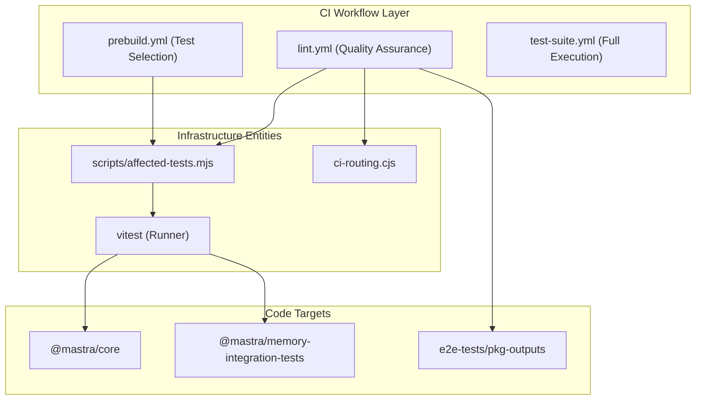
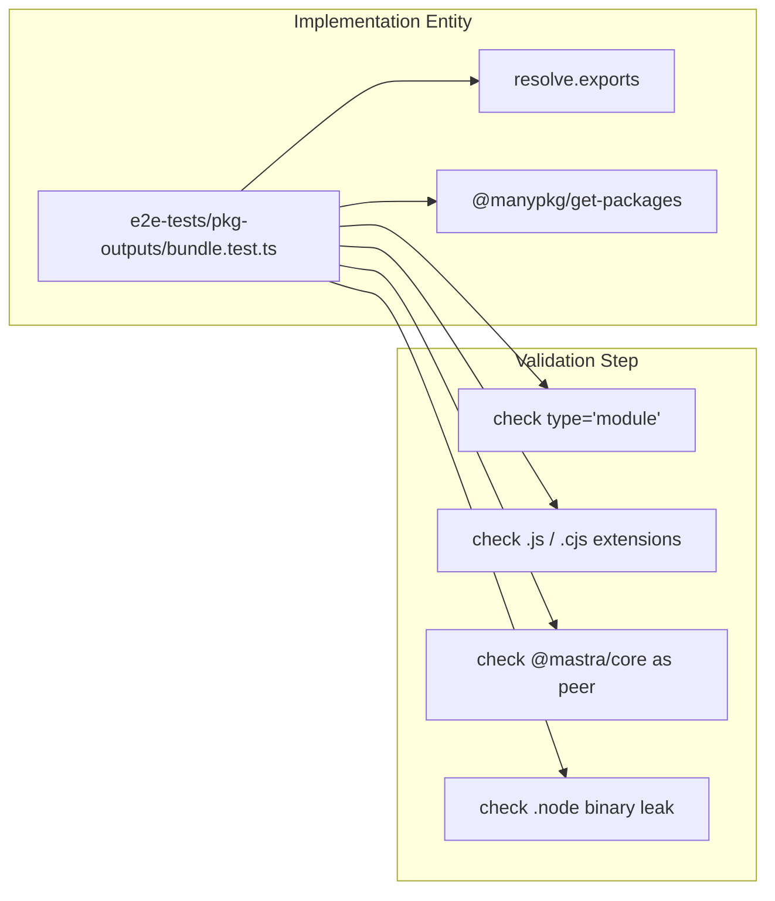

<!-- source: DeepWiki mcp.deepwiki.com · repo mastra-ai/mastra · page 12.2 Testing Infrastructure · fetched 2026-10-27 -->

# Testing Infrastructure

Relevant source files

The following files were used as context for generating this wiki page:

- [e2e-tests/commonjs/package.json](e2e-tests/commonjs/package.json)
- [e2e-tests/commonjs/pnpm-lock.yaml](e2e-tests/commonjs/pnpm-lock.yaml)
- [e2e-tests/commonjs/pnpm-workspace.yaml](e2e-tests/commonjs/pnpm-workspace.yaml)
- [e2e-tests/create-mastra/package.json](e2e-tests/create-mastra/package.json)
- [e2e-tests/create-mastra/pnpm-lock.yaml](e2e-tests/create-mastra/pnpm-lock.yaml)
- [e2e-tests/create-mastra/pnpm-workspace.yaml](e2e-tests/create-mastra/pnpm-workspace.yaml)
- [e2e-tests/deployers/package.json](e2e-tests/deployers/package.json)
- [e2e-tests/deployers/pnpm-lock.yaml](e2e-tests/deployers/pnpm-lock.yaml)
- [e2e-tests/deployers/pnpm-workspace.yaml](e2e-tests/deployers/pnpm-workspace.yaml)
- [e2e-tests/monorepo/monorepo.test.ts](e2e-tests/monorepo/monorepo.test.ts)
- [e2e-tests/monorepo/package.json](e2e-tests/monorepo/package.json)
- [e2e-tests/monorepo/pnpm-lock.yaml](e2e-tests/monorepo/pnpm-lock.yaml)
- [e2e-tests/monorepo/pnpm-workspace.yaml](e2e-tests/monorepo/pnpm-workspace.yaml)
- [e2e-tests/monorepo/template/apps/custom/package.json](e2e-tests/monorepo/template/apps/custom/package.json)
- [e2e-tests/monorepo/template/apps/custom/src/mastra/index.ts](e2e-tests/monorepo/template/apps/custom/src/mastra/index.ts)
- [e2e-tests/monorepo/template/packages/versionless-dependent/package.json](e2e-tests/monorepo/template/packages/versionless-dependent/package.json)
- [e2e-tests/monorepo/template/packages/versionless-dependent/src/index.ts](e2e-tests/monorepo/template/packages/versionless-dependent/src/index.ts)
- [e2e-tests/no-bundling/package.json](e2e-tests/no-bundling/package.json)
- [e2e-tests/no-bundling/pnpm-lock.yaml](e2e-tests/no-bundling/pnpm-lock.yaml)
- [e2e-tests/no-bundling/pnpm-workspace.yaml](e2e-tests/no-bundling/pnpm-workspace.yaml)
- [e2e-tests/type-check/package.json](e2e-tests/type-check/package.json)
- [e2e-tests/type-check/pnpm-lock.yaml](e2e-tests/type-check/pnpm-lock.yaml)
- [e2e-tests/workspace-tools/pnpm-lock.yaml](e2e-tests/workspace-tools/pnpm-lock.yaml)
- [e2e-tests/workspace-tools/pnpm-workspace.yaml](e2e-tests/workspace-tools/pnpm-workspace.yaml)
- [packages/cli/src/commands/build/BuildBundler.test.ts](packages/cli/src/commands/build/BuildBundler.test.ts)
- [packages/cli/src/commands/build/BuildBundler.ts](packages/cli/src/commands/build/BuildBundler.ts)
- [packages/cli/src/commands/build/build.ts](packages/cli/src/commands/build/build.ts)
- [packages/core/src/bundler/types.ts](packages/core/src/bundler/types.ts)
- [packages/deployer/src/build/analyze.test.ts](packages/deployer/src/build/analyze.test.ts)
- [packages/deployer/src/build/analyze.ts](packages/deployer/src/build/analyze.ts)
- [packages/deployer/src/build/analyze/analyzeEntry.test.ts](packages/deployer/src/build/analyze/analyzeEntry.test.ts)
- [packages/deployer/src/build/analyze/analyzeEntry.ts](packages/deployer/src/build/analyze/analyzeEntry.ts)
- [packages/deployer/src/build/analyze/bundleExternals.test.ts](packages/deployer/src/build/analyze/bundleExternals.test.ts)
- [packages/deployer/src/build/analyze/bundleExternals.ts](packages/deployer/src/build/analyze/bundleExternals.ts)
- [packages/deployer/src/build/analyze/externals.ts](packages/deployer/src/build/analyze/externals.ts)
- [packages/deployer/src/build/bundler.ts](packages/deployer/src/build/bundler.ts)
- [packages/deployer/src/build/plugins/node-modules-extension-resolver.test.ts](packages/deployer/src/build/plugins/node-modules-extension-resolver.test.ts)
- [packages/deployer/src/build/plugins/node-modules-extension-resolver.ts](packages/deployer/src/build/plugins/node-modules-extension-resolver.ts)
- [packages/deployer/src/build/plugins/tsconfig-paths.test.ts](packages/deployer/src/build/plugins/tsconfig-paths.test.ts)
- [packages/deployer/src/build/plugins/tsconfig-paths.ts](packages/deployer/src/build/plugins/tsconfig-paths.ts)
- [packages/deployer/src/build/types.ts](packages/deployer/src/build/types.ts)
- [packages/deployer/src/build/watcher.test.ts](packages/deployer/src/build/watcher.test.ts)
- [packages/deployer/src/build/watcher.ts](packages/deployer/src/build/watcher.ts)
- [packages/deployer/src/bundler/index.test.ts](packages/deployer/src/bundler/index.test.ts)
- [packages/deployer/src/bundler/index.ts](packages/deployer/src/bundler/index.ts)
- [packages/deployer/src/bundler/workspaceDependencies.test.ts](packages/deployer/src/bundler/workspaceDependencies.test.ts)
- [packages/deployer/src/bundler/workspaceDependencies.ts](packages/deployer/src/bundler/workspaceDependencies.ts)
- [packages/deployer/src/services/deps.test.ts](packages/deployer/src/services/deps.test.ts)
- [packages/deployer/src/services/deps.ts](packages/deployer/src/services/deps.ts)
- [scripts/gh-issue-triage/package-lock.json](scripts/gh-issue-triage/package-lock.json)
- [scripts/gh-issue-triage/package.json](scripts/gh-issue-triage/package.json)

## Purpose and Scope

The testing infrastructure in Mastra provides robust, end-to-end, integration, and unit testing capabilities across the entire monorepo. It ensures the quality, correctness, and compatibility of all Mastra subsystems, including agents, workflows, tools, storage adapters, and integration points. This page documents the Vitest configuration, test execution patterns, integration tests, and E2E test strategies employed in the Mastra ecosystem.

## Test Framework and CI Pipeline

Mastra standardizes on [Vitest](https://vitest.dev/) as its primary test runner [e2e-tests/monorepo/pnpm-lock.yaml:81](). The CI/CD pipeline is managed via GitHub Actions, using specialized workflows to gate releases and ensure code quality.

### CI Workflows and Gating
The framework utilizes a multi-stage validation process:
- **Quality Assurance**: The `lint.yml` workflow triggers on pull requests to run `pnpm lint` and `check-bundle` tasks [.github/workflows/lint.yml:1-87]().
- **Affected Test Detection**: The `prebuild.yml` workflow uses a custom script `scripts/affected-tests.mjs` to calculate which tests need to run based on the diff between the PR branch and `main` [.github/workflows/prebuild.yml:102-166]().
- **Build Validation**: Build outputs are validated by the `check-bundle` job, which ensures generated files are committed and bundles are free of leaks [.github/workflows/lint.yml:88-123]().

### Monorepo Test Scripts
Key test scripts in the root `package.json` target specific subsystems:

| Script | Targeted Subsystem | Command |
| :--- | :--- | :--- |
| `test` | Global Run | `vitest run` [package.json:70]() |
| `test:core` | Mastra Core | `pnpm --filter ./packages/core test` [package.json:78]() |
| `test:server` | Mastra Server | `pnpm --filter ./packages/server test` [package.json:76]() |
| `test:memory` | Memory System | `pnpm --filter ./packages/memory test` [package.json:83]() |
| `test:e2e:client-js` | Client JS E2E | `pnpm --filter "client-js-e2e-tests-*" test` [package.json:97]() |

Sources:
[package.json:70-97](), [.github/workflows/lint.yml:1-123](), [.github/workflows/prebuild.yml:102-180](), [scripts/affected-tests.mjs:1-20](), [e2e-tests/monorepo/pnpm-lock.yaml:81]()

---

## End-to-End (E2E) Testing

Mastra's E2E tests simulate real user scenarios by spinning up full app builds, starting dev servers, and exercising API endpoints.

### E2E Testing Categories
| Category | Purpose | Implementation Details |
| :--- | :--- | :--- |
| **Package Hygiene** | Validates package exports and binary leaks | Checks bundled outputs in `e2e-tests/pkg-outputs` [e2e-tests/pkg-outputs/bundle.test.ts:19-23]() |
| **Monorepo E2E** | Test internal package interdependencies | Uses local registry setup and `execa` for process management [e2e-tests/monorepo/monorepo.test.ts:8]() |
| **Studio E2E** | Validates the Playground/Studio UI | Uses Playwright-style specs for CMS agents [packages/playground/e2e/tests/cms/agents/create/page.spec.ts:1-10]() |

### Bundle Validation Logic
The `e2e-tests/pkg-outputs/bundle.test.ts` file performs critical checks:
1.  **Module Type**: Ensures `type="module"` is set in `package.json` [e2e-tests/pkg-outputs/bundle.test.ts:27-29]().
2.  **Extension Consistency**: Verifies that ESM exports use `.js` and `.d.ts` while CJS exports use `.cjs` [e2e-tests/pkg-outputs/bundle.test.ts:40-75]().
3.  **Dependency Leaks**: Ensures `@mastra/core` is a peer dependency rather than a direct dependency in specific packages [e2e-tests/pkg-outputs/bundle.test.ts:98-101]().

Sources:
[e2e-tests/pkg-outputs/bundle.test.ts:19-145](), [packages/playground/e2e/kitchen-sink/package.json:1-27](), [.github/workflows/lint.yml:113-123](), [e2e-tests/monorepo/monorepo.test.ts:8]()

---

## Integration Testing Patterns

Integration tests focus on key subsystems like memory, MCP servers, and the agent builder.

### Memory and Storage Integration
The `@mastra/memory-integration-tests` package validates agent memory across different storage backends.
- **Multi-Version AI SDK Testing**: Explicitly depends on multiple versions of `@ai-sdk` (v5, v6) to ensure backward and forward compatibility [packages/memory/integration-tests/package.json:11-21]().
- **Storage Adapters**: Tests are run against `@mastra/libsql`, `@mastra/pg`, and `@mastra/upstash` [packages/memory/integration-tests/package.json:27-30]().
- **Worker Testing**: Uses `compile:worker` to prepare `generic-memory-worker.ts` for testing concurrent memory operations [packages/memory/integration-tests/package.json:7]().

### MCP Integration
The `mcp-server-integration-tests` package verifies tool discovery and execution.
- **Dynamic Porting**: Uses `get-port` to spin up transient MCP servers during test runs [packages/mcp/integration-tests/package.json:26]().

Sources:
[packages/memory/integration-tests/package.json:7-31](), [packages/mcp/integration-tests/package.json:26](), [packages/agent-builder/integration-tests/package.json:27]()

---

## Code Entity Association: Bridging Concepts to Implementation

### Diagram: Test Orchestration and CI Gates

Sources:
[.github/workflows/lint.yml:54-62](), [.github/workflows/prebuild.yml:102-166](), [scripts/affected-tests.mjs:1-20](), [package.json:70-97]()

### Diagram: Package Hygiene Validation

Sources:
[e2e-tests/pkg-outputs/bundle.test.ts:3-7](), [e2e-tests/pkg-outputs/bundle.test.ts:27-29](), [e2e-tests/pkg-outputs/bundle.test.ts:40-58](), [e2e-tests/pkg-outputs/bundle.test.ts:98-101](), [e2e-tests/pkg-outputs/bundle.test.ts:142-145]()

---

## Summary

- **Vitest** is the standard runner across the monorepo [e2e-tests/monorepo/pnpm-lock.yaml:81]().
- **Affected Test Detection** optimizes CI time by only running tests relevant to changed source files [.github/workflows/prebuild.yml:143-166]().
- **Integration Tests** verify cross-package compatibility, particularly for memory storage and AI SDK versions [packages/memory/integration-tests/package.json:11-28]().
- **Package Hygiene** tests ensure that the distribution bundles follow ESM/CJS standards and do not include unintended direct dependencies [e2e-tests/pkg-outputs/bundle.test.ts:98-145]().

Sources:
[e2e-tests/monorepo/pnpm-lock.yaml:81](), [package.json:70-97](), [.github/workflows/lint.yml:1-123](), [e2e-tests/pkg-outputs/bundle.test.ts:1-145](), [packages/memory/integration-tests/package.json:1-54]()

---

