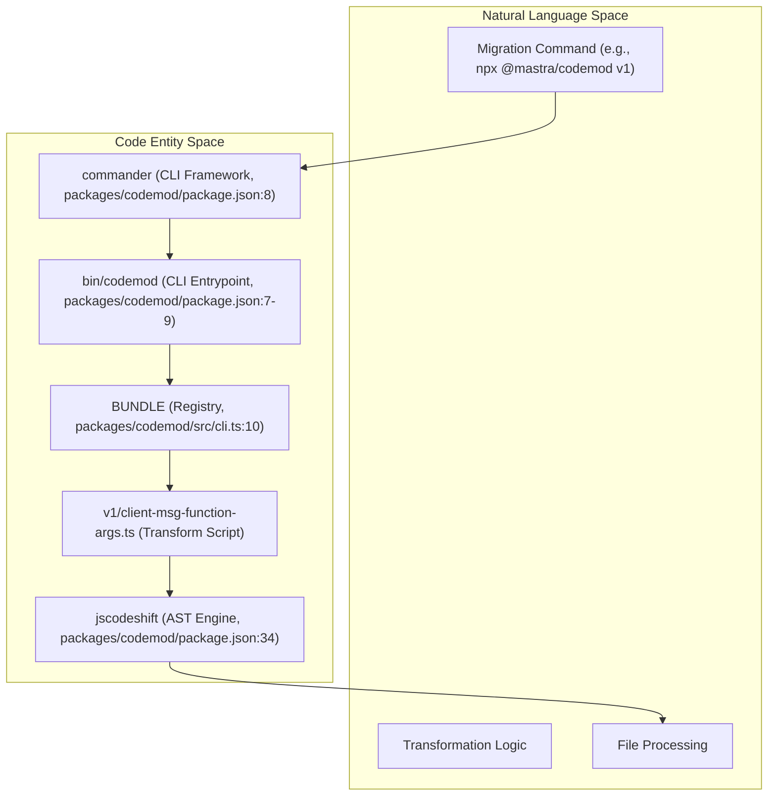
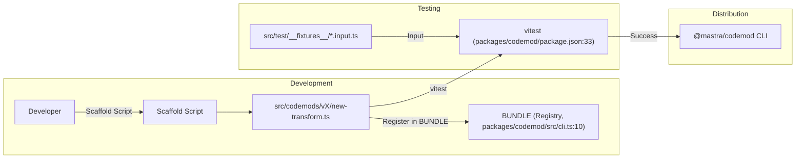

<!-- source: DeepWiki mcp.deepwiki.com · repo mastra-ai/mastra · page 12.6 Codemod and Migration Tooling · fetched 2026-10-27 -->

# Codemod and Migration Tooling

<details>
<summary>Relevant source files</summary>

The following files were used as context for generating this wiki page:

- [.changeset/fresh-init-provider-models.md](.changeset/fresh-init-provider-models.md)
- [docs/src/content/en/reference/cli/create-mastra.mdx](docs/src/content/en/reference/cli/create-mastra.mdx)
- [e2e-tests/experiment-worker/tests/portability-isolation.test.ts](e2e-tests/experiment-worker/tests/portability-isolation.test.ts)
- [packages/cli/src/commands/actions/create-project.test.ts](packages/cli/src/commands/actions/create-project.test.ts)
- [packages/cli/src/commands/actions/create-project.ts](packages/cli/src/commands/actions/create-project.ts)
- [packages/cli/src/commands/actions/init-project.ts](packages/cli/src/commands/actions/init-project.ts)
- [packages/cli/src/commands/auth/api.ts](packages/cli/src/commands/auth/api.ts)
- [packages/cli/src/commands/auth/auth.test.ts](packages/cli/src/commands/auth/auth.test.ts)
- [packages/cli/src/commands/auth/credentials.test.ts](packages/cli/src/commands/auth/credentials.test.ts)
- [packages/cli/src/commands/auth/credentials.ts](packages/cli/src/commands/auth/credentials.ts)
- [packages/cli/src/commands/auth/login.test.ts](packages/cli/src/commands/auth/login.test.ts)
- [packages/cli/src/commands/auth/login.ts](packages/cli/src/commands/auth/login.ts)
- [packages/cli/src/commands/auth/orgs.test.ts](packages/cli/src/commands/auth/orgs.test.ts)
- [packages/cli/src/commands/auth/orgs.ts](packages/cli/src/commands/auth/orgs.ts)
- [packages/cli/src/commands/auth/tokens.ts](packages/cli/src/commands/auth/tokens.ts)
- [packages/cli/src/commands/create/command.test.ts](packages/cli/src/commands/create/command.test.ts)
- [packages/cli/src/commands/create/command.ts](packages/cli/src/commands/create/command.ts)
- [packages/cli/src/commands/create/create.test.ts](packages/cli/src/commands/create/create.test.ts)
- [packages/cli/src/commands/create/create.ts](packages/cli/src/commands/create/create.ts)
- [packages/cli/src/commands/create/pnpm11-packagemanager.test.ts](packages/cli/src/commands/create/pnpm11-packagemanager.test.ts)
- [packages/cli/src/commands/create/provider-adapter.test.ts](packages/cli/src/commands/create/provider-adapter.test.ts)
- [packages/cli/src/commands/create/provider-adapter.ts](packages/cli/src/commands/create/provider-adapter.ts)
- [packages/cli/src/commands/create/scaffold.test.ts](packages/cli/src/commands/create/scaffold.test.ts)
- [packages/cli/src/commands/create/utils.ts](packages/cli/src/commands/create/utils.ts)
- [packages/cli/src/commands/create/version-resolver.test.ts](packages/cli/src/commands/create/version-resolver.test.ts)
- [packages/cli/src/commands/create/version-resolver.ts](packages/cli/src/commands/create/version-resolver.ts)
- [packages/cli/src/commands/init/init.ts](packages/cli/src/commands/init/init.ts)
- [packages/cli/src/commands/init/observability-provision.test.ts](packages/cli/src/commands/init/observability-provision.test.ts)
- [packages/cli/src/commands/init/observability-provision.ts](packages/cli/src/commands/init/observability-provision.ts)
- [packages/cli/src/commands/init/utils.test.ts](packages/cli/src/commands/init/utils.test.ts)
- [packages/cli/src/commands/init/utils.ts](packages/cli/src/commands/init/utils.ts)
- [packages/cli/src/internal/auth.ts](packages/cli/src/internal/auth.ts)
- [packages/create-mastra/src/index.ts](packages/create-mastra/src/index.ts)
- [templates/template-agent-harness/.env.example](templates/template-agent-harness/.env.example)
- [templates/template-agent-harness/.gitignore](templates/template-agent-harness/.gitignore)
- [templates/template-agent-harness/AGENTS.md](templates/template-agent-harness/AGENTS.md)
- [templates/template-agent-harness/README.md](templates/template-agent-harness/README.md)
- [templates/template-agent-harness/package.json](templates/template-agent-harness/package.json)
- [templates/template-agent-harness/src/mastra/agents/agent.ts](templates/template-agent-harness/src/mastra/agents/agent.ts)
- [templates/template-agent-harness/src/mastra/index.ts](templates/template-agent-harness/src/mastra/index.ts)
- [templates/template-agent-harness/src/mastra/tools/schedule-tools.ts](templates/template-agent-harness/src/mastra/tools/schedule-tools.ts)
- [templates/template-agent-harness/tsconfig.json](templates/template-agent-harness/tsconfig.json)

</details>


The `@mastra/codemod` package provides a Command Line Interface (CLI) and a collection of automated transformation scripts designed to assist developers in migrating their codebases across breaking changes. It especially facilitates major version migrations, such as upgrading from Mastra 0.x to the v1.0 release, by automating repetitive refactoring tasks like renaming methods, restructuring imports, and updating function signatures [packages/codemod/package.json:2-6]().

These codemods significantly reduce manual migration effort, ensuring consistency and reducing human error during complex upgrades.

---

## Package Architecture and Implementation

The codemod system is implemented on top of `jscodeshift`, a toolkit that performs source-to-source transformations by manipulating the Abstract Syntax Tree (AST) of JavaScript and TypeScript files [packages/codemod/package.json:34-34]().

### Data Flow and Execution

1.  **CLI Entry Point**: Developers invoke the codemod CLI tool via the `codemod` binary [packages/codemod/package.json:7-9](). The CLI is built using `commander` for argument parsing and `@clack/prompts` for interactive terminal UI [packages/codemod/package.json:8-8]().
2.  **Transformation Registry Lookup**: The CLI references a bundled registry called `BUNDLE` which maps transformation names to their respective module paths containing the codemod logic [packages/codemod/src/cli.ts:10-10]().
3.  **AST Parsing and Transformation**: For each matching source file, `jscodeshift` parses the file into an AST, applies the codemod's transformation functions, and then outputs the transformed source code back to disk.

### Core Implementation Components

-   **`BUNDLE`**: An array serving as the registry of available codemods, each with a `name` and `path`. This enables the CLI to call a specific codemod by name [packages/codemod/src/cli.ts:10-10]().
-   **`bin/codemod`**: The CLI entry file defined in `package.json` that handles command execution and path resolution [packages/codemod/package.json:7-9]().
-   **Transformation Modules**: Individual codemods implementing AST manipulations. For example, `v1/client-msg-function-args.ts` modifies function argument orders in client message methods.

### System Entity Mapping: Codemod CLI to Code Entities

**Codemod Execution Architecture**

Sources: [packages/codemod/package.json:7-9](), [packages/codemod/package.json:34-34](), [packages/codemod/package.json:8-8](), [packages/codemod/src/cli.ts:10-10]()

---

## Available v1 Codemods

The v1 migration suite includes transformations targeting breaking changes introduced in Mastra v1.

| Transformation Area | Codemod Name | Description |
| :------------------ | :--------------------------- | :----------------------------------------------------------- |
| **Core & Agent** | `v1/mastra-core-imports` | Updates `@mastra/core` imports to new structured subpath exports. |
| | `v1/runtime-context` | Renames `RuntimeContext` to `RequestContext`. |
| | `v1/mastra-plural-apis` | Renames plural getter methods, e.g., `getAgents` → `listAgents`. |
| | `v1/agent-property-access` | Changes direct agent property access to getter method calls. |
| | `v1/agent-voice` | Moves voice methods into `agent.voice` namespace. |
| | `v1/agent-abort-signal` | Moves `abortSignal` from `modelSettings` to top-level options. |
| **Workflow & Tools** | `v1/workflow-create-run-async` | Renames `createRunAsync` to `createRun`. |
| | `v1/workflow-run-count` | Renames `runCount` to `retryCount` in step context. |
| | `v1/workflow-get-init-data` | Updates `getInitData()` to return `unknown`. |
| | `v1/workflow-list-runs` | Renames `getWorkflowRuns` to `listWorkflowRuns`. |
| **Memory & Client** | `v1/memory-query-to-recall` | Renames `Memory.query()` to `Memory.recall()`. |
| | `v1/memory-readonly-to-options` | Moves `readOnly` into `options` object. |
| | `v1/memory-message-v2-type` | Renames `MastraMessageV2` to `MastraDBMessage`. |
| | `v1/memory-vector-search-param` | Renames `vectorMessageSearch` to `vectorSearchString`. |
| | `v1/client-offset-limit` | Changes pagination from `offset/limit` to `page/perPage`. |
| | `v1/client-msg-function-args` | Reorders client message function arguments. |
| | `v1/client-sdk-types` | Renames client SDK types from `Get*` to `List*`. |
| | `v1/client-get-memory-thread` | Updates `getMemoryThread` parameter structure. |

Sources: [packages/codemod/src/cli.ts:10-10]()

---

## Running Automated Migrations

### Run the Entire v1 Migration Suite

Execute all registered v1 codemods sequentially against your codebase:

```bash
npx @mastra/codemod v1
```

### Run an Individual Codemod

Provide the specific transformation path and the target directory:

```bash
npx @mastra/codemod v1/runtime-context .
```

---

## Writing New Codemods

### Development Workflow

1.  **Scaffold**: Use the internal scaffold script to generate boilerplate for new codemods.
2.  **Create the Codemod File**: Add a TypeScript file under `packages/codemod/src/codemods/vX/`. Use the `jscodeshift` API to manipulate AST nodes.
3.  **Register the Codemod**: Add an entry to the `BUNDLE` array [packages/codemod/src/cli.ts:10-10]().
4.  **Write Tests**: Create test cases using `vitest` [packages/codemod/package.json:33-33](). Use fixture files to verify transformations.

### Development Flow Diagram

**Codemod Authoring Pipeline**

Sources: [packages/codemod/package.json:33-33](), [packages/codemod/src/cli.ts:10-10]()

---

## Summary Table: Codemod System Overview

| Component | Role / Description |
| :------------------------- | :----------------------------------------------------------- |
| `@mastra/codemod` | Codemod package containing CLI and transformation scripts [packages/codemod/package.json:2-6]() |
| `bin/codemod` | CLI entrypoint handling command dispatch [packages/codemod/package.json:7-9]() |
| `BUNDLE` | Codemod registry mapping names to transformation modules [packages/codemod/src/cli.ts:10-10]() |
| `jscodeshift` | AST parsing and transformation engine [packages/codemod/package.json:34-34]() |
| `v1/*` codemods | Individual migration transformations for v1 release |
| `scaffold` script | Internal tool to generate new codemod templates |

Sources: [packages/codemod/package.json:2-6](), [packages/codemod/package.json:7-9](), [packages/codemod/package.json:34-34](), [packages/codemod/src/cli.ts:10-10]()

---

