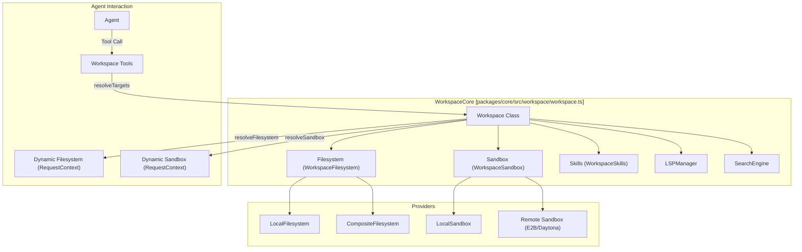
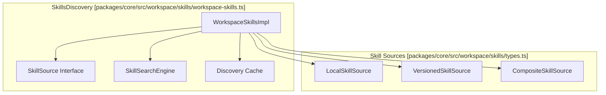
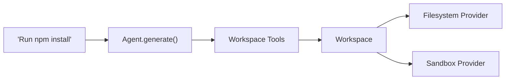
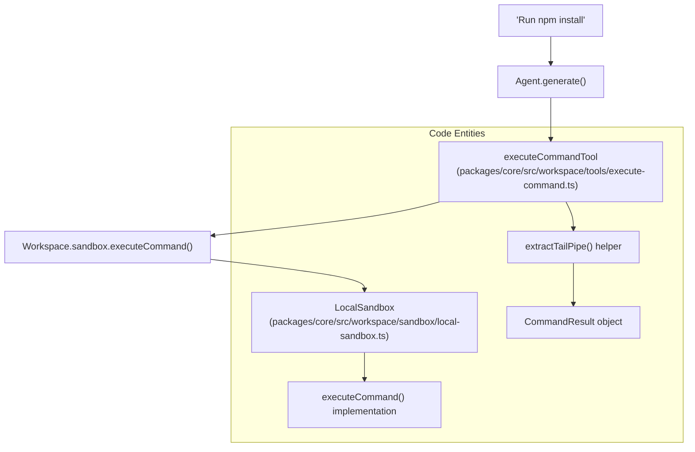
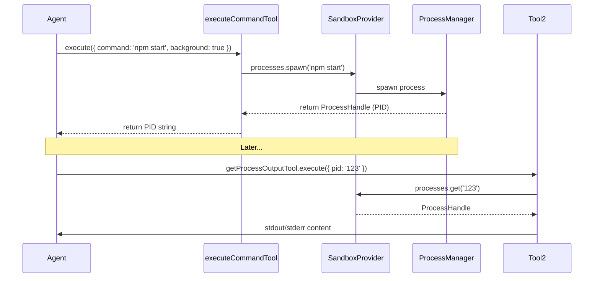

<!-- source: DeepWiki mcp.deepwiki.com · repo mastra-ai/mastra · page 15.1 Workspace Architecture · fetched 2026-10-27 -->

# Workspace Architecture

Relevant source files

The following files were used as context for generating this wiki page:

- [.changeset/contained-read-descriptor-identity.md](.changeset/contained-read-descriptor-identity.md)
- [.changeset/dull-apes-accept.md](.changeset/dull-apes-accept.md)
- [client-sdks/client-js/src/resources/workspace.test.ts](client-sdks/client-js/src/resources/workspace.test.ts)
- [client-sdks/client-js/src/resources/workspace.ts](client-sdks/client-js/src/resources/workspace.ts)
- [docs/src/content/en/docs/sandbox/filesystem.mdx](docs/src/content/en/docs/sandbox/filesystem.mdx)
- [docs/src/content/en/docs/sandbox/overview.mdx](docs/src/content/en/docs/sandbox/overview.mdx)
- [docs/src/content/en/docs/skills.mdx](docs/src/content/en/docs/skills.mdx)
- [docs/src/content/en/reference/processors/regex-filter-processor.mdx](docs/src/content/en/reference/processors/regex-filter-processor.mdx)
- [docs/src/content/en/reference/processors/skill-search-processor.mdx](docs/src/content/en/reference/processors/skill-search-processor.mdx)
- [docs/src/content/en/reference/workflows/run-methods/cancel.mdx](docs/src/content/en/reference/workflows/run-methods/cancel.mdx)
- [docs/src/content/en/reference/workflows/workflow-methods/agent.mdx](docs/src/content/en/reference/workflows/workflow-methods/agent.mdx)
- [docs/src/content/en/reference/workflows/workflow-methods/tool.mdx](docs/src/content/en/reference/workflows/workflow-methods/tool.mdx)
- [docs/src/content/en/reference/workspace/filesystem.mdx](docs/src/content/en/reference/workspace/filesystem.mdx)
- [docs/src/content/en/reference/workspace/local-filesystem.mdx](docs/src/content/en/reference/workspace/local-filesystem.mdx)
- [docs/src/content/en/reference/workspace/local-sandbox.mdx](docs/src/content/en/reference/workspace/local-sandbox.mdx)
- [docs/src/content/en/reference/workspace/sandbox.mdx](docs/src/content/en/reference/workspace/sandbox.mdx)
- [docs/src/content/en/reference/workspace/workspace-class.mdx](docs/src/content/en/reference/workspace/workspace-class.mdx)
- [examples/agent/src/mastra/public/workspace/.agents/skills/find-skills/.meta.json](examples/agent/src/mastra/public/workspace/.agents/skills/find-skills/.meta.json)
- [examples/agent/src/mastra/public/workspace/.agents/skills/find-skills/SKILL.md](examples/agent/src/mastra/public/workspace/.agents/skills/find-skills/SKILL.md)
- [examples/agent/src/mastra/public/workspace/.agents/skills/frontend-design/.meta.json](examples/agent/src/mastra/public/workspace/.agents/skills/frontend-design/.meta.json)
- [examples/agent/src/mastra/public/workspace/.agents/skills/frontend-design/LICENSE.txt](examples/agent/src/mastra/public/workspace/.agents/skills/frontend-design/LICENSE.txt)
- [examples/agent/src/mastra/public/workspace/.agents/skills/frontend-design/SKILL.md](examples/agent/src/mastra/public/workspace/.agents/skills/frontend-design/SKILL.md)
- [mastracode/sdk/src/agents/sandbox-filesystem.conformance.test.ts](mastracode/sdk/src/agents/sandbox-filesystem.conformance.test.ts)
- [mastracode/sdk/src/agents/sandbox-filesystem.test.ts](mastracode/sdk/src/agents/sandbox-filesystem.test.ts)
- [mastracode/sdk/src/agents/sandbox-filesystem.ts](mastracode/sdk/src/agents/sandbox-filesystem.ts)
- [packages/core/src/agent/__tests__/agent-skills-wiring.test.ts](packages/core/src/agent/__tests__/agent-skills-wiring.test.ts)
- [packages/core/src/agent/__tests__/skills-activation-persistence.test.ts](packages/core/src/agent/__tests__/skills-activation-persistence.test.ts)
- [packages/core/src/agent/__tests__/tool-approval.test.ts](packages/core/src/agent/__tests__/tool-approval.test.ts)
- [packages/core/src/agent/durable/__tests__/durable-agent-skill-tools-approval.test.ts](packages/core/src/agent/durable/__tests__/durable-agent-skill-tools-approval.test.ts)
- [packages/core/src/agent/durable/utils/skill-tools-approval.test.ts](packages/core/src/agent/durable/utils/skill-tools-approval.test.ts)
- [packages/core/src/loop/test-utils/aimock/scenarios/workspace-apply-patch.scenario.test.ts](packages/core/src/loop/test-utils/aimock/scenarios/workspace-apply-patch.scenario.test.ts)
- [packages/core/src/processors/processors/regex-filter.test.ts](packages/core/src/processors/processors/regex-filter.test.ts)
- [packages/core/src/processors/processors/regex-filter.ts](packages/core/src/processors/processors/regex-filter.ts)
- [packages/core/src/processors/processors/skill-search.test.ts](packages/core/src/processors/processors/skill-search.test.ts)
- [packages/core/src/processors/processors/skill-search.ts](packages/core/src/processors/processors/skill-search.ts)
- [packages/core/src/processors/processors/skills.test.ts](packages/core/src/processors/processors/skills.test.ts)
- [packages/core/src/processors/processors/skills.ts](packages/core/src/processors/processors/skills.ts)
- [packages/core/src/skills/create-skill.ts](packages/core/src/skills/create-skill.ts)
- [packages/core/src/skills/index.ts](packages/core/src/skills/index.ts)
- [packages/core/src/skills/types.ts](packages/core/src/skills/types.ts)
- [packages/core/src/skills/validate.test.ts](packages/core/src/skills/validate.test.ts)
- [packages/core/src/workspace/constants/index.ts](packages/core/src/workspace/constants/index.ts)
- [packages/core/src/workspace/filesystem/filesystem.ts](packages/core/src/workspace/filesystem/filesystem.ts)
- [packages/core/src/workspace/filesystem/local-filesystem-race.test.ts](packages/core/src/workspace/filesystem/local-filesystem-race.test.ts)
- [packages/core/src/workspace/filesystem/local-filesystem.test.ts](packages/core/src/workspace/filesystem/local-filesystem.test.ts)
- [packages/core/src/workspace/filesystem/local-filesystem.ts](packages/core/src/workspace/filesystem/local-filesystem.ts)
- [packages/core/src/workspace/gitignore.ts](packages/core/src/workspace/gitignore.ts)
- [packages/core/src/workspace/skills/local-skill-source.ts](packages/core/src/workspace/skills/local-skill-source.ts)
- [packages/core/src/workspace/skills/schemas.test.ts](packages/core/src/workspace/skills/schemas.test.ts)
- [packages/core/src/workspace/skills/schemas.ts](packages/core/src/workspace/skills/schemas.ts)
- [packages/core/src/workspace/skills/skill-source.ts](packages/core/src/workspace/skills/skill-source.ts)
- [packages/core/src/workspace/skills/tools.test.ts](packages/core/src/workspace/skills/tools.test.ts)
- [packages/core/src/workspace/skills/tools.ts](packages/core/src/workspace/skills/tools.ts)
- [packages/core/src/workspace/skills/types.ts](packages/core/src/workspace/skills/types.ts)
- [packages/core/src/workspace/skills/workspace-skills.test.ts](packages/core/src/workspace/skills/workspace-skills.test.ts)
- [packages/core/src/workspace/skills/workspace-skills.ts](packages/core/src/workspace/skills/workspace-skills.ts)
- [packages/core/src/workspace/tools/__tests__/apply-patch-parser.test.ts](packages/core/src/workspace/tools/__tests__/apply-patch-parser.test.ts)
- [packages/core/src/workspace/tools/__tests__/apply-patch.test.ts](packages/core/src/workspace/tools/__tests__/apply-patch.test.ts)
- [packages/core/src/workspace/tools/__tests__/capability-delegation.test.ts](packages/core/src/workspace/tools/__tests__/capability-delegation.test.ts)
- [packages/core/src/workspace/tools/__tests__/grep.test.ts](packages/core/src/workspace/tools/__tests__/grep.test.ts)
- [packages/core/src/workspace/tools/__tests__/list-files.test.ts](packages/core/src/workspace/tools/__tests__/list-files.test.ts)
- [packages/core/src/workspace/tools/__tests__/tree-formatter.test.ts](packages/core/src/workspace/tools/__tests__/tree-formatter.test.ts)
- [packages/core/src/workspace/tools/apply-patch-parser.ts](packages/core/src/workspace/tools/apply-patch-parser.ts)
- [packages/core/src/workspace/tools/apply-patch.ts](packages/core/src/workspace/tools/apply-patch.ts)
- [packages/core/src/workspace/tools/grep.ts](packages/core/src/workspace/tools/grep.ts)
- [packages/core/src/workspace/tools/index.ts](packages/core/src/workspace/tools/index.ts)
- [packages/core/src/workspace/tools/list-files.ts](packages/core/src/workspace/tools/list-files.ts)
- [packages/core/src/workspace/tools/tools.ts](packages/core/src/workspace/tools/tools.ts)
- [packages/core/src/workspace/tools/tree-formatter.ts](packages/core/src/workspace/tools/tree-formatter.ts)
- [packages/core/src/workspace/workspace.test.ts](packages/core/src/workspace/workspace.test.ts)
- [packages/core/src/workspace/workspace.ts](packages/core/src/workspace/workspace.ts)
- [packages/playground-ui/src/domains/workspace/__tests__/fixtures/workspace.ts](packages/playground-ui/src/domains/workspace/__tests__/fixtures/workspace.ts)
- [packages/playground/src/pages/workspace/index.tsx](packages/playground/src/pages/workspace/index.tsx)
- [packages/server/src/server/schemas/workspace.test.ts](packages/server/src/server/schemas/workspace.test.ts)
- [packages/server/src/server/schemas/workspace.ts](packages/server/src/server/schemas/workspace.ts)

The Workspace system in Mastra provides a structured environment for agents to interact with files and execute code. It abstracts the underlying storage (Filesystem) and execution environment (Sandbox), allowing agents to perform complex coding tasks, run shell commands, and manage project structures across different infrastructure providers.

## Overview

A `Workspace` is the primary container for an agent's operational environment. It integrates a `FilesystemProvider` for I/O operations and a `SandboxProvider` for code execution. It also manages **Skills**, which are markdown-based instructions and assets that provide agents with domain-specific capabilities [packages/core/src/workspace/workspace.ts:1-6]().

### Key Components
- **Workspace Class**: The orchestrator that manages the lifecycle of the filesystem, sandbox, and skills [packages/core/src/workspace/workspace.ts:17-30]().
- **FilesystemProvider**: Interface for file operations (read, write, list, delete) defined by the `WorkspaceFilesystem` interface [packages/core/src/workspace/workspace.ts:42-43]().
- **SandboxProvider**: Interface for executing code and shell commands in a secure, isolated environment (`WorkspaceSandbox`) [packages/core/src/workspace/workspace.ts:49-51]().
- **Skills System**: Implementation for discovering and searching domain instructions via `WorkspaceSkillsImpl` [packages/core/src/workspace/skills/workspace-skills.ts:92-139]().
- **LSP Integration**: Support for Language Server Protocol to provide code intelligence to agents via `LSPManager` [packages/core/src/workspace/workspace.ts:46-48]().

## Implementation Details

### The Workspace Class

The `Workspace` class is designed to unify a filesystem and sandbox into a coherent environment for agents. The filesystem handles all file I/O operations while the sandbox manages execution of code and shell commands in isolation.

- The workspace may be configured with:
  - A static filesystem instance (e.g., `LocalFilesystem`) [packages/core/src/workspace/workspace.ts:147]().
  - A dynamic filesystem resolver (`WorkspaceFilesystemResolver`) that resolves a filesystem instance per request based on `RequestContext` [packages/core/src/workspace/workspace.ts:79-82]().
  - Multiple mounted filesystems combined as a `CompositeFilesystem` [packages/core/src/workspace/workspace.ts:41]().
  - A static sandbox instance or a dynamic `WorkspaceSandboxResolver` [packages/core/src/workspace/workspace.ts:94-99]().

- It supports mounting filesystem roots automatically into the sandbox at well-known paths, ensuring sandbox environments have access to physical filesystems [packages/core/src/workspace/workspace.ts:175-177]().

#### Workspace Architecture

*Sources: [packages/core/src/workspace/workspace.ts:119-177](), [packages/core/src/workspace/tools/tools.ts:181-200](), [packages/core/src/workspace/workspace.ts:64-65]()*

### FilesystemProvider (`WorkspaceFilesystem`)

The filesystem abstraction defines the contract for file storage backends. It exposes async methods like:

- `readFile(path: string)`: Read file content.
- `writeFile(path: string, data: string|Buffer)`: Write to a file.
- `readdir(path: string)`: List files and directories [packages/core/src/workspace/filesystem/filesystem.ts:72-74]().

Filesystem providers can be static instances or dynamically resolved based on the agent's request context, enabling multitenancy or per-thread isolated filesystems [packages/core/src/workspace/workspace.ts:79-82]().

The `LocalFilesystem` implementation stores files in a folder on the local disk [packages/core/src/workspace/filesystem/local-filesystem.ts:127-128](). It supports `contained` mode to restrict operations within a `basePath` and `allowedPaths` for controlled access outside the base [packages/core/src/workspace/filesystem/local-filesystem.ts:70-75]().

*Sources: [packages/core/src/workspace/filesystem/filesystem.ts:72-74](), [packages/core/src/workspace/workspace.ts:79-82](), [packages/core/src/workspace/filesystem/local-filesystem.ts:127-128](), [packages/core/src/workspace/filesystem/local-filesystem.ts:70-75]()*

### SandboxProvider (`WorkspaceSandbox`)

The sandbox abstraction enables the workspace to execute arbitrary code or shell commands securely. The interface defines:

- `executeCommand(command: string, args?: string[])`: Run a command and return results [packages/core/src/workspace/sandbox/sandbox.ts:100]().
- `processes`: An optional `ProcessManager` for spawning background processes and retrieving output [packages/core/src/workspace/sandbox/process-manager/types.ts:10-11]().
- `onMount`: A hook function called during workspace initialization to mount filesystems into the sandbox environment [packages/core/src/workspace/sandbox/types.ts:100]().

The `LocalSandbox` implementation executes commands directly on the host machine where the Mastra application is running [docs/src/content/en/reference/workspace/local-sandbox.mdx:12-14]().

*Sources: [packages/core/src/workspace/sandbox/sandbox.ts:100](), [packages/core/src/workspace/sandbox/process-manager/types.ts:10-11](), [packages/core/src/workspace/sandbox/types.ts:100](), [docs/src/content/en/reference/workspace/local-sandbox.mdx:12-14]()*

## Skills System

Mastra's Workspace supports a **Skills** subsystem following the Agent Skills specification. Skills are `SKILL.md` files discovered from workspace paths.

- Skills are discovered via `WorkspaceSkillsImpl` [packages/core/src/workspace/skills/workspace-skills.ts:107]().
- The `SkillsProcessor` injects available skills metadata into the system message so the model knows which skills exist [packages/core/src/processors/processors/skills.ts:4-6]().
- Agents can call the `skill` tool to load full instructions or `skill_search` to find relevant information [packages/core/src/workspace/skills/tools.ts:73-81]().
- Skill sources include local files (`LocalSkillSource`), managed repos, and external packages [packages/core/src/workspace/skills/types.ts:27-31]().

#### Skills Discovery and Management

*Sources: [packages/core/src/workspace/skills/workspace-skills.ts:107-175](), [packages/core/src/processors/processors/skills.ts:73-111](), [packages/core/src/workspace/skills/types.ts:27-43]()*

## Agent Interaction and Workspace Tools

Agents interact with the workspace environment primarily through **workspace tools**, which encapsulate common filesystem and sandbox operations.

- Tools are created via `createWorkspaceTools()` [packages/core/src/workspace/tools/tools.ts:700]().
- Common workspace tools include:
  - `read_file`: Read content of a file [packages/core/src/workspace/tools/tools.ts:52]().
  - `write_file`: Write content to a file [packages/core/src/workspace/tools/tools.ts:76]().
  - `list_files`: List files and directories [packages/core/src/workspace/tools/tools.ts:49]().
  - `grep`: Search file contents using a regex pattern [packages/core/src/workspace/tools/grep.ts:50]().
  - `execute_command`: Run a shell command, supporting foreground and background modes [packages/core/src/workspace/tools/tools.ts:38-42]().
  - `get_process_output`: Retrieve status and output of background processes [packages/core/src/workspace/tools/tools.ts:44]().
  - `skill`: Load full instructions for a specific skill [packages/core/src/workspace/skills/tools.ts:107-118]().

#### Agent-Workspace Interaction

*Sources: [packages/core/src/workspace/tools/tools.ts:38-76](), [packages/core/src/workspace/workspace.ts:170-195](), [packages/core/src/workspace/skills/tools.ts:107-118](), [packages/core/src/workspace/tools/grep.ts:50]()*

### Tool Configuration Resolution

Tools support dynamic configuration values resolved per execution context. The resolution order applies global defaults, then top-level `WorkspaceToolsConfig`, then per-tool overrides [packages/core/src/workspace/tools/tools.ts:128-166]().

- `enabled`: Resolved to a boolean at tool-listing time [packages/core/src/workspace/tools/tools.ts:169]().
- `requireApproval`: Evaluated at execution-time (may depend on tool arguments) [packages/core/src/workspace/tools/tools.ts:135]().
- `requireReadBeforeWrite`: Specific to file write tools to ensure agents inspect files before modification [packages/core/src/workspace/tools/tools.ts:135]().

*Sources: [packages/core/src/workspace/tools/tools.ts:128-172]()*

## Natural Language to Code Entity Mapping

This diagram illustrates how a user's intent flows through the system to concrete workspace operations.

#### Natural Language to Workspace Operation Mapping

*Sources: [packages/core/src/workspace/workspace.ts:140-155](), [packages/core/src/workspace/tools/tools.ts:38](), [packages/core/src/workspace/sandbox/local-sandbox.ts:170-177]()*

## Data Flow: Background Command Execution

The lifecycle of an agent request to execute a background process:

#### Background Command Data Flow

*Sources: [packages/core/src/workspace/tools/tools.ts:38](), [packages/core/src/workspace/tools/tools.ts:44](), [packages/core/src/workspace/sandbox/process-manager/types.ts:10-11]()*

# Summary

- The `Workspace` class ties together a filesystem and sandbox to provide agents a code editing and execution environment.
- Filesystem providers abstract storage backends and support dynamic resolution per request context.
- Sandbox providers enable isolated code execution, supporting both synchronous commands and background processes.
- Skills provide a discoverable mechanism to extend agent capabilities with domain-specific markdown instructions.
- Workspace tools provide a secure interface for agents to interact with the environment, supporting granular approvals and safety checks.

---

*Sources:*  
[packages/core/src/workspace/workspace.ts]()  
[packages/core/src/workspace/tools/tools.ts]()  
[packages/core/src/workspace/skills/workspace-skills.ts]()  
[packages/core/src/workspace/skills/types.ts]()  
[packages/core/src/processors/processors/skills.ts]()  
[packages/core/src/workspace/filesystem/filesystem.ts]()  
[packages/core/src/workspace/filesystem/local-filesystem.ts]()  
[packages/core/src/workspace/sandbox/sandbox.ts]()  
[packages/core/src/workspace/sandbox/process-manager/types.ts]()  
[packages/core/src/workspace/sandbox/types.ts]()  
[packages/core/src/workspace/sandbox/local-sandbox.ts]()  
[packages/core/src/workspace/tools/grep.ts]()  
[packages/core/src/workspace/skills/tools.ts]()  
[docs/src/content/en/reference/workspace/local-sandbox.mdx]()

---

