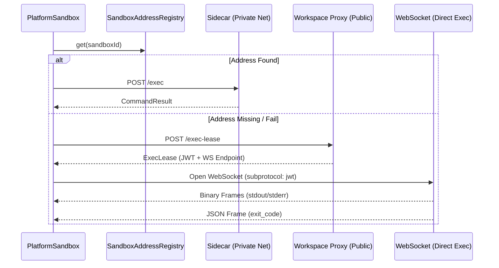

<!-- source: DeepWiki mcp.deepwiki.com · repo mastra-ai/mastra · page 15.2 Filesystem and Sandbox Providers · fetched 2026-10-27 -->

# Filesystem and Sandbox Providers

<details>
<summary>Relevant source files</summary>

The following files were used as context for generating this wiki page:

- [docs/src/content/en/integrations/sandboxes/agentcore.mdx](docs/src/content/en/integrations/sandboxes/agentcore.mdx)
- [docs/src/content/en/integrations/sandboxes/apple-container.mdx](docs/src/content/en/integrations/sandboxes/apple-container.mdx)
- [docs/src/content/en/integrations/sandboxes/blaxel.mdx](docs/src/content/en/integrations/sandboxes/blaxel.mdx)
- [docs/src/content/en/integrations/sandboxes/daytona.mdx](docs/src/content/en/integrations/sandboxes/daytona.mdx)
- [docs/src/content/en/integrations/sandboxes/e2b.mdx](docs/src/content/en/integrations/sandboxes/e2b.mdx)
- [docs/src/content/en/reference/workspace/platform-sandbox.mdx](docs/src/content/en/reference/workspace/platform-sandbox.mdx)
- [docs/src/content/en/reference/workspace/process-manager.mdx](docs/src/content/en/reference/workspace/process-manager.mdx)
- [packages/_internals/workspace/src/index.ts](packages/_internals/workspace/src/index.ts)
- [packages/core/src/workspace/index.ts](packages/core/src/workspace/index.ts)
- [packages/core/src/workspace/lifecycle.ts](packages/core/src/workspace/lifecycle.ts)
- [packages/core/src/workspace/sandbox/errors.ts](packages/core/src/workspace/sandbox/errors.ts)
- [packages/core/src/workspace/sandbox/local-process-manager.test.ts](packages/core/src/workspace/sandbox/local-process-manager.test.ts)
- [packages/core/src/workspace/sandbox/local-process-manager.ts](packages/core/src/workspace/sandbox/local-process-manager.ts)
- [packages/core/src/workspace/sandbox/local-sandbox.test.ts](packages/core/src/workspace/sandbox/local-sandbox.test.ts)
- [packages/core/src/workspace/sandbox/local-sandbox.ts](packages/core/src/workspace/sandbox/local-sandbox.ts)
- [packages/core/src/workspace/sandbox/mastra-sandbox.test.ts](packages/core/src/workspace/sandbox/mastra-sandbox.test.ts)
- [packages/core/src/workspace/sandbox/mastra-sandbox.ts](packages/core/src/workspace/sandbox/mastra-sandbox.ts)
- [packages/core/src/workspace/sandbox/native-sandbox/bubblewrap.ts](packages/core/src/workspace/sandbox/native-sandbox/bubblewrap.ts)
- [packages/core/src/workspace/sandbox/native-sandbox/seatbelt.ts](packages/core/src/workspace/sandbox/native-sandbox/seatbelt.ts)
- [packages/core/src/workspace/sandbox/native-sandbox/types.ts](packages/core/src/workspace/sandbox/native-sandbox/types.ts)
- [packages/core/src/workspace/sandbox/process-manager/types.ts](packages/core/src/workspace/sandbox/process-manager/types.ts)
- [packages/core/src/workspace/sandbox/sandbox.ts](packages/core/src/workspace/sandbox/sandbox.ts)
- [workspaces/_test-utils/src/sandbox/domains/command-execution.ts](workspaces/_test-utils/src/sandbox/domains/command-execution.ts)
- [workspaces/_test-utils/src/sandbox/domains/lifecycle.ts](workspaces/_test-utils/src/sandbox/domains/lifecycle.ts)
- [workspaces/_test-utils/src/sandbox/domains/mount-operations.ts](workspaces/_test-utils/src/sandbox/domains/mount-operations.ts)
- [workspaces/_test-utils/src/sandbox/domains/process-management.ts](workspaces/_test-utils/src/sandbox/domains/process-management.ts)
- [workspaces/_test-utils/src/sandbox/domains/reconnection.ts](workspaces/_test-utils/src/sandbox/domains/reconnection.ts)
- [workspaces/_test-utils/src/sandbox/factory.ts](workspaces/_test-utils/src/sandbox/factory.ts)
- [workspaces/_test-utils/src/sandbox/types.ts](workspaces/_test-utils/src/sandbox/types.ts)
- [workspaces/azure/src/blob/filesystem/index.test.ts](workspaces/azure/src/blob/filesystem/index.test.ts)
- [workspaces/azure/src/blob/filesystem/index.ts](workspaces/azure/src/blob/filesystem/index.ts)
- [workspaces/blaxel/README.md](workspaces/blaxel/README.md)
- [workspaces/blaxel/src/index.ts](workspaces/blaxel/src/index.ts)
- [workspaces/blaxel/src/sandbox/index.integration.test.ts](workspaces/blaxel/src/sandbox/index.integration.test.ts)
- [workspaces/blaxel/src/sandbox/index.test.ts](workspaces/blaxel/src/sandbox/index.test.ts)
- [workspaces/blaxel/src/sandbox/index.ts](workspaces/blaxel/src/sandbox/index.ts)
- [workspaces/blaxel/src/sandbox/mounts/s3.ts](workspaces/blaxel/src/sandbox/mounts/s3.ts)
- [workspaces/blaxel/src/sandbox/mounts/types.test.ts](workspaces/blaxel/src/sandbox/mounts/types.test.ts)
- [workspaces/blaxel/src/sandbox/mounts/types.ts](workspaces/blaxel/src/sandbox/mounts/types.ts)
- [workspaces/blaxel/src/sandbox/process-manager.test.ts](workspaces/blaxel/src/sandbox/process-manager.test.ts)
- [workspaces/blaxel/src/sandbox/process-manager.ts](workspaces/blaxel/src/sandbox/process-manager.ts)
- [workspaces/daytona/.env.example](workspaces/daytona/.env.example)
- [workspaces/daytona/CHANGELOG.md](workspaces/daytona/CHANGELOG.md)
- [workspaces/daytona/README.md](workspaces/daytona/README.md)
- [workspaces/daytona/package.json](workspaces/daytona/package.json)
- [workspaces/daytona/src/index.ts](workspaces/daytona/src/index.ts)
- [workspaces/daytona/src/sandbox/index.integration.test.ts](workspaces/daytona/src/sandbox/index.integration.test.ts)
- [workspaces/daytona/src/sandbox/index.test.ts](workspaces/daytona/src/sandbox/index.test.ts)
- [workspaces/daytona/src/sandbox/index.ts](workspaces/daytona/src/sandbox/index.ts)
- [workspaces/daytona/src/sandbox/mounts/azure.ts](workspaces/daytona/src/sandbox/mounts/azure.ts)
- [workspaces/daytona/src/sandbox/mounts/gcs.test.ts](workspaces/daytona/src/sandbox/mounts/gcs.test.ts)
- [workspaces/daytona/src/sandbox/mounts/gcs.ts](workspaces/daytona/src/sandbox/mounts/gcs.ts)
- [workspaces/daytona/src/sandbox/mounts/index.ts](workspaces/daytona/src/sandbox/mounts/index.ts)
- [workspaces/daytona/src/sandbox/mounts/s3-r2.integration.test.ts](workspaces/daytona/src/sandbox/mounts/s3-r2.integration.test.ts)
- [workspaces/daytona/src/sandbox/mounts/s3.test.ts](workspaces/daytona/src/sandbox/mounts/s3.test.ts)
- [workspaces/daytona/src/sandbox/mounts/s3.ts](workspaces/daytona/src/sandbox/mounts/s3.ts)
- [workspaces/daytona/src/sandbox/mounts/types.test.ts](workspaces/daytona/src/sandbox/mounts/types.test.ts)
- [workspaces/daytona/src/sandbox/mounts/types.ts](workspaces/daytona/src/sandbox/mounts/types.ts)
- [workspaces/daytona/src/sandbox/process-manager.ts](workspaces/daytona/src/sandbox/process-manager.ts)
- [workspaces/docker/README.md](workspaces/docker/README.md)
- [workspaces/docker/package.json](workspaces/docker/package.json)
- [workspaces/docker/src/index.ts](workspaces/docker/src/index.ts)
- [workspaces/docker/src/sandbox/index.integration.test.ts](workspaces/docker/src/sandbox/index.integration.test.ts)
- [workspaces/docker/src/sandbox/index.test.ts](workspaces/docker/src/sandbox/index.test.ts)
- [workspaces/docker/src/sandbox/index.ts](workspaces/docker/src/sandbox/index.ts)
- [workspaces/docker/src/sandbox/kill-helper-exit.fixture.ts](workspaces/docker/src/sandbox/kill-helper-exit.fixture.ts)
- [workspaces/docker/src/sandbox/process-manager.ts](workspaces/docker/src/sandbox/process-manager.ts)
- [workspaces/docker/src/template/build-session.test.ts](workspaces/docker/src/template/build-session.test.ts)
- [workspaces/docker/src/template/build-session.ts](workspaces/docker/src/template/build-session.ts)
- [workspaces/docker/src/template/dockerfile.test.ts](workspaces/docker/src/template/dockerfile.test.ts)
- [workspaces/docker/src/template/dockerfile.ts](workspaces/docker/src/template/dockerfile.ts)
- [workspaces/docker/src/template/index.ts](workspaces/docker/src/template/index.ts)
- [workspaces/docker/src/template/repo-template.test.ts](workspaces/docker/src/template/repo-template.test.ts)
- [workspaces/docker/src/template/repo-template.ts](workspaces/docker/src/template/repo-template.ts)
- [workspaces/docker/src/template/template.integration.test.ts](workspaces/docker/src/template/template.integration.test.ts)
- [workspaces/docker/src/template/template.test.ts](workspaces/docker/src/template/template.test.ts)
- [workspaces/docker/src/template/template.ts](workspaces/docker/src/template/template.ts)
- [workspaces/e2b/src/index.ts](workspaces/e2b/src/index.ts)
- [workspaces/e2b/src/sandbox/index.integration.test.ts](workspaces/e2b/src/sandbox/index.integration.test.ts)
- [workspaces/e2b/src/sandbox/index.test.ts](workspaces/e2b/src/sandbox/index.test.ts)
- [workspaces/e2b/src/sandbox/index.ts](workspaces/e2b/src/sandbox/index.ts)
- [workspaces/e2b/src/sandbox/mounts/gcs.ts](workspaces/e2b/src/sandbox/mounts/gcs.ts)
- [workspaces/e2b/src/sandbox/mounts/s3.ts](workspaces/e2b/src/sandbox/mounts/s3.ts)
- [workspaces/e2b/src/sandbox/mounts/types.ts](workspaces/e2b/src/sandbox/mounts/types.ts)
- [workspaces/e2b/src/sandbox/process-manager.ts](workspaces/e2b/src/sandbox/process-manager.ts)
- [workspaces/gcs/src/filesystem/index.integration.test.ts](workspaces/gcs/src/filesystem/index.integration.test.ts)
- [workspaces/gcs/src/filesystem/index.test.ts](workspaces/gcs/src/filesystem/index.test.ts)
- [workspaces/gcs/src/filesystem/index.ts](workspaces/gcs/src/filesystem/index.ts)
- [workspaces/platform-workspace/README.md](workspaces/platform-workspace/README.md)
- [workspaces/platform-workspace/src/client.test.ts](workspaces/platform-workspace/src/client.test.ts)
- [workspaces/platform-workspace/src/client.ts](workspaces/platform-workspace/src/client.ts)
- [workspaces/platform-workspace/src/direct-exec.test.ts](workspaces/platform-workspace/src/direct-exec.test.ts)
- [workspaces/platform-workspace/src/direct-exec.ts](workspaces/platform-workspace/src/direct-exec.ts)
- [workspaces/platform-workspace/src/e2b-exec.test.ts](workspaces/platform-workspace/src/e2b-exec.test.ts)
- [workspaces/platform-workspace/src/e2b-exec.ts](workspaces/platform-workspace/src/e2b-exec.ts)
- [workspaces/platform-workspace/src/filesystem.test.ts](workspaces/platform-workspace/src/filesystem.test.ts)
- [workspaces/platform-workspace/src/filesystem.ts](workspaces/platform-workspace/src/filesystem.ts)
- [workspaces/platform-workspace/src/index.ts](workspaces/platform-workspace/src/index.ts)
- [workspaces/platform-workspace/src/provider.ts](workspaces/platform-workspace/src/provider.ts)
- [workspaces/platform-workspace/src/sandbox.test.ts](workspaces/platform-workspace/src/sandbox.test.ts)
- [workspaces/platform-workspace/src/sandbox.ts](workspaces/platform-workspace/src/sandbox.ts)
- [workspaces/railway/README.md](workspaces/railway/README.md)
- [workspaces/railway/src/sandbox/index.test.ts](workspaces/railway/src/sandbox/index.test.ts)
- [workspaces/railway/src/sandbox/index.ts](workspaces/railway/src/sandbox/index.ts)

</details>


This page documents the available filesystem and sandbox providers within the Mastra framework. These abstractions enable agents to interact with files and execute code in isolated environments, either locally or on remote/cloud infrastructure.

At the core is the `Workspace` class, which orchestrates `WorkspaceFilesystem` and `WorkspaceSandbox` instances to provide agents with a cohesive environment for file storage and code execution [packages/core/src/workspace/index.ts:2-3]().

---

## Overview and Architecture

The `Workspace` acts as a bridge connecting an agent's **Natural Language Space** intent (e.g., "read the package.json file") to the **Code Entity Space** where actions like `workspace.filesystem.readFile()` and `sandbox.executeCommand()` are performed.

The `Workspace` is initialized from a `WorkspaceConfig` and manages the lifecycle of its filesystem and sandbox providers, including initialization via `init()` and cleanup via `destroy()` methods [packages/core/src/workspace/workspace.ts:119-153]().

### Workspace Provider Architecture

```mermaid
graph TD
    subgraph "Natural Language Space"
        Agent["Agent (packages/core/src/agent/agent.ts)"]
        WSInstr["WorkspaceInstructions (packages/core/src/processors/processors/workspace-instructions.ts)"]
    end
    
    subgraph "Code Entity Space"
        WS["Workspace (packages/core/src/workspace/workspace.ts)"]
        FS["WorkspaceFilesystem (Interface) (packages/core/src/workspace/filesystem/filesystem.ts)"]
        SB["WorkspaceSandbox (Interface) (packages/core/src/workspace/sandbox/sandbox.ts)"]
    end
    
    subgraph "Filesystem Implementations"
        LocalFS["LocalFilesystem (packages/core/src/workspace/filesystem/local-filesystem.ts)"]
        AgentFS["AgentFS (packages/agentfs/src/filesystem/index.ts)"]
        S3FS["S3Filesystem (packages/s3/src/filesystem/index.ts)"]
        GCSFS["GCSFilesystem (workspaces/gcs/src/filesystem/index.ts)"]
        AzureFS["AzureBlobFilesystem (workspaces/azure/src/blob/filesystem/index.ts)"]
        GoogleDriveFS["GoogleDriveFilesystem (packages/google-drive/src/filesystem/index.ts)"]
        MesaFS["MesaFilesystem (packages/mesa/src/filesystem/index.ts)"]
        ArchilFS["ArchilFilesystem (packages/archil/src/filesystem/index.ts)"]
        FilesSDKFS["FilesSDKFilesystem (packages/files-sdk/src/filesystem/index.ts)"]
        PlatformFS["PlatformFilesystem (workspaces/platform-workspace/src/filesystem.ts)"]
    end

    subgraph "Sandbox Implementations"
        LocalSB["LocalSandbox (packages/core/src/workspace/sandbox/local-sandbox.ts)"]
        E2B_SB["E2BSandbox (workspaces/e2b/src/sandbox/index.ts)"]
        Daytona_SB["DaytonaSandbox (workspaces/daytona/src/sandbox/index.ts)"]
        Blaxel_SB["BlaxelSandbox (workspaces/blaxel/src/sandbox/index.ts)"]
        Platform_SB["PlatformSandbox (workspaces/platform-workspace/src/sandbox.ts)"]
        Railway_SB["RailwaySandbox (workspaces/railway/src/sandbox/index.ts)"]
        Apple_SB["AppleContainerSandbox (workspaces/apple-container/src/sandbox/index.ts)"]
        Docker_SB["DockerSandbox (workspaces/docker/src/sandbox/index.ts)"]
        Modal_SB["ModalSandbox (workspaces/modal/src/sandbox/index.ts)"]
        AgentCore_SB["AgentCoreSandbox (workspaces/agentcore/src/sandbox/index.ts)"]
        Cloudflare_SB["CloudflareSandbox (workspaces/cloudflare/src/sandbox/index.ts)"]
        Vercel_SB["VercelSandbox (workspaces/vercel/src/sandbox/index.ts)"]
    end
    
    Agent -- "uses" --> WS
    WSInstr -- "extracts instructions from" --> WS
    WS -- "manages" --> FS
    WS -- "manages" --> SB
    FS -- "implements" --> LocalFS
    FS -- "implements" --> AgentFS
    FS -- "implements" --> S3FS
    FS -- "implements" --> GCSFS
    FS -- "implements" --> AzureFS
    FS -- "implements" --> GoogleDriveFS
    FS -- "implements" --> MesaFS
    FS -- "implements" --> ArchilFS
    FS -- "implements" --> FilesSDKFS
    FS -- "implements" --> PlatformFS
    SB -- "implements" --> LocalSB
    SB -- "implements" --> E2B_SB
    SB -- "implements" --> Daytona_SB
    SB -- "implements" --> Blaxel_SB
    SB -- "implements" --> Platform_SB
    SB -- "implements" --> Railway_SB
    SB -- "implements" --> Apple_SB
    SB -- "implements" --> Docker_SB
    SB -- "implements" --> Modal_SB
    SB -- "implements" --> AgentCore_SB
    SB -- "implements" --> Cloudflare_SB
    SB -- "implements" --> Vercel_SB
```


Sources: [packages/core/src/workspace/workspace.ts:119-153](), [packages/core/src/workspace/filesystem/filesystem.ts:10-80](), [packages/core/src/workspace/sandbox/sandbox.ts:49-51]()

---

## Filesystem Providers

Filesystem providers abstract storage and expose methods for file read/write, listing, deleting, and metadata inspection. All conform to the `WorkspaceFilesystem` interface [packages/core/src/workspace/index.ts:89-105]().

### Local Filesystem Provider

- Implements `WorkspaceFilesystem` backed by a local folder [packages/core/src/workspace/index.ts:24-24]().
- **Containment**: Restricts file access within `basePath` to prevent path traversal [packages/core/src/workspace/sandbox/local-sandbox.ts:57-73]().
- **AllowedPaths**: Permitted directories outside `basePath` [packages/core/src/workspace/filesystem/local-filesystem.ts:72-87]().

```typescript
import { LocalFilesystem } from '@mastra/core/workspace'

const fs = new LocalFilesystem({
  basePath: './my-workspace',
  contained: true,
  allowedPaths: ['/tmp/shared'],
});
```
Sources: [packages/core/src/workspace/index.ts:24-24](), [packages/core/src/workspace/sandbox/local-sandbox.ts:57-73]()

### Available Filesystem Providers

| Provider | Description | Source |
| :--- | :--- | :--- |
| `LocalFilesystem` | Local disk storage with containment options. | [packages/core/src/workspace/index.ts:24-24]() |
| `AgentFS` | SQLite-backed storage via AgentFS. | [packages/_internals/workspace/src/index.ts:1-1]() |
| `S3Filesystem` | Amazon S3 or compatible object storage. | [workspaces/e2b/src/sandbox/mounts/s3.ts:1-1]() |
| `GCSFilesystem` | Google Cloud Storage bucket storage. | [workspaces/gcs/src/filesystem/index.ts:136-174]() |
| `AzureBlobFilesystem` | Azure Blob Storage integration. | [workspaces/e2b/src/sandbox/mounts/types.ts:1-1]() |
| `GoogleDriveFilesystem` | Google Drive folder access. | [packages/_internals/workspace/src/index.ts:1-1]() |
| `MesaFilesystem` | Versioned storage in Mesa repositories. | [packages/_internals/workspace/src/index.ts:1-1]() |
| `ArchilFilesystem` | Archil cloud storage provider. | [packages/_internals/workspace/src/index.ts:1-1]() |
| `FilesSDKFilesystem` | Multi-backend support via FilesSDK. | [packages/_internals/workspace/src/index.ts:1-1]() |
| `PlatformFilesystem` | Mastra Platform bucket-backed filesystem. | [workspaces/platform-workspace/src/filesystem.ts:1-10]() |

Sources: [packages/core/src/workspace/index.ts:24-24](), [packages/_internals/workspace/src/index.ts:1-1](), [workspaces/e2b/src/sandbox/mounts/s3.ts:1-1](), [workspaces/gcs/src/filesystem/index.ts:136-174](), [workspaces/e2b/src/sandbox/mounts/types.ts:1-1](), [workspaces/platform-workspace/src/filesystem.ts:1-10]()

---

## Sandbox Providers

Sandbox providers supply isolated runtime environments for executing shell commands and code.

### Local Sandbox

- Executes commands on the host machine using `LocalProcessManager` [packages/core/src/workspace/sandbox/local-sandbox.ts:25-25]().
- **Isolation**: Supports `seatbelt` (macOS) and `bubblewrap` (Linux) via `native-sandbox.ts` [packages/core/src/workspace/sandbox/local-sandbox.ts:29-36]().
- **Mounts**: Uses symlinks to map `basePath` from `LocalFilesystem` into the sandbox `workingDirectory` [packages/core/src/workspace/sandbox/local-sandbox.test.ts:38-44]().

Sources: [packages/core/src/workspace/sandbox/local-sandbox.ts:25-25](), [packages/core/src/workspace/sandbox/local-sandbox.ts:29-36](), [packages/core/src/workspace/sandbox/local-sandbox.test.ts:38-44]()

### Remote & Cloud Sandboxes

| Provider | Description | Source |
| :--- | :--- | :--- |
| `E2BSandbox` | Isolated cloud sandboxes with FUSE mount support. | [workspaces/e2b/src/sandbox/index.ts:167-181]() |
| `DaytonaSandbox` | Cloud sandboxes supporting TS, JS, and Python. | [workspaces/daytona/src/sandbox/index.ts:1-9]() |
| `BlaxelSandbox` | Sandboxes optimized for AI workloads. | [workspaces/blaxel/src/sandbox/index.ts:1-11]() |
| `PlatformSandbox` | Mastra Platform environment-scoped sandbox, defaults to E2B or Railway. | [workspaces/platform-workspace/src/sandbox.ts:1-13]() |
| `DockerSandbox` | Executes commands within a Docker container. | [workspaces/docker/src/sandbox/index.ts:1-10]() |
| `ModalSandbox` | Serverless cloud functions as sandboxes. | [packages/_internals/workspace/src/index.ts:1-1]() |
| `AgentCoreSandbox` | AgentCore-specific sandbox environment. | [packages/_internals/workspace/src/index.ts:1-1]() |
| `RailwaySandbox` | Ephemeral Linux VMs via Railway SDK. | [workspaces/railway/src/sandbox/index.ts:1-10]() |
| `AppleContainerSandbox` | macOS-native container isolation. | [packages/_internals/workspace/src/index.ts:1-1]() |
| `CloudflareSandbox` | Cloudflare Workers as sandboxes. | [packages/_internals/workspace/src/index.ts:1-1]() |
| `VercelSandbox` | Vercel Serverless Functions as sandboxes. | [packages/_internals/workspace/src/index.ts:1-1]() |

Sources: [workspaces/e2b/src/sandbox/index.ts:167-181](), [workspaces/daytona/src/sandbox/index.ts:1-9](), [workspaces/blaxel/src/sandbox/index.ts:1-11](), [workspaces/platform-workspace/src/sandbox.ts:1-13](), [workspaces/docker/src/sandbox/index.ts:1-10](), [packages/_internals/workspace/src/index.ts:1-1](), [workspaces/railway/src/sandbox/index.ts:1-10]()

### Platform Sandbox: Private Network & Lease Logic

The `PlatformSandbox` implements a `SandboxAddressRegistry` to map `sandboxId` to `instanceUrl` [workspaces/platform-workspace/src/sandbox.ts:63-67](). It attempts to use Railway's private network first for execution, falling back to a public WebSocket lease if the private connection fails [workspaces/platform-workspace/src/sandbox.ts:46-62]().


The `PlatformSandbox` can be configured with `sandboxProvider` to explicitly choose between `e2b` (default) or `railway` [workspaces/platform-workspace/src/client.ts:28-28](). It also supports `PlatformSandboxTemplate` for defining reusable sandbox images, which are content-addressed for build reuse [workspaces/platform-workspace/src/sandbox.ts:41-44]().

Sources: [workspaces/platform-workspace/src/sandbox.ts:46-67](), [workspaces/platform-workspace/src/sandbox.test.ts:109-144](), [workspaces/platform-workspace/src/client.ts:28-28](), [workspaces/platform-workspace/src/sandbox.ts:41-44]()

### E2B Sandbox Features

The `E2BSandbox` provides a simplified E2B sandbox implementation with support for:
- **Cloud Filesystem Mounting**: Supports S3, GCS, and Azure Blob Storage via FUSE [workspaces/e2b/src/sandbox/index.ts:4-6]().
- **Template Management**: Allows using existing templates by ID, custom `TemplateBuilder` instances, or customizing the default mountable template [workspaces/e2b/src/sandbox/index.ts:108-118]().
- **Lifecycle Management**: Configurable `lifecycle` behavior for sandbox timeouts, defaulting to `pause` to snapshot the sandbox [workspaces/e2b/src/sandbox/index.ts:139-147]().
- **Process Management**: Uses `E2BProcessManager` for handling command execution and background processes [workspaces/e2b/src/sandbox/process-manager.ts:1-10]().

Sources: [workspaces/e2b/src/sandbox/index.ts:4-6](), [workspaces/e2b/src/sandbox/index.ts:108-118](), [workspaces/e2b/src/sandbox/index.ts:139-147](), [workspaces/e2b/src/sandbox/process-manager.ts:1-10]()

### Daytona Sandbox Features

The `DaytonaSandbox` supports advanced features:
- **Computer Use**: Desktop capability with X11/noVNC support [workspaces/daytona/src/sandbox/index.ts:29-30]().
- **Snapshots**: Create sandboxes from pre-built snapshots [workspaces/daytona/src/sandbox/index.ts:128-129]().
- **Resource Allocation**: Custom CPU, memory, and disk settings [workspaces/daytona/src/sandbox/index.ts:122-123]().
- **Volume Mounting**: Supports attaching Daytona volumes at creation time [workspaces/daytona/src/sandbox/index.ts:154-156]().
- **Network Isolation**: Options for `networkBlockAll`, `networkAllowList`, and `domainAllowList` for fine-grained network control [workspaces/daytona/src/sandbox/index.ts:168-179]().
- **Secrets Integration**: Exposes Daytona Secrets as environment variables, with values substituted by Daytona's egress proxy for security [workspaces/daytona/src/sandbox/index.ts:182-189]().

Sources: [workspaces/daytona/src/sandbox/index.ts:29-30](), [workspaces/daytona/src/sandbox/index.ts:128-129](), [workspaces/daytona/src/sandbox/index.ts:122-123](), [workspaces/daytona/src/sandbox/index.ts:154-156](), [workspaces/daytona/src/sandbox/index.ts:168-179](), [workspaces/daytona/src/sandbox/index.ts:182-189]()

### Docker Sandbox Features

The `DockerSandbox` provides a local Docker-based sandbox implementation:
- **Container Lifecycle**: Manages creation, starting, stopping, and removal of Docker containers [workspaces/docker/src/sandbox/index.test.ts:18-19]().
- **Image and Template Support**: Can use a specified Docker image or a `DockerTemplateSpec` for custom container images [workspaces/docker/src/sandbox/index.ts:148-161]().
- **Environment Variables**: Allows setting environment variables within the container [workspaces/docker/src/sandbox/index.ts:173-173]().
- **Volume and Bind Mounts**: Supports various types of mounts including `volume`, `bind`, and `tmpfs` mounts for persistent or temporary storage [workspaces/docker/src/sandbox/index.ts:67-131]().
- **Resource Limits**: Configurable memory, CPU, and ulimit settings for containers [workspaces/docker/src/sandbox/index.ts:182-184]().
- **Process Management**: Uses `DockerProcessManager` for executing commands and managing processes inside the Docker container [workspaces/docker/src/sandbox/process-manager.ts:1-10]().

Sources: [workspaces/docker/src/sandbox/index.test.ts:18-19](), [workspaces/docker/src/sandbox/index.ts:148-161](), [workspaces/docker/src/sandbox/index.ts:173-173](), [workspaces/docker/src/sandbox/index.ts:67-131](), [workspaces/docker/src/sandbox/index.ts:182-184](), [workspaces/docker/src/sandbox/process-manager.ts:1-10]()

---

## Configuration Patterns

### Cloud Filesystem Mounting

Cloud sandboxes like `DaytonaSandbox` and `E2BSandbox` support mounting cloud filesystems (S3, GCS, Azure) via FUSE [workspaces/e2b/src/sandbox/index.ts:4-6](). This is handled by the `MountManager` within the sandbox implementation [packages/core/src/workspace/index.ts:144-144]().

```typescript
const sandbox = new E2BSandbox({
  timeout: 60000,
});

const workspace = new Workspace({
  sandbox,
  mounts: {
    '/bucket': new S3Filesystem({
      bucket: 'my-bucket',
      region: 'us-east-1',
    }),
  },
});
```
Sources: [workspaces/e2b/src/sandbox/index.ts:4-6](), [packages/core/src/workspace/index.ts:144-144]()

### Dynamic Resolvers

Workspaces can resolve filesystems and sandboxes dynamically based on `RequestContext`, enabling multi-tenant or per-thread isolation [packages/core/src/workspace/workspace.ts:79-91]().

```typescript
const workspace = new Workspace({
  sandbox: ({ requestContext }) => new LocalSandbox({
    id: requestContext.get('userId')
  })
});
```
Sources: [packages/core/src/workspace/workspace.ts:75-110](), [docs/src/content/en/reference/workspace/workspace-class.mdx:52-64]()

### Summary of Key Entities

| Code Entity | Role | File Path |
| :--- | :--- | :--- |
| `Workspace` | Central orchestrator for FS and Sandbox. | [packages/core/src/workspace/workspace.ts:92-196]() |
| `MastraSandbox` | Base class for sandbox implementations. | [packages/core/src/workspace/index.ts:29-29]() |
| `MastraFilesystem` | Base class for filesystem implementations. | [packages/core/src/workspace/index.ts:29-29]() |
| `WorkspaceSkillsImpl` | Manages discovery and search for skills. | [packages/core/src/workspace/skills/workspace-skills.ts:92-150]() |
| `PlatformSandbox` | Railway/Platform specific sandbox implementation. | [workspaces/platform-workspace/src/sandbox.ts:196-200]() |
| `E2BSandbox` | E2B cloud sandbox implementation. | [workspaces/e2b/src/sandbox/index.ts:167-181]() |
| `DaytonaSandbox` | Daytona cloud sandbox implementation. | [workspaces/daytona/src/sandbox/index.ts:102-102]() |
| `DockerSandbox` | Docker container sandbox implementation. | [workspaces/docker/src/sandbox/index.ts:137-137]() |
| `S3Filesystem` | S3-compatible filesystem implementation. | [workspaces/e2b/src/sandbox/mounts/s3.ts:1-1]() |
| `GCSFilesystem` | Google Cloud Storage filesystem implementation. | [workspaces/gcs/src/filesystem/index.ts:186-186]() |
| `PlatformFilesystem` | Mastra Platform bucket-backed filesystem. | [workspaces/platform-workspace/src/filesystem.ts:1-10]()

Sources: [packages/core/src/workspace/workspace.ts:33-65](), [packages/core/src/workspace/index.ts:29-29](), [packages/core/src/workspace/skills/workspace-skills.ts:1-87](), [workspaces/platform-workspace/src/sandbox.ts:196-200](), [workspaces/e2b/src/sandbox/index.ts:167-181](), [workspaces/daytona/src/sandbox/index.ts:102-102](), [workspaces/docker/src/sandbox/index.ts:137-137](), [workspaces/e2b/src/sandbox/mounts/s3.ts:1-1](), [workspaces/gcs/src/filesystem/index.ts:186-186](), [workspaces/platform-workspace/src/filesystem.ts:1-10]()

---

