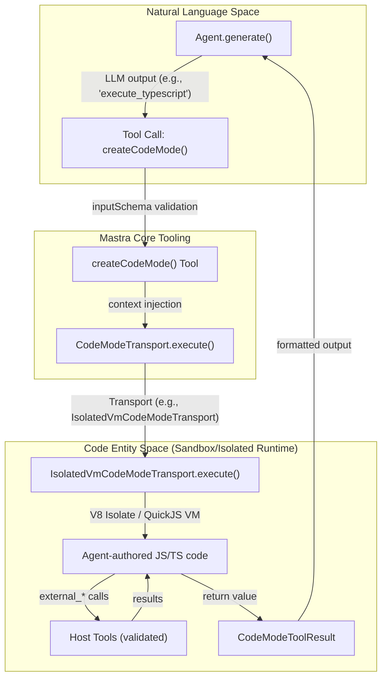

<!-- source: DeepWiki mcp.deepwiki.com · repo mastra-ai/mastra · page 15.3 Code Mode (Isolated Execution Transports) · fetched 2026-10-27 -->

# Code Mode (Isolated Execution Transports)

<details>
<summary>Relevant source files</summary>

The following files were used as context for generating this wiki page:

- [.claude/skills/mastra-docs/SKILL.md](.claude/skills/mastra-docs/SKILL.md)
- [.claude/skills/mastra-docs/references/DOC.md](.claude/skills/mastra-docs/references/DOC.md)
- [.claude/skills/mastra-docs/references/GUIDE_INTEGRATION.md](.claude/skills/mastra-docs/references/GUIDE_INTEGRATION.md)
- [.claude/skills/mastra-docs/references/REFERENCE.md](.claude/skills/mastra-docs/references/REFERENCE.md)
- [.claude/skills/mastra-docs/references/STYLEGUIDE.md](.claude/skills/mastra-docs/references/STYLEGUIDE.md)
- [.github/ISSUE_TEMPLATE/bug_report.yml](.github/ISSUE_TEMPLATE/bug_report.yml)
- [.github/ISSUE_TEMPLATE/config.yml](.github/ISSUE_TEMPLATE/config.yml)
- [.github/ISSUE_TEMPLATE/feature_request.yml](.github/ISSUE_TEMPLATE/feature_request.yml)
- [.github/ISSUE_TEMPLATE/integration_request.yml](.github/ISSUE_TEMPLATE/integration_request.yml)
- [.github/PULL_REQUEST_TEMPLATE.md](.github/PULL_REQUEST_TEMPLATE.md)
- [CONTRIBUTING.md](CONTRIBUTING.md)
- [DEVELOPMENT.md](DEVELOPMENT.md)
- [README.md](README.md)
- [docs/.oxfmtrc.json](docs/.oxfmtrc.json)
- [docs/AGENTS.md](docs/AGENTS.md)
- [docs/CONTRIBUTING.md](docs/CONTRIBUTING.md)
- [docs/package.json](docs/package.json)
- [docs/src/content/en/docs/agents/code-mode.mdx](docs/src/content/en/docs/agents/code-mode.mdx)
- [docs/src/content/en/reference/tools/create-code-mode.mdx](docs/src/content/en/reference/tools/create-code-mode.mdx)
- [examples/README.md](examples/README.md)
- [scripts/gh-dane-command/index.ts](scripts/gh-dane-command/index.ts)
- [scripts/gh-dane-command/package.json](scripts/gh-dane-command/package.json)
- [templates/weather-agent/README.md](templates/weather-agent/README.md)
- [templates/weather-agent/package.json](templates/weather-agent/package.json)

</details>


Code Mode refers to the capability within the Mastra framework to execute agent-authored code within constrained, secure runtimes. This system bridges the gap between the LLM's "Natural Language Space" and the underlying "Code Entity Space" by providing isolated execution environments (Sandboxes) where code can be run safely without compromising the host system.

## Overview and Security Boundaries

Code Mode is built upon the `Workspace` abstraction, which combines a `FilesystemProvider` and a `SandboxProvider` [docs/src/content/en/docs/agents/code-mode.mdx:35-36](). By default, Mastra enforces strict security boundaries:

*   **No Host Access:** Agents do not have access to the host `fs`, `net`, or `process` modules unless explicitly granted through the transport configuration.
*   **Isolated Runtimes:** Execution occurs in constrained environments like `LocalSandbox` or remote providers such as E2B, Daytona, or Railway.
*   **Capability Injection:** External capabilities are injected into the execution context via `external_*` functions, allowing the agent to interact with the outside world only through predefined, validated interfaces.

### Data Flow: Natural Language to Code Execution

The following diagram illustrates how an agent's intent in natural language is transformed into executed code within a sandbox.

**Diagram: Intent to Execution Flow**

Sources: [docs/src/content/en/docs/agents/code-mode.mdx:10-16](), [docs/src/content/en/reference/tools/create-code-mode.mdx:12-13](), [docs/src/content/en/reference/tools/create-code-mode.mdx:113-128]()

## Transport Implementations

Mastra supports multiple transports for code execution, ranging from local process isolation to in-process isolated runtimes. The `createCodeMode()` function allows specifying a `transport` [docs/src/content/en/reference/tools/create-code-mode.mdx:101-107]().

### 1. Local Sandbox (Node.js Process)

By default, if no specific transport is provided and a `sandbox` is configured, `createCodeMode()` uses a transport that writes the program to the host filesystem and runs `node` against it [docs/src/content/en/docs/agents/code-mode.mdx:138-141]().

*   **Execution Environment:** A Node.js process within a `WorkspaceSandbox`.
*   **Security:** Relies on the `WorkspaceSandbox` for isolation, which can be `LocalSandbox` (running on the host with host privileges) or a remote sandbox like E2B.
*   **Usage:** `sandbox: new LocalSandbox()` [docs/src/content/en/docs/agents/code-mode.mdx:69-69]() explicitly runs code on the host machine, suitable for trusted code or local development.

### 2. Isolated VM Transports

These transports provide their own execution boundary, meaning they do not require an external `WorkspaceSandbox` [docs/src/content/en/docs/agents/code-mode.mdx:37-38](), [docs/src/content/en/reference/tools/create-code-mode.mdx:101-107]().

*   **`IsolatedVmCodeModeTransport`**:
    *   **Mechanism:** Runs the program in an in-process V8 isolate [docs/src/content/en/docs/agents/code-mode.mdx:37-38](). This provides strong isolation within the same Node.js process.
    *   **Security:** Offers memory limits and CPU time constraints inherent to V8 isolates.
    *   **Usage:** No `sandbox` is needed when using this transport.

*   **`QuickJsCodeModeTransport`**:
    *   **Mechanism:** Executes code within a QuickJS runtime. QuickJS is a small, embeddable JavaScript engine.
    *   **Security:** Provides a completely clean environment, without access to Node.js globals or the host filesystem/network, unless explicitly bridged.
    *   **Usage:** Similar to `IsolatedVmCodeModeTransport`, it runs without requiring an external `sandbox`.

**Diagram: Code Mode Transport Options**
```mermaid
graph TD
    A[createCodeMode()] --> B{Transport Configured?}

    B -- Yes, with sandbox --> C[Default Transport (Node.js process)]
    C --> D[WorkspaceSandbox (LocalSandbox, E2B, etc.)]
    D -- "OS-level isolation / Remote VM" --> E[Agent-authored code]

    B -- Yes, with IsolatedVmCodeModeTransport --> F[IsolatedVmCodeModeTransport]
    F --> G[In-process V8 Isolate]
    G --> E

    B -- Yes, with QuickJsCodeModeTransport --> H[QuickJsCodeModeTransport]
    H --> I[In-process QuickJS VM]
    I --> E

    B -- No, default --> C
```
Sources: [docs/src/content/en/docs/agents/code-mode.mdx:37-38](), [docs/src/content/en/docs/agents/code-mode.mdx:69-69](), [docs/src/content/en/docs/agents/code-mode.mdx:138-141](), [docs/src/content/en/reference/tools/create-code-mode.mdx:101-107]()

## Capability Injection and Tooling

The core idea of Code Mode is to allow the LLM to orchestrate existing tools. `createCodeMode()` takes a `tools` object [docs/src/content/en/reference/tools/create-code-mode.mdx:71-75]() which defines the tools available to the generated code.

*   **`external_*` Functions:** Tools passed to `createCodeMode()` are exposed to the generated code as `external_<id>` functions [docs/src/content/en/reference/tools/create-code-mode.mdx:71-75](). For example, `getTopProducts` becomes `external_getTopProducts` [docs/src/content/en/docs/agents/code-mode.mdx:84-84]().
*   **Validation and Context:** When an `external_*` function is called from within the isolated runtime, the call is bridged back to the host. The original tool's `inputSchema` is used for validation, and the execution runs with the full `RequestContext` and tracing capabilities of Mastra [docs/src/content/en/docs/agents/code-mode.mdx:31-33]().
*   **Scoping:** Multiple `createCodeMode()` instances can be used, each with a distinct `id` and a specific subset of tools. This ensures least-privilege access and keeps the prompt surface small for each code tool [docs/src/content/en/docs/agents/code-mode.mdx:109-136]().

### `createCodeMode()` Parameters and Returns

The `createCodeMode()` function [docs/src/content/en/reference/tools/create-code-mode.mdx:12-13]() returns an object containing:

*   `tool`: The generated code mode tool itself, typically with the ID `execute_typescript` [docs/src/content/en/reference/tools/create-code-mode.mdx:120-121]().
*   `instructions`: Generated model instructions that include typed `external_*` declarations for the configured tools. These instructions guide the LLM on how to use the code mode tool [docs/src/content/en/reference/tools/create-code-mode.mdx:123-126]().

The tool's execution result is a `CodeModeToolResult` [docs/src/content/en/reference/tools/create-code-mode.mdx:131-185]() object, which includes:

*   `success`: A boolean indicating if the code ran without throwing [docs/src/content/en/reference/tools/create-code-mode.mdx:137-140]().
*   `result`: The value returned by the generated code [docs/src/content/en/reference/tools/create-code-mode.mdx:141-144]().
*   `logs`: Captured console output from the execution [docs/src/content/en/reference/tools/create-code-mode.mdx:145-152]().
*   `error`: Details if an error occurred during execution [docs/src/content/en/reference/tools/create-code-mode.mdx:153-185]().

**Diagram: `createCodeMode()` and Agent Integration**
```mermaid
graph TD
    A[Agent Configuration] --> B{createCodeMode(config)}
    B -- "Returns { tool, instructions }" --> C[Agent.tools]
    B -- "Returns { tool, instructions }" --> D[Agent.instructions]

    subgraph "createCodeMode() Config"
        T["tools: { ToolA, ToolB }"]
        S["sandbox?: WorkspaceSandbox"]
        ID["id?: string (default: 'execute_typescript')"]
        TO["timeout?: number"]
    end

    subgraph "CodeModeToolResult"
        RES["result: unknown"]
        SUCC["success: boolean"]
        LOGS["logs: string[]"]
        ERR["error?: { message, name, line }"]
    end

    C --> E["Agent calls 'execute_typescript'"]
    E --> F[CodeModeToolResult]
    D --> G[LLM uses instructions to generate code]
    G --> E
```
Sources: [docs/src/content/en/reference/tools/create-code-mode.mdx:12-13](), [docs/src/content/en/reference/tools/create-code-mode.mdx:60-107](), [docs/src/content/en/reference/tools/create-code-mode.mdx:113-128](), [docs/src/content/en/reference/tools/create-code-mode.mdx:131-185]()

---

