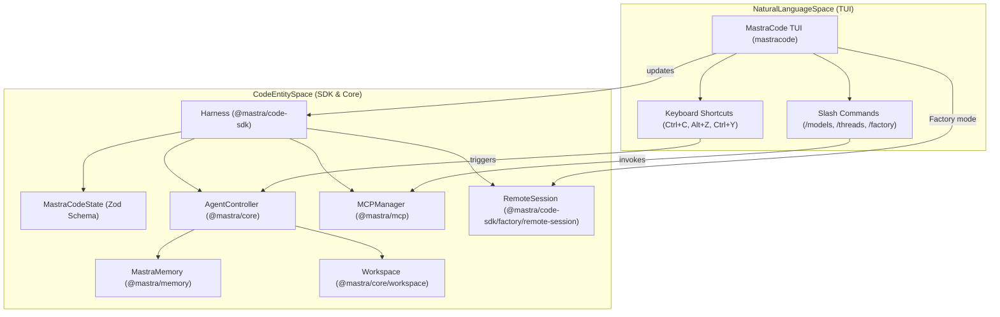
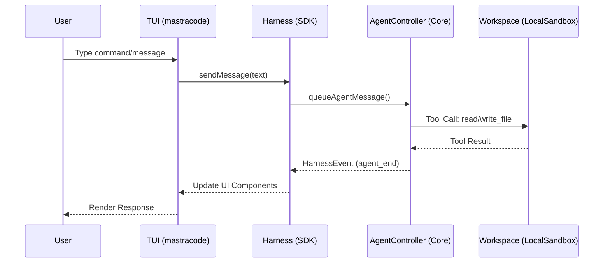

<!-- source: DeepWiki mcp.deepwiki.com · repo mastra-ai/mastra · page 16 Mastra Code and Software Factory · fetched 2026-10-27 -->

# Mastra Code and Software Factory

Relevant source files

The following files were used as context for generating this wiki page:

- [mastracode/factory/CHANGELOG.md](mastracode/factory/CHANGELOG.md)
- [mastracode/factory/package.json](mastracode/factory/package.json)
- [mastracode/mastra-factory/CHANGELOG.md](mastracode/mastra-factory/CHANGELOG.md)
- [mastracode/mastra-factory/package.json](mastracode/mastra-factory/package.json)
- [mastracode/sdk/CHANGELOG.md](mastracode/sdk/CHANGELOG.md)
- [mastracode/sdk/package.json](mastracode/sdk/package.json)
- [mastracode/tui/CHANGELOG.md](mastracode/tui/CHANGELOG.md)
- [mastracode/tui/package.json](mastracode/tui/package.json)

This page provides a high-level overview of the Mastra Code and Software Factory ecosystem. It encompasses the terminal coding agent, the underlying SDK, the Software Factory server, its web UI, and the scaffolding tools for setting up new Factory projects. These components work together to provide an AI-powered software delivery environment.

## Mastra Code (Terminal Coding Agent)

Mastra Code (`mastracode`) is a terminal-based AI coding agent designed for long-running software development projects. It leverages **Observational Memory** to maintain deep project context across persistent conversation threads, avoiding the context window limitations of many other agents. It is built as a specialized implementation of the Mastra framework, utilizing core primitives like `AgentController`, `Agent`, and `Memory`.
Sources:
[mastracode/sdk/package.json:64-65]()
[mastracode/sdk/package.json:58, 64]()

The system is primarily composed of two packages:
1.  **`@mastra/code-sdk`**: This package provides the core logic, including the `Harness` orchestrator, state management, and tool definitions. It is UI-agnostic, allowing for the creation of custom interfaces on top of its functionality.
2.  **`mastracode` (TUI)**: This package delivers the interactive terminal user interface, built using the `pi-tui` library, providing the CLI experience.
Sources:
[mastracode/sdk/package.json:2-4]()
[mastracode/tui/package.json:2-4, 103]()

Mastra Code integrates with a wide array of AI models through a unified provider registry and offers specialized modes (e.g., Plan, Build, Review) to optimize for different development tasks.
Sources:
[mastracode/tui/package.json:97-100]()

### Core Architecture

The Mastra Code architecture is designed to manage local filesystem access, shell execution, and multi-agent coordination.

1.  **The Harness**: This is the central orchestrator, responsible for managing mode switching, thread persistence, and the event-driven lifecycle of agent runs. For details, see [Harness Architecture and Agent Modes](#16.1).
2.  **Agent Modes**: These are contextual configurations that determine the available tools and system prompts. For example, `Plan` mode is typically read-only, while `Build` mode allows file modifications. For details, see [Harness Architecture and Agent Modes](#16.1).
3.  **Observational Memory**: A background system that summarizes interactions to prevent context window overflow while retaining critical project details.

### Mastra Code Entity Mapping

The diagram below illustrates how user-facing TUI elements map to the underlying SDK and Mastra Core entities.

Sources:
[mastracode/sdk/package.json:58, 63, 64, 78]()
[mastracode/tui/package.json:21-23, 103, 105-106]()
[mastracode/sdk/CHANGELOG.md:15-24]()
[mastracode/tui/CHANGELOG.md:7-20]()

### Key Features

-   **Multi-Model Pack Switching**: Users can switch between various model providers (e.g., Anthropic, OpenAI, Amazon Bedrock) mid-conversation.
    Sources:
    [mastracode/sdk/package.json:51-54]()
-   **Smart Editing**: Utilizes structure-aware code transformations, often powered by `ast-grep`, for more intelligent code modifications than simple string replacement.
    Sources:
    [mastracode/sdk/package.json:55]()
-   **MCP Integration**: Enables dynamic tool discovery and execution through the Model Context Protocol.
    Sources:
    [mastracode/sdk/package.json:63]()
-   **YOLO Mode**: A mode that allows the agent to execute shell commands and perform file writes without requiring explicit user approval.
-   **Factory Mode**: The TUI can operate as a thin client for a remote Software Factory session, where the agent, tools, models, and credentials are managed by the Factory. For details, see [TUI Interface and Commands](#16.2).
    Sources:
    [mastracode/tui/CHANGELOG.md:7-20]()

### Integration Flow

The sequence of events from a user's input to an agent's code execution involves the TUI state machine and the Harness event stream.

Sources:
[mastracode/tui/package.json:103, 105-106]()
[mastracode/sdk/package.json:71]()

## Software Factory

The Mastra Software Factory is a backend system (`@mastra/factory`) designed to manage and automate software delivery workflows using AI agents. It provides structured boards and phases for work items, manages sessions and runs, and integrates with various external platforms. For details, see [Software Factory Server (@mastra/factory)](#16.3).
Sources:
[mastracode/factory/package.json:2-4]()

### Key Concepts

-   **Boards and Phases**: Organize work items into distinct stages of the software delivery process.
-   **Work Items**: Represent individual tasks or issues, often synchronized with external systems like GitHub or Jira.
-   **Sessions/Runs/Skills**: Manage the execution of agent tasks, including specific `factory-skills` for review, re-review, and triage. Factory user sessions can start sub-sessions and report back from them. For details, see [Software Factory Server (@mastra/factory)](#16.3).
    Sources:
    [mastracode/factory/CHANGELOG.md:7-15]()
-   **Rules Dispatcher and Transition Service**: Automate the movement of work items between phases based on predefined rules and agent actions.
-   **Workspace Snapshots**: Maintain versions of the codebase for reproducibility and review.
-   **Storage Domains**: Define how Factory data is persisted.
-   **Shared Memory**: Factory sessions (work-item runs, side sessions, Slack channel threads) share memory under the Factory ID, allowing recall search across threads. For details, see [Software Factory Server (@mastra/factory)](#16.3).
    Sources:
    [mastracode/factory/CHANGELOG.md:45-61]()
    [mastracode/sdk/CHANGELOG.md:63-64]()
-   **MCP Server**: Factory includes a built-in MCP server at `/web/factory/projects/:projectId/mcp` for clients like ChatGPT to interact with Factory tools. For details, see [Software Factory Server (@mastra/factory)](#16.3).
    Sources:
    [mastracode/factory/CHANGELOG.md:36-43]()

### Factory Integrations

The Factory integrates with several external platforms to streamline workflows. For details, see [Factory Integrations (GitHub, GitLab, Jira, Slack, Platform)](#16.4).

-   **GitHub**: Manages GitHub App installations, routes for webhooks, and sandboxed environments for agent interactions with repositories. Factory reviews can report test results as `Factory Review / tests` checks on pull requests.
    Sources:
    [mastracode/factory/CHANGELOG.md:65-68]()
-   **GitLab**: Provides similar integration capabilities for GitLab repositories.
-   **Jira**: Allows for intake of issues and synchronization of work item status.
-   **Slack**: Facilitates gateway sessions for agent interaction and notifications. Linked Slack conversations are treated as User Sessions, authorizing interactive tools as the linked sender.
    Sources:
    [mastracode/factory/CHANGELOG.md:32-35]()
-   **incident.io**: Supports follow-up intake and management.
-   **Platform-mediated credentials**: Securely handles credentials for various integrations.
Sources:
[mastracode/factory/CHANGELOG.md:181-201]()

### Factory UI and Web Surface

The `mastracode/factory-ui` package provides the user interface for the Software Factory, allowing users to visualize and interact with work items and agent activities. The `mastracode/web` package serves as the web surface, handling GitHub App integration, Linear intake routes, and general browser-based access to the Factory. For details, see [Factory UI and Web Surface](#16.5).
Sources:
[mastracode/factory/package.json:2-4]()

## `create-factory` Scaffolding

The `create-factory` package (`mastracode/mastra-factory`) is a command-line tool for scaffolding new Mastra Factory projects. It simplifies project setup, template synchronization, and platform provisioning. Production Factory servers now enforce security configurations for credential encryption and sandbox providers. For details, see [create-factory Scaffolding and Templates](#16.6).
Sources:
[mastracode/mastra-factory/package.json:2-4]()
[mastracode/mastra-factory/CHANGELOG.md:7-11]()

### Technical Specifications Summary

| Component | Implementation | Source |
| :--- | :--- | :--- |
| **CLI Binary** | `mastracode` | [mastracode/tui/package.json:22]() |
| **SDK Core** | `@mastra/code-sdk` | [mastracode/sdk/package.json:2]() |
| **Software Factory Core** | `@mastra/factory` | [mastracode/factory/package.json:2]() |
| **Project Scaffolding** | `create-factory` | [mastracode/mastra-factory/package.json:2]() |
| **Shell Execution** | `execa` | [mastracode/sdk/package.json:82]()
| **Runtime** | Node.js >= 22.19.0 | [mastracode/sdk/package.json:105]() |

## Child Pages

### [Harness Architecture and Agent Modes](#16.1)
This page details the `Harness` class, the `MastraCodeState` Zod schema, and the operational modes (Plan, Build, Review). It also covers the plugin system, LSP integration for code intelligence, and how the `MCPManager` handles external tool servers.
Sources:
[mastracode/sdk/package.json:78]()
[mastracode/sdk/package.json:63, 75-76]()

### [TUI Interface and Commands](#16.2)
This page documents the terminal interface components, keyboard shortcuts, and slash commands available in `mastracode`, including the new Factory mode.
Sources:
[mastracode/tui/package.json:21-23]()
[mastracode/tui/CHANGELOG.md:7-20]()

### [Software Factory Server (@mastra/factory)](#16.3)
This page provides an in-depth look at the Factory backend, including boards and phases, work items, sessions/runs/skills, the rules dispatcher and transition service, workspace snapshots, storage domains, shared memory, and the built-in MCP server.
Sources:
[mastracode/factory/package.json:2-4]()
[mastracode/factory/CHANGELOG.md:7-15]()
[mastracode/factory/CHANGELOG.md:36-43]()
[mastracode/factory/CHANGELOG.md:45-61]()

### [Factory Integrations (GitHub, GitLab, Jira, Slack, Platform)](#16.4)
This page covers the Factory's integration layer, detailing the GitHub App (including review test checks), GitLab, Jira, incident.io, and Slack gateway sessions (including linked conversations as User Sessions), as well as `factory-skills` like review, re-review, and triage.
Sources:
[mastracode/factory/CHANGELOG.md:181-201]()
[mastracode/factory/CHANGELOG.md:32-35]()
[mastracode/factory/CHANGELOG.md:65-68]()

### [Factory UI and Web Surface](#16.5)
This page documents the `mastracode/factory-ui` components, such as `BoardPage`, work item cards, chat transcript rendering, and tool cards. It also covers `mastracode/web` for GitHub App integration, Linear intake routes, and browser-based access.

### [create-factory Scaffolding and Templates](#16.6)
This page documents the `create-factory` package, including project scaffolding, template synchronization scripts, platform provisioning, end-to-end tests for the software factory, and the new security requirements for production Factory servers.
Sources:
[mastracode/mastra-factory/package.json:2-4]()
[mastracode/mastra-factory/CHANGELOG.md:7-11]()

---

