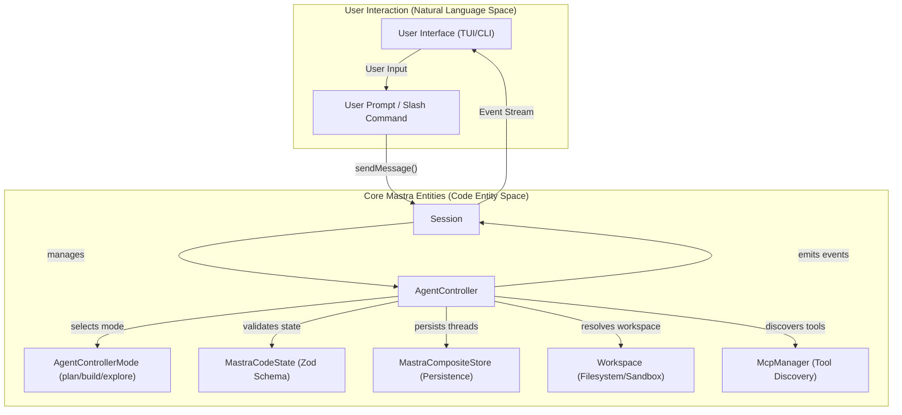
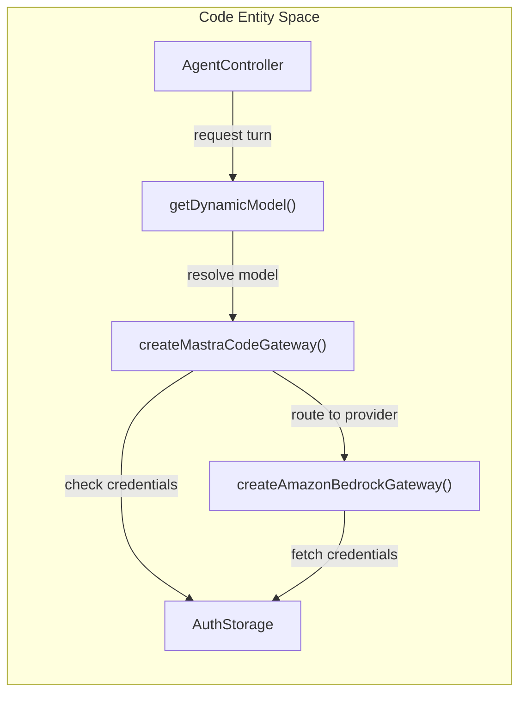

<!-- source: DeepWiki mcp.deepwiki.com · repo mastra-ai/mastra · page 16.1 Harness Architecture and Agent Modes · fetched 2026-10-27 -->

# Harness Architecture and Agent Modes

Relevant source files

The following files were used as context for generating this wiki page:

- [.changeset/no-bare-wake-without-owner.md](.changeset/no-bare-wake-without-owner.md)
- [docs/src/mastra-code/configuration.mdx](docs/src/mastra-code/configuration.mdx)
- [docs/src/mastra-code/customization.mdx](docs/src/mastra-code/customization.mdx)
- [docs/src/mastra-code/goals.mdx](docs/src/mastra-code/goals.mdx)
- [docs/src/mastra-code/headless.mdx](docs/src/mastra-code/headless.mdx)
- [docs/src/mastra-code/index.mdx](docs/src/mastra-code/index.mdx)
- [docs/src/mastra-code/modes.mdx](docs/src/mastra-code/modes.mdx)
- [docs/src/mastra-code/reference.mdx](docs/src/mastra-code/reference.mdx)
- [docs/src/mastra-code/themes.mdx](docs/src/mastra-code/themes.mdx)
- [docs/src/mastra-code/tools.mdx](docs/src/mastra-code/tools.mdx)
- [mastracode/factory-ui/src/hooks/useAvailableModels.ts](mastracode/factory-ui/src/hooks/useAvailableModels.ts)
- [mastracode/factory-ui/src/ui/domains/chat/components/StatusLine/ModelCredential.tsx](mastracode/factory-ui/src/ui/domains/chat/components/StatusLine/ModelCredential.tsx)
- [mastracode/factory-ui/src/ui/domains/chat/components/StatusLine/OperationalMemoryStatus.tsx](mastracode/factory-ui/src/ui/domains/chat/components/StatusLine/OperationalMemoryStatus.tsx)
- [mastracode/factory-ui/src/ui/domains/chat/components/StatusLine/__tests__/ModelCredential.msw.test.tsx](mastracode/factory-ui/src/ui/domains/chat/components/StatusLine/__tests__/ModelCredential.msw.test.tsx)
- [mastracode/factory/src/routes/config.test.ts](mastracode/factory/src/routes/config.test.ts)
- [mastracode/factory/src/routes/config.ts](mastracode/factory/src/routes/config.ts)
- [mastracode/factory/src/routes/session-model-catalog.test.ts](mastracode/factory/src/routes/session-model-catalog.test.ts)
- [mastracode/factory/src/session/memory-settings-hydration.test.ts](mastracode/factory/src/session/memory-settings-hydration.test.ts)
- [mastracode/factory/src/session/memory-settings-hydration.ts](mastracode/factory/src/session/memory-settings-hydration.ts)
- [mastracode/factory/src/session/org-seed-fail-open.test.ts](mastracode/factory/src/session/org-seed-fail-open.test.ts)
- [mastracode/factory/src/session/org-seed.ts](mastracode/factory/src/session/org-seed.ts)
- [mastracode/sdk/src/__tests__/index.test.ts](mastracode/sdk/src/__tests__/index.test.ts)
- [mastracode/sdk/src/__tests__/notification-wake-without-session.test.ts](mastracode/sdk/src/__tests__/notification-wake-without-session.test.ts)
- [mastracode/sdk/src/agents/__tests__/model.test.ts](mastracode/sdk/src/agents/__tests__/model.test.ts)
- [mastracode/sdk/src/agents/mastracode-gateway.ts](mastracode/sdk/src/agents/mastracode-gateway.ts)
- [mastracode/sdk/src/agents/memory.test.ts](mastracode/sdk/src/agents/memory.test.ts)
- [mastracode/sdk/src/agents/memory.ts](mastracode/sdk/src/agents/memory.ts)
- [mastracode/sdk/src/agents/model.ts](mastracode/sdk/src/agents/model.ts)
- [mastracode/sdk/src/headless/cli.test.ts](mastracode/sdk/src/headless/cli.test.ts)
- [mastracode/sdk/src/headless/cli.ts](mastracode/sdk/src/headless/cli.ts)
- [mastracode/sdk/src/index.test.ts](mastracode/sdk/src/index.test.ts)
- [mastracode/sdk/src/index.ts](mastracode/sdk/src/index.ts)
- [mastracode/sdk/src/knowledge-inspector.test.ts](mastracode/sdk/src/knowledge-inspector.test.ts)
- [mastracode/sdk/src/knowledge-inspector.ts](mastracode/sdk/src/knowledge-inspector.ts)
- [mastracode/sdk/src/knowledge-scope.test.ts](mastracode/sdk/src/knowledge-scope.test.ts)
- [mastracode/sdk/src/knowledge-scope.ts](mastracode/sdk/src/knowledge-scope.ts)
- [mastracode/sdk/src/onboarding/__tests__/packs.test.ts](mastracode/sdk/src/onboarding/__tests__/packs.test.ts)
- [mastracode/sdk/src/onboarding/packs.ts](mastracode/sdk/src/onboarding/packs.ts)
- [mastracode/sdk/src/utils/__tests__/storage-maintenance.test.ts](mastracode/sdk/src/utils/__tests__/storage-maintenance.test.ts)
- [mastracode/sdk/src/utils/storage-maintenance.ts](mastracode/sdk/src/utils/storage-maintenance.ts)
- [mastracode/tui/README.md](mastracode/tui/README.md)
- [mastracode/tui/e2e/terminal-backend.ts](mastracode/tui/e2e/terminal-backend.ts)
- [mastracode/tui/e2e/tui/approval-overlay-focus.ts](mastracode/tui/e2e/tui/approval-overlay-focus.ts)
- [mastracode/tui/e2e/tui/index.ts](mastracode/tui/e2e/tui/index.ts)
- [mastracode/tui/e2e/tui/knowledge-browser.ts](mastracode/tui/e2e/tui/knowledge-browser.ts)
- [mastracode/tui/e2e/tui/startup.ts](mastracode/tui/e2e/tui/startup.ts)
- [mastracode/tui/e2e/tui/stream-error-retry.ts](mastracode/tui/e2e/tui/stream-error-retry.ts)
- [mastracode/tui/e2e/tui/types.ts](mastracode/tui/e2e/tui/types.ts)
- [mastracode/tui/src/main.ts](mastracode/tui/src/main.ts)
- [mastracode/tui/src/tui/__tests__/command-dispatch.test.ts](mastracode/tui/src/tui/__tests__/command-dispatch.test.ts)
- [mastracode/tui/src/tui/__tests__/mastra-tui-queueing.test.ts](mastracode/tui/src/tui/__tests__/mastra-tui-queueing.test.ts)
- [mastracode/tui/src/tui/__tests__/overlay-focus-handoff.test.ts](mastracode/tui/src/tui/__tests__/overlay-focus-handoff.test.ts)
- [mastracode/tui/src/tui/__tests__/setup-keyboard-shortcuts.test.ts](mastracode/tui/src/tui/__tests__/setup-keyboard-shortcuts.test.ts)
- [mastracode/tui/src/tui/__tests__/setup-layout.test.ts](mastracode/tui/src/tui/__tests__/setup-layout.test.ts)
- [mastracode/tui/src/tui/__tests__/status-line.test.ts](mastracode/tui/src/tui/__tests__/status-line.test.ts)
- [mastracode/tui/src/tui/command-dispatch.ts](mastracode/tui/src/tui/command-dispatch.ts)
- [mastracode/tui/src/tui/commands/__tests__/prune.test.ts](mastracode/tui/src/tui/commands/__tests__/prune.test.ts)
- [mastracode/tui/src/tui/commands/index.ts](mastracode/tui/src/tui/commands/index.ts)
- [mastracode/tui/src/tui/commands/prune.ts](mastracode/tui/src/tui/commands/prune.ts)
- [mastracode/tui/src/tui/components/__tests__/help-overlay.test.ts](mastracode/tui/src/tui/components/__tests__/help-overlay.test.ts)
- [mastracode/tui/src/tui/components/help-overlay.ts](mastracode/tui/src/tui/components/help-overlay.ts)
- [mastracode/tui/src/tui/handlers/__tests__/agent-lifecycle.test.ts](mastracode/tui/src/tui/handlers/__tests__/agent-lifecycle.test.ts)
- [mastracode/tui/src/tui/handlers/__tests__/tool.test.ts](mastracode/tui/src/tui/handlers/__tests__/tool.test.ts)
- [mastracode/tui/src/tui/handlers/agent-lifecycle.ts](mastracode/tui/src/tui/handlers/agent-lifecycle.ts)
- [mastracode/tui/src/tui/mastra-tui.ts](mastracode/tui/src/tui/mastra-tui.ts)
- [mastracode/tui/src/tui/render-messages.ts](mastracode/tui/src/tui/render-messages.ts)
- [mastracode/tui/src/tui/setup.ts](mastracode/tui/src/tui/setup.ts)
- [mastracode/tui/src/tui/state.ts](mastracode/tui/src/tui/state.ts)
- [mastracode/tui/src/tui/status-line.ts](mastracode/tui/src/tui/status-line.ts)
- [packages/core/src/workspace/sandbox/local-process-manager-termination.test.ts](packages/core/src/workspace/sandbox/local-process-manager-termination.test.ts)
- [packages/core/src/workspace/sandbox/local-sandbox-timeout.test.ts](packages/core/src/workspace/sandbox/local-sandbox-timeout.test.ts)

The **Harness** is the core orchestration abstraction in Mastra used to manage multi-mode agent interactions within a coherent conversational context. It provides thread persistence, shared state management with schema validation, event handling, and mode switching to customize agent behaviors. The Harness acts as the bridge between user-facing interfaces (e.g., terminal UI) and Mastra's core systems like Agents, Memory, Storage, and Workspace providers.

In the `@mastra/code-sdk` package, this architecture is extended to support specialized coding modes, Model Context Protocol (MCP) management, and robust error recovery via stream processors. The `AgentController` class serves as the shared host that creates isolated sessions and coordinates these agents, tools, and workspaces [mastracode/sdk/src/index.ts:7-18]().

---

## Harness Architecture

The `Harness` (instantiated via `AgentController` in the Mastra Software Factory) encapsulates components required for managing agent concurrency, state, and I/O across multiple modes. It exposes APIs for initiating sessions, processing incoming messages, switching modes, and observing event streams [mastracode/sdk/src/index.ts:176-179]().

### Core Responsibilities

- **Mode Management:** Supports multiple modes representing distinct agent configurations (e.g., `plan`, `build`, `explore`). Each mode can specify a model, toolsets, and instructions [mastracode/sdk/src/agents/modes/build.js:1-1](), [mastracode/sdk/src/agents/modes/explore.js:1-1](), [mastracode/sdk/src/agents/modes/plan.js:1-1]().
- **Session & Thread Persistence:** Manages persistent conversation threads scoped by resource IDs tied to projects or repository roots. The `registerSessionAndWaitForMaintenance` and `unregisterSession` utilities ensure concurrency safety and proper shutdown [mastracode/sdk/src/utils/maintenance-lock.js:1-1]().
- **State Management:** Maintains a shared JSON-serializable state validated against a Zod schema (`MastraCodeState`) for robust client-server state synchronization [mastracode/sdk/src/schema.js:1-1]().
- **Event Subscription:** Provides an event system to notify client UIs of intermediate streaming updates, agent lifecycle events, and tool suspensions via `AgentControllerEvent` [mastracode/sdk/src/index.ts:12]().
- **Transient Error Recovery:** Handles transient connection failures (e.g., `ECONNRESET`, `EPIPE`) and server errors (500, 502, 503) using a `StreamErrorRetryProcessor` with exponential backoff [mastracode/sdk/src/index.ts:32]().

### Architecture Diagram: Natural Language to Code Entity Flow

Sources: [mastracode/sdk/src/index.ts:7-18](), [mastracode/sdk/src/index.ts:32](), [mastracode/sdk/src/index.ts:113](), [mastracode/sdk/src/agents/modes/build.js:1-1](), [mastracode/sdk/src/agents/modes/explore.js:1-1](), [mastracode/sdk/src/agents/modes/plan.js:1-1](), [mastracode/sdk/src/schema.js:1-1](), [mastracode/sdk/src/utils/maintenance-lock.js:1-1]()

---

## Harness Modes

An `AgentControllerMode` supplies a tailored agent configuration that dictates the agent's role, default model, instructions, and tool access.

### `AgentControllerMode` Structure

| Mode | Purpose | Key Symbols |
|---|---|---|
| **Plan** | Analyzes requirements and generates a step-by-step implementation plan. | `createPlanMode` [mastracode/sdk/src/agents/modes/plan.js:1-1]() |
| **Build** | Executes code changes, manages files, and runs terminal commands. | `buildMode` [mastracode/sdk/src/agents/modes/build.js:1-1]() |
| **Explore** | General purpose exploration and codebase querying. | `fastMode` [mastracode/sdk/src/agents/modes/explore.js:1-1]() |

### Mode Transitions and Persistence
The `/model` and `/models` commands allow users to change the model for the current mode at runtime. These changes persist across sessions [mastracode/tui/src/tui/mastra-tui.ts:145-156](). The `THREAD_ACTIVE_MODEL_PACK_ID_KEY` is used to store the active model pack ID in thread metadata [mastracode/tui/src/tui/mastra-tui.ts:23]().

Sources: [mastracode/sdk/src/agents/modes/build.js:1-1](), [mastracode/sdk/src/agents/modes/explore.js:1-1](), [mastracode/sdk/src/agents/modes/plan.js:1-1](), [mastracode/tui/src/tui/mastra-tui.ts:23](), [mastracode/tui/src/tui/mastra-tui.ts:145-156]()

---

## Thread Persistence and State Management

The Harness manages persistent conversational threads scoped by resource IDs. Thread state, including "caveman state" (Observational Memory state), is attached to the persistence layer to survive restarts via `attachOMThreadStatePersistence` and `restoreOMThreadStateForCurrentThread` [mastracode/sdk/src/agents/thread-caveman-state.js:1-1]().

### State Schema and Validation
The `MastraCodeState` schema defines the valid structure for agent memory and session data. It includes fields for project identity, active mode, and task progress [mastracode/sdk/src/schema.js:1-1](). This schema is used for Zod validation [mastracode/sdk/src/index.ts:134]().

### Storage Adapters
Mastra Code supports multiple storage backends for thread and vector persistence:
- **LibSQL:** Default for local storage via `LibSQLStore` and `LibSQLVector` [mastracode/sdk/src/index.ts:46]().
- **DuckDB:** Used for local analytical tasks via `DuckDBStore` [mastracode/sdk/src/index.ts:43]().
The `MastraCompositeStore` is used to combine these storage solutions [mastracode/sdk/src/index.ts:40]().

Sources: [mastracode/sdk/src/index.ts:40](), [mastracode/sdk/src/index.ts:43](), [mastracode/sdk/src/index.ts:46](), [mastracode/sdk/src/index.ts:134](), [mastracode/sdk/src/agents/thread-caveman-state.js:1-1](), [mastracode/sdk/src/schema.js:1-1]()

---

## MCP Manager and LSP Integration

The Harness architecture supports deep integration with development tools via the Model Context Protocol (MCP) and Language Server Protocol (LSP).

### MCP Manager
The `createMcpManager` function initializes the MCP subsystem, allowing the Harness to connect to external MCP servers (via Stdio or SSE) and expose their tools to the agent [mastracode/sdk/src/index.ts:102](). The `McpManager` handles these connections, managing lifecycle and namespacing [mastracode/sdk/src/mcp/index.ts:1-1]().

### LSP Integration
The SDK integrates with `vscode-languageserver-protocol` to provide agents with code intelligence (definitions, references, diagnostics) [mastracode/sdk/src/onboarding/settings.js:161](). The `lsp` field in settings stores LSP configuration [mastracode/sdk/src/onboarding/settings.js:161]().

Sources: [mastracode/sdk/src/index.ts:102](), [mastracode/sdk/src/mcp/index.ts:1-1](), [mastracode/sdk/src/onboarding/settings.js:161]()

---

## Provider Configuration

The Harness dynamically resolves models and credentials for various providers. The `@mastra/code-sdk` includes pre-configured support for major coding LLMs:

- **Amazon Bedrock:** Integrated via `createAmazonBedrockGateway` [mastracode/sdk/src/index.ts:118]().
- **GitHub Copilot:** Supported with specialized auth storage via `setGitHubCopilotAuthStorage` [mastracode/sdk/src/index.ts:121]().
- **OpenAI Codex:** Integrated via `setOpenAIAuthStorage` [mastracode/sdk/src/index.ts:123]().
- **Kimi For Coding:** Recently added support for Kimi account authentication and model routing via `setKimiCodingAuthStorage` [mastracode/sdk/src/index.ts:122]().
- **xAI:** Supported via `setXAIAuthStorage` [mastracode/sdk/src/index.ts:124]().
- **Anthropic (Claude):** Supported via `setAuthStorage` [mastracode/sdk/src/index.ts:119]().

### Model Resolution Diagram

Sources: [mastracode/sdk/src/index.ts:69](), [mastracode/sdk/src/index.ts:118-124](), [mastracode/sdk/src/agents/model.js:1-1]()

---

## Headless CLI Mode

The Harness is designed to run in headless environments (CLI) without a TUI.
- **Headless Export:** The `mastracode` package provides a `./headless` export for direct SDK interaction [mastracode/sdk/src/headless/cli.ts:1-1](). The `runMCCli` function is the entry point for the headless CLI [mastracode/tui/src/main.ts:13]().
- **Plugin System:** The `PluginManager` allows extending the headless agent's capabilities with custom processors and signal lanes [mastracode/sdk/src/index.ts:114](). `PluginSignalLane` is used for signal processing [mastracode/sdk/src/index.ts:115]().
- **Workspace Resolution:** The `getDynamicWorkspace` function resolves the appropriate filesystem and sandbox providers based on the session context [mastracode/sdk/src/index.ts:89]().

Sources: [mastracode/sdk/src/index.ts:89](), [mastracode/sdk/src/index.ts:114-115](), [mastracode/sdk/src/headless/cli.ts:1-1](), [mastracode/tui/src/main.ts:13]()

---

