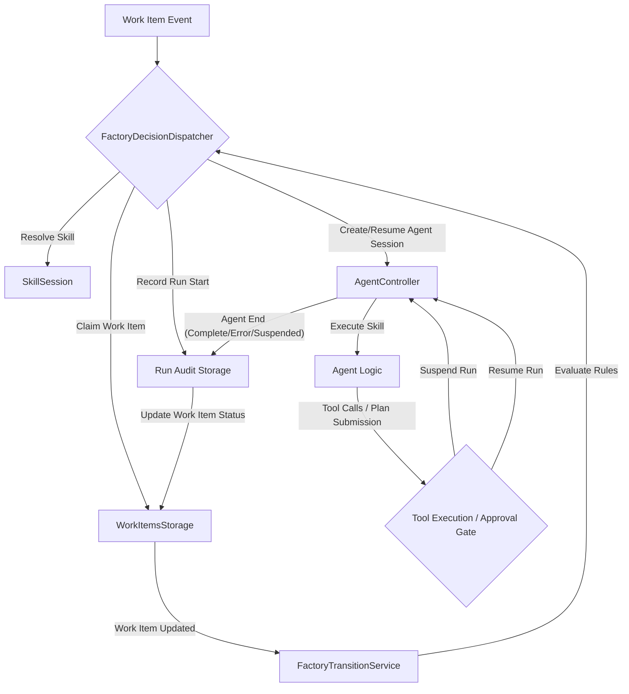
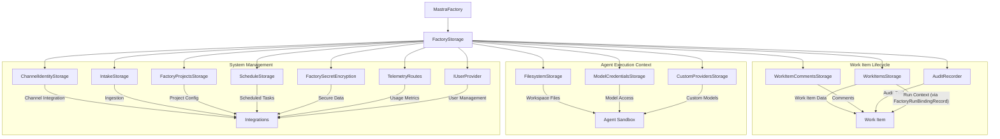

<!-- source: DeepWiki mcp.deepwiki.com · repo mastra-ai/mastra · page 16.3 Software Factory Server (@mastra/factory) · fetched 2026-10-27 -->

# Software Factory Server (@mastra/factory)

<details>
<summary>Relevant source files</summary>

The following files were used as context for generating this wiki page:

- [.changeset/afraid-queens-beg.md](.changeset/afraid-queens-beg.md)
- [.changeset/full-eyes-read.md](.changeset/full-eyes-read.md)
- [.changeset/long-showers-report.md](.changeset/long-showers-report.md)
- [.changeset/loud-regions-flow.md](.changeset/loud-regions-flow.md)
- [.changeset/model-intent-session-switch.md](.changeset/model-intent-session-switch.md)
- [.changeset/quiet-owls-gather.md](.changeset/quiet-owls-gather.md)
- [mastracode/factory/README.md](mastracode/factory/README.md)
- [mastracode/factory/factory-skills/configure-factory-rules/SKILL.md](mastracode/factory/factory-skills/configure-factory-rules/SKILL.md)
- [mastracode/factory/src/boards/define-board.test.ts](mastracode/factory/src/boards/define-board.test.ts)
- [mastracode/factory/src/boards/define-board.ts](mastracode/factory/src/boards/define-board.ts)
- [mastracode/factory/src/boards/index.ts](mastracode/factory/src/boards/index.ts)
- [mastracode/factory/src/boards/review.test.ts](mastracode/factory/src/boards/review.test.ts)
- [mastracode/factory/src/boards/review.ts](mastracode/factory/src/boards/review.ts)
- [mastracode/factory/src/boards/transition-policy.test.ts](mastracode/factory/src/boards/transition-policy.test.ts)
- [mastracode/factory/src/boards/transition-policy.ts](mastracode/factory/src/boards/transition-policy.ts)
- [mastracode/factory/src/boards/work-transition-policy.ts](mastracode/factory/src/boards/work-transition-policy.ts)
- [mastracode/factory/src/boards/work.ts](mastracode/factory/src/boards/work.ts)
- [mastracode/factory/src/factory.test.ts](mastracode/factory/src/factory.test.ts)
- [mastracode/factory/src/factory.ts](mastracode/factory/src/factory.ts)
- [mastracode/factory/src/index.ts](mastracode/factory/src/index.ts)
- [mastracode/factory/src/integrations/base.ts](mastracode/factory/src/integrations/base.ts)
- [mastracode/factory/src/integrations/github/default-rules.test.ts](mastracode/factory/src/integrations/github/default-rules.test.ts)
- [mastracode/factory/src/integrations/github/default-rules.ts](mastracode/factory/src/integrations/github/default-rules.ts)
- [mastracode/factory/src/integrations/github/rules.test.ts](mastracode/factory/src/integrations/github/rules.test.ts)
- [mastracode/factory/src/integrations/github/rules.ts](mastracode/factory/src/integrations/github/rules.ts)
- [mastracode/factory/src/integrations/gitlab/default-rules.test.ts](mastracode/factory/src/integrations/gitlab/default-rules.test.ts)
- [mastracode/factory/src/integrations/gitlab/default-rules.ts](mastracode/factory/src/integrations/gitlab/default-rules.ts)
- [mastracode/factory/src/integrations/slack/channel-reply-processor.test.ts](mastracode/factory/src/integrations/slack/channel-reply-processor.test.ts)
- [mastracode/factory/src/integrations/slack/channel-reply-processor.ts](mastracode/factory/src/integrations/slack/channel-reply-processor.ts)
- [mastracode/factory/src/integrations/slack/channel-session-link-processor.test.ts](mastracode/factory/src/integrations/slack/channel-session-link-processor.test.ts)
- [mastracode/factory/src/integrations/slack/channel-session-link-processor.ts](mastracode/factory/src/integrations/slack/channel-session-link-processor.ts)
- [mastracode/factory/src/integrations/slack/channel-tools.test.ts](mastracode/factory/src/integrations/slack/channel-tools.test.ts)
- [mastracode/factory/src/integrations/slack/integration.test.ts](mastracode/factory/src/integrations/slack/integration.test.ts)
- [mastracode/factory/src/integrations/slack/integration.ts](mastracode/factory/src/integrations/slack/integration.ts)
- [mastracode/factory/src/integrations/slack/reply-reminder-processor.scenario.test.ts](mastracode/factory/src/integrations/slack/reply-reminder-processor.scenario.test.ts)
- [mastracode/factory/src/integrations/slack/slack.test.ts](mastracode/factory/src/integrations/slack/slack.test.ts)
- [mastracode/factory/src/integrations/slack/slack.ts](mastracode/factory/src/integrations/slack/slack.ts)
- [mastracode/factory/src/review-verdict.ts](mastracode/factory/src/review-verdict.ts)
- [mastracode/factory/src/routes/surface.test.ts](mastracode/factory/src/routes/surface.test.ts)
- [mastracode/factory/src/routes/surface.ts](mastracode/factory/src/routes/surface.ts)
- [mastracode/factory/src/routes/work-items.test.ts](mastracode/factory/src/routes/work-items.test.ts)
- [mastracode/factory/src/routes/work-items.ts](mastracode/factory/src/routes/work-items.ts)
- [mastracode/factory/src/rules/binding-context.ts](mastracode/factory/src/rules/binding-context.ts)
- [mastracode/factory/src/rules/default-handlers.test.ts](mastracode/factory/src/rules/default-handlers.test.ts)
- [mastracode/factory/src/rules/dispatch-errors.ts](mastracode/factory/src/rules/dispatch-errors.ts)
- [mastracode/factory/src/rules/dispatcher.test.ts](mastracode/factory/src/rules/dispatcher.test.ts)
- [mastracode/factory/src/rules/dispatcher.ts](mastracode/factory/src/rules/dispatcher.ts)
- [mastracode/factory/src/rules/processor.test.ts](mastracode/factory/src/rules/processor.test.ts)
- [mastracode/factory/src/rules/processor.ts](mastracode/factory/src/rules/processor.ts)
- [mastracode/factory/src/rules/resolve.test.ts](mastracode/factory/src/rules/resolve.test.ts)
- [mastracode/factory/src/rules/start-coordinator.test.ts](mastracode/factory/src/rules/start-coordinator.test.ts)
- [mastracode/factory/src/rules/start-coordinator.ts](mastracode/factory/src/rules/start-coordinator.ts)
- [mastracode/factory/src/rules/tools.test.ts](mastracode/factory/src/rules/tools.test.ts)
- [mastracode/factory/src/rules/tools.ts](mastracode/factory/src/rules/tools.ts)
- [mastracode/factory/src/rules/transition-service.test.ts](mastracode/factory/src/rules/transition-service.test.ts)
- [mastracode/factory/src/rules/transition-service.ts](mastracode/factory/src/rules/transition-service.ts)
- [mastracode/factory/src/rules/types.ts](mastracode/factory/src/rules/types.ts)
- [mastracode/factory/src/rules/validation.test.ts](mastracode/factory/src/rules/validation.test.ts)
- [mastracode/factory/src/rules/validation.ts](mastracode/factory/src/rules/validation.ts)
- [mastracode/factory/src/session/factory-session.test.ts](mastracode/factory/src/session/factory-session.test.ts)
- [mastracode/factory/src/session/factory-session.ts](mastracode/factory/src/session/factory-session.ts)
- [mastracode/factory/src/storage/domains/source-control/base.test.ts](mastracode/factory/src/storage/domains/source-control/base.test.ts)
- [mastracode/factory/src/storage/domains/source-control/base.ts](mastracode/factory/src/storage/domains/source-control/base.ts)
- [mastracode/factory/src/storage/domains/source-control/inmemory.ts](mastracode/factory/src/storage/domains/source-control/inmemory.ts)
- [mastracode/factory/src/storage/domains/work-items/base.test.ts](mastracode/factory/src/storage/domains/work-items/base.test.ts)
- [mastracode/factory/src/storage/domains/work-items/base.ts](mastracode/factory/src/storage/domains/work-items/base.ts)
- [mastracode/factory/src/storage/domains/work-items/metrics.test.ts](mastracode/factory/src/storage/domains/work-items/metrics.test.ts)
- [mastracode/factory/src/storage/domains/work-items/metrics.ts](mastracode/factory/src/storage/domains/work-items/metrics.ts)
- [mastracode/factory/src/tools/approval-tools.ts](mastracode/factory/src/tools/approval-tools.ts)
- [mastracode/factory/src/tools/deliver.test.ts](mastracode/factory/src/tools/deliver.test.ts)
- [mastracode/factory/src/tools/deliver.ts](mastracode/factory/src/tools/deliver.ts)
- [mastracode/factory/src/tools/index.ts](mastracode/factory/src/tools/index.ts)
- [mastracode/factory/src/tools/messaging-tools.test.ts](mastracode/factory/src/tools/messaging-tools.test.ts)
- [mastracode/factory/src/tools/messaging-tools.ts](mastracode/factory/src/tools/messaging-tools.ts)
- [mastracode/factory/src/tools/permissions.ts](mastracode/factory/src/tools/permissions.ts)
- [mastracode/factory/src/tools/run-watch.test.ts](mastracode/factory/src/tools/run-watch.test.ts)
- [mastracode/factory/src/tools/run-watch.ts](mastracode/factory/src/tools/run-watch.ts)
- [mastracode/factory/src/tools/scope.test.ts](mastracode/factory/src/tools/scope.test.ts)
- [mastracode/factory/src/tools/scope.ts](mastracode/factory/src/tools/scope.ts)
- [mastracode/factory/src/tools/session-tools.test.ts](mastracode/factory/src/tools/session-tools.test.ts)
- [mastracode/factory/src/tools/session-tools.ts](mastracode/factory/src/tools/session-tools.ts)
- [mastracode/factory/src/tools/sessions-state-processor.test.ts](mastracode/factory/src/tools/sessions-state-processor.test.ts)
- [mastracode/factory/src/tools/sessions-state-processor.ts](mastracode/factory/src/tools/sessions-state-processor.ts)
- [mastracode/factory/src/tools/work-item-tools.test.ts](mastracode/factory/src/tools/work-item-tools.test.ts)
- [mastracode/factory/src/tools/work-item-tools.ts](mastracode/factory/src/tools/work-item-tools.ts)
- [mastracode/factory/src/work-item-branch.test.ts](mastracode/factory/src/work-item-branch.test.ts)
- [mastracode/factory/src/work-item-branch.ts](mastracode/factory/src/work-item-branch.ts)

</details>


The `@mastra/factory` package provides the backend services for the Mastra Software Factory. It orchestrates agent-powered software delivery by managing work items, their lifecycle through boards and phases, and the execution of agent sessions and skills. It also handles workspace snapshots, integrates with various external platforms, and defines the storage domains for Factory-specific data.

Sources:
- [mastracode/factory/README.md:3-3]()

## Core Concepts

The Software Factory operates on several key abstractions:

*   **Boards and Phases**: Boards represent a high-level view of work, while phases define the stages within a board that a work item progresses through.
*   **Work Items**: The fundamental unit of work in the Factory, representing tasks, issues, pull requests, or other actionable items.
*   **Sessions/Runs/Skills**: Agent sessions are created to address work items, executing specific skills (pre-defined agent capabilities) through runs.
*   **Rules Dispatcher and Transition Service**: These components automate the movement of work items between phases based on defined rules and agent decisions.
*   **Workspace Snapshots**: Capture the state of an agent's working environment at specific points, enabling reproducibility and debugging.
*   **Storage Domains**: Dedicated storage layers for Factory-specific data, such as work items, audit logs, and session details.

## Boards and Phases

Boards provide a structured way to visualize and manage the flow of work. Each board is composed of several phases, representing distinct stages in the software delivery process. For example, a typical board might have phases like "Intake", "Triage", "Planning", "Building", and "Review".

The Factory defines a `BoardRegistry` to manage and retrieve installed boards [mastracode/factory/src/factory.ts:52](). Boards can be defined using `defineBoard` [mastracode/factory/src/boards/index.js:3](). The `MastraFactory` constructor accepts an array of `boards` [mastracode/factory/README.md:85]().

Work items transition between phases based on rules and agent actions. The `workItemPhaseSemantics` function [mastracode/factory/src/rules/dispatcher.ts:11]() helps determine the meaning of a phase (e.g., whether it's a terminal phase).

Sources:
- [mastracode/factory/README.md:85]()
- [mastracode/factory/src/boards/index.js:3]()
- [mastracode/factory/src/factory.ts:52]()
- [mastracode/factory/src/rules/dispatcher.ts:11]()

## Work Items

A `WorkItem` is the central entity in the Software Factory, representing a piece of work that agents can act upon. Work items are stored in the `WorkItemsStorage` domain [mastracode/factory/src/storage/domains/work-items/base.ts:34]().

Each work item has:
*   An `externalSource` (e.g., a GitHub issue, a Linear issue) [mastracode/factory/src/storage/domains/work-items/base.ts:59]().
*   A `title` and a list of `stages` (phases) it has been through [mastracode/factory/src/rules/dispatcher.test.ts:28-29]().
*   Associated `sessions` and `metadata` [mastracode/factory/src/rules/dispatcher.test.ts:29-30]().

The `WorkItemsStorage` provides methods for `upsert`ing and managing work items [mastracode/factory/src/storage/domains/work-items/base.ts:33](). Conflicts during updates are handled by `WorkItemUpdateConflictError` [mastracode/factory/src/storage/domains/work-items/base.ts:10]().

Sources:
- [mastracode/factory/src/rules/dispatcher.test.ts:28-30]()
- [mastracode/factory/src/storage/domains/work-items/base.ts:10]()
- [mastracode/factory/src/storage/domains/work-items/base.ts:33]()
- [mastracode/factory/src/storage/domains/work-items/base.ts:34]()
- [mastracode/factory/src/storage/domains/work-items/base.ts:59]()

## Sessions, Runs, and Skills

When an agent interacts with a work item, it initiates a **session**. Within a session, agents perform **runs** to execute specific **skills**. Skills are pre-defined agent capabilities, such as `factory-review`, `factory-rereview`, or `factory-triage` [mastracode/factory/factory-skills/configure-factory-rules/SKILL.md]().

The `FactoryDecisionDispatcher` [mastracode/factory/src/rules/dispatcher.ts:41]() is responsible for starting and managing these runs. It uses an `AgentController` [mastracode/factory/src/rules/dispatcher.ts:2]() to interact with the agent.

Key aspects of sessions and runs:
*   **Run Binding**: A `FactoryRunBindingRecord` [mastracode/factory/src/rules/dispatcher.ts:34]() links a run to a specific work item and its context.
*   **Skill Invocation**: The dispatcher resolves skill invocations using `resolveSkillInvocation` [mastracode/factory/src/rules/dispatcher.ts:23]() and `resolveSkillResumeInvocation` [mastracode/factory/src/rules/dispatcher.ts:23]().
*   **Run Auditing**: `recordSessionRunStart` [mastracode/factory/src/rules/dispatcher.ts:19]() and `waitForSessionRunAudit` [mastracode/factory/src/rules/dispatcher.ts:21]() track the lifecycle of runs.
*   **Session State**: The `LiveSessions` class [mastracode/factory/src/routes/surface.ts:91]() manages active sessions.
*   **Workspace Snapshots**: During a session, the agent's workspace can be snapshotted. The `FactorySandbox` interface [mastracode/factory/src/factory.ts:39]() is used to describe and manage these sandbox environments.

### Diagram: Session and Run Lifecycle



Sources:
- [mastracode/factory/factory-skills/configure-factory-rules/SKILL.md]()
- [mastracode/factory/src/factory.ts:39]()
- [mastracode/factory/src/rules/dispatcher.ts:2]()
- [mastracode/factory/src/rules/dispatcher.ts:19]()
- [mastracode/factory/src/rules/dispatcher.ts:21]()
- [mastracode/factory/src/rules/dispatcher.ts:23]()
- [mastracode/factory/src/rules/dispatcher.ts:34]()
- [mastracode/factory/src/rules/dispatcher.ts:41]()
- [mastracode/factory/src/routes/surface.ts:91]()

## Rules Dispatcher and Transition Service

The `FactoryDecisionDispatcher` [mastracode/factory/src/rules/dispatcher.ts:41]() is the core component for automating work item progression. It listens for events, evaluates rules, and dispatches actions.

Key responsibilities:
*   **Claiming Work Items**: It claims work items to prevent concurrent processing [mastracode/factory/src/storage/domains/work-items/base.ts:28]().
*   **Decision Making**: It processes `FactoryCommitDecision` [mastracode/factory/src/rules/types.ts:16]() objects, which represent actions to be taken on a work item (e.g., `invokeSkill`, `sendMessage`, `transitionPhase`) [mastracode/factory/src/rules/dispatcher.ts:75-76]().
*   **Run Management**: It starts and monitors agent runs, handling suspensions and completions [mastracode/factory/src/rules/dispatcher.ts:117-118]().
*   **Error Handling**: It identifies terminal failures and handles retry logic for transient errors [mastracode/factory/src/rules/dispatcher.ts:128-129]().

The `FactoryTransitionService` [mastracode/factory/src/rules/transition-service.ts:10]() works in conjunction with the dispatcher. It's responsible for applying phase transitions to work items based on decisions made by agents or rules. It ensures that work items move through the defined phases correctly.

The `FactoryPhaseStateProcessor` [mastracode/factory/src/rules/processor.ts:10]() is a processor that applies phase-related state changes to work items.

Sources:
- [mastracode/factory/src/rules/dispatcher.ts:41]()
- [mastracode/factory/src/rules/dispatcher.ts:75-76]()
- [mastracode/factory/src/rules/dispatcher.ts:117-118]()
- [mastracode/factory/src/rules/dispatcher.ts:128-129]()
- [mastracode/factory/src/rules/processor.ts:10]()
- [mastracode/factory/src/rules/transition-service.ts:10]()
- [mastracode/factory/src/rules/types.ts:16]()
- [mastracode/factory/src/storage/domains/work-items/base.ts:28]()

### Diagram: Rules Dispatcher and Transition Service Flow

```mermaid
graph TD
    A[Work Item Event] --> B{FactoryDecisionDispatcher};
    B -- "Claim Work Item" --> C[WorkItemsStorage];
    B -- "Evaluate Rules" --> D[FactoryRuleActor];
    D -- "Generate Decisions (e.g., invokeSkill, transitionPhase)" --> B;
    B -- "Process Decisions" --> E{Decision Type};
    E -- "invokeSkill" --> F[AgentController (Start/Resume Run)];
    E -- "transitionPhase" --> G[FactoryTransitionService];
    G -- "Apply Phase Change" --> C;
    F -- "Run Completes/Suspends" --> B;
    B -- "Record Audit" --> H[AuditStorage];
    C -- "Work Item State Change" --> B;
```

Sources:
- [mastracode/factory/src/rules/dispatcher.ts:41]()
- [mastracode/factory/src/rules/processor.ts:10]()
- [mastracode/factory/src/rules/transition-service.ts:10]()
- [mastracode/factory/src/rules/types.ts:16]()
- [mastracode/factory/src/storage/domains/audit/domain.ts:10]()
- [mastracode/factory/src/storage/domains/work-items/base.ts:34]()

## Workspace Snapshots

The Software Factory leverages the `Workspace` abstraction from `@mastra/core` to provide agents with a file system and execution environment. For Factory-specific operations, the `FactorySandbox` interface [mastracode/factory/src/factory.ts:39]() is used to configure and manage these workspaces.

Workspace snapshots are crucial for:
*   **Reproducibility**: Capturing the state of the agent's environment at a given point.
*   **Debugging**: Allowing developers to inspect the exact state an agent was in.
*   **Context Switching**: Enabling agents to seamlessly switch between different tasks or work items while preserving their working context.

The `observeSessionFilesystem` [mastracode/factory/src/session/filesystem-capture.ts:10]() function is used to capture filesystem changes within a session. The `SessionRetirementCoordinator` [mastracode/factory/src/sandbox/session-retirement.ts:10]() manages the lifecycle of these sandbox environments.

Sources:
- [mastracode/factory/src/factory.ts:39]()
- [mastracode/factory/src/sandbox/session-retirement.ts:10]()
- [mastracode/factory/src/session/filesystem-capture.ts:10]()

## Storage Domains

The `@mastra/factory` package defines several specialized storage domains to persist Factory-specific data. These domains are built on top of the general `MastraStorage` abstraction.

Key storage domains include:
*   **Work Items Storage**: `WorkItemsStorage` [mastracode/factory/src/storage/domains/work-items/base.ts:34]() stores the details and state of all work items.
*   **Audit Storage**: `AuditRecorder` [mastracode/factory/src/rules/dispatcher.ts:25]() records actions performed by agents and the system, providing an auditable trail.
*   **Channel Identity Storage**: `ChannelIdentityStorage` [mastracode/factory/src/integrations/slack/slack.ts:37]() stores information related to communication channels (e.g., Slack).
*   **Comments Storage**: `WorkItemCommentsStorage` [mastracode/factory/src/storage/domains/work-items/base.ts:22]() and `CommentsDomain` [mastracode/factory/src/integrations/slack/slack.ts:114]() manage comments and discussions associated with work items.
*   **Credentials Storage**: `ModelCredentialsStorage` [mastracode/factory/src/routes/surface.ts:112]() stores credentials for various models and integrations.
*   **Custom Providers Storage**: `CustomProvidersStorage` [mastracode/factory/src/routes/surface.ts:113]() for custom model providers.
*   **Filesystem Storage**: `FilesystemStorage` [mastracode/factory/src/routes/surface.ts:114]() for agent workspace files.
*   **Intake Storage**: `IntakeStorage` [mastracode/factory/src/routes/surface.ts:111]() for incoming work item data.
*   **Project Storage**: `FactoryProjectsStorage` [mastracode/factory/src/routes/surface.ts:116]() for Factory project configurations.
*   **Run Binding Storage**: `FactoryRunBindingRecord` [mastracode/factory/src/rules/dispatcher.ts:34]() are stored within the `WorkItemsStorage`.
*   **Schedule Storage**: `ScheduleStorage` [mastracode/factory/src/factory.ts:190]() for scheduled tasks.
*   **Secret Storage**: `FactorySecretEncryption` [mastracode/factory/src/factory.ts:109]() for encrypted secrets.
*   **Telemetry Storage**: `TelemetryRoutes` [mastracode/factory/src/factory.ts:88]() handles telemetry data.
*   **User Storage**: `IUserProvider` [mastracode/factory/src/routes/surface.ts:95]() for user-related data.

These storage domains are typically initialized and managed by the `MastraFactory` class [mastracode/factory/src/factory.ts:2]().

### Diagram: Factory Storage Domains



Sources:
- [mastracode/factory/src/factory.ts:2]()
- [mastracode/factory/src/factory.ts:88]()
- [mastracode/factory/src/factory.ts:109]()
- [mastracode/factory/src/factory.ts:190]()
- [mastracode/factory/src/integrations/slack/slack.ts:37]()
- [mastracode/factory/src/integrations/slack/slack.ts:114]()
- [mastracode/factory/src/rules/dispatcher.ts:25]()
- [mastracode/factory/src/rules/dispatcher.ts:34]()
- [mastracode/factory/src/routes/surface.ts:95]()
- [mastracode/factory/src/routes/surface.ts:111]()
- [mastracode/factory/src/routes/surface.ts:112]()
- [mastracode/factory/src/routes/surface.ts:113]()
- [mastracode/factory/src/routes/surface.ts:114]()
- [mastracode/factory/src/routes/surface.ts:116]()
- [mastracode/factory/src/storage/domains/work-items/base.ts:22]()
- [mastracode/factory/src/storage/domains/work-items/base.ts:34]()

---

