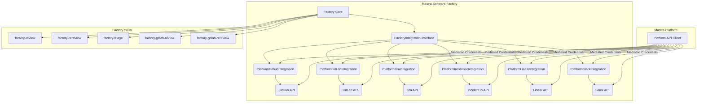
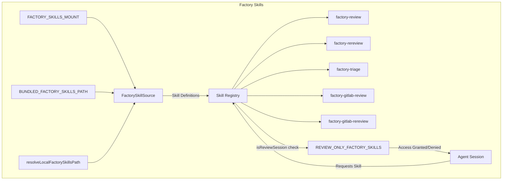

<!-- source: DeepWiki mcp.deepwiki.com · repo mastra-ai/mastra · page 16.4 Factory Integrations (GitHub, GitLab, Jira, Slack, Platform) · fetched 2026-10-27 -->

# Factory Integrations (GitHub, GitLab, Jira, Slack, Platform)

<details>
<summary>Relevant source files</summary>

The following files were used as context for generating this wiki page:

- [.changeset/fix-deployed-factory-skills.md](.changeset/fix-deployed-factory-skills.md)
- [.changeset/full-eyes-read.md](.changeset/full-eyes-read.md)
- [.changeset/long-showers-report.md](.changeset/long-showers-report.md)
- [.changeset/loud-regions-flow.md](.changeset/loud-regions-flow.md)
- [.changeset/quiet-owls-gather.md](.changeset/quiet-owls-gather.md)
- [mastracode/factory/factory-skills/factory-gitlab-rereview/SKILL.md](mastracode/factory/factory-skills/factory-gitlab-rereview/SKILL.md)
- [mastracode/factory/factory-skills/factory-gitlab-review/SKILL.md](mastracode/factory/factory-skills/factory-gitlab-review/SKILL.md)
- [mastracode/factory/factory-skills/factory-plan/SKILL.md](mastracode/factory/factory-skills/factory-plan/SKILL.md)
- [mastracode/factory/factory-skills/factory-rereview/SKILL.md](mastracode/factory/factory-skills/factory-rereview/SKILL.md)
- [mastracode/factory/factory-skills/factory-review/SKILL.md](mastracode/factory/factory-skills/factory-review/SKILL.md)
- [mastracode/factory/factory-skills/factory-triage/SKILL.md](mastracode/factory/factory-skills/factory-triage/SKILL.md)
- [mastracode/factory/src/boards/review.test.ts](mastracode/factory/src/boards/review.test.ts)
- [mastracode/factory/src/boards/review.ts](mastracode/factory/src/boards/review.ts)
- [mastracode/factory/src/factory.test.ts](mastracode/factory/src/factory.test.ts)
- [mastracode/factory/src/factory.ts](mastracode/factory/src/factory.ts)
- [mastracode/factory/src/integrations/base.ts](mastracode/factory/src/integrations/base.ts)
- [mastracode/factory/src/integrations/github/default-rules.test.ts](mastracode/factory/src/integrations/github/default-rules.test.ts)
- [mastracode/factory/src/integrations/github/default-rules.ts](mastracode/factory/src/integrations/github/default-rules.ts)
- [mastracode/factory/src/integrations/github/integration.test.ts](mastracode/factory/src/integrations/github/integration.test.ts)
- [mastracode/factory/src/integrations/github/integration.ts](mastracode/factory/src/integrations/github/integration.ts)
- [mastracode/factory/src/integrations/github/reconcile-worker.test.ts](mastracode/factory/src/integrations/github/reconcile-worker.test.ts)
- [mastracode/factory/src/integrations/github/reconcile-worker.ts](mastracode/factory/src/integrations/github/reconcile-worker.ts)
- [mastracode/factory/src/integrations/github/routes.test.ts](mastracode/factory/src/integrations/github/routes.test.ts)
- [mastracode/factory/src/integrations/github/routes.ts](mastracode/factory/src/integrations/github/routes.ts)
- [mastracode/factory/src/integrations/github/sandbox.test.ts](mastracode/factory/src/integrations/github/sandbox.test.ts)
- [mastracode/factory/src/integrations/github/sandbox.ts](mastracode/factory/src/integrations/github/sandbox.ts)
- [mastracode/factory/src/integrations/github/session-subscriptions.test.ts](mastracode/factory/src/integrations/github/session-subscriptions.test.ts)
- [mastracode/factory/src/integrations/github/session-subscriptions.ts](mastracode/factory/src/integrations/github/session-subscriptions.ts)
- [mastracode/factory/src/integrations/github/token-refresh.ts](mastracode/factory/src/integrations/github/token-refresh.ts)
- [mastracode/factory/src/integrations/github/webhook.test.ts](mastracode/factory/src/integrations/github/webhook.test.ts)
- [mastracode/factory/src/integrations/github/webhook.ts](mastracode/factory/src/integrations/github/webhook.ts)
- [mastracode/factory/src/integrations/gitlab/default-rules.test.ts](mastracode/factory/src/integrations/gitlab/default-rules.test.ts)
- [mastracode/factory/src/integrations/gitlab/default-rules.ts](mastracode/factory/src/integrations/gitlab/default-rules.ts)
- [mastracode/factory/src/integrations/platform/api-client.test.ts](mastracode/factory/src/integrations/platform/api-client.test.ts)
- [mastracode/factory/src/integrations/platform/api-client.ts](mastracode/factory/src/integrations/platform/api-client.ts)
- [mastracode/factory/src/integrations/platform/github/event-worker.lifecycle.test.ts](mastracode/factory/src/integrations/platform/github/event-worker.lifecycle.test.ts)
- [mastracode/factory/src/integrations/platform/github/event-worker.test.ts](mastracode/factory/src/integrations/platform/github/event-worker.test.ts)
- [mastracode/factory/src/integrations/platform/github/event-worker.ts](mastracode/factory/src/integrations/platform/github/event-worker.ts)
- [mastracode/factory/src/integrations/platform/github/integration.test.ts](mastracode/factory/src/integrations/platform/github/integration.test.ts)
- [mastracode/factory/src/integrations/platform/github/integration.ts](mastracode/factory/src/integrations/platform/github/integration.ts)
- [mastracode/factory/src/integrations/slack/channel-reply-processor.test.ts](mastracode/factory/src/integrations/slack/channel-reply-processor.test.ts)
- [mastracode/factory/src/integrations/slack/channel-reply-processor.ts](mastracode/factory/src/integrations/slack/channel-reply-processor.ts)
- [mastracode/factory/src/integrations/slack/channel-session-link-processor.test.ts](mastracode/factory/src/integrations/slack/channel-session-link-processor.test.ts)
- [mastracode/factory/src/integrations/slack/channel-session-link-processor.ts](mastracode/factory/src/integrations/slack/channel-session-link-processor.ts)
- [mastracode/factory/src/integrations/slack/channel-tools.test.ts](mastracode/factory/src/integrations/slack/channel-tools.test.ts)
- [mastracode/factory/src/integrations/slack/integration.test.ts](mastracode/factory/src/integrations/slack/integration.test.ts)
- [mastracode/factory/src/integrations/slack/integration.ts](mastracode/factory/src/integrations/slack/integration.ts)
- [mastracode/factory/src/integrations/slack/reply-reminder-processor.scenario.test.ts](mastracode/factory/src/integrations/slack/reply-reminder-processor.scenario.test.ts)
- [mastracode/factory/src/integrations/slack/slack.test.ts](mastracode/factory/src/integrations/slack/slack.test.ts)
- [mastracode/factory/src/integrations/slack/slack.ts](mastracode/factory/src/integrations/slack/slack.ts)
- [mastracode/factory/src/review-verdict.ts](mastracode/factory/src/review-verdict.ts)
- [mastracode/factory/src/routes/surface.test.ts](mastracode/factory/src/routes/surface.test.ts)
- [mastracode/factory/src/routes/surface.ts](mastracode/factory/src/routes/surface.ts)
- [mastracode/factory/src/rules/default-handlers.test.ts](mastracode/factory/src/rules/default-handlers.test.ts)
- [mastracode/factory/src/rules/review-source-tool.test.ts](mastracode/factory/src/rules/review-source-tool.test.ts)
- [mastracode/factory/src/rules/review-source-tool.ts](mastracode/factory/src/rules/review-source-tool.ts)
- [mastracode/factory/src/session/factory-session.test.ts](mastracode/factory/src/session/factory-session.test.ts)
- [mastracode/factory/src/session/factory-session.ts](mastracode/factory/src/session/factory-session.ts)
- [mastracode/factory/src/session/source-control-tools.test.ts](mastracode/factory/src/session/source-control-tools.test.ts)
- [mastracode/factory/src/session/source-control-tools.ts](mastracode/factory/src/session/source-control-tools.ts)
- [mastracode/factory/src/skills/review-skill-publish.test.ts](mastracode/factory/src/skills/review-skill-publish.test.ts)
- [mastracode/factory/src/storage/domains/source-control/base.test.ts](mastracode/factory/src/storage/domains/source-control/base.test.ts)
- [mastracode/factory/src/storage/domains/source-control/base.ts](mastracode/factory/src/storage/domains/source-control/base.ts)
- [mastracode/factory/src/storage/domains/source-control/inmemory.ts](mastracode/factory/src/storage/domains/source-control/inmemory.ts)
- [mastracode/factory/src/work-item-branch.test.ts](mastracode/factory/src/work-item-branch.test.ts)
- [mastracode/factory/src/work-item-branch.ts](mastracode/factory/src/work-item-branch.ts)
- [mastracode/factory/src/workspace-skills.test.ts](mastracode/factory/src/workspace-skills.test.ts)
- [mastracode/factory/src/workspace.test.ts](mastracode/factory/src/workspace.test.ts)
- [mastracode/factory/src/workspace.ts](mastracode/factory/src/workspace.ts)

</details>


This page details the integration layer of the Mastra Software Factory, covering how it interacts with external platforms like GitHub, GitLab, Jira, incident.io, and Slack. It also explains the role of Platform-mediated credentials and the implementation of factory-specific skills such as review, re-review, and triage.

## Factory Integration Architecture

The Factory integrates with various external services to automate workflows and manage work items. These integrations are managed through a common `FactoryIntegration` interface and leverage Platform-mediated credentials for secure access.


Sources:
- [mastracode/factory/src/factory.ts:47-61]()
- [mastracode/factory/src/integrations/base.ts]()
- [mastracode/factory/factory-skills/factory-review/SKILL.md]()
- [mastracode/factory/factory-skills/factory-rereview/SKILL.md]()
- [mastracode/factory/factory-skills/factory-triage/SKILL.md]()
- [mastracode/factory/factory-skills/factory-gitlab-review/SKILL.md]()
- [mastracode/factory/factory-skills/factory-gitlab-rereview/SKILL.md]()

The `MastraFactory` class serves as the entry point for the Factory, explicitly threading dependencies like `PlatformGithubIntegration`, `PlatformGitLabIntegration`, `PlatformJiraIntegration`, `PlatformIncidentioIntegration`, and `PlatformLinearIntegration` [mastracode/factory/src/factory.ts:1-18](). These integrations are instantiated based on the presence of Platform credentials.

### Platform-Mediated Credentials

The Factory leverages the Mastra Platform for managing credentials to external services. The `PlatformApiClient` [mastracode/factory/src/integrations/platform/api-client.ts:78]() is used to interact with the Platform API, which provides secure access tokens and configuration for various integrations. This centralizes credential management and enhances security.

For example, the `PlatformGithubIntegration` [mastracode/factory/src/integrations/platform/github/integration.ts:73]() uses the `PlatformApiClient` to fetch GitHub installation details and repository access tokens. This ensures that the Factory does not directly store sensitive GitHub credentials.

## GitHub Integration

The GitHub integration allows the Factory to interact with GitHub repositories, issues, and pull requests. This includes handling webhooks, managing sandbox environments for code execution, and providing tools for agents to perform GitHub-related actions.

### GitHub App and Webhooks

The Factory can be configured as a GitHub App. It processes GitHub webhook events to trigger rules and workflows. The `buildGithubRoutes` function [mastracode/factory/src/integrations/github/routes.ts:102]() defines the API routes for handling these webhooks.

The `GithubAppIdentity` [mastracode/factory/src/integrations/github/integration.ts:50]() helps the Factory identify its own actions on GitHub, preventing self-triggering loops.

### GitHub Sandbox

The GitHub sandbox environment is crucial for agents to interact with code in a controlled manner. When an agent needs to work on a GitHub repository, a sandbox is provisioned. This involves:
1.  **Materializing the repository**: Cloning the repository into the sandbox using `materializeRepo` [mastracode/factory/src/integrations/github/sandbox.ts:28]().
2.  **Checking out a session branch**: Creating or checking out a specific branch for the agent's session using `checkoutSessionBranch` [mastracode/factory/src/integrations/github/sandbox.ts:29]().
3.  **Running setup commands**: Executing predefined setup commands within the sandbox using `runSetupCommand` [mastracode/factory/src/integrations/github/sandbox.ts:30]().
4.  **Injecting GitHub tokens**: Providing the sandbox with a temporary GitHub token for authenticated operations via `registerGithubTokenInjector` [mastracode/factory/src/workspace.ts:38]().

The `createWorkspaceFactory` function [mastracode/factory/src/factory.ts:160]() is responsible for setting up the workspace, which includes the sandbox. The `getSessionSandbox` [mastracode/factory/src/sandbox/session-sandbox.ts:50]() retrieves the sandbox for a given session.

```mermaid
graph TD
    subgraph "GitHub Integration"
        GH_APP[GitHub App] -- "Webhooks" --> GH_ROUTES[/v1/server/github/webhooks]
        GH_ROUTES --> DISPATCHER[FactoryDecisionDispatcher]
        DISPATCHER --> WORK_ITEM_STORAGE[WorkItemsStorage]
        DISPATCHER --> AGENT_CONTROLLER[AgentController]

        AGENT_CONTROLLER -- "Needs Code Execution" --> WORKSPACE_FACTORY[createWorkspaceFactory]
        WORKSPACE_FACTORY --> SANDBOX_PROVISIONER[Sandbox Provisioning]
        SANDBOX_PROVISIONER -- "materializeRepo" --> GH_SANDBOX[GitHub Sandbox]
        SANDBOX_PROVISIONER -- "checkoutSessionBranch" --> GH_SANDBOX
        SANDBOX_PROVISIONER -- "runSetupCommand" --> GH_SANDBOX
        SANDBOX_PROVISIONER -- "injectGithubToken" --> GH_SANDBOX
        GH_SANDBOX -- "Code Execution" --> AGENT_CONTROLLER
    end

    subgraph "Mastra Platform"
        PLATFORM_API[PlatformApiClient] -- "Repository Access Tokens" --> GH_SANDBOX
    end
```
Sources:
- [mastracode/factory/src/integrations/github/routes.ts:102]()
- [mastracode/factory/src/integrations/github/integration.ts:50]()
- [mastracode/factory/src/integrations/github/sandbox.ts:28-30]()
- [mastracode/factory/src/workspace.ts:38]()
- [mastracode/factory/src/factory.ts:160]()
- [mastracode/factory/src/sandbox/session-sandbox.ts:50]()
- [mastracode/factory/src/rules/dispatcher.ts]()
- [mastracode/factory/src/storage/domains/work-items/base.ts]()
- [mastracode/factory/src/factory.ts:47-61]()

### GitHub Rules and Reconciliation

The GitHub integration includes a rule engine that processes GitHub events and translates them into Factory decisions. The `resolveGithubRules` function [mastracode/factory/src/integrations/github/default-rules.ts:52]() defines how various GitHub events (e.g., `issues.opened`, `pull_request.opened`, `issue_comment.created`) map to Factory actions.

A reconciliation worker (`PlatformGithubEventWorker`) [mastracode/factory/src/integrations/platform/github/event-worker.ts:80]() periodically checks the state of GitHub issues and pull requests against the Factory's work items, ensuring consistency and triggering updates if discrepancies are found.

## GitLab Integration

The GitLab integration, similar to GitHub, allows the Factory to interact with GitLab repositories and merge requests. The `PlatformGitLabIntegration` [mastracode/factory/src/factory.ts:71]() is responsible for this. Factory skills like `factory-gitlab-review` [mastracode/factory/factory-skills/factory-gitlab-review/SKILL.md]() and `factory-gitlab-rereview` [mastracode/factory/factory-skills/factory-gitlab-rereview/SKILL.md]() are specifically designed for GitLab workflows.

## Jira Integration

The `PlatformJiraIntegration` [mastracode/factory/src/factory.ts:72]() enables the Factory to interact with Jira issues. This integration allows for the creation, update, and tracking of Jira issues as Factory work items.

## incident.io Integration

The `PlatformIncidentioIntegration` [mastracode/factory/src/factory.ts:70]() provides integration with incident.io, allowing the Factory to manage incidents and follow-up tasks.

## Slack Gateway Sessions

The Slack integration facilitates communication and interaction with agents through Slack channels. The `PlatformSlackIntegration` [mastracode/factory/src/integrations/slack/integration.ts:10]() handles the gateway sessions, allowing agents to receive commands and post updates directly to Slack.

The `AgentControllerChannels` [mastracode/core/channels.ts:28]() can be configured to use Slack as a channel provider, enabling agents to send and receive signals via Slack. The `createHandlers` function [mastracode/factory/src/integrations/slack/slack.ts:329]() sets up the Slack channel handlers, which manage session resolution, starting, and resource ID mapping.

## Factory Skills

Factory skills are specialized agent capabilities designed for common software development tasks within the Factory context. These skills are defined in `SKILL.md` files within the `factory-skills` directory.

### `factory-review`

The `factory-review` skill [mastracode/factory/factory-skills/factory-review/SKILL.md]() is used to review a pull request for a Factory work item. It guides the agent through:
1.  **PR Goal & Context**: Understanding the PR's purpose and related issues.
2.  **Security**: Identifying and reporting potential prompt injection attempts or malicious code.
3.  **Code Review**: Evaluating correctness, tests, scope, and consistency.
4.  **Verdict**: Publishing a verdict on the PR and recording it on the work item.

This skill emphasizes independent judgment by the agent, recording assumptions, and identifying open questions for human follow-up.

### `factory-rereview`

The `factory-rereview` skill [mastracode/factory/factory-skills/factory-rereview/SKILL.md]() is invoked when a pull request requires a re-review, typically after changes have been made based on previous feedback. It focuses on verifying that the requested changes have been addressed and re-evaluating the PR.

### `factory-triage`

The `factory-triage` skill [mastracode/factory/factory-skills/factory-triage/SKILL.md]() is used to triage incoming work items, typically issues or pull requests. This involves:
1.  **Understanding the Request**: Analyzing the issue/PR description and context.
2.  **Classification**: Categorizing the work item (e.g., bug, feature, chore).
3.  **Initial Assessment**: Determining severity, priority, and potential next steps.
4.  **Assignment/Routing**: Assigning the work item or routing it to the appropriate phase or agent.

### GitLab-Specific Review Skills

`factory-gitlab-review` [mastracode/factory/factory-skills/factory-gitlab-review/SKILL.md]() and `factory-gitlab-rereview` [mastracode/factory/factory-skills/factory-gitlab-rereview/SKILL.md]() are specialized versions of the review and re-review skills tailored for GitLab merge requests. They adapt the review process to GitLab's terminology and API interactions.

### Skill Discovery and Access Control

Factory skills are discovered from bundled and local paths [mastracode/factory/src/workspace.ts:67-96](). The `FactorySkillSource` class [mastracode/factory/src/workspace.ts:145]() manages the loading of these skills.

Access to certain skills, like review skills, is role-guarded. `REVIEW_ONLY_FACTORY_SKILLS` [mastracode/factory/src/workspace.ts:114]() defines skills that can only be discovered or loaded by sessions with an active review run binding. The `isReviewSession` check [mastracode/factory/src/workspace.ts:155]() determines if a session has the necessary role.


Sources:
- [mastracode/factory/src/workspace.ts:67-96]()
- [mastracode/factory/src/workspace.ts:145]()
- [mastracode/factory/src/workspace.ts:114]()
- [mastracode/factory/src/workspace.ts:155]()
- [mastracode/factory/factory-skills/factory-review/SKILL.md]()
- [mastracode/factory/factory-skills/factory-rereview/SKILL.md]()
- [mastracode/factory/factory-skills/factory-triage/SKILL.md]()
- [mastracode/factory/factory-skills/factory-gitlab-review/SKILL.md]()
- [mastracode/factory/factory-skills/factory-gitlab-rereview/SKILL.md]()

---

