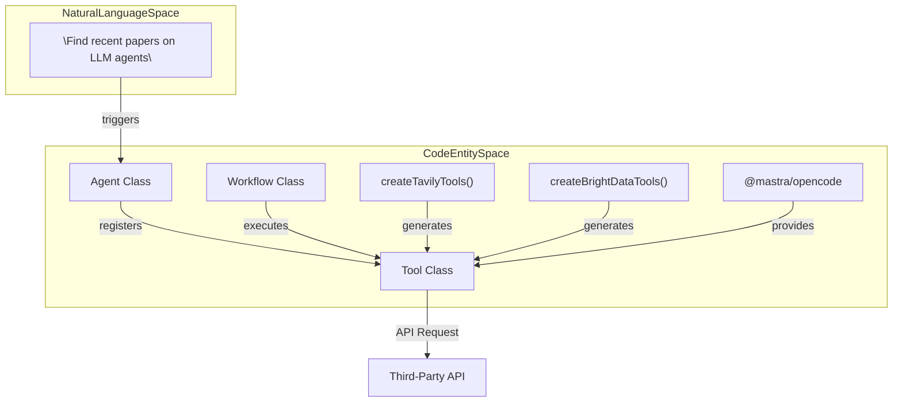
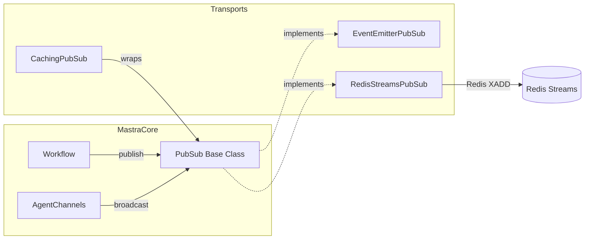
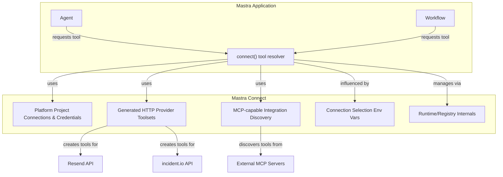

<!-- source: DeepWiki mcp.deepwiki.com · repo mastra-ai/mastra · page 17 Integrations, Connect, and PubSub · fetched 2026-10-27 -->

# Integrations, Connect, and PubSub

Relevant source files

The following files were used as context for generating this wiki page:

- [.changeset/jolly-baths-bet.md](.changeset/jolly-baths-bet.md)
- [.changeset/purple-crabs-lick.md](.changeset/purple-crabs-lick.md)
- [docs/src/content/en/integrations/deploy/neon.mdx](docs/src/content/en/integrations/deploy/neon.mdx)
- [docs/src/content/en/integrations/file-storage/amazon-s3.mdx](docs/src/content/en/integrations/file-storage/amazon-s3.mdx)
- [docs/src/content/en/integrations/file-storage/neon.mdx](docs/src/content/en/integrations/file-storage/neon.mdx)
- [docs/src/content/en/integrations/file-storage/vercel-files.mdx](docs/src/content/en/integrations/file-storage/vercel-files.mdx)
- [docs/src/content/en/integrations/sidebars.js](docs/src/content/en/integrations/sidebars.js)
- [packages/core/src/workspace/filesystem/mount.ts](packages/core/src/workspace/filesystem/mount.ts)
- [packages/mcp-registry-registry/package.json](packages/mcp-registry-registry/package.json)
- [packages/playground-ui/src/domains/workspace/components/mount-icon.tsx](packages/playground-ui/src/domains/workspace/components/mount-icon.tsx)
- [packages/server/src/server/handlers/workspace.test.ts](packages/server/src/server/handlers/workspace.test.ts)
- [packages/server/src/server/handlers/workspace.ts](packages/server/src/server/handlers/workspace.ts)
- [stores/s3vectors/package.json](stores/s3vectors/package.json)
- [voice/aws-nova-sonic/CHANGELOG.md](voice/aws-nova-sonic/CHANGELOG.md)
- [voice/aws-nova-sonic/package.json](voice/aws-nova-sonic/package.json)
- [workspaces/agentcore/CHANGELOG.md](workspaces/agentcore/CHANGELOG.md)
- [workspaces/agentcore/README.md](workspaces/agentcore/README.md)
- [workspaces/agentcore/package.json](workspaces/agentcore/package.json)
- [workspaces/agentcore/src/index.ts](workspaces/agentcore/src/index.ts)
- [workspaces/agentcore/src/provider.test.ts](workspaces/agentcore/src/provider.test.ts)
- [workspaces/s3/README.md](workspaces/s3/README.md)
- [workspaces/s3/package.json](workspaces/s3/package.json)
- [workspaces/s3/src/blob-store/index.ts](workspaces/s3/src/blob-store/index.ts)
- [workspaces/s3/src/filesystem/index.integration.test.ts](workspaces/s3/src/filesystem/index.integration.test.ts)
- [workspaces/s3/src/filesystem/index.test.ts](workspaces/s3/src/filesystem/index.test.ts)
- [workspaces/s3/src/filesystem/index.ts](workspaces/s3/src/filesystem/index.ts)
- [workspaces/s3/src/provider.ts](workspaces/s3/src/provider.ts)

Mastra provides a robust ecosystem for extending agent capabilities through third-party integrations and a scalable event system for cross-process communication. This section covers the specialized toolsets for web research, coding, and real-time interaction, alongside the `PubSub` and `AgentChannels` abstractions that power event-driven workflows, thread streaming, and multi-platform agent deployments.

## Third-Party Tool Integrations

Mastra includes dedicated packages that integrate popular AI-enabling services as toolsets easily registered with an `Agent` or embedded in a `Workflow`. These integrations provide powerful domain-specific tools that enable web scraping, AI-driven search, research assistance, and coding helper functionality.

Each integration package typically exposes factory functions—such as `createBrightDataTools` or `createTavilyTools`—which return collections of `Tool` instances conforming to Mastra's runtime abstractions for seamless agent invocation.

### Available Integrations

-   **BrightData**: Provides tools for web scraping and parsing search engine results, enabling agents to extract live data.
-   **Perplexity**: Supplies AI-powered search capabilities that allow agents to access up-to-date information synthesized across the web.
-   **Tavily**: Designed for research-intensive AI agents, Tavily offers optimized search tools to interface with AI-centric search backends.
-   **OpenCode**: Integrates coding assistant services, offering tooling support to augment development workflows via the `@mastra/opencode` package [integrations/opencode/package.json:2](). It acts as a plugin for Mastra Observational Memory [integrations/opencode/package.json:4]().
-   **LiveKit**: Facilitates real-time voice session management, dispatch, consent/end-call tools, and worker bridges, enabling agents to interact in real-time voice environments.
-   **Parallel**: Provides tools for parallel execution of tasks, enhancing agent efficiency.

These integrations bridge user natural language requests with external APIs via Mastra's tool interface, enabling agents to enhance their capabilities dynamically.

For comprehensive details on setup, configuration, and registering these integrations as agent tools, see the child page: **[Third-Party Tool Integrations](#17.1)**.

### Integration Registry Mapping

The following diagram illustrates how external integrations are ingested into the Mastra `Agent` and `Workflow` systems as executable code entities:

Sources: [integrations/opencode/package.json:2-4]()

---

## PubSub and Event System

Mastra employs a `PubSub` (Publish/Subscribe) abstraction layer that underpins asynchronous eventing critical for decoupling components and enabling scalable multi-agent workflows. This system allows the framework to handle distributed execution, thread streaming, and cross-process signaling.

### Key PubSub Providers

-   **Redis Streams**: A performant, durable event stream provider supporting consumer groups for competing consumer patterns and reliable message delivery with `XAUTOCLAIM`. It also implements `LeaseProvider` for distributed coordination.
-   **Valkey Streams**: A high-performance fork of Redis, supported as a drop-in durable provider.
-   **Google Cloud PubSub**: Cloud-managed scalable pub/sub infrastructure for enterprise deployments.
-   **EventEmitterPubSub**: An in-memory, local pub/sub implementation ideal for single-process development.
-   **CachingPubSub**: A decorator that adds event caching and replay capabilities to any `PubSub` implementation, enabling resumable streams.

### Core PubSub Capabilities

1.  **Workflow and Agent Events**: The system manages lifecycle events for workflows and agents, including `step-start`, `step-finish`, and `finish`.
2.  **Thread Streaming**: `AgentChannels` and `InngestWorkflow` use `PubSub` to broadcast sanitized model output parts to specific topics for real-time UI consumption.
3.  **Durable Replay**: Using `CachingPubSub`, `InngestAgent` can replay history to late-joining observers, ensuring no chunks are missed.
4.  **Channel Integration**: `AgentChannels` wires bot identities (Slack, Discord) to the Mastra pipeline using a dedicated `StateAdapter` for event deduplication and subscription tracking.

For in-depth implementation details—including the `PubSub` base class, event delivery modes, Redis Streams consumer groups, and integration with workflows—see the child page: **[PubSub and Event System](#17.2)**.

### Event System Architecture

The diagram below maps the interaction between the core event classes and the external transport providers:

Sources: 

---

## Mastra Connect (Platform Connections)

Mastra Connect, provided by the `@mastra/connect` package, is the platform-connection layer that enables agents and workflows to interact with external services and APIs securely and efficiently. It provides a standardized way to manage project connections, credentials, and discover integration capabilities.

Key aspects of Mastra Connect include:

-   **`connect()` tool resolver**: A central function for resolving and providing tools based on configured platform connections.
-   **Platform project connections and credentials**: Secure management of API keys, tokens, and other credentials required for third-party service access.
-   **Generated HTTP provider toolsets**: Automatic generation of toolsets for common HTTP-based services (e.g., Resend for email, incident.io for incident management), simplifying integration.
-   **MCP-capable integration discovery**: Integration with the Model Context Protocol (MCP) for dynamic discovery of available tools and services.
-   **Connection selection environment variables**: Configuration options to select specific connections at runtime using environment variables.
-   **Runtime/registry internals**: The underlying mechanisms for managing and providing connection details to agents and workflows.

For a detailed understanding of how to configure and utilize Mastra Connect for your projects, refer to the child page: **[Mastra Connect (Platform Connections)](#17.3)**.

### Mastra Connect Architecture

Sources: 

---

## Related Child Pages

-   **[Third-Party Tool Integrations](#17.1)**: Detailed documentation of the integrations packages, tool factories, and registration approaches for BrightData, Perplexity, Tavily, OpenCode, Parallel, and LiveKit.
-   **[PubSub and Event System](#17.2)**: Comprehensive guide on the Mastra `PubSub` abstraction, Redis Streams specifics, Google Cloud PubSub integration, and how events power `AgentChannels` and durable execution.
-   **[Mastra Connect (Platform Connections)](#17.3)**: In-depth documentation of the `@mastra/connect` package, including the `connect()` tool resolver, platform connections, generated toolsets, and MCP integration.

---
Sources: [integrations/opencode/package.json:2-4]()

---

