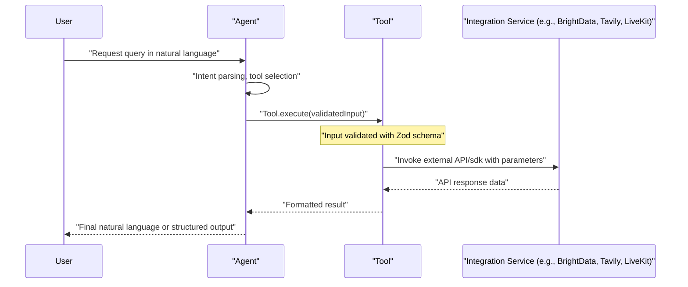
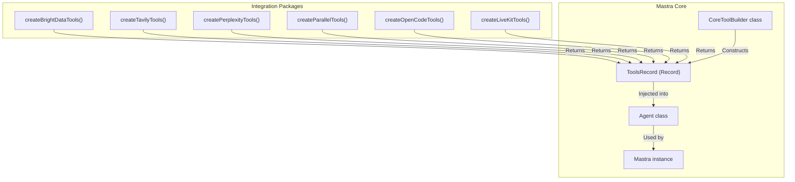
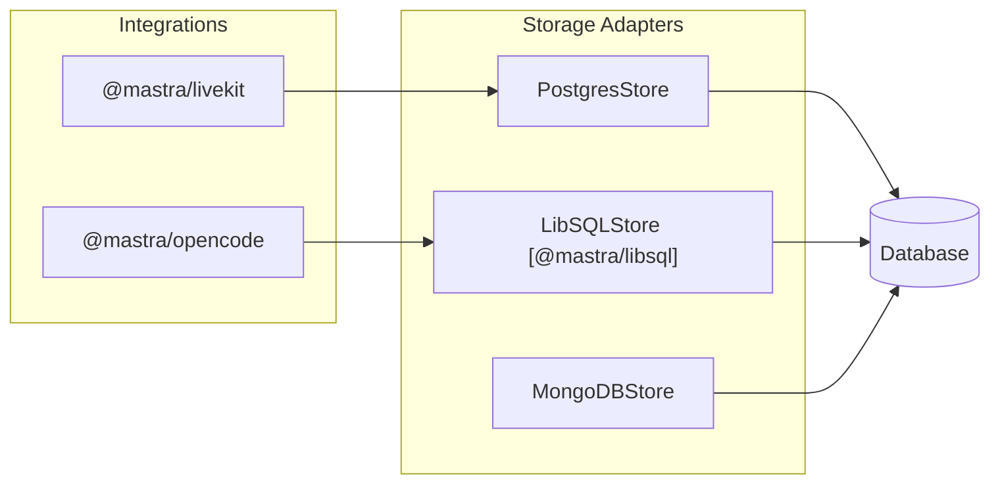

<!-- source: DeepWiki mcp.deepwiki.com · repo mastra-ai/mastra · page 17.1 Third-Party Tool Integrations · fetched 2026-10-27 -->

# Third-Party Tool Integrations

<details>
<summary>Relevant source files</summary>

The following files were used as context for generating this wiki page:

- [.changeset/jolly-baths-bet.md](.changeset/jolly-baths-bet.md)
- [.changeset/pre.json](.changeset/pre.json)
- [.changeset/purple-crabs-lick.md](.changeset/purple-crabs-lick.md)
- [client-sdks/react/CHANGELOG.md](client-sdks/react/CHANGELOG.md)
- [client-sdks/react/package.json](client-sdks/react/package.json)
- [docs/src/content/en/integrations/deploy/neon.mdx](docs/src/content/en/integrations/deploy/neon.mdx)
- [docs/src/content/en/integrations/file-storage/amazon-s3.mdx](docs/src/content/en/integrations/file-storage/amazon-s3.mdx)
- [docs/src/content/en/integrations/file-storage/neon.mdx](docs/src/content/en/integrations/file-storage/neon.mdx)
- [docs/src/content/en/integrations/file-storage/vercel-files.mdx](docs/src/content/en/integrations/file-storage/vercel-files.mdx)
- [docs/src/content/en/integrations/sidebars.js](docs/src/content/en/integrations/sidebars.js)
- [explorations/longmemeval/CHANGELOG.md](explorations/longmemeval/CHANGELOG.md)
- [explorations/longmemeval/package.json](explorations/longmemeval/package.json)
- [integrations/opencode/CHANGELOG.md](integrations/opencode/CHANGELOG.md)
- [integrations/opencode/package.json](integrations/opencode/package.json)
- [packages/cli/CHANGELOG.md](packages/cli/CHANGELOG.md)
- [packages/cli/package.json](packages/cli/package.json)
- [packages/core/src/workspace/filesystem/mount.ts](packages/core/src/workspace/filesystem/mount.ts)
- [packages/create-mastra/CHANGELOG.md](packages/create-mastra/CHANGELOG.md)
- [packages/create-mastra/package.json](packages/create-mastra/package.json)
- [packages/mcp-docs-server/CHANGELOG.md](packages/mcp-docs-server/CHANGELOG.md)
- [packages/mcp-docs-server/package.json](packages/mcp-docs-server/package.json)
- [packages/mcp-registry-registry/package.json](packages/mcp-registry-registry/package.json)
- [packages/playground-ui/CHANGELOG.md](packages/playground-ui/CHANGELOG.md)
- [packages/playground-ui/package.json](packages/playground-ui/package.json)
- [packages/playground-ui/src/domains/workspace/components/mount-icon.tsx](packages/playground-ui/src/domains/workspace/components/mount-icon.tsx)
- [packages/playground/CHANGELOG.md](packages/playground/CHANGELOG.md)
- [packages/playground/package.json](packages/playground/package.json)
- [packages/server/src/server/handlers/workspace.test.ts](packages/server/src/server/handlers/workspace.test.ts)
- [packages/server/src/server/handlers/workspace.ts](packages/server/src/server/handlers/workspace.ts)
- [stores/s3vectors/package.json](stores/s3vectors/package.json)
- [voice/aws-nova-sonic/CHANGELOG.md](voice/aws-nova-sonic/CHANGELOG.md)
- [voice/aws-nova-sonic/package.json](voice/aws-nova-sonic/package.json)
- [workspaces/agentcore/CHANGELOG.md](workspaces/agentcore/CHANGELOG.md)
- [workspaces/agentcore/README.md](workspaces/agentcore/README.md)
- [workspaces/agentcore/package.json](workspaces/agentcore/package.json)
- [workspaces/agentcore/src/index.ts](workspaces/agentcore/src/index.ts)
- [workspaces/agentcore/src/provider.test.ts](workspaces/agentcore/src/provider.test.ts)
- [workspaces/s3/README.md](workspaces/s3/README.md)
- [workspaces/s3/package.json](workspaces/s3/package.json)
- [workspaces/s3/src/blob-store/index.ts](workspaces/s3/src/blob-store/index.ts)
- [workspaces/s3/src/filesystem/index.integration.test.ts](workspaces/s3/src/filesystem/index.integration.test.ts)
- [workspaces/s3/src/filesystem/index.test.ts](workspaces/s3/src/filesystem/index.test.ts)
- [workspaces/s3/src/filesystem/index.ts](workspaces/s3/src/filesystem/index.ts)
- [workspaces/s3/src/provider.ts](workspaces/s3/src/provider.ts)

</details>


Third-party tool integrations in Mastra provide a standardized and extensible mechanism to enrich agents with external capabilities such as web scraping, AI-powered search, research assistance, and coding environment interactions. These integrations are implemented as independent packages supplying factory functions to create one or more Mastra-compatible `Tool` instances, which can be seamlessly incorporated into agents and workflows.

This page documents the key integration packages—BrightData, Perplexity, Tavily, Parallel, OpenCode, and LiveKit—with emphasis on the `createBrightDataTools` and `createTavilyTools` factories, and explains how to register these integrations as agent tools.

---

## Integration Packages Overview

Mastra supports the following notable third-party tool integration packages:

| Package | Purpose | Key Factory Function |
|---|---|---|
| `@mastra/brightdata` | Web scraping and SERP (Search Engine Results Page) tools leveraging Bright Data APIs | `createBrightDataTools()` |
| `@mastra/perplexity` | AI-powered search tool using Perplexity models for real-time web grounding | `createPerplexityTools()` |
| `@mastra/tavily` | Research-optimized search engine with contextual filtering and citations | `createTavilyTools({ apiKey: string })` |
| `@mastra/parallel` | Parallel processing and execution tools. | `createParallelTools()` |
| `@mastra/opencode` | Coding assistant integration with capabilities for file and terminal manipulation | `createOpenCodeTools()` |
| `@mastra/livekit` | Real-time voice session management with dispatch, consent/end-call tools, and worker bridge | `createLiveKitTools()` |

These packages export factory functions returning objects whose keys are tool names and whose values are `Tool` instances constructed to interface with the underlying service APIs.

Sources: [.changeset/pre.json:46-51](), [integrations/opencode/package.json:1-66]()

---

## Technical Implementation

### Tool Abstraction and Factory Functions

Each integration package builds on Mastra’s `Tool` abstraction, which encapsulates input/output validation, execution logic, and metadata. Factory functions instantiate service clients (e.g., REST API clients or SDKs), then use these to construct domain-specific tools.

These tools validate inputs via Zod schemas and execute service calls asynchronously, returning results in formats understandable by agents or workflows.

### OpenCode Integration Details
The `@mastra/opencode` package specifically provides a plugin for Mastra **Observational Memory** [integrations/opencode/package.json:4-4](). It depends on `@mastra/core`, `@mastra/libsql`, and `@mastra/memory` [integrations/opencode/package.json:50-54]() to bridge coding assistant capabilities into the agent's long-term memory and tool surfaces.

### Example: `createBrightDataTools()`
- Initializes Bright Data API clients and configures request headers and credentials.
- Defines tools for scraping with browser automation and for SERP querying.
- Associates each tool with Zod schemas validating inputs like URLs, queries, and selectors, and output schemas ensuring structured JSON responses.

### Example: `createTavilyTools({ apiKey: string })`
- Creates and configures a Tavily API client with the provided API key.
- Defines tools optimized for research context search, passing filtering, query, and citation options.
- Returns a set of tools enabling AI-enhanced retrieval of contextual search snippets with metadata.

### Overview of LiveKit Integration (Voice Session Management)
The LiveKit integration provides specialized tools for real-time voice interaction. It includes:
- **Dispatch Tools**: For routing voice sessions to specific agents.
- **Consent/End-Call Tools**: For managing session lifecycle and user privacy.
- **Worker Bridge**: Facilitates communication between Mastra agents and LiveKit workers in distributed environments.

Sources: [integrations/opencode/package.json:4-4](), [integrations/opencode/package.json:50-54]()

---

## Data Flow: Natural Language to Integration Tool Execution

The lifecycle of an agent dispatching a natural language request to an integration tool follows this pattern:

Title: Integration Tool Execution Flow


Sources: [integrations/opencode/package.json:50-54]()

---

## Registering Integration Tools with Agents

Integration tools returned by packages’ factory functions are registered with agents through the `tools` property in the `Agent` constructor options.

### Example Registration

```typescript
import { createBrightDataTools } from '@mastra/brightdata';
import { createTavilyTools } from '@mastra/tavily';
import { Agent } from '@mastra/core';

const brightDataTools = createBrightDataTools();
const tavilyTools = createTavilyTools({ apiKey: process.env.TAVILY_API_KEY! });

const myAgent = new Agent({
  name: "ResearchAgent",
  instructions: "Use available tools to research information.",
  model: { provider: 'OPEN_AI', name: 'gpt-4o' },
  tools: {
    ...brightDataTools,
    ...tavilyTools,
  },
});
```

The tools factory functions return a `ToolsRecord` object. This registry is wired into the agent, allowing the agent to choose and execute the appropriate tool by name.

---

## Code Entity Mapping

Title: Natural Language Tool Integrations to Code Entities


Sources: [.changeset/pre.json:46-51](), [integrations/opencode/package.json:50-54]()

---

## Storage and Persistence for Integrations

Third-party integrations often require persistent storage for metadata, experiment results, or session state. Mastra provides specialized storage adapters that these tools can leverage:

- **PostgreSQL**: Via `@mastra/pg`, supporting vector and relational storage.
- **LibSQL**: Via `@mastra/libsql`, suitable for edge environments [integrations/opencode/package.json:51-51]().
- **Cloudflare D1/KV**: For serverless environments.
- **MongoDB**: For document-based metadata storage.

Title: Integration Storage Architecture


Sources: [integrations/opencode/package.json:50-54]()

---

## Integration Tools in Workflows

Tools created by integration factories are fully compatible with the Mastra `Workflow` system. They can be used as individual steps or tool steps. The workflow execution pipeline handles:
1. **Validation**: Using the tool's Zod schema.
2. **Invocation**: Executing the underlying service call.
3. **Result Handling**: Formatting the API response for subsequent steps.

---

## Summary

- **Standardized Factories**: Packages like `@mastra/brightdata` and `@mastra/tavily` provide factory functions for instant tool generation.
- **Deep Integration**: `@mastra/opencode` integrates with Mastra's memory system for persistent coding context [integrations/opencode/package.json:4-4]().
- **Real-time Capabilities**: `@mastra/livekit` handles voice session dispatching and lifecycle management.
- **Extensible Storage**: All integrations can utilize Mastra's storage provider layer (PG, LibSQL, MongoDB, etc.) for persistence.

Sources: [integrations/opencode/package.json:1-66]()

---

