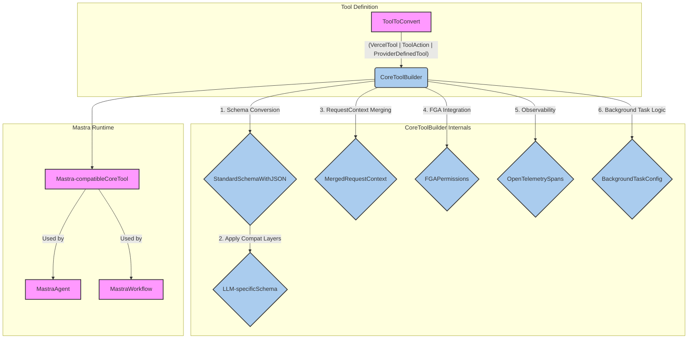

<!-- source: DeepWiki mcp.deepwiki.com · repo mastra-ai/mastra · page 17.3 Mastra Connect (Platform Connections) · fetched 2026-10-27 -->

# Mastra Connect (Platform Connections)

<details>
<summary>Relevant source files</summary>

The following files were used as context for generating this wiki page:

- [.changeset/fluffy-oranges-end.md](.changeset/fluffy-oranges-end.md)
- [.changeset/jolly-baths-bet.md](.changeset/jolly-baths-bet.md)
- [.changeset/purple-crabs-lick.md](.changeset/purple-crabs-lick.md)
- [client-sdks/ai-sdk/src/__tests__/background-task-stream.test.ts](client-sdks/ai-sdk/src/__tests__/background-task-stream.test.ts)
- [docs/src/content/en/integrations/deploy/neon.mdx](docs/src/content/en/integrations/deploy/neon.mdx)
- [docs/src/content/en/integrations/file-storage/amazon-s3.mdx](docs/src/content/en/integrations/file-storage/amazon-s3.mdx)
- [docs/src/content/en/integrations/file-storage/neon.mdx](docs/src/content/en/integrations/file-storage/neon.mdx)
- [docs/src/content/en/integrations/file-storage/vercel-files.mdx](docs/src/content/en/integrations/file-storage/vercel-files.mdx)
- [docs/src/content/en/integrations/sidebars.js](docs/src/content/en/integrations/sidebars.js)
- [docs/src/content/en/reference/agents/agent.mdx](docs/src/content/en/reference/agents/agent.mdx)
- [docs/src/content/en/reference/tools/create-tool.mdx](docs/src/content/en/reference/tools/create-tool.mdx)
- [packages/core/src/agent/__tests__/tools.test.ts](packages/core/src/agent/__tests__/tools.test.ts)
- [packages/core/src/agent/__tests__/working-memory-context.test.ts](packages/core/src/agent/__tests__/working-memory-context.test.ts)
- [packages/core/src/agent/durable/__tests__/durable-agent-client-tool-pending.test.ts](packages/core/src/agent/durable/__tests__/durable-agent-client-tool-pending.test.ts)
- [packages/core/src/agent/durable/__tests__/durable-agent-tools.test.ts](packages/core/src/agent/durable/__tests__/durable-agent-tools.test.ts)
- [packages/core/src/agent/durable/workflows/steps/llm-mapping-pending-client-tool.test.ts](packages/core/src/agent/durable/workflows/steps/llm-mapping-pending-client-tool.test.ts)
- [packages/core/src/loop/shared/auto-resume-system-message.test.ts](packages/core/src/loop/shared/auto-resume-system-message.test.ts)
- [packages/core/src/loop/shared/auto-resume-system-message.ts](packages/core/src/loop/shared/auto-resume-system-message.ts)
- [packages/core/src/loop/test-utils/aimock/scenarios/approval-conditional.scenario.test.ts](packages/core/src/loop/test-utils/aimock/scenarios/approval-conditional.scenario.test.ts)
- [packages/core/src/loop/test-utils/aimock/scenarios/approval-input-validation.scenario.test.ts](packages/core/src/loop/test-utils/aimock/scenarios/approval-input-validation.scenario.test.ts)
- [packages/core/src/loop/test-utils/aimock/scenarios/auto-resume-suspended-tools.scenario.test.ts](packages/core/src/loop/test-utils/aimock/scenarios/auto-resume-suspended-tools.scenario.test.ts)
- [packages/core/src/loop/test-utils/aimock/scenarios/background-task-agent-level.scenario.test.ts](packages/core/src/loop/test-utils/aimock/scenarios/background-task-agent-level.scenario.test.ts)
- [packages/core/src/loop/test-utils/aimock/scenarios/background-task-tool-level.scenario.test.ts](packages/core/src/loop/test-utils/aimock/scenarios/background-task-tool-level.scenario.test.ts)
- [packages/core/src/loop/test-utils/aimock/scenarios/client-tools.scenario.test.ts](packages/core/src/loop/test-utils/aimock/scenarios/client-tools.scenario.test.ts)
- [packages/core/src/loop/test-utils/aimock/scenarios/prepare-step.scenario.test.ts](packages/core/src/loop/test-utils/aimock/scenarios/prepare-step.scenario.test.ts)
- [packages/core/src/loop/test-utils/aimock/scenarios/supervisor-delegation-hooks.scenario.test.ts](packages/core/src/loop/test-utils/aimock/scenarios/supervisor-delegation-hooks.scenario.test.ts)
- [packages/core/src/loop/test-utils/aimock/scenarios/tool-lifecycle-hooks.scenario.test.ts](packages/core/src/loop/test-utils/aimock/scenarios/tool-lifecycle-hooks.scenario.test.ts)
- [packages/core/src/loop/workflows/agentic-execution/tool-approval-verdict.ts](packages/core/src/loop/workflows/agentic-execution/tool-approval-verdict.ts)
- [packages/core/src/loop/workflows/agentic-execution/tool-call-step-before-approval.test.ts](packages/core/src/loop/workflows/agentic-execution/tool-call-step-before-approval.test.ts)
- [packages/core/src/loop/workflows/agentic-execution/tool-call-step.test.ts](packages/core/src/loop/workflows/agentic-execution/tool-call-step.test.ts)
- [packages/core/src/loop/workflows/agentic-execution/tool-call-step.ts](packages/core/src/loop/workflows/agentic-execution/tool-call-step.ts)
- [packages/core/src/processors/processor-tool-request-context.test.ts](packages/core/src/processors/processor-tool-request-context.test.ts)
- [packages/core/src/tools/builtin/web-fetch.test.ts](packages/core/src/tools/builtin/web-fetch.test.ts)
- [packages/core/src/tools/builtin/web-fetch.ts](packages/core/src/tools/builtin/web-fetch.ts)
- [packages/core/src/tools/index.ts](packages/core/src/tools/index.ts)
- [packages/core/src/tools/tool-builder/background-override-injection.test.ts](packages/core/src/tools/tool-builder/background-override-injection.test.ts)
- [packages/core/src/tools/tool-builder/builder.e2e.test.ts](packages/core/src/tools/tool-builder/builder.e2e.test.ts)
- [packages/core/src/tools/tool-builder/builder.test.ts](packages/core/src/tools/tool-builder/builder.test.ts)
- [packages/core/src/tools/tool-builder/builder.ts](packages/core/src/tools/tool-builder/builder.ts)
- [packages/core/src/tools/tool-builder/schema-compat-validation.test.ts](packages/core/src/tools/tool-builder/schema-compat-validation.test.ts)
- [packages/core/src/tools/tool-builder/validation-error-paths.test.ts](packages/core/src/tools/tool-builder/validation-error-paths.test.ts)
- [packages/core/src/tools/tool.test.ts](packages/core/src/tools/tool.test.ts)
- [packages/core/src/tools/tool.ts](packages/core/src/tools/tool.ts)
- [packages/core/src/tools/toolchecks.ts](packages/core/src/tools/toolchecks.ts)
- [packages/core/src/tools/types.ts](packages/core/src/tools/types.ts)
- [packages/core/src/tools/validation.test.ts](packages/core/src/tools/validation.test.ts)
- [packages/core/src/tools/validation.ts](packages/core/src/tools/validation.ts)
- [packages/core/src/workspace/filesystem/mount.ts](packages/core/src/workspace/filesystem/mount.ts)
- [packages/mcp-registry-registry/package.json](packages/mcp-registry-registry/package.json)
- [packages/playground-ui/src/domains/workspace/components/mount-icon.tsx](packages/playground-ui/src/domains/workspace/components/mount-icon.tsx)
- [packages/server/src/server/handlers/workspace.test.ts](packages/server/src/server/handlers/workspace.test.ts)
- [packages/server/src/server/handlers/workspace.ts](packages/server/src/server/handlers/workspace.ts)
- [stores/s3vectors/package.json](stores/s3vectors/package.json)
- [voice/aws-nova-sonic/CHANGELOG.md](voice/aws-nova-sonic/CHANGELOG.md)
- [voice/aws-nova-sonic/package.json](voice/aws-nova-sonic/package.json)
- [workspaces/agentcore/CHANGELOG.md](workspaces/agentcore/CHANGELOG.md)
- [workspaces/agentcore/README.md](workspaces/agentcore/README.md)
- [workspaces/agentcore/package.json](workspaces/agentcore/package.json)
- [workspaces/agentcore/src/index.ts](workspaces/agentcore/src/index.ts)
- [workspaces/agentcore/src/provider.test.ts](workspaces/agentcore/src/provider.test.ts)
- [workspaces/s3/README.md](workspaces/s3/README.md)
- [workspaces/s3/package.json](workspaces/s3/package.json)
- [workspaces/s3/src/blob-store/index.ts](workspaces/s3/src/blob-store/index.ts)
- [workspaces/s3/src/filesystem/index.integration.test.ts](workspaces/s3/src/filesystem/index.integration.test.ts)
- [workspaces/s3/src/filesystem/index.test.ts](workspaces/s3/src/filesystem/index.test.ts)
- [workspaces/s3/src/filesystem/index.ts](workspaces/s3/src/filesystem/index.ts)
- [workspaces/s3/src/provider.ts](workspaces/s3/src/provider.ts)

</details>


This page details `@mastra/connect`, a core component of the Mastra framework responsible for managing connections to external platforms and services. It covers the `connect()` tool resolver, how Platform project connections and credentials are handled, the generation of HTTP provider toolsets (e.g., Resend, incident.io), Model Context Protocol (MCP)-capable integration discovery, environment variable-based connection selection, and the underlying runtime and registry mechanisms.

## The `connect()` Tool Resolver

The `connect()` function acts as a central resolver for integrating external services into Mastra applications. It simplifies the process of accessing and utilizing tools provided by various platforms by abstracting away the underlying connection and authentication mechanisms. When an agent or workflow needs to interact with an external service, `connect()` ensures that the appropriate toolset is available and configured with the correct credentials.

### How `connect()` Works

`connect()` typically takes a configuration object that specifies the desired platform or service. It then uses this configuration to:
1.  **Discover Available Tools**: It identifies the tools exposed by the specified platform.
2.  **Configure Credentials**: It retrieves and applies the necessary authentication credentials (e.g., API keys, OAuth tokens) for the connection.
3.  **Generate Toolsets**: It dynamically creates a set of Mastra-compatible tools that wrap the platform's API. These generated tools adhere to Mastra's `Tool` interface, allowing them to be seamlessly integrated into agents and workflows.
4.  **Handle Connection Lifecycle**: It manages the lifecycle of the connection, including initialization, error handling, and potential re-authentication.

## Platform Project Connections and Credentials

Mastra provides a robust system for managing platform connections and credentials, ensuring secure and efficient access to external services.

### Credential Management
Credentials for platform connections are typically managed through environment variables or a secure configuration store. This approach enhances security by keeping sensitive information out of the codebase and allowing for easy rotation and management.

For example, an API key for a service might be stored in an environment variable like `RESEND_API_KEY`. When `connect()` is invoked for the Resend platform, it automatically looks for this environment variable to configure the Resend client.

### Connection Configuration
Platform connections are configured within the Mastra application, often through a central configuration file or programmatic setup. This configuration specifies which platforms are enabled, their respective credentials, and any platform-specific settings.

## Generated HTTP Provider Toolsets

`@mastra/connect` can dynamically generate toolsets for HTTP-based APIs, transforming them into Mastra-compatible tools. This is particularly useful for integrating with services that expose a well-defined API but don't offer a native Mastra SDK.

### Example: Resend Toolset
For a service like Resend (an email API), `connect()` can generate tools such as `sendEmail`.

```typescript
// Example of how a Resend tool might be generated and used
import { connect } from '@mastra/connect';
import { createTool } from '@mastra/core/tools';
import { z } from 'zod';

// Assume 'resend' is a configured platform in Mastra
const resendTools = connect('resend');

const sendEmailTool = createTool({
  id: 'sendEmail',
  description: 'Sends an email using Resend.',
  inputSchema: z.object({
    to: z.string().email().array(),
    from: z.string().email(),
    subject: z.string(),
    body: z.string(),
  }),
  execute: async (input, context) => {
    // This would internally call the generated Resend client
    // For demonstration, we'll simulate the call
    const res = await resendTools.sendEmail(input);
    return { success: res.success, messageId: res.id };
  },
});
```
Sources: [packages/core/src/tools/tool.ts:151-163](), [packages/core/src/tools/tool.ts:170-176]()

### Example: incident.io Toolset
Similarly, for incident.io (an incident management platform), `connect()` could generate tools like `createIncident` or `updateIncidentStatus`.

```typescript
// Example of how an incident.io tool might be generated and used
import { connect } from '@mastra/connect';
import { createTool } from '@mastra/core/tools';
import { z } from 'zod';

// Assume 'incidentio' is a configured platform
const incidentioTools = connect('incidentio');

const createIncidentTool = createTool({
  id: 'createIncident',
  description: 'Creates a new incident in incident.io.',
  inputSchema: z.object({
    title: z.string(),
    severity: z.enum(['low', 'medium', 'high']),
    description: z.string().optional(),
  }),
  execute: async (input, context) => {
    const incident = await incidentioTools.createIncident(input);
    return { incidentId: incident.id, status: incident.status };
  },
});
```
Sources: [packages/core/src/tools/tool.ts:151-163](), [packages/core/src/tools/tool.ts:170-176]()

These generated toolsets abstract the HTTP requests, authentication headers, and response parsing, allowing agents to interact with these services using a consistent and type-safe interface.

## MCP-Capable Integration Discovery

The Model Context Protocol (MCP) is a standard for agents to discover and interact with tools and resources. `@mastra/connect` leverages MCP for integration discovery, enabling Mastra applications to dynamically find and utilize tools exposed by MCP-compliant servers.

### `MCPClient` and `InternalMastraMCPClient`
The core of MCP integration in Mastra is the `MCPClient` class, specifically its internal implementation `InternalMastraMCPClient`. This client manages connections to multiple MCP servers and provides access to their exposed tools.

```typescript
// packages/mcp/src/client/client.ts
export class InternalMastraMCPClient extends MastraBase {
  // ...
}
```
Sources: [packages/mcp-registry-registry/package.json](), [packages/core/src/tools/types.ts:22-23]()

The `InternalMastraMCPClient` handles:
- **Connection Management**: Establishing and maintaining connections to MCP servers, which can be either HTTP-based (`StreamableHTTPClientTransport`) or stdio-based (`StdioClientTransport`).
- **Tool Discovery**: Querying MCP servers for their available tools, agents, and workflows.
- **Schema Conversion**: Converting MCP tool schemas (JSON Schema 2020-12) into Mastra's `StandardSchemaWithJSON` format for internal use.
- **Tool Execution**: Facilitating the execution of remote MCP tools, handling input/output validation and error reporting.
- **Authentication**: Integrating with OAuth providers for secure access to MCP servers.

### MCP Server (`MCPServer`)
Mastra itself can act as an MCP server, exposing its own tools, agents, and workflows to external MCP clients. The `MCPServer` class in `@mastra/mcp` handles this.

```typescript
// packages/mcp/src/server/server.ts
export class MCPServer extends MCPServerBase {
  // ...
}
```
Sources: [packages/mcp-registry-registry/package.json]()

An `MCPServer` can expose:
- **Mastra Tools**: Directly exposes `createTool` definitions.
- **Mastra Agents**: Converts agents into `ask_<agentName>` tools.
- **Mastra Workflows**: Converts workflows into `run_<workflowName>` tools.

This bidirectional capability allows Mastra applications to both consume tools from external MCP servers and expose their own functionalities as MCP services.

### Data Flow for MCP Tool Discovery and Execution

```mermaid
graph TD
    subgraph "Mastra Application"
        A[Mastra Agent/Workflow] --> B{connect("mcp-server-name")};
        B --> C[InternalMastraMCPClient];
    end

    subgraph "MCP Server (External or Internal)"
        D[MCPServer] --> E[Tool Definitions (Mastra Tools, Agents, Workflows)];
        E -- "JSON Schema 2020-12" --> F[MCP Protocol Handler];
    end

    C -- "1. connect()" --> F;
    F -- "2. server/discover" --> C;
    C -- "3. tools/list" --> F;
    F -- "4. List of MCP Tools (JSON Schema)" --> C;
    C -- "5. Convert to Mastra Tools" --> G[Mastra-compatible Toolset];
    B --> G;
    A --> H{Call Mastra Tool};
    H --> G;
    G -- "6. tools/call (input)" --> F;
    F -- "7. Execute Tool" --> E;
    E -- "8. Tool Result" --> F;
    F -- "9. tools/call (output)" --> G;
    G --> H;

    style A fill:#ace,stroke:#333,stroke-width:2px
    style B fill:#f9f,stroke:#333,stroke-width:2px
    style C fill:#f9f,stroke:#333,stroke-width:2px
    style D fill:#ace,stroke:#333,stroke-width:2px
    style E fill:#ace,stroke:#333,stroke-width:2px
    style F fill:#ace,stroke:#333,stroke-width:2px
    style G fill:#f9f,stroke:#333,stroke-width:2px
    style H fill:#f9f,stroke:#333,stroke-width:2px
```
**Diagram: MCP Tool Discovery and Execution Flow**
Sources: [packages/mcp-registry-registry/package.json](), [packages/core/src/tools/types.ts:22-23]()

1.  **`connect("mcp-server-name")`**: An agent or workflow requests a toolset for a named MCP server.
2.  **`InternalMastraMCPClient.connect()`**: The client initiates a connection to the specified MCP server.
3.  **`server/discover`**: The client sends a `server/discover` request to determine the server's capabilities and supported protocol versions.
4.  **`tools/list`**: The client requests a list of all available tools from the MCP server.
5.  **MCP Tool List Response**: The server responds with a list of tools, each described by its name, description, and input/output schemas (JSON Schema 2020-12).
6.  **Schema Conversion**: The `InternalMastraMCPClient` converts the received JSON Schemas into Mastra's internal `StandardSchemaWithJSON` format.
7.  **Mastra-compatible Toolset**: A set of Mastra `Tool` instances is created, wrapping the remote MCP tools. These tools include `mcpMetadata` to identify their origin.
8.  **Tool Call**: When the agent/workflow calls one of these Mastra-wrapped tools, the `InternalMastraMCPClient` translates the call into an MCP `tools/call` request.
9.  **Tool Execution on Server**: The MCP server receives the `tools/call` request, executes the corresponding tool (which could be a Mastra tool, agent, or workflow on the server side).
10. **Result Return**: The server sends the tool's output back to the `InternalMastraMCPClient`, which then returns it to the calling Mastra agent/workflow.

## Connection Selection Environment Variables

Mastra allows for dynamic selection of connections based on environment variables, providing flexibility in deployment and testing scenarios. This is particularly useful for switching between different environments (e.g., development, staging, production) or for A/B testing different service providers.

For example, an environment variable like `MASTRA_CONNECT_RESEND_PROVIDER` could be used to specify whether to use a mock Resend service or the actual Resend API.

## Runtime and Registry Internals

The `connect()` mechanism relies on an internal registry to manage available platform integrations and their configurations.

### `CoreToolBuilder`
The `CoreToolBuilder` is a crucial component in the tool system. It takes an `originalTool` (which can be a `VercelTool`, `ToolAction`, or `ProviderDefinedTool`) and constructs a Mastra-compatible `CoreTool`. This builder is responsible for:
- **Schema Compatibility**: Applying schema compatibility layers (e.g., `OpenAISchemaCompatLayer`, `AnthropicSchemaCompatLayer`) to ensure tool schemas are correctly interpreted by different LLMs. [packages/core/src/tools/tool-builder/builder.ts:4-13]()
- **Request Context Merging**: Merging `RequestContext` objects to preserve non-serializable values across workflow serialization boundaries. [packages/core/src/tools/tool-builder/builder.ts:85-105]()
- **FGA (Fine-Grained Authorization)**: Integrating with Mastra's FGA system to enforce permissions on tool execution. [packages/core/src/tools/tool-builder/builder.test.ts:55-112]()
- **Observability**: Wrapping tool execution with OpenTelemetry spans for tracing and monitoring. [packages/core/src/observability:28]()
- **Background Task Integration**: Handling tools that can run as background tasks. [packages/core/src/background-tasks:6-7]()


**Diagram: `CoreToolBuilder` Internal Flow**
Sources: [packages/core/src/tools/tool-builder/builder.ts:112](), [packages/core/src/tools/tool-builder/builder.ts:4-13](), [packages/core/src/tools/tool-builder/builder.ts:85-105](), [packages/core/src/tools/tool-builder/builder.test.ts:55-112](), [packages/core/src/tools/tool-builder/builder.test.ts:203-218](), [packages/core/src/auth/ee.ts:18](), [packages/core/src/observability:28](), [packages/core/src/background-tasks:6-7]()

### `RequestContext` Handling
The `RequestContext` is central to how tools operate within Mastra. It carries dynamic, request-scoped information such as user identity, tenant ID, and active spans.

When tools are executed, especially in evented workflow engines, the `RequestContext` might undergo serialization. The `CoreToolBuilder` includes logic to `mergeRequestContexts` to ensure that non-serializable values (like function references or complex objects) are correctly restored or preserved. This is critical for maintaining the integrity of the execution context across different phases of a workflow.
Sources: [packages/core/src/tools/tool-builder/builder.ts:85-105]()

### `McpMetadata`
Tools originating from MCP servers carry `McpMetadata`. This metadata includes information about the MCP server (e.g., `serverName`, `serverVersion`, `forwardInstructions`) and is used for tracing, logging, and potentially for conditional logic within the Mastra application.
Sources: [packages/core/src/tools/types.ts:52-53](), [packages/core/src/tools/tool-builder/builder.test.ts:203-218]()

### Tool Execution Flow
The `createToolCallStep` function, used within the agentic execution loop, orchestrates the actual execution of tools. It handles:
- **Input Validation**: Validating tool arguments against the defined `inputSchema`. [packages/core/src/tools/validation.ts:34-41]()
- **Approval Mechanisms**: Checking if tool execution requires approval (either globally or per-tool). [packages/core/src/loop/workflows/agentic-execution/tool-approval-verdict.ts:69]()
- **Background Task Dispatch**: Dispatching tools to run as background tasks if configured. [packages/core/src/loop/shared/steps/background-dispatch-core.ts:4]()
- **Suspension and Resumption**: Managing tool suspension and resumption, particularly for long-running operations or those requiring external approval. [packages/core/src/loop/workflows/agentic-execution/tool-call-step.ts:118-121]()
- **Observability**: Integrating with the observability system to create spans for tool calls. [packages/core/src/observability:28]()
Sources: [packages/core/src/loop/workflows/agentic-execution/tool-call-step.ts:106-112](), [packages/core/src/loop/workflows/agentic-execution/tool-call-step.ts:122-124](), [packages/core/src/loop/workflows/agentic-execution/tool-call-step.ts:140-145](), [packages/core/src/loop/workflows/agentic-execution/tool-call-step.ts:47-48](), [packages/core/src/tools/validation.ts:34-41](), [packages/core/src/loop/workflows/agentic-execution/tool-approval-verdict.ts:69](), [packages/core/src/loop/shared/steps/background-dispatch-core.ts:4](), [packages/core/src/observability:28]()

The `connect()` tool resolver, combined with the robust `CoreToolBuilder` and MCP integration, provides a powerful and flexible system for integrating external services into Mastra applications, ensuring secure, observable, and scalable interactions.

Sources:
- [packages/core/src/tools/tool-builder/builder.ts]()
- [packages/core/src/loop/workflows/agentic-execution/tool-call-step.ts]()
- [packages/core/src/tools/validation.ts]()
- [packages/core/src/tools/types.ts]()
- [packages/core/src/tools/tool.ts]()
- [docs/src/content/en/integrations/sidebars.js]()
- [docs/src/content/en/reference/agents/agent.mdx]()
- [docs/src/content/en/reference/tools/create-tool.mdx]()
- [packages/core/src/tools/validation.test.ts]()
- [packages/core/src/tools/tool-builder/builder.test.ts]()
- [workspaces/s3/package.json]()

---

