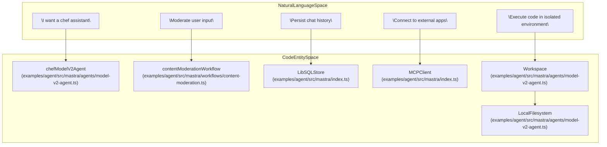
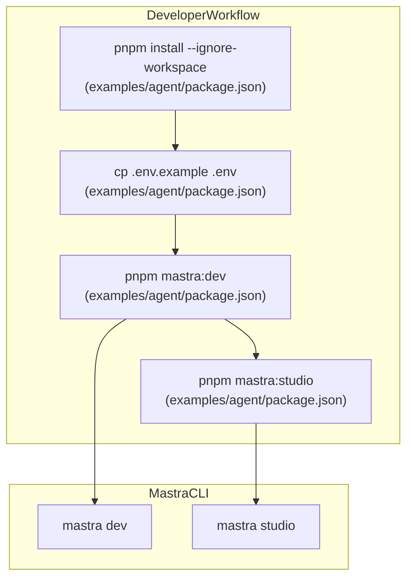

<!-- source: DeepWiki mcp.deepwiki.com · repo mastra-ai/mastra · page 18 Example Applications and Patterns · fetched 2026-10-27 -->

# Example Applications and Patterns

Relevant source files

The following files were used as context for generating this wiki page:

- [auth/better-auth/package.json](auth/better-auth/package.json)
- [e2e-tests/_local-registry-setup/pnpm-lock.yaml](e2e-tests/_local-registry-setup/pnpm-lock.yaml)
- [e2e-tests/_local-registry-setup/pnpm-workspace.yaml](e2e-tests/_local-registry-setup/pnpm-workspace.yaml)
- [e2e-tests/commonjs/template/package.json](e2e-tests/commonjs/template/package.json)
- [e2e-tests/experiment-worker/pnpm-lock.yaml](e2e-tests/experiment-worker/pnpm-lock.yaml)
- [e2e-tests/experiment-worker/pnpm-workspace.yaml](e2e-tests/experiment-worker/pnpm-workspace.yaml)
- [e2e-tests/monorepo/template/package.json](e2e-tests/monorepo/template/package.json)
- [e2e-tests/no-bundling/template/package.json](e2e-tests/no-bundling/template/package.json)
- [e2e-tests/pkg-outputs/pnpm-lock.yaml](e2e-tests/pkg-outputs/pnpm-lock.yaml)
- [e2e-tests/softwarefactory/pnpm-lock.yaml](e2e-tests/softwarefactory/pnpm-lock.yaml)
- [e2e-tests/softwarefactory/pnpm-workspace.yaml](e2e-tests/softwarefactory/pnpm-workspace.yaml)
- [examples/agent-builder/package.json](examples/agent-builder/package.json)
- [examples/agent-builder/pnpm-lock.yaml](examples/agent-builder/pnpm-lock.yaml)
- [examples/agent/package.json](examples/agent/package.json)
- [examples/agent/pnpm-lock.yaml](examples/agent/pnpm-lock.yaml)
- [examples/agent/pnpm-workspace.yaml](examples/agent/pnpm-workspace.yaml)
- [examples/durable-agents/package.json](examples/durable-agents/package.json)
- [examples/durable-agents/pnpm-lock.yaml](examples/durable-agents/pnpm-lock.yaml)
- [examples/evals-with-memory/package.json](examples/evals-with-memory/package.json)
- [examples/evals-with-memory/pnpm-lock.yaml](examples/evals-with-memory/pnpm-lock.yaml)
- [examples/evals-with-memory/pnpm-workspace.yaml](examples/evals-with-memory/pnpm-workspace.yaml)
- [examples/voice-agent/pnpm-lock.yaml](examples/voice-agent/pnpm-lock.yaml)
- [package.json](package.json)
- [packages/agent-builder/integration-tests/package.json](packages/agent-builder/integration-tests/package.json)
- [packages/agent-builder/integration-tests/pnpm-lock.yaml](packages/agent-builder/integration-tests/pnpm-lock.yaml)
- [packages/mcp/integration-tests/package.json](packages/mcp/integration-tests/package.json)
- [packages/mcp/integration-tests/pnpm-lock.yaml](packages/mcp/integration-tests/pnpm-lock.yaml)
- [packages/mcp/integration-tests/pnpm-workspace.yaml](packages/mcp/integration-tests/pnpm-workspace.yaml)
- [packages/memory/integration-tests/package.json](packages/memory/integration-tests/package.json)
- [packages/memory/integration-tests/pnpm-lock.yaml](packages/memory/integration-tests/pnpm-lock.yaml)
- [packages/memory/integration-tests/pnpm-workspace.yaml](packages/memory/integration-tests/pnpm-workspace.yaml)
- [packages/playground/e2e/kitchen-sink/package.json](packages/playground/e2e/kitchen-sink/package.json)
- [packages/playground/e2e/kitchen-sink/pnpm-lock.yaml](packages/playground/e2e/kitchen-sink/pnpm-lock.yaml)
- [packages/playground/e2e/kitchen-sink/pnpm-workspace.yaml](packages/playground/e2e/kitchen-sink/pnpm-workspace.yaml)
- [pnpm-lock.yaml](pnpm-lock.yaml)
- [pnpm-workspace.yaml](pnpm-workspace.yaml)
- [voice/azure/package.json](voice/azure/package.json)
- [voice/gladia/package.json](voice/gladia/package.json)
- [voice/murf/package.json](voice/murf/package.json)
- [voice/murf/src/index.ts](voice/murf/src/index.ts)
- [voice/speechify/package.json](voice/speechify/package.json)

This document provides a high-level overview of the reference implementations and project templates available in the Mastra codebase. These examples demonstrate common architectural patterns, tool integrations, and system configurations for building AI-native applications leveraging Mastra’s core capabilities such as agents, workflows, tools, and memory.

The goal is to expose patterns that bridge abstract AI application goals with concrete code artifacts, providing both a conceptual map and practical starting points for building AI-powered solutions.

For detailed implementation guides, see the child pages:
- [Core Example Patterns](#18.1) — Detailed walkthroughs of foundational patterns including agents, evals, RAG, and scorers with practical examples.
- [Project Templates](#18.2) — Reference production-ready templates such as browsing agents, chat-with-PDF, deep search, GitHub review agent, Slack agent, and instructions on using and contributing new templates.

---

## High-Level Architecture of Examples

Mastra examples act as a bridge between natural language application requirements and corresponding code entities. This mapping illustrates how broad user intents and workflow needs translate into classes, workflows, agents, and storage components within the codebase—particularly within the `examples/agent` directory.

### Concept to Code Mapping

Title: "Concept to Code Mapping"

This diagram helps engineers quickly locate where to look in code for specific functionality or patterns referenced in natural language requirements.

Sources: [examples/agent/src/mastra/agents/model-v2-agent.ts:86-131](), [examples/agent/src/mastra/workflows/content-moderation.ts:186-192](), [examples/agent/src/mastra/index.ts:127-130](), [examples/agent/src/mastra/index.ts:63-71](), [examples/agent/src/mastra/agents/model-v2-agent.ts:30-34]()

---

## Core Example Patterns

The `examples/agent` directory contains reference implementations that demonstrate the foundational patterns of the Mastra framework. These include the creation and composition of agents, use of workflows as processors, integration with memory and storage, advanced moderation scenarios, and Model Context Protocol (MCP) usage.

### Agent and Tool Composition

- **Specialized Persona Agents**: For example, `chefModelV2Agent` combines a rich instruction prompt with a set of tools to embody a chef assistant persona [examples/agent/src/mastra/agents/model-v2-agent.ts:86-131](). It also integrates a `Workspace` with a `LocalFilesystem` for file operations [examples/agent/src/mastra/agents/model-v2-agent.ts:30-34]().
- **Dynamic Configuration**: Agents like `dynamicAgent` select tools and language models dynamically at runtime based on `requestContext`, demonstrating adaptive behavior driven by context-aware configurations [examples/agent/src/mastra/index.ts:151]().
- **Schema-Validated Agents**: Using `requestContextSchema`, `schemaValidatedAgent` enforces typed inputs for agents at runtime ensuring safer and more predictable executions [examples/agent/src/mastra/index.ts:157]().
- **Multi-Agent Networks**: The `networkAgent` demonstrates agent-to-agent collaboration by including a `weatherAgent` in its `agents` configuration [examples/agent/src/mastra/agents/model-v2-agent.ts:149-190]().
- **Durable Agents**: The `durableSupervisorAgent` and `durableCryptoResearchAgent` showcase the use of `createDurableAgent` for long-running, fault-tolerant agent executions [examples/agent/src/mastra/index.ts:171-174]().

### Workflows as Processors & Moderation Patterns

Mastra supports attaching workflows as processors to agents to enable complex reasoning and validation outside of a single agent prompt.

- **Individual Processors**: The `moderatedAssistantAgent` demonstrates attaching individual `inputProcessors` and `outputProcessors` directly to an agent [examples/agent/src/mastra/workflows/content-moderation.ts:46-65]().
- **Sequential Moderation**: The `agentWithSequentialModeration` uses `contentModerationWorkflow` as an input processor [examples/agent/src/mastra/agents/model-v2-agent.ts:214-222]().
- **Parallel Moderation**: The `agentWithAdvancedModeration` utilizes `advancedModerationWorkflow` for parallel PII, toxicity, and spam checks, demonstrating advanced workflow features [examples/agent/src/mastra/agents/model-v2-agent.ts:198-207]().
- **Complex Control Flow**: The `advancedModerationWorkflow` itself demonstrates sequential, parallel, and branching logic within a processor workflow [examples/agent/src/mastra/workflows/content-moderation.ts:186-192]().

### Storage and Memory Patterns

- **Composite Storage**: `MastraCompositeStore` is used to route different data domains (like `observability`) to specialized stores like `DuckDBStore` while using `LibSQLStore` for default persistence [examples/agent/src/mastra/index.ts:131-139]().
- **Observational Memory**: The `memory` configuration in `chefModelV2Agent` demonstrates three-tier memory architecture with specific token thresholds for `observation` and `reflection` [examples/agent/src/mastra/agents/model-v2-agent.ts:37-57]().

### Workspace and Sandbox Patterns

- **Local Workspace**: The `chefModelV2Agent` is configured with a `Workspace` that uses a `LocalFilesystem` for local file interactions [examples/agent/src/mastra/agents/model-v2-agent.ts:30-34]().
- **Platform Sandbox**: The `PlatformSandbox` is used for provisioning isolated remote sandboxes, allowing agents to execute commands, install dependencies, and manage processes in a secure environment [docs/src/content/en/reference/workspace/platform-sandbox.mdx:13-17](). It supports features like checkpoint recovery and reusable templates [docs/src/content/en/reference/workspace/platform-sandbox.mdx:120-147]().
- **Platform Filesystem**: `PlatformFilesystem` provides agents with read, write, list, delete, and move access to a workspace bucket within a Mastra Platform environment [docs/src/content/en/reference/workspace/platform-filesystem.mdx:13-15]().

### MCP Integration Patterns

- **MCP Clients**: Demonstrates consumption of external MCP servers via `MCPClient` and proxying them into the Mastra instance using `toMCPServerProxies()` [examples/agent/src/mastra/index.ts:63-71](), [examples/agent/src/mastra/index.ts:208]().
- **Local MCP Servers**: Examples of registering locally defined MCP servers like `myMcpServer` and `mcpAppsServer` [examples/agent/src/mastra/index.ts:205-207]().

For complete walkthroughs and code samples, see [Core Example Patterns](#18.1).

Sources: [examples/agent/src/mastra/agents/model-v2-agent.ts:30-190](), [examples/agent/src/mastra/workflows/content-moderation.ts:46-192](), [examples/agent/src/mastra/index.ts:131-174](), [examples/agent/src/mastra/index.ts:63-71](), [examples/agent/src/mastra/index.ts:205-208](), [docs/src/content/en/reference/workspace/platform-sandbox.mdx:13-147](), [docs/src/content/en/reference/workspace/platform-filesystem.mdx:13-15]()

---

## Project Templates

Mastra provides a curated set of production-ready full-stack templates. These templates can be instantiated directly via the CLI using `create-mastra --template` and represent common use cases like browsing agents, multi-document chatbots, deep semantic search, GitHub code review automation, and Slack integration.

### Development and E2E Testing Patterns

The `examples/agent` directory itself serves as an example project, with scripts for starting the development server (`pnpm mastra:dev`), building for production (`pnpm mastra:build`), and opening the Studio UI (`pnpm mastra:studio`) [examples/agent/package.json:120-124]().

Title: "Example Project Development Flow"

### Notable Patterns in Templates

- **Request Context Presets**: The `examples/agent` project demonstrates how to define and use `request-context-presets.json` to quickly switch between different environments or user roles in the Studio UI. This allows agents like `requestContextDemoAgent` to dynamically adapt their behavior, model selection, and tool availability based on the active preset.
- **Dynamic Workflows**: The `daily-standup-digest` example showcases seeding a workflow at boot from a JSON `DynamicWorkflowGraph` without explicit `createWorkflow` calls, demonstrating how dynamic workflows are registered and persisted [examples/agent/src/mastra/index.ts:180-183]().
- **Computer-use Agent**: The `computerUseAgent` demonstrates controlling a remote Linux desktop using tools for screenshots, mouse, keyboard, and shell commands, configurable with providers like Daytona or E2B Desktop.

For full details and usage instructions, see [Project Templates](#18.2).

Sources: [examples/agent/package.json:120-124](), [examples/agent/src/mastra/index.ts:180-183]()

---

## Summary Table of Example Implementations

| Example / Template      | Primary Feature                      | Key Code Entities                        |
|------------------------|------------------------------------|-----------------------------------------|
| `examples/agent`       | Multi-agent systems & Processors   | `moderationProcessor`, `networkAgent`  |
| `chefModelV2Agent`     | Advanced Memory & Tools            | `Memory`, `cookingTool`, `Workspace`   |
| `moderatedAssistantAgent` | Individual Processors              | `piiDetectionProcessor`, `toxicityCheckProcessor` |
| `agentWithAdvancedModeration` | Advanced Processor Workflows       | `advancedModerationWorkflow`           |
| `requestContextDemoAgent` | Dynamic Request Context Presets    | `request-context-presets.json`         |
| `computerUseAgent`     | Remote Desktop Control             | `Daytona`, `E2B Desktop`               |
| `durableSupervisorAgent` | Durable Agents                     | `createDurableAgent`                   |

These implementations provide a broad spectrum of starting points to accelerate development with Mastra depending on your target use case.

Sources: [examples/agent/src/mastra/agents/model-v2-agent.ts:37-190](), [examples/agent/src/mastra/workflows/content-moderation.ts:46-65](), [examples/agent/src/mastra/agents/model-v2-agent.ts:198-207](), [examples/agent/src/mastra/index.ts:171-174]()

---

This page serves as the high-level gateway to the numerous example applications and design patterns within Mastra. For comprehensive technical walkthroughs, consult the linked child pages.

# Next Steps

- For detailed explanations and examples of core patterns including agents, workflows, and evaluators, see [Core Example Patterns](#18.1).
- To explore production-ready templates and instructions on creating new ones, see [Project Templates](#18.2).

---

