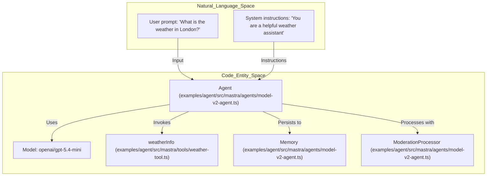
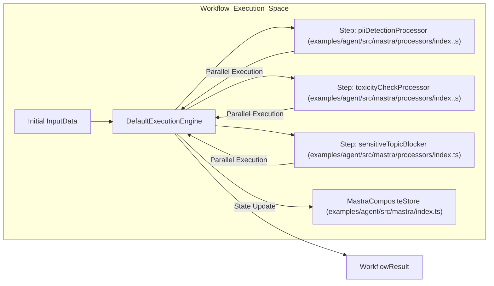

<!-- source: DeepWiki mcp.deepwiki.com · repo mastra-ai/mastra · page 18.1 Core Example Patterns · fetched 2026-10-27 -->

# Core Example Patterns

Relevant source files

The following files were used as context for generating this wiki page:

- [auth/better-auth/package.json](auth/better-auth/package.json)
- [docs/src/content/en/docs/evals/evals-with-memory.mdx](docs/src/content/en/docs/evals/evals-with-memory.mdx)
- [docs/src/content/en/docs/evals/running-in-ci.mdx](docs/src/content/en/docs/evals/running-in-ci.mdx)
- [docs/src/content/en/docs/evals/vitest-integration.mdx](docs/src/content/en/docs/evals/vitest-integration.mdx)
- [docs/src/content/en/reference/evals/scorer-utils.mdx](docs/src/content/en/reference/evals/scorer-utils.mdx)
- [docs/src/content/en/reference/evals/trajectory-accuracy.mdx](docs/src/content/en/reference/evals/trajectory-accuracy.mdx)
- [e2e-tests/_local-registry-setup/pnpm-lock.yaml](e2e-tests/_local-registry-setup/pnpm-lock.yaml)
- [e2e-tests/_local-registry-setup/pnpm-workspace.yaml](e2e-tests/_local-registry-setup/pnpm-workspace.yaml)
- [e2e-tests/commonjs/template/package.json](e2e-tests/commonjs/template/package.json)
- [e2e-tests/experiment-worker/pnpm-lock.yaml](e2e-tests/experiment-worker/pnpm-lock.yaml)
- [e2e-tests/experiment-worker/pnpm-workspace.yaml](e2e-tests/experiment-worker/pnpm-workspace.yaml)
- [e2e-tests/monorepo/template/package.json](e2e-tests/monorepo/template/package.json)
- [e2e-tests/no-bundling/template/package.json](e2e-tests/no-bundling/template/package.json)
- [e2e-tests/pkg-outputs/pnpm-lock.yaml](e2e-tests/pkg-outputs/pnpm-lock.yaml)
- [e2e-tests/softwarefactory/pnpm-lock.yaml](e2e-tests/softwarefactory/pnpm-lock.yaml)
- [e2e-tests/softwarefactory/pnpm-workspace.yaml](e2e-tests/softwarefactory/pnpm-workspace.yaml)
- [examples/agent-builder/package.json](examples/agent-builder/package.json)
- [examples/agent-builder/pnpm-lock.yaml](examples/agent-builder/pnpm-lock.yaml)
- [examples/agent/package.json](examples/agent/package.json)
- [examples/agent/pnpm-lock.yaml](examples/agent/pnpm-lock.yaml)
- [examples/agent/pnpm-workspace.yaml](examples/agent/pnpm-workspace.yaml)
- [examples/agent/src/mastra/agents/capitals.eval.test.ts](examples/agent/src/mastra/agents/capitals.eval.test.ts)
- [examples/agent/vitest.config.ts](examples/agent/vitest.config.ts)
- [examples/durable-agents/package.json](examples/durable-agents/package.json)
- [examples/durable-agents/pnpm-lock.yaml](examples/durable-agents/pnpm-lock.yaml)
- [examples/evals-with-memory/.gitignore](examples/evals-with-memory/.gitignore)
- [examples/evals-with-memory/README.md](examples/evals-with-memory/README.md)
- [examples/evals-with-memory/package.json](examples/evals-with-memory/package.json)
- [examples/evals-with-memory/pnpm-lock.yaml](examples/evals-with-memory/pnpm-lock.yaml)
- [examples/evals-with-memory/pnpm-workspace.yaml](examples/evals-with-memory/pnpm-workspace.yaml)
- [examples/evals-with-memory/src/dataset.ts](examples/evals-with-memory/src/dataset.ts)
- [examples/evals-with-memory/src/runeval-global.ts](examples/evals-with-memory/src/runeval-global.ts)
- [examples/evals-with-memory/src/runeval-per-item.ts](examples/evals-with-memory/src/runeval-per-item.ts)
- [examples/evals-with-memory/src/shared.ts](examples/evals-with-memory/src/shared.ts)
- [examples/voice-agent/pnpm-lock.yaml](examples/voice-agent/pnpm-lock.yaml)
- [package.json](package.json)
- [packages/agent-builder/integration-tests/package.json](packages/agent-builder/integration-tests/package.json)
- [packages/agent-builder/integration-tests/pnpm-lock.yaml](packages/agent-builder/integration-tests/pnpm-lock.yaml)
- [packages/core/src/evals/types.test.ts](packages/core/src/evals/types.test.ts)
- [packages/core/src/evals/types.ts](packages/core/src/evals/types.ts)
- [packages/evals/src/scorers/code/trajectory/index.test.ts](packages/evals/src/scorers/code/trajectory/index.test.ts)
- [packages/evals/src/scorers/code/trajectory/index.ts](packages/evals/src/scorers/code/trajectory/index.ts)
- [packages/evals/src/scorers/llm/trajectory/index.ts](packages/evals/src/scorers/llm/trajectory/index.ts)
- [packages/evals/src/scorers/utils.test.ts](packages/evals/src/scorers/utils.test.ts)
- [packages/evals/src/scorers/utils.ts](packages/evals/src/scorers/utils.ts)
- [packages/evals/src/vitest/expect-evals.test.ts](packages/evals/src/vitest/expect-evals.test.ts)
- [packages/evals/src/vitest/expect-evals.ts](packages/evals/src/vitest/expect-evals.ts)
- [packages/mcp/integration-tests/package.json](packages/mcp/integration-tests/package.json)
- [packages/mcp/integration-tests/pnpm-lock.yaml](packages/mcp/integration-tests/pnpm-lock.yaml)
- [packages/mcp/integration-tests/pnpm-workspace.yaml](packages/mcp/integration-tests/pnpm-workspace.yaml)
- [packages/memory/integration-tests/package.json](packages/memory/integration-tests/package.json)
- [packages/memory/integration-tests/pnpm-lock.yaml](packages/memory/integration-tests/pnpm-lock.yaml)
- [packages/memory/integration-tests/pnpm-workspace.yaml](packages/memory/integration-tests/pnpm-workspace.yaml)
- [packages/playground/e2e/kitchen-sink/package.json](packages/playground/e2e/kitchen-sink/package.json)
- [packages/playground/e2e/kitchen-sink/pnpm-lock.yaml](packages/playground/e2e/kitchen-sink/pnpm-lock.yaml)
- [packages/playground/e2e/kitchen-sink/pnpm-workspace.yaml](packages/playground/e2e/kitchen-sink/pnpm-workspace.yaml)
- [packages/playground/src/domains/datasets/components/datasets-list/no-datasets-info.tsx](packages/playground/src/domains/datasets/components/datasets-list/no-datasets-info.tsx)
- [packages/playground/src/domains/datasets/components/empty-datasets-table.tsx](packages/playground/src/domains/datasets/components/empty-datasets-table.tsx)
- [packages/playground/src/domains/experiments/components/no-experiments-info.tsx](packages/playground/src/domains/experiments/components/no-experiments-info.tsx)
- [pnpm-lock.yaml](pnpm-lock.yaml)
- [pnpm-workspace.yaml](pnpm-workspace.yaml)
- [voice/azure/package.json](voice/azure/package.json)
- [voice/gladia/package.json](voice/gladia/package.json)
- [voice/murf/package.json](voice/murf/package.json)
- [voice/murf/src/index.ts](voice/murf/src/index.ts)
- [voice/speechify/package.json](voice/speechify/package.json)

This section documents the reference implementations found in the `examples/` directory, specifically covering agents, durable agents, evals with memory, voice agents, sandbox deployer, OracleDB, and the `longmemeval` exploration. These examples demonstrate how to compose Mastra's core primitives—Agents, Workflows, Tools, and Memory—into functional applications.

---

## Overview of Example Structure

The Mastra monorepo uses a consistent structure for its example applications, typically centering around a `src/mastra` directory where the framework is initialized via the `Mastra` class.

| Component | Example Location | Key Class / Function |
| :---------------- | :------------------------------- | :----------------------------------- |
| **Central Hub** | `examples/agent/src/mastra/index.ts` | `Mastra` [examples/agent/src/mastra/index.ts:141-288]() |
| **Agents** | `examples/agent/src/mastra/agents/` | `Agent` [examples/agent/src/mastra/agents/model-v2-agent.ts:70-74]() |
| **Workflows** | `examples/agent/src/mastra/workflows/` | `createWorkflow` [examples/agent/src/mastra/index.ts:73-75]() |
| **Tools** | `examples/agent/src/mastra/tools/` | `createTool` [examples/agent/src/mastra/tools/index.ts:1-10]() |
| **Processors** | `examples/agent/src/mastra/processors/` | `ModerationProcessor` [examples/agent/src/mastra/agents/model-v2-agent.ts:77-83]() |
| **Memory** | `examples/agent/src/mastra/agents/model-v2-agent.ts` | `Memory` [examples/agent/src/mastra/agents/model-v2-agent.ts:37-59]() |

These files form the basis for building and understanding core example patterns using Mastra primitives.

Sources:
[examples/agent/src/mastra/index.ts:1-288](),
[examples/agent/src/mastra/agents/model-v2-agent.ts:37-83](),
[examples/agent/src/mastra/tools/index.ts:1-10]()

---

## Agent Patterns

Agents in Mastra encapsulate reasoning and decision-making using LLMs, tools, memory, and optionally workflows and subagents. The `agent` examples illustrate several core patterns.

### Basic Agent Configuration

The `Agent` class is the primary entry point for creating autonomous entities. It handles the orchestration of LLM calls, tool execution, and memory management.

- **Initialization**: Agents are instantiated with a unique `id`, a `model` configuration, and optional `instructions` [examples/agent/src/mastra/agents/model-v2-agent.ts:85-131]().
- **Tool Integration**: Tools are passed to the agent to extend its capabilities, such as `weatherInfo` or `cookingTool` [examples/agent/src/mastra/agents/model-v2-agent.ts:112-115]().
- **Execution**: Agents support both `generate` (unary) and `stream` (streaming) methods for interaction.

### Dynamic Configuration and Schema Validation

Advanced agents demonstrate context-aware behavior and strict data integrity:

- **RequestContext**: The `RequestContext` class allows for tenant isolation and dynamic configuration based on runtime metadata like `userId` or `threadId`. The `requestContextDemoAgent` in `examples/agent/src/mastra/index.ts` is an example of this.
- **Structured Output**: Agents can be configured to return data matching a specific `Zod` schema using the `structuredOutput` option. The `schemaValidatedAgent` in `examples/agent/src/mastra/index.ts` demonstrates this.
- **Processors**: Input and output processors can be attached to agents to modify prompts or validate results before they reach the user or the LLM. For example, `moderationProcessor` is used in `chefModelV2Agent` [examples/agent/src/mastra/agents/model-v2-agent.ts:127]().

### Durable Agents

Durable agents are designed for long-running, fault-tolerant operations. They can persist their state and resume execution after interruptions. The `createDurableAgent` function is used to define such agents [examples/agent/src/mastra/agents/model-v2-agent.ts:28]().

- **State Persistence**: Durable agents automatically save their state, including conversation history and tool call results, allowing for recovery from failures.
- **Run Recovery**: If a durable agent's execution is interrupted, it can be resumed from its last saved state, ensuring progress is not lost. Examples include `durableSupervisorAgent` and `durableCryptoResearchAgent` [examples/agent/src/mastra/index.ts:171-174]().

### Agent Entity Mapping Diagram

This diagram bridges the gap between natural language intent and the code entities that handle them within the Mastra framework.

Sources:
[examples/agent/src/mastra/agents/model-v2-agent.ts:70-145](),
[examples/agent/src/mastra/agents/model-v2-agent.ts:28](),
[examples/agent/src/mastra/index.ts:171-174]()

---

## Workflow Patterns

Workflows provide a structured way to chain multiple steps, including agent calls, tool executions, and custom logic.

### Step Composition

Workflows are composed of discrete `Step` objects.
- **Step Factories**: Mastra provides utilities like `createStepFromAgent` and `createStepFromTool` to quickly turn existing primitives into workflow steps.
- **Execution Engine**: The `DefaultExecutionEngine` manages the transition between steps, handling retries and state persistence.

### Control Flow

Mastra workflows support complex execution patterns:
- **Parallel Execution**: Multiple steps can run concurrently. The `advancedModerationWorkflow` [examples/agent/src/mastra/workflows/content-moderation.ts:100-101]() demonstrates parallel checks.
- **Conditional Branching**: Steps can be executed based on the results of previous steps. The `branchingModerationWorkflow` [examples/agent/src/mastra/workflows/content-moderation.ts:140-141]() is an example of this.
- **Suspend and Resume**: Workflows can be paused (e.g., for human approval) and resumed later using stored snapshots.

### Workflow Data Flow Diagram

This diagram illustrates how data flows through a workflow execution, from initial input to the final result.

Sources:
[examples/agent/src/mastra/workflows/content-moderation.ts:100-141](),
[examples/agent/src/mastra/processors/index.ts:1-10](),
[examples/agent/src/mastra/index.ts:133-138]()

---

## Evaluation and Scorer Patterns

Mastra includes a system for evaluating agent and workflow performance using scorers.

### Scorer Implementation
Scorers measure the quality of an LLM's output based on specific metrics.
- **Definition**: Scorers are defined to evaluate inputs and outputs, often used within an agent's execution loop or as a standalone evaluation step. For example, `alwaysPassScorer` and `alternatingScorer` are used in `chefModelV2Agent` [examples/agent/src/mastra/agents/model-v2-agent.ts:122-123](). The `createScorer` function is used to define custom scorers [packages/evals/src/scorers/utils.test.ts:2]().
- **Execution**: The `evalAgent` in `examples/agent/src/mastra/index.ts` demonstrates an agent configured for evaluation.

### Evals with Memory

The `examples/evals-with-memory` directory showcases how to integrate evaluation with an agent's memory system. This allows for assessing agent performance over longer interactions and how well it utilizes its memory. The `examples/evals-with-memory/src/dataset.ts` file defines the dataset used for evaluation, and `docs/src/content/en/docs/evals/evals-with-memory.mdx` provides documentation on this pattern.

Sources:
[examples/agent/src/mastra/agents/model-v2-agent.ts:122-123](),
[examples/agent/src/mastra/index.ts:156](),
[packages/evals/src/scorers/utils.test.ts:2](),
[examples/evals-with-memory/src/dataset.ts](),
[docs/src/content/en/docs/evals/evals-with-memory.mdx]()

---

## Voice Agent Patterns

The `examples/voice/aws-nova-sonic-test` directory demonstrates the integration of voice capabilities into Mastra agents. This involves using Text-to-Speech (TTS) and Speech-to-Text (STT) providers to enable natural language voice interactions.

- **Voice Provider Integration**: Mastra supports various voice providers. The example likely uses a specific provider (e.g., AWS Nova Sonic) to convert agent responses into speech and user speech into text. The `voice/gladia` and `voice/murf` packages are examples of such integrations.
- **Real-time Interaction**: Voice agents are designed for real-time conversational experiences, often leveraging streaming capabilities for both STT and TTS.

Sources:
[pnpm-workspace.yaml:18](),
[voice/gladia/package.json](),
[voice/murf/package.json]()

---

## Sandbox Deployer

The `PlatformSandbox` in `@mastra/platform-workspace` allows for provisioning and managing isolated execution environments for agents. This is crucial for agents that need to execute code or interact with external systems securely.

- **Isolated Execution**: Agents can run code within a sandbox, preventing malicious or erroneous code from affecting the host system [docs/src/content/en/reference/workspace/platform-sandbox.mdx:63-64]().
- **Template-based Provisioning**: Sandboxes can be provisioned from reusable templates, ensuring consistent environments [docs/src/content/en/reference/workspace/platform-sandbox.mdx:121-122]().
- **Network Isolation**: Sandboxes can be configured with different network isolation levels (e.g., `PRIVATE` for internal services or `ISOLATED` for outbound internet only) [docs/src/content/en/reference/workspace/platform-sandbox.mdx:90-101]().

Sources:
[docs/src/content/en/reference/workspace/platform-sandbox.mdx:63-122]()

---

## OracleDB Integration

While not explicitly shown in the provided `examples/agent` files, the `pnpm-workspace.yaml` indicates support for various storage solutions, including OracleDB. This implies that Mastra can integrate with OracleDB for persistent storage of agent memory, workflow states, and other application data.

- **Storage Adapter Pattern**: Mastra uses a storage adapter pattern, allowing different database systems to be plugged in as storage backends. The `stores/*` entry in `pnpm-workspace.yaml` indicates the presence of various storage adapters.
- **Configuration**: OracleDB integration would typically involve configuring connection details and schema mappings within the Mastra application.

Sources:
[pnpm-workspace.yaml:10]()

---

## Long Memory Evaluation (`longmemeval`) Exploration

The `explorations/longmemeval` directory points to an area of active research and development within Mastra, focusing on evaluating agents with extended memory capabilities.

- **Purpose**: This exploration aims to test and refine how agents handle and recall information over long conversational or operational periods.
- **Methodology**: It likely involves specific evaluation metrics and scenarios designed to stress-test the agent's memory system, including observational memory and semantic recall.

Sources:
[pnpm-workspace.yaml:29]()

---

## Storage and Persistence

Mastra uses a modular storage system to persist agent threads, workflow states, and observability data.

- **Composite Storage**: The `MastraCompositeStore` (often used in examples) allows routing different types of data (e.g., traces vs. messages) to different underlying databases. In `examples/agent/src/mastra/index.ts`, it's configured to use `LibSQLStore` as default and `DuckDBStore` for observability [examples/agent/src/mastra/index.ts:133-138]().
- **Thread Management**: Messages are organized into threads and resources, allowing agents to maintain long-term context. The `Memory` instance in `chefModelV2Agent` demonstrates configuration for observational memory [examples/agent/src/mastra/agents/model-v2-agent.ts:37-59]().

Sources:
[examples/agent/src/mastra/index.ts:133-138](),
[examples/agent/src/mastra/agents/model-v2-agent.ts:37-59]()

---

# Summary

The core example patterns in Mastra demonstrate a modular approach to AI application development:
- **Agents** serve as the reasoning core, utilizing LLMs and tools, with support for **Durable Agents** for long-running tasks.
- **Workflows** provide the structure for complex, multi-step processes.
- **Memory and Storage** ensure that context is preserved across interactions, with flexible storage options like `LibSQLStore` and `DuckDBStore`, and potential for OracleDB.
- **Evals** provide the necessary feedback loop to measure and improve system performance, including specialized **Evals with Memory**.
- **Voice Agents** enable natural language interactions through TTS/STT integration.
- **Sandbox Deployers** offer secure and isolated execution environments for agent code.
- The `longmemeval` exploration highlights ongoing efforts to enhance and evaluate long-term memory capabilities.

# End of 18.1 "Core Example Patterns"

---

