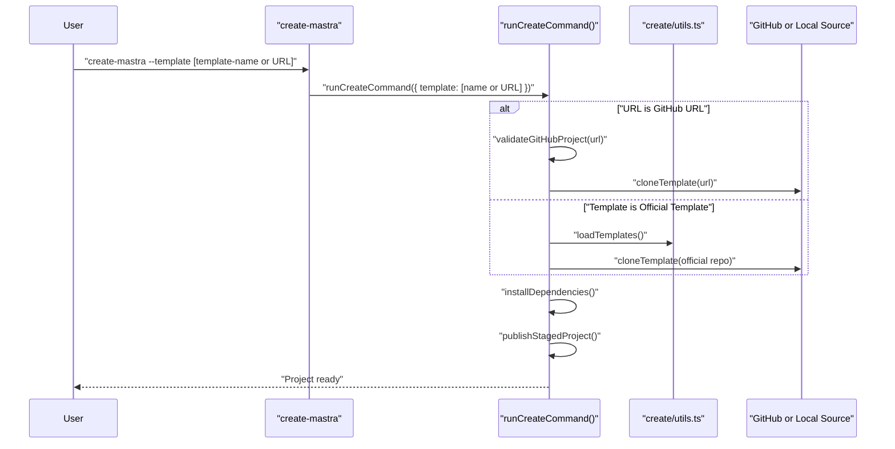
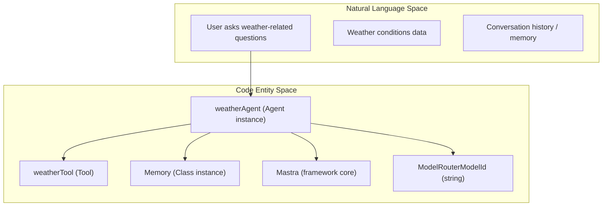
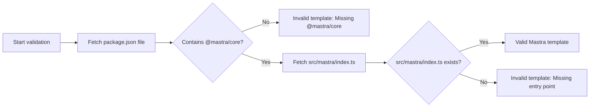

<!-- source: DeepWiki mcp.deepwiki.com · repo mastra-ai/mastra · page 18.2 Project Templates · fetched 2026-10-27 -->

# Project Templates

Relevant source files

The following files were used as context for generating this wiki page:

- [.changeset/fresh-init-provider-models.md](.changeset/fresh-init-provider-models.md)
- [docs/src/content/en/reference/cli/create-mastra.mdx](docs/src/content/en/reference/cli/create-mastra.mdx)
- [e2e-tests/experiment-worker/tests/portability-isolation.test.ts](e2e-tests/experiment-worker/tests/portability-isolation.test.ts)
- [packages/cli/src/commands/actions/create-project.test.ts](packages/cli/src/commands/actions/create-project.test.ts)
- [packages/cli/src/commands/actions/create-project.ts](packages/cli/src/commands/actions/create-project.ts)
- [packages/cli/src/commands/actions/init-project.ts](packages/cli/src/commands/actions/init-project.ts)
- [packages/cli/src/commands/auth/api.ts](packages/cli/src/commands/auth/api.ts)
- [packages/cli/src/commands/auth/auth.test.ts](packages/cli/src/commands/auth/auth.test.ts)
- [packages/cli/src/commands/auth/credentials.test.ts](packages/cli/src/commands/auth/credentials.test.ts)
- [packages/cli/src/commands/auth/credentials.ts](packages/cli/src/commands/auth/credentials.ts)
- [packages/cli/src/commands/auth/login.test.ts](packages/cli/src/commands/auth/login.test.ts)
- [packages/cli/src/commands/auth/login.ts](packages/cli/src/commands/auth/login.ts)
- [packages/cli/src/commands/auth/orgs.test.ts](packages/cli/src/commands/auth/orgs.test.ts)
- [packages/cli/src/commands/auth/orgs.ts](packages/cli/src/commands/auth/orgs.ts)
- [packages/cli/src/commands/auth/tokens.ts](packages/cli/src/commands/auth/tokens.ts)
- [packages/cli/src/commands/create/command.test.ts](packages/cli/src/commands/create/command.test.ts)
- [packages/cli/src/commands/create/command.ts](packages/cli/src/commands/create/command.ts)
- [packages/cli/src/commands/create/create.test.ts](packages/cli/src/commands/create/create.test.ts)
- [packages/cli/src/commands/create/create.ts](packages/cli/src/commands/create/create.ts)
- [packages/cli/src/commands/create/pnpm11-packagemanager.test.ts](packages/cli/src/commands/create/pnpm11-packagemanager.test.ts)
- [packages/cli/src/commands/create/provider-adapter.test.ts](packages/cli/src/commands/create/provider-adapter.test.ts)
- [packages/cli/src/commands/create/provider-adapter.ts](packages/cli/src/commands/create/provider-adapter.ts)
- [packages/cli/src/commands/create/scaffold.test.ts](packages/cli/src/commands/create/scaffold.test.ts)
- [packages/cli/src/commands/create/utils.ts](packages/cli/src/commands/create/utils.ts)
- [packages/cli/src/commands/create/version-resolver.test.ts](packages/cli/src/commands/create/version-resolver.test.ts)
- [packages/cli/src/commands/create/version-resolver.ts](packages/cli/src/commands/create/version-resolver.ts)
- [packages/cli/src/commands/init/init.ts](packages/cli/src/commands/init/init.ts)
- [packages/cli/src/commands/init/observability-provision.test.ts](packages/cli/src/commands/init/observability-provision.test.ts)
- [packages/cli/src/commands/init/observability-provision.ts](packages/cli/src/commands/init/observability-provision.ts)
- [packages/cli/src/commands/init/utils.test.ts](packages/cli/src/commands/init/utils.test.ts)
- [packages/cli/src/commands/init/utils.ts](packages/cli/src/commands/init/utils.ts)
- [packages/cli/src/internal/auth.ts](packages/cli/src/internal/auth.ts)
- [packages/create-mastra/src/index.ts](packages/create-mastra/src/index.ts)
- [templates/template-agent-harness/.env.example](templates/template-agent-harness/.env.example)
- [templates/template-agent-harness/.gitignore](templates/template-agent-harness/.gitignore)
- [templates/template-agent-harness/AGENTS.md](templates/template-agent-harness/AGENTS.md)
- [templates/template-agent-harness/README.md](templates/template-agent-harness/README.md)
- [templates/template-agent-harness/package.json](templates/template-agent-harness/package.json)
- [templates/template-agent-harness/src/mastra/agents/agent.ts](templates/template-agent-harness/src/mastra/agents/agent.ts)
- [templates/template-agent-harness/src/mastra/index.ts](templates/template-agent-harness/src/mastra/index.ts)
- [templates/template-agent-harness/src/mastra/tools/schedule-tools.ts](templates/template-agent-harness/src/mastra/tools/schedule-tools.ts)
- [templates/template-agent-harness/tsconfig.json](templates/template-agent-harness/tsconfig.json)

Project templates in Mastra provide pre-configured starter kits that accelerate the creation of AI-powered applications by bundling typical agents, workflows, memory configurations, and tools tailored to common use cases. This system simplifies bootstrapping new projects by providing ready-to-use codebases that embody best practices and integration patterns, enabling developers to focus on customization rather than setup.

These templates are accessible through both the standalone `create-mastra` CLI utility and the integrated `mastra create` command, which supports additional options for customization. The templates cover a range of scenarios, including browsing agents, PDF chatbots, deep search utilities, GitHub code review bots, Slack integrations, and more.

## Template Infrastructure

The templates system is implemented within the Mastra CLI tool ecosystem. Key capabilities include discovering available templates, validating templates, cloning template repositories (from local directories or GitHub), installing dependencies, and initializing projects accordingly.

### Key Components and Workflow

| Component | File Path | Role |
| :--- | :--- | :--- |
| `create-mastra` CLI | [packages/create-mastra/src/index.ts:1-52]() | Command-line interface for creating new Mastra projects, supports the `--template` flag to create projects from a selected template. |
| `runCreateCommand` | [packages/cli/src/commands/actions/create-project.ts:26-34]() | Primary function handling the project creation flow including template selection, cloning, dependency installation, and project initialization. |
| `cloneTemplate` utility | [packages/cli/src/commands/create/create.ts:7]() | Downloads and copies template code from a source into the target project directory. |
| `loadTemplates` and `selectTemplate` | [packages/cli/src/commands/create/create.ts:8]() | Discovers available templates and provides an interactive prompt for selecting one when none is specified. |
| `writeEmptyScaffold` | [packages/cli/src/commands/create/utils.ts:94-156]() | Generates the minimal project structure (`package.json`, `tsconfig.json`, `.gitignore`) when creating an empty project. |

### Data Flow: Creating a Project with a Template

The following sequence diagram depicts the high-level interactions when using `create-mastra --template`:

Title: create-mastra Template Execution Flow

**Sources:**
[packages/create-mastra/src/index.ts:1-52](),
[packages/cli/src/commands/actions/create-project.ts:26-34](),
[packages/cli/src/commands/create/create.ts:7](),
[packages/cli/src/commands/create/create.ts:8]()

---

## Available Templates

Mastra provides a collection of curated official templates. These templates serve different AI application scenarios and are often maintained in the `templates/` directory of the monorepo.

### Notable Templates and Purpose

| Template Name | Description | Representative Code Location |
| :------------ | :---------- | :--------------------------- |
| `Agent Harness` | A general-purpose Mastra agent that can research current information, manage multi-step tasks, work with local files, run approved shell commands, and create recurring schedules. | [templates/template-agent-harness/README.md:1-16]() |
| `weather-agent` | A generated sample template that provides an agent to fetch weather information using tools and memory. | [packages/cli/src/commands/init/utils.ts:130-191]() |
| `workflow-sample` | A generated sample template demonstrating multi-step workflows with Zod schema validation. | [packages/cli/src/commands/init/utils.ts:193-220]() |
| `mastra-factory` | A template for the Mastra Factory, an agent-powered software delivery environment. | [packages/cli/src/commands/create/create.ts:51-60]() |

### Template Structure Requirements

For a directory or repository to qualify as a valid Mastra template, it must satisfy these requirements:

1.  **`package.json`**
    Must include `@mastra/core` as a dependency. The CLI verifies this to ensure the project is compatible with the Mastra framework.
    Source: [packages/cli/src/commands/create/utils.ts:131]()

2.  **Entry Point**
    Must have a `src/mastra/index.ts` file exporting a `Mastra` instance. This is the central registry for agents, tools, and workflows.
    Source: [packages/cli/src/commands/create/utils.ts:145-148]()

---

## Using Templates with create-mastra

The `create-mastra` CLI enables creating projects directly from templates using the `--template` option. This option accepts:

-   A template name (e.g., `template-agent-harness`) corresponding to an official template.
-   A public GitHub URL of a Mastra project repository.
-   No value (just `--template`), prompting an interactive selection from available templates via `selectTemplate`.

### Validation of GitHub Templates

When a GitHub URL is provided, the CLI validates the repository by checking for the presence of a `package.json` containing `@mastra/core` and the `src/mastra/index.ts` entry point.

Source: [packages/cli/src/commands/create/create.ts:763]()

---

## Implementation Detail: Weather Agent Template

The weather agent template illustrates a typical Mastra project template where an agent integrates with domain-specific tools and memory.

### Core elements created by the CLI

The function `writeAgentSample` generates a weather assistant agent that:

-   Uses a model identifier based on the provider (e.g., `openai/gpt-6.1-sol`).
-   Integrates an optional `weatherTool` imported from `../tools/weather-tool`.
-   Includes a `Memory` component for conversation history.
-   Has detailed instructions defined as system prompts.

Source: [packages/cli/src/commands/init/utils.ts:108-191]()

### Example code entity mapping diagram

This diagram bridges the natural language concepts to the actual code entities of the weather agent template:

Title: Weather Agent Entity Mapping

**Sources:**
[packages/cli/src/commands/init/utils.ts:130-191](), [packages/cli/src/commands/init/init.ts:27-105]()

---

## Contributing New Templates

Creating and adding new templates to the Mastra ecosystem involves the following steps:

1.  **Develop Your Mastra Project**
    Build a standard Mastra project using `mastra init` or `create-mastra`.
    Source: [packages/cli/src/commands/init/init.ts:27-64]()

2.  **Export Mastra Instance**
    Ensure your project exports the `Mastra` runtime instance from `src/mastra/index.ts`.
    Source: [packages/cli/src/commands/create/utils.ts:145-148]()

3.  **Specify Dependencies**
    List all necessary `@mastra/*` packages in your `package.json` dependencies.
    Source: [packages/cli/src/commands/create/utils.ts:131]()

4.  **Template Validation Logic**
    During project creation from a GitHub URL, the CLI performs validation through the following steps to ensure the repository is a valid Mastra template:

Title: Template Validation Logic

**Sources:**
[packages/cli/src/commands/create/create.ts:763]()

---

# Summary

Mastra’s project templates system simplifies initial project setup by offering curated starter kits. The CLI manages template discovery, validation, and cloning, ensuring that new projects follow the framework's architectural requirements like the `src/mastra/index.ts` entry point and core dependencies.

**Sources:**
[packages/create-mastra/src/index.ts:1-52](),
[packages/cli/src/commands/actions/create-project.ts:26-34](),
[packages/cli/src/commands/create/create.ts:7](),
[packages/cli/src/commands/create/create.ts:8](),
[packages/cli/src/commands/init/utils.ts:130-191](),
[packages/cli/src/commands/create/utils.ts:131](),
[packages/cli/src/commands/create/utils.ts:145-148](),
[packages/cli/src/commands/init/init.ts:27-64]()

---

