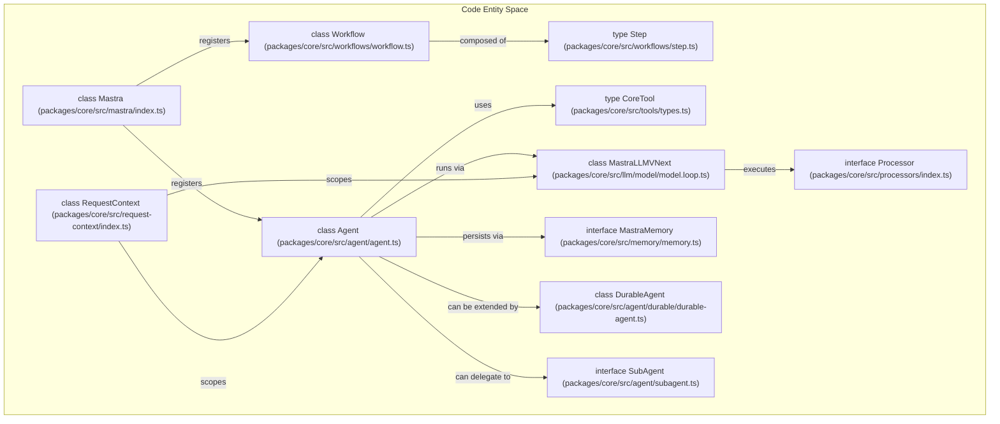
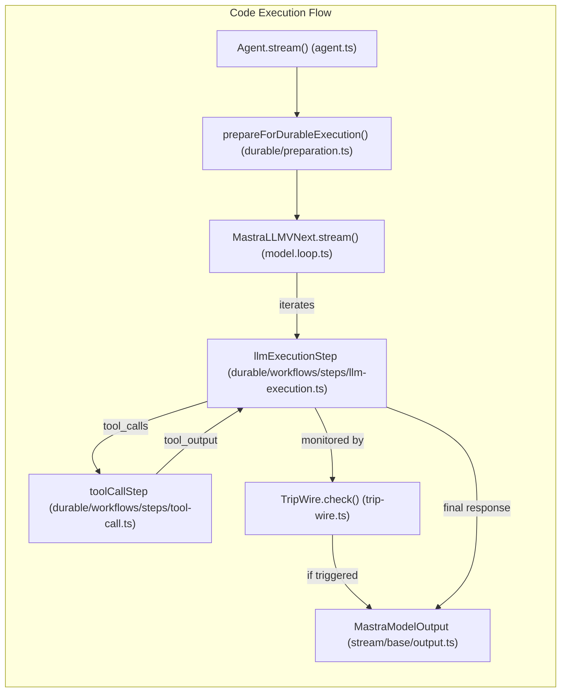

<!-- source: DeepWiki mcp.deepwiki.com · repo mastra-ai/mastra · page 19.1 Glossary: Core Runtime Concepts · fetched 2026-10-27 -->

# Glossary: Core Runtime Concepts

Relevant source files

The following files were used as context for generating this wiki page:

- [.changeset/evented-foreach-running-status.md](.changeset/evented-foreach-running-status.md)
- [.changeset/peer-discovery-busy-caller.md](.changeset/peer-discovery-busy-caller.md)
- [.changeset/retake-lapsed-thread-lease.md](.changeset/retake-lapsed-thread-lease.md)
- [.changeset/strong-gifts-smell.md](.changeset/strong-gifts-smell.md)
- [docs/src/content/en/docs/subagents.mdx](docs/src/content/en/docs/subagents.mdx)
- [mastracode/sdk/src/agent-connections/__tests__/cross-process-agent-signals.integration.test.ts](mastracode/sdk/src/agent-connections/__tests__/cross-process-agent-signals.integration.test.ts)
- [mastracode/sdk/src/agent-connections/__tests__/fixtures/cross-process-agent-signals-child.mts](mastracode/sdk/src/agent-connections/__tests__/fixtures/cross-process-agent-signals-child.mts)
- [observability/mastra/src/model-tracing.test.ts](observability/mastra/src/model-tracing.test.ts)
- [observability/mastra/src/model-tracing.ts](observability/mastra/src/model-tracing.ts)
- [packages/core/src/agent-controller/lease-lost-abort-reason.test.ts](packages/core/src/agent-controller/lease-lost-abort-reason.test.ts)
- [packages/core/src/agent/__tests__/delegation-thread-metadata.test.ts](packages/core/src/agent/__tests__/delegation-thread-metadata.test.ts)
- [packages/core/src/agent/__tests__/memory-metadata.test.ts](packages/core/src/agent/__tests__/memory-metadata.test.ts)
- [packages/core/src/agent/__tests__/signals-claimed-ownership.test.ts](packages/core/src/agent/__tests__/signals-claimed-ownership.test.ts)
- [packages/core/src/agent/__tests__/signals-idle-active-behavior.test.ts](packages/core/src/agent/__tests__/signals-idle-active-behavior.test.ts)
- [packages/core/src/agent/__tests__/stream.test.ts](packages/core/src/agent/__tests__/stream.test.ts)
- [packages/core/src/agent/__tests__/thread-lease-loss-abort.test.ts](packages/core/src/agent/__tests__/thread-lease-loss-abort.test.ts)
- [packages/core/src/agent/__tests__/tool-concurrency-called-strategy-resume.test.ts](packages/core/src/agent/__tests__/tool-concurrency-called-strategy-resume.test.ts)
- [packages/core/src/agent/__tests__/tool-concurrency-called-strategy.test.ts](packages/core/src/agent/__tests__/tool-concurrency-called-strategy.test.ts)
- [packages/core/src/agent/__tests__/tool-handling.test.ts](packages/core/src/agent/__tests__/tool-handling.test.ts)
- [packages/core/src/agent/agent-legacy.ts](packages/core/src/agent/agent-legacy.ts)
- [packages/core/src/agent/agent-types.test-d.ts](packages/core/src/agent/agent-types.test-d.ts)
- [packages/core/src/agent/agent.test.ts](packages/core/src/agent/agent.test.ts)
- [packages/core/src/agent/agent.ts](packages/core/src/agent/agent.ts)
- [packages/core/src/agent/agent.types.ts](packages/core/src/agent/agent.types.ts)
- [packages/core/src/agent/durable/__tests__/durable-agent-approval-resume-data.test.ts](packages/core/src/agent/durable/__tests__/durable-agent-approval-resume-data.test.ts)
- [packages/core/src/agent/durable/__tests__/durable-agent-emit-error.test.ts](packages/core/src/agent/durable/__tests__/durable-agent-emit-error.test.ts)
- [packages/core/src/agent/durable/__tests__/durable-agent-structured-output-persistence.test.ts](packages/core/src/agent/durable/__tests__/durable-agent-structured-output-persistence.test.ts)
- [packages/core/src/agent/durable/__tests__/durable-agent-structured-output.test.ts](packages/core/src/agent/durable/__tests__/durable-agent-structured-output.test.ts)
- [packages/core/src/agent/durable/__tests__/durable-agent-to-model-output.test.ts](packages/core/src/agent/durable/__tests__/durable-agent-to-model-output.test.ts)
- [packages/core/src/agent/durable/__tests__/durable-agent-tracing.test.ts](packages/core/src/agent/durable/__tests__/durable-agent-tracing.test.ts)
- [packages/core/src/agent/durable/__tests__/durable-agent-version-resume.test.ts](packages/core/src/agent/durable/__tests__/durable-agent-version-resume.test.ts)
- [packages/core/src/agent/durable/__tests__/durable-agent.test.ts](packages/core/src/agent/durable/__tests__/durable-agent.test.ts)
- [packages/core/src/agent/durable/__tests__/recover-run.test.ts](packages/core/src/agent/durable/__tests__/recover-run.test.ts)
- [packages/core/src/agent/durable/__tests__/resume-api.test.ts](packages/core/src/agent/durable/__tests__/resume-api.test.ts)
- [packages/core/src/agent/durable/durable-agent.ts](packages/core/src/agent/durable/durable-agent.ts)
- [packages/core/src/agent/durable/durable-parity.test-d.ts](packages/core/src/agent/durable/durable-parity.test-d.ts)
- [packages/core/src/agent/durable/evented-agent.ts](packages/core/src/agent/durable/evented-agent.ts)
- [packages/core/src/agent/durable/preparation.ts](packages/core/src/agent/durable/preparation.ts)
- [packages/core/src/agent/durable/stream-adapter.ts](packages/core/src/agent/durable/stream-adapter.ts)
- [packages/core/src/agent/durable/types.ts](packages/core/src/agent/durable/types.ts)
- [packages/core/src/agent/durable/utils/resolve-runtime.ts](packages/core/src/agent/durable/utils/resolve-runtime.ts)
- [packages/core/src/agent/durable/utils/serialize-state.test.ts](packages/core/src/agent/durable/utils/serialize-state.test.ts)
- [packages/core/src/agent/durable/utils/serialize-state.ts](packages/core/src/agent/durable/utils/serialize-state.ts)
- [packages/core/src/agent/durable/workflows/__tests__/finalize-run.test.ts](packages/core/src/agent/durable/workflows/__tests__/finalize-run.test.ts)
- [packages/core/src/agent/durable/workflows/create-durable-agentic-workflow.ts](packages/core/src/agent/durable/workflows/create-durable-agentic-workflow.ts)
- [packages/core/src/agent/durable/workflows/durable-loop-builder.ts](packages/core/src/agent/durable/workflows/durable-loop-builder.ts)
- [packages/core/src/agent/durable/workflows/finalize-run.ts](packages/core/src/agent/durable/workflows/finalize-run.ts)
- [packages/core/src/agent/durable/workflows/shared/iteration-state.test.ts](packages/core/src/agent/durable/workflows/shared/iteration-state.test.ts)
- [packages/core/src/agent/durable/workflows/shared/iteration-state.ts](packages/core/src/agent/durable/workflows/shared/iteration-state.ts)
- [packages/core/src/agent/durable/workflows/shared/schemas.ts](packages/core/src/agent/durable/workflows/shared/schemas.ts)
- [packages/core/src/agent/durable/workflows/steps/llm-execution.ts](packages/core/src/agent/durable/workflows/steps/llm-execution.ts)
- [packages/core/src/agent/durable/workflows/steps/llm-mapping.ts](packages/core/src/agent/durable/workflows/steps/llm-mapping.ts)
- [packages/core/src/agent/durable/workflows/steps/tool-call.ts](packages/core/src/agent/durable/workflows/steps/tool-call.ts)
- [packages/core/src/agent/subagent.ts](packages/core/src/agent/subagent.ts)
- [packages/core/src/agent/thread-stream-runtime.ts](packages/core/src/agent/thread-stream-runtime.ts)
- [packages/core/src/agent/types.ts](packages/core/src/agent/types.ts)
- [packages/core/src/agent/workflows/prepare-stream/client-tool-output-hooks.test.ts](packages/core/src/agent/workflows/prepare-stream/client-tool-output-hooks.test.ts)
- [packages/core/src/agent/workflows/prepare-stream/client-tool-output-hooks.ts](packages/core/src/agent/workflows/prepare-stream/client-tool-output-hooks.ts)
- [packages/core/src/agent/workflows/prepare-stream/index.ts](packages/core/src/agent/workflows/prepare-stream/index.ts)
- [packages/core/src/agent/workflows/prepare-stream/map-results-step.ts](packages/core/src/agent/workflows/prepare-stream/map-results-step.ts)
- [packages/core/src/agent/workflows/prepare-stream/prepare-memory-step.ts](packages/core/src/agent/workflows/prepare-stream/prepare-memory-step.ts)
- [packages/core/src/agent/workflows/prepare-stream/prepare-tools-step.ts](packages/core/src/agent/workflows/prepare-stream/prepare-tools-step.ts)
- [packages/core/src/agent/workflows/prepare-stream/run-scope-keys.ts](packages/core/src/agent/workflows/prepare-stream/run-scope-keys.ts)
- [packages/core/src/agent/workflows/prepare-stream/schema.ts](packages/core/src/agent/workflows/prepare-stream/schema.ts)
- [packages/core/src/agent/workflows/prepare-stream/stream-step.ts](packages/core/src/agent/workflows/prepare-stream/stream-step.ts)
- [packages/core/src/llm/model/model.loop.ts](packages/core/src/llm/model/model.loop.ts)
- [packages/core/src/loop/loop.ts](packages/core/src/loop/loop.ts)
- [packages/core/src/loop/network/index.ts](packages/core/src/loop/network/index.ts)
- [packages/core/src/loop/network/validation.test.ts](packages/core/src/loop/network/validation.test.ts)
- [packages/core/src/loop/network/validation.ts](packages/core/src/loop/network/validation.ts)
- [packages/core/src/loop/types.ts](packages/core/src/loop/types.ts)
- [packages/core/src/loop/workflows/agentic-execution/index.ts](packages/core/src/loop/workflows/agentic-execution/index.ts)
- [packages/core/src/loop/workflows/agentic-execution/llm-execution-step.ts](packages/core/src/loop/workflows/agentic-execution/llm-execution-step.ts)
- [packages/core/src/loop/workflows/agentic-execution/tool-call-concurrency.test.ts](packages/core/src/loop/workflows/agentic-execution/tool-call-concurrency.test.ts)
- [packages/core/src/loop/workflows/agentic-execution/tool-call-concurrency.ts](packages/core/src/loop/workflows/agentic-execution/tool-call-concurrency.ts)
- [packages/core/src/loop/workflows/agentic-loop/index.ts](packages/core/src/loop/workflows/agentic-loop/index.ts)
- [packages/core/src/memory/index.ts](packages/core/src/memory/index.ts)
- [packages/core/src/memory/run-state.test.ts](packages/core/src/memory/run-state.test.ts)
- [packages/core/src/memory/run-state.ts](packages/core/src/memory/run-state.ts)
- [packages/core/src/processors/index.ts](packages/core/src/processors/index.ts)
- [packages/core/src/processors/processor-model-settings.test-d.ts](packages/core/src/processors/processor-model-settings.test-d.ts)
- [packages/core/src/processors/runner.test.ts](packages/core/src/processors/runner.test.ts)
- [packages/core/src/processors/runner.ts](packages/core/src/processors/runner.ts)
- [packages/core/src/processors/step-schema.ts](packages/core/src/processors/step-schema.ts)
- [packages/core/src/tools/request-context-schema-types.test-d.ts](packages/core/src/tools/request-context-schema-types.test-d.ts)
- [packages/core/src/workflows/concurrent-resume.test.ts](packages/core/src/workflows/concurrent-resume.test.ts)
- [packages/core/src/workflows/default.test.ts](packages/core/src/workflows/default.test.ts)
- [packages/core/src/workflows/default.ts](packages/core/src/workflows/default.ts)
- [packages/core/src/workflows/evented/evented-workflow.test.ts](packages/core/src/workflows/evented/evented-workflow.test.ts)
- [packages/core/src/workflows/evented/foreach-running-status.test.ts](packages/core/src/workflows/evented/foreach-running-status.test.ts)
- [packages/core/src/workflows/evented/step-executor.test.ts](packages/core/src/workflows/evented/step-executor.test.ts)
- [packages/core/src/workflows/evented/step-executor.ts](packages/core/src/workflows/evented/step-executor.ts)
- [packages/core/src/workflows/evented/workflow-event-processor/index.ts](packages/core/src/workflows/evented/workflow-event-processor/index.ts)
- [packages/core/src/workflows/evented/workflow-event-processor/loop.ts](packages/core/src/workflows/evented/workflow-event-processor/loop.ts)
- [packages/core/src/workflows/evented/workflow.ts](packages/core/src/workflows/evented/workflow.ts)
- [packages/core/src/workflows/execution-engine.ts](packages/core/src/workflows/execution-engine.ts)
- [packages/core/src/workflows/foreach-nested-workflow.test.ts](packages/core/src/workflows/foreach-nested-workflow.test.ts)
- [packages/core/src/workflows/foreach-running-status.test.ts](packages/core/src/workflows/foreach-running-status.test.ts)
- [packages/core/src/workflows/handlers/control-flow.ts](packages/core/src/workflows/handlers/control-flow.ts)
- [packages/core/src/workflows/handlers/entry.ts](packages/core/src/workflows/handlers/entry.ts)
- [packages/core/src/workflows/handlers/sleep.ts](packages/core/src/workflows/handlers/sleep.ts)
- [packages/core/src/workflows/handlers/step.ts](packages/core/src/workflows/handlers/step.ts)
- [packages/core/src/workflows/types.ts](packages/core/src/workflows/types.ts)
- [packages/core/src/workflows/utils.ts](packages/core/src/workflows/utils.ts)
- [packages/core/src/workflows/workflow.test.ts](packages/core/src/workflows/workflow.test.ts)
- [packages/core/src/workflows/workflow.ts](packages/core/src/workflows/workflow.ts)
- [packages/rag/src/document/validation.ts](packages/rag/src/document/validation.ts)
- [workflows/inngest/src/index.ts](workflows/inngest/src/index.ts)

This page defines the fundamental runtime entities and abstractions within the Mastra framework. It serves as a technical reference for the classes and data structures that govern execution across agents, workflows, steps, tools, processors, and memory components.

---

## Core Runtime Architecture

The Mastra runtime is built on a hierarchical architecture where `Mastra` acts as the central orchestrator managing agents, workflows, tools, and execution contexts.

### 1. Mastra (The Orchestrator)

- **Description:**  
  The `Mastra` class is the central entry point of the framework. It manages the registration, configuration, and lifecycle of all core primitives: agents, workflows, tools, and memory/storage adapters. It exposes shared services such as logging, telemetry, and configuration injection.

- **Implementation:**  
  The `Mastra` class is imported as a type in `Agent` [packages/core/src/agent/agent.ts:61]() and its constructor is held by `mastraCtorHolder` [packages/core/src/agent/agent.ts:62](). It serves as the primary container, holding instances of `Agent`, `Workflow`, and `MastraMemory`. It registers primitives and provides a global registry for access across the system.

- **Role & Data Flow:**  
  When a component (e.g., an `Agent`) is registered on `Mastra`, it gains access to shared instances of storage, logger, telemetry, and context via the `MastraBase` and primitive registration methods [packages/core/src/agent/agent.ts:11]().

**Sources:** [packages/core/src/agent/agent.ts:11-62]().

---

### 2. Agent

- **Description:**  
  An `Agent` is an autonomous AI entity that integrates a Large Language Model (LLM) with instructions, tools, and memory to perform conversational or task-based workflows.

- **Implementation:**  
  The `Agent` class is implemented in [packages/core/src/agent/agent.ts:162](). It exposes `generate()` and `stream()` methods to run inference. Agents leverage the `MastraLLMVNext` loop architecture to drive iterative LLM and tool invocation cycles [packages/core/src/agent/agent.ts:40]().

- **Key Components:**
  - **Instructions:** System and user prompt messages defined as `AgentInstructions` [packages/core/src/agent/types.ts:134]().
  - **Model:** Configured via `MastraModelConfig` [packages/core/src/agent/agent.ts:48]() and routed through `ModelRouterLanguageModel` [packages/core/src/agent/agent.ts:43]().
  - **Tools:** External APIs provided via `ToolsInput` [packages/core/src/agent/types.ts:129-132]().
  - **Memory:** Contextual state managed by `MastraMemory` [packages/core/src/agent/agent.ts:65]().
  - **Execution Loop:** The `MastraLLMVNext` loop manages LLM step execution, tool calling, and stream processing [packages/core/src/llm/model/model.loop.ts:20-148]().

**Sources:** [packages/core/src/agent/agent.ts:40-162](), [packages/core/src/agent/types.ts:129-134](), [packages/core/src/llm/model/model.loop.ts:20-148]().

---

### 3. Workflow

- **Description:**  
  A `Workflow` is a durable directed graph composed of typed `Steps`. It enables building multi-step business or AI-driven processes with explicit state management, conditional branching, and retry logic.

- **Implementation:**  
  Workflows are defined using `createWorkflow` [packages/core/src/workflows/workflow.ts:70](). They manage state transitions and execution via engines like `DefaultExecutionEngine` [packages/core/src/workflows/default.ts:78]() or `EventedExecutionEngine` [packages/core/src/workflows/evented/execution-engine.ts:10]().

- **State:**  
  Workflow state (`WorkflowRunState` [packages/core/src/workflows/types.ts:127]()) persists step outputs and metadata for reliable re-execution and persistence in storage [packages/core/src/workflows/types.ts:111]().

**Sources:** [packages/core/src/workflows/workflow.ts:70](), [packages/core/src/workflows/default.ts:78](), [packages/core/src/workflows/evented/execution-engine.ts:10](), [packages/core/src/workflows/types.ts:111-127]().

---

### 4. Step

- **Description:**  
  `Step` is the atomic execution unit within a `Workflow`. Each step wraps a discrete operation, which can be an `Agent`, a `Tool`, a `Processor`, or a custom function.

- **Implementation:**  
  Represented by the `Step` type [packages/core/src/workflows/types.ts:98](). Steps are created using `createStep` [packages/core/src/workflows/workflow.ts:70]().

- **Specialized Steps:**  
  - **LLM Execution Step:** Manages the actual call to the language model during an agentic loop [packages/core/src/loop/workflows/agentic-execution/llm-execution-step.ts:1]().
  - **Tool Call Step:** Executes a tool call within the agentic loop [packages/core/src/agent/durable/workflows/steps/tool-call.ts:1]().

**Sources:** [packages/core/src/workflows/workflow.ts:70](), [packages/core/src/workflows/types.ts:98](), [packages/core/src/loop/workflows/agentic-execution/llm-execution-step.ts:1](), [packages/core/src/agent/durable/workflows/steps/tool-call.ts:1]().

---

### 5. Tool

- **Description:**  
  A `Tool` is a typed external function or API that agents or workflows can call to perform side effects.

- **Implementation:**  
  Tools are created via `createTool` [packages/core/src/agent/agent.ts:140](). They utilize `CoreTool` definitions [packages/core/src/agent/agent.ts:146]().

- **Context:**  
  Tools receive a `ToolExecutionContext` [packages/core/src/workflows/workflow.ts:79]() which provides access to current messages, request context, and workspace resources.

**Sources:** [packages/core/src/agent/agent.ts:140-146](), [packages/core/src/workflows/workflow.ts:79]().

---

### 6. Processor

- **Description:**  
  A `Processor` is a middleware abstraction used to transform data entering or leaving an agent or workflow step.

- **Implementation:**  
  Managed by `ProcessorRunner` [packages/core/src/agent/agent.ts:113](). Mastra includes built-in processors like `SkillsProcessor` [packages/core/src/agent/agent.ts:109]() and `WorkspaceInstructionsProcessor` [packages/core/src/agent/agent.ts:110]().

- **Types:**  
  - **InputProcessor:** Modifies data before LLM execution [packages/core/src/agent/agent.ts:102]().
  - **OutputProcessor:** Transforms LLM responses before returning to the caller [packages/core/src/agent/agent.ts:104]().

**Sources:** [packages/core/src/agent/agent.ts:102-113]().

---

### 7. Memory

- **Description:**  
  Memory manages the persistence of conversational and workflow state, including threads and messages.

- **Implementation:**  
  Abstracted by `MastraMemory` [packages/core/src/agent/agent.ts:65](). 
  - **MessageList:** Manages the ordered list of messages and conversion between different model formats [packages/core/src/workflows/workflow.ts:6]().
  - **Thread:** A logical scope for a conversation identified by `threadId` [packages/core/src/request-context/index.ts:20]().

**Sources:** [packages/core/src/agent/agent.ts:65](), [packages/core/src/workflows/workflow.ts:6](), [packages/core/src/request-context/index.ts:20]().

---

### 8. RequestContext

- **Description:**  
  `RequestContext` is a runtime container for dynamically scoped data like tenant IDs, authorization credentials, and runtime configuration.

- **Implementation:**  
  Defined in [packages/core/src/request-context/index.ts:20](). It uses reserved keys such as `MASTRA_RESOURCE_ID_KEY` and `MASTRA_THREAD_ID_KEY` to isolate data across different requests [packages/core/src/request-context/index.ts:20]().

**Sources:** [packages/core/src/request-context/index.ts:20]().

---

### 9. Loop

- **Description:**  
  The "Loop" refers to the `MastraLLMVNext` agentic execution cycle that iteratively runs LLM prompts, interprets outputs, and executes tool calls.

- **Implementation:**  
  The loop is implemented in `MastraLLMVNext.stream` [packages/core/src/llm/model/model.loop.ts:107-148](). It uses `TERMINAL_FINISH_REASONS` (like 'stop' or 'length') to decide when to exit the iteration [packages/core/src/loop/workflows/agentic-execution/llm-execution-step.ts:104]().

**Sources:** [packages/core/src/llm/model/model.loop.ts:107-148](), [packages/core/src/loop/workflows/agentic-execution/llm-execution-step.ts:104]().

---

### 10. RunScope

- **Description:**
  `RunScope` represents the execution context for a specific agent or workflow run. It encapsulates the `runId`, `resourceId`, and other run-specific metadata, ensuring isolation and traceability of individual executions.

- **Implementation:**
  The `RunScopeContext` type [packages/core/src/loop/workflows/agentic-execution/llm-execution-step.ts:74]() is used to manage scoped data within the agentic loop. `readScoped` and `writeScoped` functions [packages/core/src/loop/workflows/agentic-execution/llm-execution-step.ts:75]() provide access to this context. `RequestContext` keys like `MASTRA_RESOURCE_ID_KEY` and `MASTRA_THREAD_ID_KEY` [packages/core/src/request-context/index.ts:20]() also contribute to defining the run's scope.

**Sources:** [packages/core/src/loop/workflows/agentic-execution/llm-execution-step.ts:74-75](), [packages/core/src/request-context/index.ts:20]().

---

### 11. Tripwire

- **Description:**
  A `Tripwire` is a mechanism to detect and prevent infinite loops or excessive resource consumption within agentic execution. It monitors the agent's output and can interrupt execution if certain conditions are met (e.g., repeated tool calls, lack of progress).

- **Implementation:**
  The `TripWire` class [packages/core/src/agent/trip-wire.ts:10]() is used within the agent's execution loop to track state and intervene if necessary. It's often integrated with processors to analyze output.

**Sources:** [packages/core/src/agent/trip-wire.ts:10]().

---

### 12. Harness

- **Description:**  
  The `Harness` is a specialized runtime environment for terminal-based or complex interactive agents (like MastraCode).

- **Implementation:**  
  The `Harness` class manages agent modes, thread persistence, and state management via Zod schemas. (Specific file path for `Harness` class not directly available in provided snippets, but its concept is central to `@mastra/code-sdk`).

**Sources:** No direct citation from provided files for `Harness` class definition.

---

### 13. Agent-to-Agent (A2A)

- **Description:**  
  A2A allows agents to communicate with each other, effectively treating one agent as a tool for another.

- **Implementation:**  
  Orchestrated by the `networkLoop` [packages/core/src/agent/agent.ts:52](). It handles delegation hooks like `onDelegationStart` and `onDelegationComplete` to manage inter-agent data flow [packages/core/src/agent/agent.types.ts:80-147]().

**Sources:** [packages/core/src/agent/agent.ts:52](), [packages/core/src/agent/agent.types.ts:80-147]().

---

### 14. ACP (Agent Client Protocol)

- **Description:**  
  ACP is a protocol for wrapping remote agents as Mastra SubAgents. It defines a standardized way for a Mastra agent to interact with and control an agent running in a separate process or service.

- **Implementation:**  
  The `@mastra/acp` package enables `AcpAgent` integration, allowing remote ACP-compatible agents to be used within the Mastra runtime. This is distinct from A2A, which is typically for agents within the same Mastra instance. The `createACPTool` function is used to integrate ACP agents as tools.

**Sources:** No direct citation from provided files for `AcpAgent` class definition.

---

### 15. SubAgent and SDKAgent

- **Description:**  
  - **SubAgent:** An abstraction for external agents (like those from OpenAI or Anthropic SDKs) to be used inside Mastra [packages/core/src/workflows/workflow.ts:9]().
  - **SDKAgent:** Wrappers for specific third-party SDKs (Claude, Cursor, OpenAI) that bridge their internal run loops into the Mastra `generate`/`stream` interface. These are concrete implementations of the `SubAgent` interface.

- **Implementation:**  
  Compatibility is verified via `isAgentCompatible` [packages/core/src/workflows/workflow.ts:8]().

**Sources:** [packages/core/src/workflows/workflow.ts:8-9]().

---

### 16. DurableAgent

- **Description:**
  A `DurableAgent` is an `Agent` instance wrapped with a durability engine (e.g., Inngest, Temporal) that allows its execution to be suspended, persisted, and resumed across process restarts or failures. This enables long-running, fault-tolerant agentic workflows.

- **Implementation:**
  The `DurableAgent` class extends `Agent` [packages/core/src/agent/durable/durable-agent.ts:36](). It manages run registration [packages/core/src/agent/durable/durable-agent.ts:83](), execution fencing [packages/core/src/agent/durable/durable-agent.ts:61](), and stream adaptation [packages/core/src/agent/durable/durable-agent.ts:87]() to provide durability. It uses durable workflow steps like `DurableStepIds` [packages/core/src/agent/durable/durable-agent.ts:55]().

**Sources:** [packages/core/src/agent/durable/durable-agent.ts:36-87](), [packages/core/src/agent/durable/types.ts:1]().

---

## Code Entity Mapping

### Diagram 1: Runtime Object Hierarchy

Bridging natural language architecture to concrete code entities.

**Sources:** [packages/core/src/agent/agent.ts:39-162](), [packages/core/src/agent/durable/durable-agent.ts:36](), [packages/core/src/agent/subagent.ts:1](), [packages/core/src/llm/model/model.loop.ts:20-148](), [packages/core/src/mastra/index.ts:1-101](), [packages/core/src/memory/memory.ts:1](), [packages/core/src/processors/index.ts:1](), [packages/core/src/request-context/index.ts:1](), [packages/core/src/tools/types.ts:1](), [packages/core/src/workflows/step.ts:1](), [packages/core/src/workflows/workflow.ts:1]().

---

### Diagram 2: The Agentic Execution Loop

Mapping the "Loop" concept to core internal functions and steps.

**Sources:** [packages/core/src/agent/agent.ts:39](), [packages/core/src/agent/durable/preparation.ts:75](), [packages/core/src/agent/durable/workflows/steps/llm-execution.ts:70](), [packages/core/src/agent/durable/workflows/steps/tool-call.ts:41](), [packages/core/src/agent/trip-wire.ts:10](), [packages/core/src/llm/model/model.loop.ts:107](), [packages/core/src/stream/base/output.ts:40]().

---

## Technical Summary Table

| Term            | Code Symbol       | File Path                                      | Description                                                |
|-----------------|-------------------|------------------------------------------------|------------------------------------------------------------|
| **Mastra**      | `Mastra`          | [packages/core/src/agent/agent.ts:61]()        | Central orchestrator for AI components.                    |
| **Agent**       | `Agent`           | [packages/core/src/agent/agent.ts:162]()       | Autonomous LLM-based executor with memory and tools.       |
| **Workflow**    | `Workflow`        | [packages/core/src/workflows/workflow.ts:70]() | Directed graph of steps for multi-step processes.          |
| **Step**        | `Step`            | [packages/core/src/workflows/types.ts:98]()    | Atomic unit of workflow execution.                         |
| **Tool**        | `CoreTool`        | [packages/core/src/agent/agent.ts:146]()       | Typed executable functions callable by agents.             |
| **Processor**   | `Processor`       | [packages/core/src/agent/agent.ts:107]()       | Middleware component transforming data streams.            |
| **Memory**      | `MastraMemory`    | [packages/core/src/agent/agent.ts:65]()        | Interface for state persistence.                           |
| **RequestContext** | `RequestContext` | [packages/core/src/request-context/index.ts:20]() | Dynamic context container for tenant/user scope.           |
| **Loop**        | `MastraLLMVNext`  | [packages/core/src/llm/model/model.loop.ts:20]()| Iterative execution loop for LLM + tool interaction.       |
| **RunScope**    | `RunScopeContext` | [packages/core/src/loop/workflows/agentic-execution/llm-execution-step.ts:74]() | Execution context for a specific run.                      |
| **Tripwire**    | `TripWire`        | [packages/core/src/agent/trip-wire.ts:10]()    | Mechanism to detect and prevent infinite loops.            |
| **Harness**     | `Harness`         | (external package)                             | Specialized runtime for interactive agents.                |
| **A2A**         | `networkLoop`     | [packages/core/src/agent/agent.ts:52]()        | Protocol for multi-agent communication.                    |
| **ACP**         | `AcpAgent`        | (external package)                             | Protocol for remote agent integration.                     |
| **SubAgent**    | `SubAgent`        | [packages/core/src/workflows/workflow.ts:9]()  | Abstraction for external agents.                           |
| **SDKAgent**    | (various)         | (e.g., `ClaudeSDKAgent`)                       | Wrappers for specific third-party SDKs.                    |
| **DurableAgent**| `DurableAgent`    | [packages/core/src/agent/durable/durable-agent.ts:36]() | Agent with suspend/resume capabilities.                    |

**Sources:** [packages/core/src/agent/agent.ts](), [packages/core/src/agent/durable/durable-agent.ts:36](), [packages/core/src/agent/trip-wire.ts:10](), [packages/core/src/llm/model/model.loop.ts](), [packages/core/src/loop/workflows/agentic-execution/llm-execution-step.ts:74](), [packages/core/src/request-context/index.ts:20](), [packages/core/src/workflows/workflow.ts:9-70](), [packages/core/src/workflows/types.ts:98]().

---

