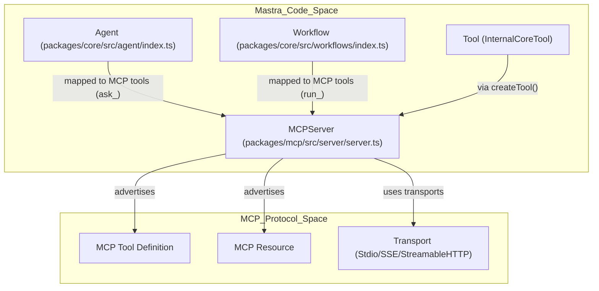

<!-- source: DeepWiki mcp.deepwiki.com · repo mastra-ai/mastra · page 19.3 Glossary: Tooling and Ecosystem · fetched 2026-10-27 -->

# Glossary: Tooling and Ecosystem

<details>
<summary>Relevant source files</summary>

The following files were used as context for generating this wiki page:

- [.changeset/bumpy-files-unite.md](.changeset/bumpy-files-unite.md)
- [.changeset/kind-pens-react.md](.changeset/kind-pens-react.md)
- [.changeset/salty-hands-shake.md](.changeset/salty-hands-shake.md)
- [.changeset/sharp-plums-speak.md](.changeset/sharp-plums-speak.md)
- [.changeset/smart-peas-grin.md](.changeset/smart-peas-grin.md)
- [.changeset/sparkly-camels-fold.md](.changeset/sparkly-camels-fold.md)
- [channels/slack/src/provider.test.ts](channels/slack/src/provider.test.ts)
- [channels/slack/src/provider.ts](channels/slack/src/provider.ts)
- [channels/slack/src/types.ts](channels/slack/src/types.ts)
- [docs/src/content/en/docs/channels.mdx](docs/src/content/en/docs/channels.mdx)
- [docs/src/content/en/reference/agents/channels.mdx](docs/src/content/en/reference/agents/channels.mdx)
- [docs/src/content/en/reference/channels/channel-provider.mdx](docs/src/content/en/reference/channels/channel-provider.mdx)
- [docs/src/content/en/reference/channels/slack-provider.mdx](docs/src/content/en/reference/channels/slack-provider.mdx)
- [docs/src/content/en/reference/cli/mastra.mdx](docs/src/content/en/reference/cli/mastra.mdx)
- [mastracode/factory/CHANGELOG.md](mastracode/factory/CHANGELOG.md)
- [mastracode/factory/package.json](mastracode/factory/package.json)
- [mastracode/mastra-factory/CHANGELOG.md](mastracode/mastra-factory/CHANGELOG.md)
- [mastracode/mastra-factory/package.json](mastracode/mastra-factory/package.json)
- [mastracode/sdk/CHANGELOG.md](mastracode/sdk/CHANGELOG.md)
- [mastracode/sdk/package.json](mastracode/sdk/package.json)
- [mastracode/tui/CHANGELOG.md](mastracode/tui/CHANGELOG.md)
- [mastracode/tui/package.json](mastracode/tui/package.json)
- [packages/cli/src/commands/api/api.test.ts](packages/cli/src/commands/api/api.test.ts)
- [packages/cli/src/commands/api/client.test.ts](packages/cli/src/commands/api/client.test.ts)
- [packages/cli/src/commands/api/client.ts](packages/cli/src/commands/api/client.ts)
- [packages/cli/src/commands/api/descriptors.test.ts](packages/cli/src/commands/api/descriptors.test.ts)
- [packages/cli/src/commands/api/index.ts](packages/cli/src/commands/api/index.ts)
- [packages/cli/src/commands/api/schema.test.ts](packages/cli/src/commands/api/schema.test.ts)
- [packages/cli/src/commands/api/schema.ts](packages/cli/src/commands/api/schema.ts)
- [packages/cli/src/commands/api/target.test.ts](packages/cli/src/commands/api/target.test.ts)
- [packages/cli/src/commands/api/target.ts](packages/cli/src/commands/api/target.ts)
- [packages/cli/src/commands/api/types.ts](packages/cli/src/commands/api/types.ts)
- [packages/cli/src/commands/deploy/index.test.ts](packages/cli/src/commands/deploy/index.test.ts)
- [packages/cli/src/commands/deploy/index.ts](packages/cli/src/commands/deploy/index.ts)
- [packages/cli/src/commands/platform-api.d.ts](packages/cli/src/commands/platform-api.d.ts)
- [packages/cli/src/commands/server/deploy.test.ts](packages/cli/src/commands/server/deploy.test.ts)
- [packages/cli/src/commands/server/deploy.ts](packages/cli/src/commands/server/deploy.ts)
- [packages/cli/src/commands/server/platform-api.test.ts](packages/cli/src/commands/server/platform-api.test.ts)
- [packages/cli/src/commands/server/platform-api.ts](packages/cli/src/commands/server/platform-api.ts)
- [packages/cli/src/commands/studio/deploy.test.ts](packages/cli/src/commands/studio/deploy.test.ts)
- [packages/cli/src/commands/studio/deploy.ts](packages/cli/src/commands/studio/deploy.ts)
- [packages/cli/src/commands/studio/platform-api.test.ts](packages/cli/src/commands/studio/platform-api.test.ts)
- [packages/cli/src/commands/studio/platform-api.ts](packages/cli/src/commands/studio/platform-api.ts)
- [packages/cli/src/commands/studio/project-config.test.ts](packages/cli/src/commands/studio/project-config.test.ts)
- [packages/cli/src/commands/studio/project-config.ts](packages/cli/src/commands/studio/project-config.ts)
- [packages/cli/src/index.ts](packages/cli/src/index.ts)
- [packages/core/src/channels/__tests__/agent-channels.test.ts](packages/core/src/channels/__tests__/agent-channels.test.ts)
- [packages/core/src/channels/__tests__/agent-controller-channels-tenant-context.test.ts](packages/core/src/channels/__tests__/agent-controller-channels-tenant-context.test.ts)
- [packages/core/src/channels/__tests__/agent-controller-channels.test.ts](packages/core/src/channels/__tests__/agent-controller-channels.test.ts)
- [packages/core/src/channels/__tests__/integration.test.ts](packages/core/src/channels/__tests__/integration.test.ts)
- [packages/core/src/channels/__tests__/output-processor.test.ts](packages/core/src/channels/__tests__/output-processor.test.ts)
- [packages/core/src/channels/__tests__/stream-helpers.test.ts](packages/core/src/channels/__tests__/stream-helpers.test.ts)
- [packages/core/src/channels/agent-channels.ts](packages/core/src/channels/agent-channels.ts)
- [packages/core/src/channels/agent-controller-channels.ts](packages/core/src/channels/agent-controller-channels.ts)
- [packages/core/src/channels/chat-driver-static.ts](packages/core/src/channels/chat-driver-static.ts)
- [packages/core/src/channels/chat-driver-streaming.ts](packages/core/src/channels/chat-driver-streaming.ts)
- [packages/core/src/channels/formatting.test.ts](packages/core/src/channels/formatting.test.ts)
- [packages/core/src/channels/formatting.ts](packages/core/src/channels/formatting.ts)
- [packages/core/src/channels/output-processor.ts](packages/core/src/channels/output-processor.ts)
- [packages/core/src/channels/processor.test.ts](packages/core/src/channels/processor.test.ts)
- [packages/core/src/channels/processor.ts](packages/core/src/channels/processor.ts)
- [packages/core/src/channels/stream-helpers.ts](packages/core/src/channels/stream-helpers.ts)
- [packages/core/src/channels/types.ts](packages/core/src/channels/types.ts)

</details>


This page defines the developer-tooling and ecosystem concepts within the Mastra framework. It covers the Command Line Interface (CLI), project initialization, external integration protocols like MCP, and the abstractions used for local development environments, sandboxed execution, and deployment.

## CLI and Project Lifecycle

The Mastra CLI is the primary entry point for managing the lifecycle of an AI application, from local initialization to cloud deployment.

### Commands and Actions
The CLI is built using the `commander` library and organizes functionality into distinct action handlers [packages/cli/src/index.ts:57-61]().

| Command | Function | Key Action File |
| :--- | :--- | :--- |
| `create` | Bootstraps a new project from scratch or templates [packages/cli/src/index.ts:74-75]() | `createProject` [packages/cli/src/commands/actions/create-project.ts:1-10]() |
| `init` | Initializes Mastra in an existing project [packages/cli/src/index.ts:77-101]() | `initProject` [packages/cli/src/commands/actions/init-project.ts:1-10]() |
| `dev` | Starts the development server with hot reloading [packages/cli/src/index.ts:120-141]() | `startDevServer` [packages/cli/src/commands/actions/start-dev-server.ts:1-10]() |
| `build` | Compiles the project for production [docs/src/content/en/reference/cli/mastra.mdx:122-132]() | `buildProject` [packages/cli/src/commands/actions/build-project.ts:1-10]() |
| `deploy` | Deploys the project to Mastra Cloud or other platforms [packages/cli/src/index.ts:27-27]() | `unifiedDeployAction` [packages/cli/src/commands/deploy/index.ts:1-10]() |
| `studio` | Starts the local Mastra Studio UI [packages/cli/src/index.ts:19-19]() | `startStudio` [packages/cli/src/commands/actions/start-studio.ts:1-10]() |
| `factory dev` | Starts the development server for the Agent Builder [docs/src/content/en/reference/cli/mastra.mdx:110-116]() | `startDevServer` (via `factory` command) [packages/cli/src/commands/actions/start-dev-server.ts:1-10]() |

### Project Initialization Flow
When `mastra init` or `mastra create` is run, the system performs a sequence of filesystem operations to set up the `src/mastra` directory and its subcomponents (agents, workflows, tools, scorers). The `init` process coordinates directory creation and file generation via functions like `writeAgentSample` and `writeWorkflowSample`. It also handles the installation of required peer dependencies based on the selected components [packages/cli/src/index.ts:77-101]().

**Sources:** [packages/cli/src/index.ts:57-175](), [docs/src/content/en/reference/cli/mastra.mdx:12-160]()

---

## Model Context Protocol (MCP) and ACP

Mastra implements the [Model Context Protocol](https://modelcontextprotocol.io/) to allow interoperability between Mastra agents and external tools or IDEs (like Cursor and Windsurf).

### MCPServer
The `MCPServer` class exposes Mastra entities as MCP-compliant resources [packages/mcp/src/server/server.ts:155]().
- **Agents and Workflows as Tools**: Agents and Workflows are automatically converted to tools for the MCP client. Agents become `ask_<agentId>` and workflows become `run_<workflowId>` [packages/mcp/src/server/server.ts:102-103]().
- **Transports**: Supports `StdioServerTransport` for local IDE integration [packages/mcp/src/server/server.ts:46]() and `SSEServerTransport` for legacy HTTP-based communication [packages/mcp/src/server/server.ts:47](). It also supports `NodeStreamableHTTPServerTransport` for modern session-based HTTP communication [packages/mcp/src/server/server.ts:26]().
- **Dynamic Tools**: The `toolActions` property allows for runtime registration and removal of tools [packages/mcp/src/server/server.ts:63]().

### MCPClient
The `MCPClient` manages multiple MCP server connections [packages/mcp/src/client/configuration.ts:106](). It uses `InternalMastraMCPClient` to handle low-level connections via the `@modelcontextprotocol/client` SDK [packages/mcp/src/client/client.ts:18]().
- **Tool Discovery**: Automatically fetches and wraps remote MCP tools as Mastra `Tool` instances [packages/mcp/src/client/client.ts:7-8]().
- **Instruction Forwarding**: Can append server-advertised instructions to an agent's system prompt if `forwardInstructions` is enabled [packages/mcp/src/client/client.ts:110-115]().

### ACP (Agent Client Protocol)
Mastra supports the Agent Client Protocol via the `@mastra/acp` package, providing an `AcpAgent` class for wrapping remote ACP-compatible agents as Mastra SubAgents and `createACPTool` for exposing ACP endpoints as tools.

### MCP Integration Diagram
The following diagram illustrates how the `MCPServer` bridges Mastra code entities to the MCP protocol.

**Natural Language Space to Code Entity Space: MCP Mapping**



**Sources:** [packages/mcp/src/server/server.ts:122-182](), [packages/mcp/src/client/client.ts:18-135](), [packages/mcp/src/client/configuration.ts:105-175](), [docs/src/content/en/reference/tools/mcp-server.mdx:43-115]()

---

## Bundler and Deployment Architecture

Mastra uses a specialized build system to prepare AI applications for various environments, including edge and serverless platforms.

### Bundler Abstraction
The build process uses `BuildBundler` for local production builds [packages/cli/src/commands/actions/build-project.ts:1-10]() and `DevBundler` for the development server [packages/cli/src/commands/actions/start-dev-server.ts:1-10](). These leverage Rollup to tree-shake code and handle module resolution.

### Platform Deployers
Mastra includes specialized deployers that wrap the bundler for specific platforms:
- **Cloudflare**: The `CloudflareDeployer` handles bundling for Cloudflare Workers, providing stubs for Node-only modules like `execa` and `typescript` that are unavailable in the Worker runtime.
- **Vercel**: The `VercelDeployer` configures projects for Vercel Functions, ensuring proper handling of circular dependencies in serverless environments.

**Sources:** [docs/src/content/en/reference/cli/mastra.mdx:122-132]()

---

## Ecosystem Integration: SDKs and Adapters

### AI SDK Adapter
The `@mastra/ai-sdk` adapter bridges Mastra to the Vercel AI SDK. It provides handlers like `handleChatStream` to convert Mastra's internal stream formats into formats compatible with `useChat` and `useCompletion` hooks.

### SDK Agents
Mastra supports wrapping third-party agent SDKs as native Mastra sub-agents:
- **`ClaudeSDKAgent`**: Wraps the Anthropic Claude Agent SDK.
- **`CursorSDKAgent`**: Integrates with the Cursor SDK.
- **`OpenAISDKAgent`**: Adapter for the OpenAI Agents SDK.

### Workspace and Sandboxes
The `Workspace` system provides agents with controlled environments for file operations and code execution.
- **`PlatformSandbox`**: A sandbox provider for executing code in isolated environments like Railway or E2B [workspaces/platform-workspace/src/sandbox.ts:62]().
- **`LocalSandbox`**: Provides local isolation using tools like `bwrap` (Linux) or `seatbelt` (macOS) [packages/core/src/workspace/sandbox/local-sandbox.ts:11]().
- **`Mesa` / `Archil`**: Filesystem providers for managing agent file systems in cloud environments.
- **`Railway` / `Apple Container`**: Sandbox providers for containerized execution.

### PubSub and Durability
- **PubSub**: Mastra's PubSub abstraction supports Redis Streams (with consumer groups and `XAUTOCLAIM` for reliability) and Google Cloud PubSub for cross-process communication.
- **Temporal**: The `@mastra/temporal` package provides `TemporalWorkflow` and `TemporalExecutionEngine` for running durable workflows on Temporal clusters.
- **Inngest**: Provides durable primitives and replay safety for Mastra workflows.

### Integrations
- **LiveKit**: Integration for real-time voice sessions, managing dispatch and end-call tools.
- **GitHub Signals**: Provides PR subscription notifications to trigger agent actions [packages/core/src/channels/agent-channels.ts:6](). The `AgentChannels` class manages the integration of agents with various messaging platforms, including handling signals [packages/core/src/channels/agent-channels.ts:96-97]().
- **NestJS Adapter**: Allows mounting Mastra within NestJS DI systems.

**Sources:** [workspaces/platform-workspace/src/sandbox.ts:32-118](), [packages/core/src/workspace/sandbox/local-sandbox.ts:11-50](), [packages/cli/src/index.ts:2-55](), [packages/core/src/channels/agent-channels.ts:6-97]()

---

## Maintenance and Release Tooling

### Changesets and Codemods
- **Changesets**: Mastra uses Changesets for versioning and CHANGELOG generation. This is evident in the `CHANGELOG.md` files for various packages, such as `@mastra/factory` [mastracode/factory/CHANGELOG.md:1-7]() and `@mastra/code-sdk` [mastracode/sdk/CHANGELOG.md:1-7]().
- **Codemod**: The `@mastra/codemod` package provides automated migrations for breaking changes between framework versions.

### Studio and Editor
The Studio UI provides a playground for agents and workflows. The `Editor` system supports CRUD operations for stored overrides, allowing runtime changes to prompts and tools without redeploying code.

### Factory: Boards, Work Items, and Skills
The Mastra Software Factory (`@mastra/factory`) is a core component for agent-powered software delivery [mastracode/factory/package.json:4](). It introduces several key concepts:
- **Boards**: Visual representations of project progress, similar to Kanban boards. They organize work items into phases [mastracode/factory/package.json:22-27]().
- **Work Items**: Individual tasks or issues that agents work on. These can originate from external systems like GitHub, GitLab, or Linear [mastracode/factory/CHANGELOG.md:70-71](). Work items carry metadata like assignee, creator, labels, and priority.
- **Skills**: Agent capabilities specifically designed for Factory operations, such as `factory-review`, `factory-rereview`, and `factory-gitlab-review` [mastracode/factory/CHANGELOG.md:22-22](). These skills often interact with external platforms (e.g., publishing review comments to GitHub).
- **Channels**: The Factory integrates with communication channels like Slack to provide gateway sessions [mastracode/factory/package.json:66](). The `AgentChannels` class in `@mastra/core` provides the underlying mechanism for connecting agents to messaging platforms [packages/core/src/channels/agent-channels.ts:96-97]().
- **Signals**: The system uses signals to trigger agent actions, for example, a push to a Factory-authored pull request can automatically start a re-review [mastracode/factory/CHANGELOG.md:7-7](). The `factory_review_source` tool provides information about the session URL, triggered user, and review target for traceability [mastracode/factory/CHANGELOG.md:22-22](). The `createSignal` function is used to define agent signals [packages/core/src/channels/agent-channels.ts:6]().

**Factory Workflow Diagram**

```mermaid
graph TD
    ExternalEvent[("External Event (e.g., GitHub PR, Linear Issue)")] --> Intake[("Factory Intake (e.g., LinearIntegration)")]
    Intake --> WorkItem[Work Item (Card on Board)]
    WorkItem -- "Moves through phases" --> Planning[Planning]
    Planning -- "Agent generates plan" --> Building[Building]
    Building -- "Agent creates PR" --> Review[Review]
    Review -- "Agent uses factory-review skill" --> Done[Done]

    subgraph "Agent Interaction"
        Agent["Mastra Agent"]
        Agent -- "Executes" --> Skill["Factory Skill (e.g., factory-review)"]
        Skill -- "Interacts with" --> ExternalPlatform["External Platform (e.g., GitHub API)"]
        Skill -- "Uses" --> FactoryReviewSourceTool["factory_review_source tool"]
    end

    WorkItem -- "Assigned to" --> Agent
    FactoryReviewSourceTool -- "Provides session context" --> Skill
    ExternalPlatform -- "Sends" --> Signals[Signals (e.g., PR push)]
    Signals --> Factory[Mastra Factory]
    Factory -- "Triggers" --> Agent
```

**Sources:** [mastracode/factory/CHANGELOG.md:1-71](), [mastracode/factory/package.json:1-91](), [mastracode/sdk/CHANGELOG.md:1-7](), [packages/cli/src/index.ts:1-164](), [docs/src/content/en/reference/cli/mastra.mdx:12-80](), [packages/core/src/channels/agent-channels.ts:6-97]()