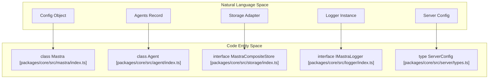
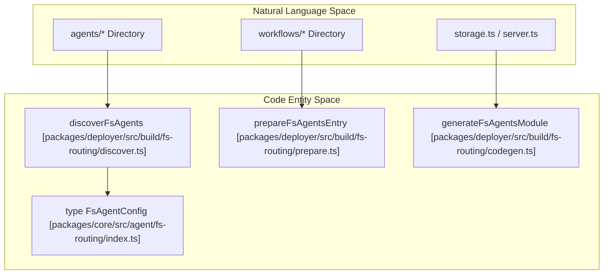

<!-- source: DeepWiki mcp.deepwiki.com · repo mastra-ai/mastra · page 2.1 Configuration Schema and Options · fetched 2026-10-27 -->

# Configuration Schema and Options

<details>
<summary>Relevant source files</summary>

The following files were used as context for generating this wiki page:

- [docs/src/content/en/reference/configuration.mdx](docs/src/content/en/reference/configuration.mdx)
- [docs/src/content/en/reference/server/register-api-route.mdx](docs/src/content/en/reference/server/register-api-route.mdx)
- [e2e-tests/_local-registry-setup/package.json](e2e-tests/_local-registry-setup/package.json)
- [e2e-tests/_local-registry-setup/prepare.js](e2e-tests/_local-registry-setup/prepare.js)
- [e2e-tests/_local-registry-setup/publish-ci-registry.js](e2e-tests/_local-registry-setup/publish-ci-registry.js)
- [e2e-tests/_local-registry-setup/publish-roots.js](e2e-tests/_local-registry-setup/publish-roots.js)
- [e2e-tests/_local-registry-setup/publish.js](e2e-tests/_local-registry-setup/publish.js)
- [e2e-tests/commonjs/setup.ts](e2e-tests/commonjs/setup.ts)
- [e2e-tests/create-mastra/create-mastra.test.ts](e2e-tests/create-mastra/create-mastra.test.ts)
- [e2e-tests/create-mastra/setup.ts](e2e-tests/create-mastra/setup.ts)
- [e2e-tests/deployers/setup.ts](e2e-tests/deployers/setup.ts)
- [e2e-tests/no-bundling/setup.ts](e2e-tests/no-bundling/setup.ts)
- [e2e-tests/type-check/setup.ts](e2e-tests/type-check/setup.ts)
- [e2e-tests/type-check/template/core/agent-message-input.test-d.ts](e2e-tests/type-check/template/core/agent-message-input.test-d.ts)
- [e2e-tests/type-check/template/core/auth.test-d.ts](e2e-tests/type-check/template/core/auth.test-d.ts)
- [e2e-tests/type-check/template/package.json](e2e-tests/type-check/template/package.json)
- [e2e-tests/type-check/template/tsconfig.exact-optional.json](e2e-tests/type-check/template/tsconfig.exact-optional.json)
- [e2e-tests/type-check/template/tsconfig.mcp.json](e2e-tests/type-check/template/tsconfig.mcp.json)
- [e2e-tests/type-check/template/vitest.config.ts](e2e-tests/type-check/template/vitest.config.ts)
- [e2e-tests/type-check/template/vitest.mcp.config.ts](e2e-tests/type-check/template/vitest.mcp.config.ts)
- [e2e-tests/type-check/test.ts](e2e-tests/type-check/test.ts)
- [packages/_internals/auth/src/provider/index.ts](packages/_internals/auth/src/provider/index.ts)
- [packages/_types-builder/AGENTS.md](packages/_types-builder/AGENTS.md)
- [packages/auth/src/index.ts](packages/auth/src/index.ts)
- [packages/core/src/agent/message-list/types.ts](packages/core/src/agent/message-list/types.ts)
- [packages/core/src/server/auth.test.ts](packages/core/src/server/auth.test.ts)
- [packages/core/src/server/auth.ts](packages/core/src/server/auth.ts)
- [packages/core/src/server/composite-auth.ts](packages/core/src/server/composite-auth.ts)
- [packages/core/src/server/index.ts](packages/core/src/server/index.ts)
- [packages/core/src/server/server.test-d.ts](packages/core/src/server/server.test-d.ts)
- [packages/core/src/server/server.test.ts](packages/core/src/server/server.test.ts)
- [packages/core/src/server/types.ts](packages/core/src/server/types.ts)

</details>


## Overview and Scope

The purpose of this page is to detail the `Config` type, initialization options, and the mechanisms used to configure a `Mastra` instance. The `Config` interface acts as the primary declarative specification for the entire application, registering agents, workflows, tools, memory stores, storage adapters, logging, observability, and server options [packages/core/src/mastra/index.ts:120-181]().

---

## Configuration Overview

The `Config` interface defines all subsystems managed by the `Mastra` class. During instantiation, the `Mastra` constructor parses this configuration object to build internal registries, validate component dependencies, and set up event routing and background worker systems [packages/core/src/mastra/index.ts:210-240]().

### Configuration Component Map

Title: "Mastra Configuration Component Map"

```mermaid
graph TB
    Config["Config Interface"] --> Agents["agents: Record<string, Agent | ToolLoopAgentLike | DurableAgentLike>"]
    Config --> Workflows["workflows: Record<string, AnyWorkflow>"]
    Config --> Tools["tools: Record<string, ToolAction>"]
    Config --> Memory["memory: Record<string, MastraMemory>"]
    Config --> Storage["storage: MastraCompositeStore"]
    Config --> Vectors["vectors: Record<string, MastraVector>"]
    Config --> Logger["logger: IMastraLogger | false"]
    Config --> Observability["observability: ObservabilityEntrypoint"]
    Config --> Server["server: ServerConfig"]
    Config --> Background["backgroundTasks: BackgroundTaskManagerConfig"]
    Config --> Deployer["deployer: MastraDeployer"]
```

Sources: [packages/core/src/mastra/index.ts:120-181]()

---

## Core Component Configuration

### Agents Configuration

The `agents` configuration property accepts a record mapping agent identifiers to `Agent` instances, AI SDK v6 `ToolLoopAgentLike` objects, or `DurableAgentLike` runners. The `Mastra` runtime bridges these external types during initialization using conversion helpers [packages/core/src/mastra/index.ts:251-265]().

**Type Signature:**
```typescript
agents?: { [K in keyof TAgents]: TAgents[K] | ToolLoopAgentLike | DurableAgentLike };
```
Sources: [packages/core/src/mastra/index.ts:121-122](), [packages/core/src/mastra/index.ts:251-265]()

### Workflows Configuration

The `workflows` property registers executable multi-step workflow pipelines. Mastra processes these definitions to establish step dependency graphs, event processors, and scheduler bindings [packages/core/src/mastra/index.ts:314-330]().

**Type Signature:**
```typescript
workflows?: Record<string, AnyWorkflow>
```
Sources: [packages/core/src/mastra/index.ts:172-172](), [packages/core/src/mastra/index.ts:314-330]()

### Tools Configuration

The `tools` property registers global `ToolAction` instances that can be invoked by any agent, workflow step, or exposed via Model Context Protocol (MCP) endpoints [packages/deployer/src/server/index.ts:135-143]().

**Type Signature:**
```typescript
tools?: Record<string, ToolAction<any, any, any, any, any, any>>
```
Sources: [packages/core/src/mastra/index.ts:123-124](), [packages/deployer/src/server/index.ts:135-143]()

Sources: [packages/core/src/mastra/index.ts:120-181](), [packages/deployer/src/server/index.ts:135-143]()

---

## Memory and Storage Configuration

### Memory Configuration

The `memory` property stores a record of named `MastraMemory` instances. Memory subsystems handle conversation history persistence, semantic recall search indexes, and working memory buffers [packages/core/src/mastra/index.ts:143-143]().

### Storage Configuration

The `storage` property expects an implementation of `MastraCompositeStore`. Storage handles persistence domains including workflow execution states, thread messages, and background task queues [packages/core/src/mastra/index.ts:159-160](). If omitted, Mastra falls back to an `InMemoryStore` instance [packages/core/src/mastra/index.ts:222-222]().

Sources: [packages/core/src/mastra/index.ts:143-143](), [packages/core/src/mastra/index.ts:159-160](), [packages/core/src/mastra/index.ts:222-222]()

---

## Infrastructure Configuration

### Logger and Observability

The `logger` property accepts an `IMastraLogger` instance (such as `ConsoleLogger` or `DualLogger`) or `false` to disable logging [packages/core/src/mastra/index.ts:140-142](). The `observability` property accepts an `ObservabilityEntrypoint` instance to coordinate OpenTelemetry tracing, metrics collection, and span routing [packages/core/src/mastra/index.ts:149-152]().

### Server Configuration

The `server` property configures the HTTP server parameters via `ServerConfig`, including routing prefixes, CORS rules, custom Hono middleware, and endpoints registered via `registerApiRoute` [packages/core/src/server/types.ts:23-38](), [packages/core/src/server/index.ts:136-151]().

Sources: [packages/core/src/mastra/index.ts:140-158](), [packages/core/src/server/types.ts:23-38](), [packages/core/src/server/index.ts:136-151]()

---

## File-System Routing Configuration

Mastra provides automated discovery for file-system routed agents, workflows, and singleton configuration files (e.g., `storage.ts`, `observability.ts`, `server.ts`) [packages/deployer/src/build/fs-routing/prepare.ts:66-80](). The build system uses `prepareFsAgentsEntry` and `discoverFsAgents` to scan directories, parse frontmatter, and compile wrapper entry modules [packages/deployer/src/build/fs-routing/prepare.ts:66-105](), [packages/deployer/src/build/fs-routing/discover.ts:1-50]().

Sources: [packages/deployer/src/build/fs-routing/prepare.ts:66-105](), [packages/deployer/src/build/fs-routing/discover.ts:1-50]()

---

## Configuration Initialization Flow and Entity Mapping

### Natural Language to Code Entity Mapping: Core Registry

Title: "Core Configuration to Code Entity Mapping"

Sources: [packages/core/src/mastra/index.ts:120-181]()

### Natural Language to Code Entity Mapping: File-System Routing

Title: "FS Routing Configuration to Code Entity Mapping"

Sources: [packages/deployer/src/build/fs-routing/discover.ts:1-50](), [packages/deployer/src/build/fs-routing/prepare.ts:66-105](), [packages/deployer/src/build/fs-routing/codegen.ts:1-30](), [packages/core/src/agent/fs-routing/index.ts:32-39]()

---

## Detailed Config Schema Table

| Property | Type | Description |
| :--- | :--- | :--- |
| `agents` | `Record<string, Agent \| ToolLoopAgentLike \| DurableAgentLike>` | Autonomous decision-making systems registered in Mastra [packages/core/src/mastra/index.ts:121-122](). |
| `backgroundTasks` | `BackgroundTaskManagerConfig` | Configuration manager for asynchronous tool and subagent execution [packages/core/src/mastra/index.ts:125-127](). |
| `cache` | `MastraServerCache` | Server-side caching engine [packages/core/src/mastra/index.ts:128-129](). |
| `channels` | `ChannelProvider` | External messaging platform integration provider [packages/core/src/mastra/index.ts:130-131](). |
| `datasets` | `DatasetsManager` | Dataset management and experiment tracker [packages/core/src/mastra/index.ts:132-132](). |
| `deployer` | `MastraDeployer` | Deployment publisher for serverless or container targets [packages/core/src/mastra/index.ts:133-133](). |
| `gateways` | `Record<string, MastraModelGateway>` | Model gateway definitions for provider routing [packages/core/src/mastra/index.ts:138-139](). |
| `logger` | `IMastraLogger \| false` | Structured logging implementation or disable flag [packages/core/src/mastra/index.ts:140-142](). |
| `memory` | `Record<string, MastraMemory>` | Registry of memory and context backends [packages/core/src/mastra/index.ts:143-143](). |
| `mcpServers` | `Record<string, MCPServerBase>` | Model Context Protocol servers for tool discovery [packages/core/src/mastra/index.ts:144-144](). |
| `observability` | `ObservabilityEntrypoint` | Tracing and metrics collection entrypoint [packages/core/src/mastra/index.ts:149-152](). |
| `processors` | `Record<string, Processor>` | Global pipeline step processors [packages/core/src/mastra/index.ts:154-154](). |
| `server` | `ServerConfig` | API server and router configuration [packages/core/src/mastra/index.ts:157-158](). |
| `storage` | `MastraCompositeStore` | Persistence store for workflows, tasks, and memory [packages/core/src/mastra/index.ts:159-160](). |
| `workflows` | `Record<string, AnyWorkflow>` | Multi-step orchestration pipelines [packages/core/src/mastra/index.ts:172-172](). |
| `workspaces` | `Record<string, AnyWorkspace>` | Sandboxed filesystem and execution workspaces [packages/core/src/mastra/index.ts:176-176](). |

Sources: [packages/core/src/mastra/index.ts:120-181]()

---

