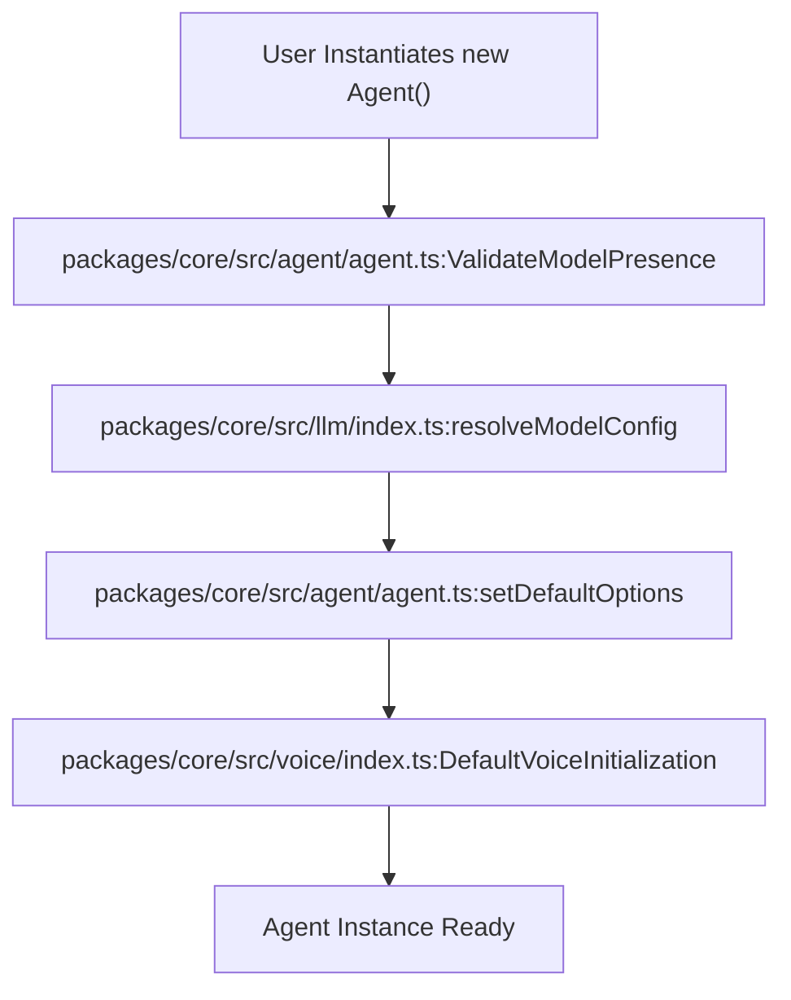
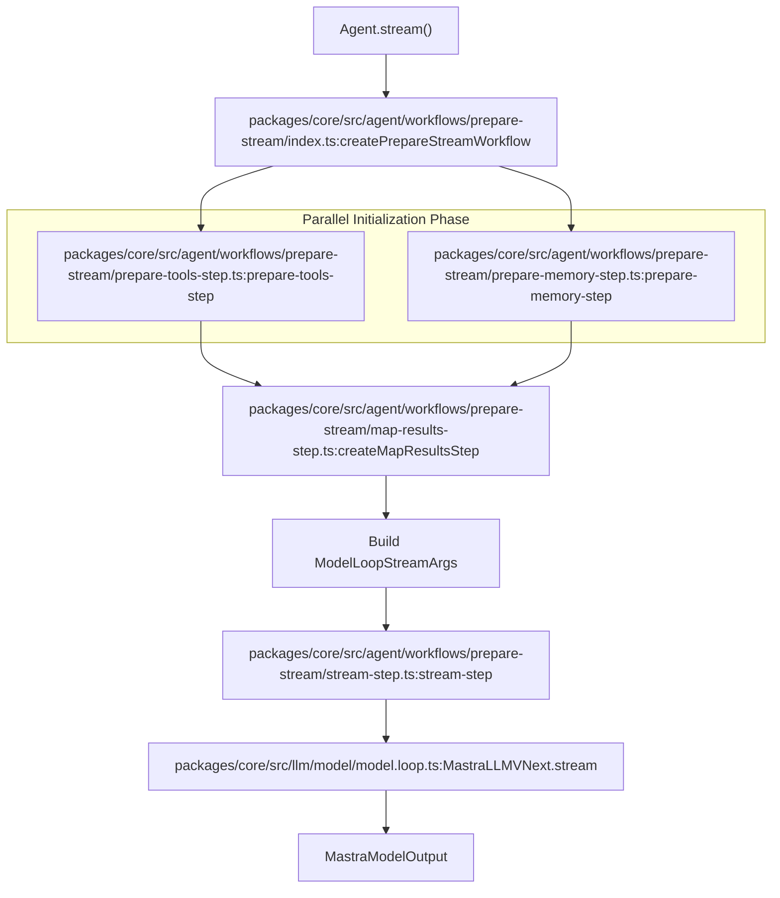
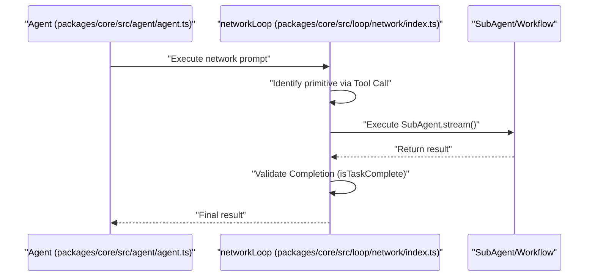

<!-- source: DeepWiki mcp.deepwiki.com · repo mastra-ai/mastra · page 3.1 Agent Configuration and Execution · fetched 2026-10-27 -->

# Agent Configuration and Execution

Relevant source files

The following files were used as context for generating this wiki page:

- [.changeset/peer-discovery-busy-caller.md](.changeset/peer-discovery-busy-caller.md)
- [.changeset/retake-lapsed-thread-lease.md](.changeset/retake-lapsed-thread-lease.md)
- [.changeset/wise-tabs-agree.md](.changeset/wise-tabs-agree.md)
- [docs/src/content/en/docs/agents/human-in-the-loop.mdx](docs/src/content/en/docs/agents/human-in-the-loop.mdx)
- [docs/src/content/en/docs/guides/context-engineering.mdx](docs/src/content/en/docs/guides/context-engineering.mdx)
- [docs/src/content/en/docs/observability/logging.mdx](docs/src/content/en/docs/observability/logging.mdx)
- [docs/src/content/en/docs/subagents.mdx](docs/src/content/en/docs/subagents.mdx)
- [docs/src/content/en/reference/agents/generate.mdx](docs/src/content/en/reference/agents/generate.mdx)
- [docs/src/content/en/reference/signals/task-signal-provider.mdx](docs/src/content/en/reference/signals/task-signal-provider.mdx)
- [docs/src/content/en/reference/streaming/agents/stream.mdx](docs/src/content/en/reference/streaming/agents/stream.mdx)
- [docs/src/plugins/docusaurus-plugin-llms-txt/__tests__/component-handlers.test.ts](docs/src/plugins/docusaurus-plugin-llms-txt/__tests__/component-handlers.test.ts)
- [docs/src/plugins/docusaurus-plugin-llms-txt/component-handlers.ts](docs/src/plugins/docusaurus-plugin-llms-txt/component-handlers.ts)
- [mastracode/sdk/src/agent-connections/__tests__/cross-process-agent-signals.integration.test.ts](mastracode/sdk/src/agent-connections/__tests__/cross-process-agent-signals.integration.test.ts)
- [mastracode/sdk/src/agent-connections/__tests__/fixtures/cross-process-agent-signals-child.mts](mastracode/sdk/src/agent-connections/__tests__/fixtures/cross-process-agent-signals-child.mts)
- [observability/mastra/src/model-tracing.test.ts](observability/mastra/src/model-tracing.test.ts)
- [observability/mastra/src/model-tracing.ts](observability/mastra/src/model-tracing.ts)
- [packages/core/src/agent-controller/lease-lost-abort-reason.test.ts](packages/core/src/agent-controller/lease-lost-abort-reason.test.ts)
- [packages/core/src/agent/__tests__/delegation-thread-metadata.test.ts](packages/core/src/agent/__tests__/delegation-thread-metadata.test.ts)
- [packages/core/src/agent/__tests__/memory-metadata.test.ts](packages/core/src/agent/__tests__/memory-metadata.test.ts)
- [packages/core/src/agent/__tests__/signals-claimed-ownership.test.ts](packages/core/src/agent/__tests__/signals-claimed-ownership.test.ts)
- [packages/core/src/agent/__tests__/signals-idle-active-behavior.test.ts](packages/core/src/agent/__tests__/signals-idle-active-behavior.test.ts)
- [packages/core/src/agent/__tests__/stream.test.ts](packages/core/src/agent/__tests__/stream.test.ts)
- [packages/core/src/agent/__tests__/thread-lease-loss-abort.test.ts](packages/core/src/agent/__tests__/thread-lease-loss-abort.test.ts)
- [packages/core/src/agent/__tests__/tool-concurrency-called-strategy-resume.test.ts](packages/core/src/agent/__tests__/tool-concurrency-called-strategy-resume.test.ts)
- [packages/core/src/agent/__tests__/tool-concurrency-called-strategy.test.ts](packages/core/src/agent/__tests__/tool-concurrency-called-strategy.test.ts)
- [packages/core/src/agent/__tests__/tool-handling.test.ts](packages/core/src/agent/__tests__/tool-handling.test.ts)
- [packages/core/src/agent/agent-legacy.ts](packages/core/src/agent/agent-legacy.ts)
- [packages/core/src/agent/agent-types.test-d.ts](packages/core/src/agent/agent-types.test-d.ts)
- [packages/core/src/agent/agent.test.ts](packages/core/src/agent/agent.test.ts)
- [packages/core/src/agent/agent.ts](packages/core/src/agent/agent.ts)
- [packages/core/src/agent/agent.types.ts](packages/core/src/agent/agent.types.ts)
- [packages/core/src/agent/durable/durable-parity.test-d.ts](packages/core/src/agent/durable/durable-parity.test-d.ts)
- [packages/core/src/agent/subagent.ts](packages/core/src/agent/subagent.ts)
- [packages/core/src/agent/thread-stream-runtime.ts](packages/core/src/agent/thread-stream-runtime.ts)
- [packages/core/src/agent/types.ts](packages/core/src/agent/types.ts)
- [packages/core/src/agent/workflows/prepare-stream/index.ts](packages/core/src/agent/workflows/prepare-stream/index.ts)
- [packages/core/src/agent/workflows/prepare-stream/map-results-step.ts](packages/core/src/agent/workflows/prepare-stream/map-results-step.ts)
- [packages/core/src/agent/workflows/prepare-stream/prepare-memory-step.ts](packages/core/src/agent/workflows/prepare-stream/prepare-memory-step.ts)
- [packages/core/src/agent/workflows/prepare-stream/prepare-tools-step.ts](packages/core/src/agent/workflows/prepare-stream/prepare-tools-step.ts)
- [packages/core/src/agent/workflows/prepare-stream/run-scope-keys.ts](packages/core/src/agent/workflows/prepare-stream/run-scope-keys.ts)
- [packages/core/src/agent/workflows/prepare-stream/schema.ts](packages/core/src/agent/workflows/prepare-stream/schema.ts)
- [packages/core/src/agent/workflows/prepare-stream/stream-step.ts](packages/core/src/agent/workflows/prepare-stream/stream-step.ts)
- [packages/core/src/llm/model/model.loop.ts](packages/core/src/llm/model/model.loop.ts)
- [packages/core/src/loop/loop.ts](packages/core/src/loop/loop.ts)
- [packages/core/src/loop/network/index.ts](packages/core/src/loop/network/index.ts)
- [packages/core/src/loop/network/validation.test.ts](packages/core/src/loop/network/validation.test.ts)
- [packages/core/src/loop/network/validation.ts](packages/core/src/loop/network/validation.ts)
- [packages/core/src/loop/types.ts](packages/core/src/loop/types.ts)
- [packages/core/src/loop/workflows/agentic-execution/index.ts](packages/core/src/loop/workflows/agentic-execution/index.ts)
- [packages/core/src/loop/workflows/agentic-execution/tool-call-concurrency.test.ts](packages/core/src/loop/workflows/agentic-execution/tool-call-concurrency.test.ts)
- [packages/core/src/loop/workflows/agentic-execution/tool-call-concurrency.ts](packages/core/src/loop/workflows/agentic-execution/tool-call-concurrency.ts)
- [packages/core/src/loop/workflows/agentic-loop/index.ts](packages/core/src/loop/workflows/agentic-loop/index.ts)
- [packages/core/src/memory/index.ts](packages/core/src/memory/index.ts)
- [packages/core/src/memory/run-state.test.ts](packages/core/src/memory/run-state.test.ts)
- [packages/core/src/memory/run-state.ts](packages/core/src/memory/run-state.ts)
- [packages/core/src/signals/task-signal-provider.ts](packages/core/src/signals/task-signal-provider.ts)
- [packages/core/src/tools/builtin/task-state-processor.ts](packages/core/src/tools/builtin/task-state-processor.ts)
- [packages/core/src/tools/builtin/task-tools.ts](packages/core/src/tools/builtin/task-tools.ts)
- [packages/core/src/tools/request-context-schema-types.test-d.ts](packages/core/src/tools/request-context-schema-types.test-d.ts)
- [packages/rag/src/document/validation.ts](packages/rag/src/document/validation.ts)

## Purpose and Scope

This document covers the configuration and execution architecture of agents in Mastra. It details the `Agent` class constructor options (`Agent` class defined in `packages/core/src/agent/agent.ts`), the `generate()` and `stream()` execution methods, and the internal `prepare-stream` workflow pipeline (`createPrepareStreamWorkflow` in `packages/core/src/agent/workflows/prepare-stream/index.ts`) that orchestrates execution.

For LLM provider integration and model router details, see [3.2 LLM Integration and Model Router](). For tool execution mechanics, see [3.3 Tool Integration and Execution](). For memory management, see [3.4 Agent Memory System]().

---

## Agent Configuration

### Agent Class Options

The `Agent` constructor accepts a configuration object defining identity, capabilities, and default behaviors [packages/core/src/agent/agent.ts:189-204]().

**Key Configuration Fields**

| Field | Type | Required | Description |
|-------|------|----------|-------------|
| `id` | `string` | Yes | Unique identifier for the agent [packages/core/src/agent/agent.ts:192]() |
| `name` | `string` | Yes | Display name for the agent [packages/core/src/agent/agent.ts:193]() |
| `instructions` | `DynamicArgument<AgentInstructions>` | Yes | System instructions guiding agent behavior [packages/core/src/agent/agent.ts:195]() |
| `model` | `DynamicArgument<MastraModelConfig \| ModelWithRetries[]>` | Yes | Language model configuration [packages/core/src/agent/agent.ts:196]() |
| `tools` | `DynamicArgument<ToolsInput>` | No | Tools available to the agent [packages/core/src/agent/agent.ts:198]() |
| `memory` | `DynamicArgument<MastraMemory>` | No | Memory module for stateful context [packages/core/src/agent/agent.ts:200]() |
| `inputProcessors` | `DynamicArgument<InputProcessorOrWorkflow[]>` | No | Pre-processing pipeline [packages/core/src/agent/agent.ts:201]() |
| `outputProcessors` | `DynamicArgument<OutputProcessorOrWorkflow[]>` | No | Post-processing pipeline [packages/core/src/agent/agent.ts:202]() |
| `scorers` | `DynamicArgument<MastraScorers>` | No | Evaluation scorers for task completion [packages/core/src/agent/agent.ts:203]() |

Sources: [packages/core/src/agent/agent.ts:189-204](), [packages/core/src/agent/types.ts:106-128]()

### Model Configuration Patterns

Agents support three model configuration patterns:

1.  **Single Model ID**: A string like `openai/gpt-4o`.
2.  **Dynamic Selection**: A function resolving the model based on `RequestContext` [packages/core/src/agent/agent.ts:216-236]().
3.  **Fallback Array**: An array of `ModelWithRetries` objects. The agent attempts each model in sequence if the primary fails [packages/core/src/agent/agent.ts:216-236]().

Sources: [packages/core/src/agent/agent.ts:139-147](), [packages/core/src/agent/agent.ts:216-236]()

---

## Agent Initialization

### Constructor Flow

The `Agent` constructor performs validation and internal state setup. Below is a diagram mapping the conceptual initialization steps to code execution entities within `packages/core/src/agent/agent.ts` and related modules, bridging natural language requirements to code entities.

Title: "Agent Constructor to Code Entity Mapping"

Sources: [packages/core/src/agent/agent.ts:189-308](), [packages/core/src/voice/index.ts]()

---

## Execution Methods

Agents provide two primary execution APIs: `generate()` and `stream()` [packages/core/src/agent/agent.ts:1097-1206](). Both utilize the modern `MastraLLMVNext` model loop (`packages/core/src/llm/model/model.loop.ts`) [packages/core/src/agent/agent.ts:39]().

### Method Comparison

| Method | Return Type | Primary Use Case |
|--------|-------------|------------------|
| `generate()` | `Promise<FullOutput>` | Synchronous execution; waits for the full response and tool loop completion [packages/core/src/agent/agent.ts:1097-1141](). |
| `stream()` | `Promise<MastraModelOutput>` | Streaming execution; returns a stream of text, tool calls, and usage data [packages/core/src/agent/agent.ts:1143-1206](). |

Sources: [packages/core/src/agent/agent.ts:1097-1206](), [packages/core/src/llm/model/model.loop.ts:107-147]()

### VNext Execution Flow

The `stream()` method is the core execution engine. `generate()` acts as a wrapper that consumes the stream returned by `stream()` [packages/core/src/agent/agent.ts:1134-1140]().

**Execution Sequence**:
1.  Initialize `runId` and start observability span [packages/core/src/agent/agent.ts:1146-1153]().
2.  Create and execute the `prepare-stream` workflow [packages/core/src/agent/agent.ts:1155-1175]().
3.  The workflow returns a `MastraModelOutput` which wraps the LLM stream [packages/core/src/agent/agent.ts:1203-1205]().

Sources: [packages/core/src/agent/agent.ts:1097-1206](), [packages/core/src/llm/model/model.loop.ts:107-147]()

---

## Prepare-Stream Workflow Pipeline

Mastra uses an internal workflow called `prepare-stream` (`packages/core/src/agent/workflows/prepare-stream/index.ts`) to orchestrate the steps required before the LLM loop starts.

### Pipeline Architecture

Title: "Prepare-Stream Architecture to Code Entity Mapping"

**1. prepare-tools-step**:
Resolves dynamic tools, adds built-in tools (like web search), and converts them to `CoreTool` format [packages/core/src/agent/workflows/prepare-stream/prepare-tools-step.ts:1-86]().

**2. prepare-memory-step**:
Loads thread history, initializes the `MessageList`, and runs input processors [packages/core/src/agent/workflows/prepare-stream/prepare-memory-step.ts:1-150]().

**3. map-results-step**:
Consolidates tools, memory, and options into `ModelLoopStreamArgs`. It also injects the `StructuredOutputProcessor` if a schema is provided in `AgentExecutionOptions` [packages/core/src/agent/workflows/prepare-stream/map-results-step.ts:66-187]().

**4. stream-step**:
Invokes the `MastraLLMVNext` model loop [packages/core/src/llm/model/model.loop.ts:107](). It manages the `SaveQueueManager` to ensure messages are persisted to memory after each step [packages/core/src/agent/workflows/prepare-stream/stream-step.ts:1-137]().

Sources: [packages/core/src/agent/workflows/prepare-stream/index.ts:1-197](), [packages/core/src/agent/workflows/prepare-stream/map-results-step.ts:66-187](), [packages/core/src/llm/model/model.loop.ts:107-147]()

---

## Agent Network and Delegation

The `network()` method enables multi-agent collaboration by treating sub-agents and workflows as tools [packages/core/src/loop/network/index.ts:1-180]().

### Network Execution Logic

Title: "Agent Network Execution Flow"

**Key Features**:
*   **Routing Agent**: Automatically created to decide which sub-agent or workflow to invoke [packages/core/src/loop/network/index.ts:169-180]().
*   **Message Filtering**: Uses `filterMessagesForSubAgent` to pass only relevant history to sub-agents, excluding internal network JSON markers [packages/core/src/loop/network/index.ts:132-166]().
*   **Delegation Hooks**: `onDelegationStart` and `onDelegationComplete` allow for monitoring and modifying the cross-agent communication [packages/core/src/agent/agent.types.ts:77-180]().
*   **Observational Memory Constraint**: Observational Memory is unsupported in `agent.network()` because the network does not propagate required `threadId`/`resourceId` context [packages/core/src/loop/network/index.ts:57-89]().

Sources: [packages/core/src/agent/agent.ts:46](), [packages/core/src/loop/network/index.ts:1-180](), [packages/core/src/agent/agent.types.ts:48-180]()

---

## Sources Summary

*   **Agent Class Definition**: [packages/core/src/agent/agent.ts:189-308]()
*   **Agent Configuration Types**: [packages/core/src/agent/types.ts:106-278]()
*   **Execution Methods (generate/stream)**: [packages/core/src/agent/agent.ts:1097-1206]()
*   **Prepare Stream Workflow**: [packages/core/src/agent/workflows/prepare-stream/index.ts:1-197]()
*   **Map Results Logic**: [packages/core/src/agent/workflows/prepare-stream/map-results-step.ts:66-187]()
*   **Network Loop Implementation**: [packages/core/src/loop/network/index.ts:1-180]()
*   **Network/Delegation Types**: [packages/core/src/agent/agent.types.ts:48-180]()
*   **Model Loop (VNext)**: [packages/core/src/llm/model/model.loop.ts:107-147]()
*   **Message List Logic**: [packages/core/src/agent/message-list/message-list.ts:108-180]()

---

