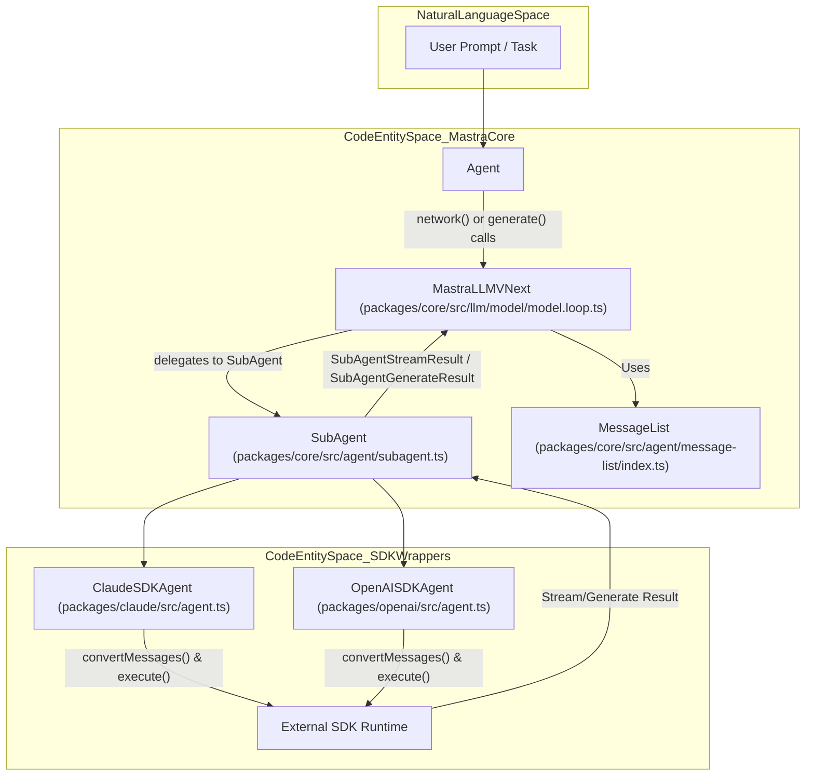
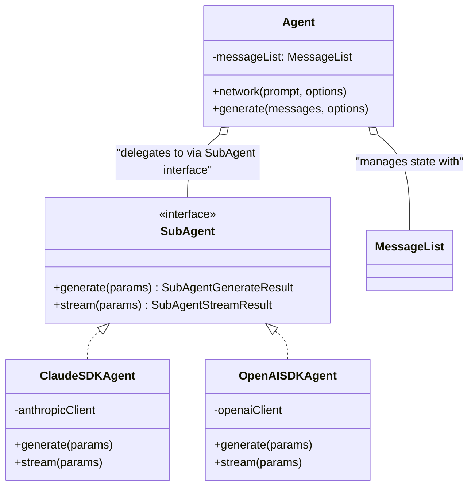

<!-- source: DeepWiki mcp.deepwiki.com · repo mastra-ai/mastra · page 3.11 Agent SDK Wrappers (Claude, Cursor, OpenAI) · fetched 2026-10-27 -->

# Agent SDK Wrappers (Claude, Cursor, OpenAI)

Relevant source files

The following files were used as context for generating this wiki page:

- [.changeset/peer-discovery-busy-caller.md](.changeset/peer-discovery-busy-caller.md)
- [.changeset/retake-lapsed-thread-lease.md](.changeset/retake-lapsed-thread-lease.md)
- [docs/src/content/en/docs/subagents.mdx](docs/src/content/en/docs/subagents.mdx)
- [mastracode/sdk/src/agent-connections/__tests__/cross-process-agent-signals.integration.test.ts](mastracode/sdk/src/agent-connections/__tests__/cross-process-agent-signals.integration.test.ts)
- [mastracode/sdk/src/agent-connections/__tests__/fixtures/cross-process-agent-signals-child.mts](mastracode/sdk/src/agent-connections/__tests__/fixtures/cross-process-agent-signals-child.mts)
- [observability/mastra/src/model-tracing.test.ts](observability/mastra/src/model-tracing.test.ts)
- [observability/mastra/src/model-tracing.ts](observability/mastra/src/model-tracing.ts)
- [packages/core/src/agent-controller/lease-lost-abort-reason.test.ts](packages/core/src/agent-controller/lease-lost-abort-reason.test.ts)
- [packages/core/src/agent/__tests__/delegation-thread-metadata.test.ts](packages/core/src/agent/__tests__/delegation-thread-metadata.test.ts)
- [packages/core/src/agent/__tests__/memory-metadata.test.ts](packages/core/src/agent/__tests__/memory-metadata.test.ts)
- [packages/core/src/agent/__tests__/signals-claimed-ownership.test.ts](packages/core/src/agent/__tests__/signals-claimed-ownership.test.ts)
- [packages/core/src/agent/__tests__/signals-idle-active-behavior.test.ts](packages/core/src/agent/__tests__/signals-idle-active-behavior.test.ts)
- [packages/core/src/agent/__tests__/stream.test.ts](packages/core/src/agent/__tests__/stream.test.ts)
- [packages/core/src/agent/__tests__/thread-lease-loss-abort.test.ts](packages/core/src/agent/__tests__/thread-lease-loss-abort.test.ts)
- [packages/core/src/agent/__tests__/tool-concurrency-called-strategy-resume.test.ts](packages/core/src/agent/__tests__/tool-concurrency-called-strategy-resume.test.ts)
- [packages/core/src/agent/__tests__/tool-concurrency-called-strategy.test.ts](packages/core/src/agent/__tests__/tool-concurrency-called-strategy.test.ts)
- [packages/core/src/agent/__tests__/tool-handling.test.ts](packages/core/src/agent/__tests__/tool-handling.test.ts)
- [packages/core/src/agent/agent-legacy.ts](packages/core/src/agent/agent-legacy.ts)
- [packages/core/src/agent/agent-types.test-d.ts](packages/core/src/agent/agent-types.test-d.ts)
- [packages/core/src/agent/agent.test.ts](packages/core/src/agent/agent.test.ts)
- [packages/core/src/agent/agent.ts](packages/core/src/agent/agent.ts)
- [packages/core/src/agent/agent.types.ts](packages/core/src/agent/agent.types.ts)
- [packages/core/src/agent/durable/durable-parity.test-d.ts](packages/core/src/agent/durable/durable-parity.test-d.ts)
- [packages/core/src/agent/subagent.ts](packages/core/src/agent/subagent.ts)
- [packages/core/src/agent/thread-stream-runtime.ts](packages/core/src/agent/thread-stream-runtime.ts)
- [packages/core/src/agent/types.ts](packages/core/src/agent/types.ts)
- [packages/core/src/agent/workflows/prepare-stream/index.ts](packages/core/src/agent/workflows/prepare-stream/index.ts)
- [packages/core/src/agent/workflows/prepare-stream/map-results-step.ts](packages/core/src/agent/workflows/prepare-stream/map-results-step.ts)
- [packages/core/src/agent/workflows/prepare-stream/prepare-memory-step.ts](packages/core/src/agent/workflows/prepare-stream/prepare-memory-step.ts)
- [packages/core/src/agent/workflows/prepare-stream/prepare-tools-step.ts](packages/core/src/agent/workflows/prepare-stream/prepare-tools-step.ts)
- [packages/core/src/agent/workflows/prepare-stream/run-scope-keys.ts](packages/core/src/agent/workflows/prepare-stream/run-scope-keys.ts)
- [packages/core/src/agent/workflows/prepare-stream/schema.ts](packages/core/src/agent/workflows/prepare-stream/schema.ts)
- [packages/core/src/agent/workflows/prepare-stream/stream-step.ts](packages/core/src/agent/workflows/prepare-stream/stream-step.ts)
- [packages/core/src/llm/model/model.loop.ts](packages/core/src/llm/model/model.loop.ts)
- [packages/core/src/loop/loop.ts](packages/core/src/loop/loop.ts)
- [packages/core/src/loop/network/index.ts](packages/core/src/loop/network/index.ts)
- [packages/core/src/loop/network/validation.test.ts](packages/core/src/loop/network/validation.test.ts)
- [packages/core/src/loop/network/validation.ts](packages/core/src/loop/network/validation.ts)
- [packages/core/src/loop/types.ts](packages/core/src/loop/types.ts)
- [packages/core/src/loop/workflows/agentic-execution/index.ts](packages/core/src/loop/workflows/agentic-execution/index.ts)
- [packages/core/src/loop/workflows/agentic-execution/tool-call-concurrency.test.ts](packages/core/src/loop/workflows/agentic-execution/tool-call-concurrency.test.ts)
- [packages/core/src/loop/workflows/agentic-execution/tool-call-concurrency.ts](packages/core/src/loop/workflows/agentic-execution/tool-call-concurrency.ts)
- [packages/core/src/loop/workflows/agentic-loop/index.ts](packages/core/src/loop/workflows/agentic-loop/index.ts)
- [packages/core/src/memory/index.ts](packages/core/src/memory/index.ts)
- [packages/core/src/memory/run-state.test.ts](packages/core/src/memory/run-state.test.ts)
- [packages/core/src/memory/run-state.ts](packages/core/src/memory/run-state.ts)
- [packages/core/src/tools/request-context-schema-types.test-d.ts](packages/core/src/tools/request-context-schema-types.test-d.ts)
- [packages/rag/src/document/validation.ts](packages/rag/src/document/validation.ts)

Mastra provides specialized wrapper packages that allow third-party agent SDKs to be integrated as first-class `SubAgent` entities within the Mastra ecosystem. These wrappers bridge the execution loops of external SDKs (like Anthropic's Claude Agent SDK, Cursor SDK, and OpenAI Agents SDK) into Mastra's standard `generate` and `stream` interfaces, enabling observability, tool sharing, and memory persistence.

## Overview

The `agent-sdks` packages wrap external SDK runtimes to make them compatible with Mastra's agentic execution system. This allows developers to use specialized agent logic from other providers while benefiting from Mastra's infrastructure for logging, storage, and multi-agent collaboration.

### Key Wrapper Classes
- `ClaudeSDKAgent`: Wraps the Anthropic Claude Agent SDK.
- `CursorSDKAgent`: Wraps the Cursor SDK.
- `OpenAISDKAgent`: Wraps the OpenAI Agents SDK.

These wrappers are tracked as distinct packages in the monorepo, such as `@mastra/claude`, `@mastra/cursor`, and `@mastra/openai` [packages/core/src/agent/subagent.ts:1-10]().

### Purpose and Data Flow
The wrappers implement the `SubAgent` interface [packages/core/src/agent/subagent.ts:12](), which defines how an agent responds to `generate` and `stream` requests. When a Mastra `Agent` delegates a task to an SDK wrapper via the `network()` loop [packages/core/src/loop/network/index.ts:4](), the wrapper translates Mastra's `CoreMessage` [packages/core/src/agent/types.ts:25]() format into the target SDK's native format, executes the external SDK's run loop, and maps the result back to `SubAgentGenerateResult` or `SubAgentStreamResult` [packages/core/src/agent/agent.types.ts:26]().

Sources: [packages/core/src/agent/types.ts:25](), [packages/core/src/loop/network/index.ts:4](), [packages/core/src/agent/subagent.ts:12](), [packages/core/src/agent/agent.types.ts:26]()

## Implementation Architecture

The wrappers act as a bridge between the Mastra agentic loop and the external SDK loop.

### Bridging the Run Loop
External SDKs often have their own internal "loop" for handling tool calls and multi-turn reasoning. The Mastra wrappers encapsulate this by:
1.  **Context Mapping**: Converting Mastra's `RequestContext` [packages/core/src/request-context/index.ts:1]() and thread history (from `MessageList` [packages/core/src/agent/message-list/index.ts:1]()) into the external SDK's session state.
2.  **Execution**: Calling the external SDK's primary execution function.
3.  **Stream Transformation**: Using Mastra's streaming utilities, such as `MastraAgentNetworkStream` [packages/core/src/stream/MastraAgentNetworkStream.ts:1](), to pipe external chunks into a format Mastra understands.

### Data Flow Diagram: Mastra to External SDK

This diagram illustrates how a request flows from a Mastra `Agent` through the `SubAgent` interface into a wrapped SDK agent.

Title: "Mastra Agent Execution Flow"

Sources: [packages/core/src/agent/agent.ts:1-150](), [packages/core/src/agent/subagent.ts:12](), [packages/core/src/llm/model/model.loop.ts:27](), [packages/core/src/agent/message-list/index.ts:1](), [packages/core/src/stream/MastraAgentNetworkStream.ts:1](), [packages/core/src/request-context/index.ts:1]()

## Integration Details

### Observability
All SDK wrappers integrate with Mastra's OpenTelemetry-based observability system. When an SDK agent is executed, Mastra creates spans using `getOrCreateSpan` [packages/core/src/observability/index.ts:17]() with a `SpanType` [packages/core/src/observability/index.ts:17](). This ensures that external SDK calls are traceable alongside native Mastra steps using `ObservabilityContext` [packages/core/src/observability/index.ts:17](). The `ModelSpanTracker` [observability/mastra/src/model-tracing.ts:9]() is used to track model generation spans, including `MODEL_STEP`, `MODEL_INFERENCE`, and `MODEL_CHUNK` [observability/mastra/src/model-tracing.ts:9-10]().

Sources: [packages/core/src/observability/index.ts:17](), [observability/mastra/src/model-tracing.ts:9-10]()

### Tool Integration
Wrappers bridge Mastra tools to the external SDK:
- Mastra `CoreTool` definitions [packages/core/src/tools/types.ts:145]() are converted to the JSON Schema format expected by the target SDK using `standardSchemaToJSONSchema` [packages/core/src/schema/index.ts:1]().
- The tool preparation logic ensures that tools are correctly formatted before being passed to the sub-agent via `prepare-tools-step` [packages/core/src/agent/workflows/prepare-stream/prepare-tools-step.ts:1]().

Sources: [packages/core/src/tools/types.ts:145](), [packages/core/src/schema/index.ts:1](), [packages/core/src/agent/workflows/prepare-stream/prepare-tools-step.ts:1]()

### Class Relationship Diagram

Title: "SDK Wrapper Class Hierarchy"

Sources: [packages/core/src/agent/agent.ts:1-150](), [packages/core/src/agent/subagent.ts:12](), [packages/core/src/agent/message-list/index.ts:1]()

## When to Use SDK Wrappers vs. Native Agents

| Feature | Native Mastra Agent | SDK Wrapper Agent |
| :--- | :--- | :--- |
| **Execution Loop** | `MastraLLMVNext` [packages/core/src/llm/model/model.loop.ts:27]() | External (Anthropic/OpenAI/Cursor) |
| **Model Support** | Any provider in registry | Provider-specific |
| **Tool Calling** | Native `CoreTool` execution | Bridged to SDK-native tool handling |
| **Memory** | `MastraMemory` & `MessageList` | Often uses SDK-native session management |
| **Observability** | Deeply integrated spans | Wrapped external spans |

### Usage Scenarios
-   **Native Mastra Agent**: Use when you need complex multi-step workflows, cross-provider model routing, or fine-grained control over the agentic loop [packages/core/src/llm/model/model.loop.ts:27]().
-   **SDK Wrapper**: Use when you want to utilize specific, high-performance agent logic provided by model creators (e.g., using Anthropic's specialized reasoning loops) while keeping them within your Mastra application's observability and management layer.

Sources: [packages/core/src/agent/agent.ts:1-150](), [packages/core/src/agent/subagent.ts:12](), [packages/core/src/llm/model/model.loop.ts:27](), [packages/core/src/observability/index.ts:17]()

---

