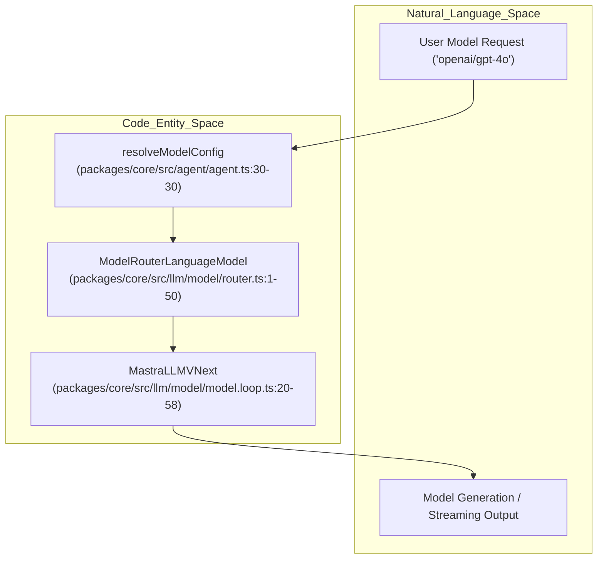
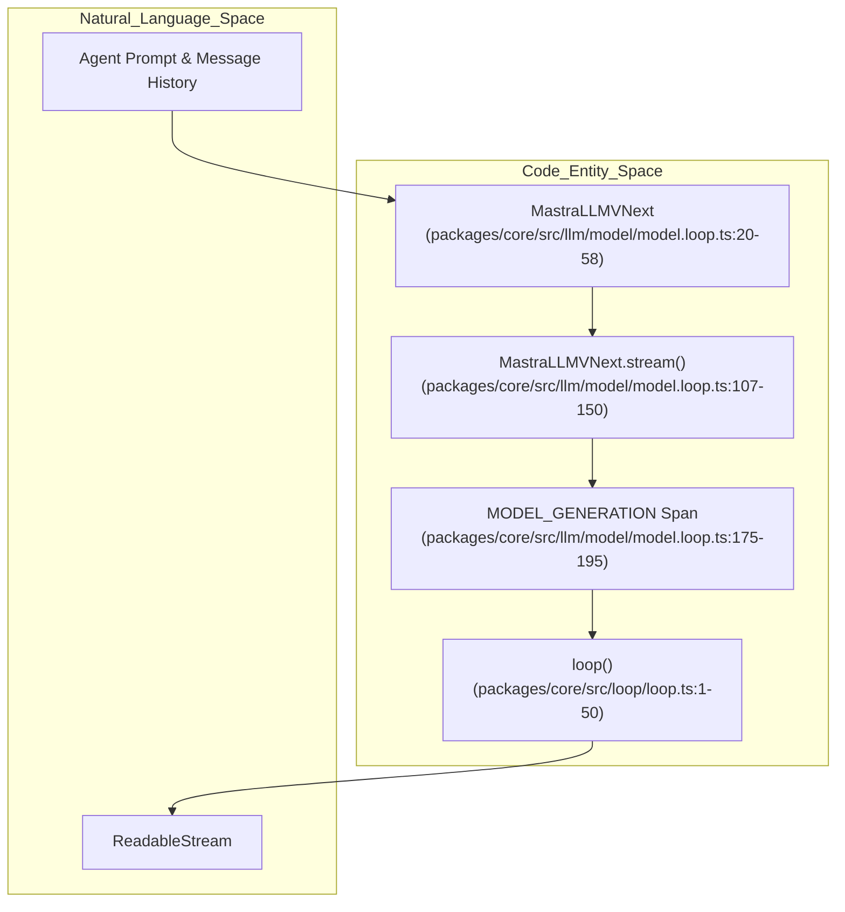

<!-- source: DeepWiki mcp.deepwiki.com · repo mastra-ai/mastra · page 3.2 LLM Integration and Model Router · fetched 2026-10-27 -->

# LLM Integration and Model Router

Relevant source files

The following files were used as context for generating this wiki page:

- [.changeset/peer-discovery-busy-caller.md](.changeset/peer-discovery-busy-caller.md)
- [.changeset/retake-lapsed-thread-lease.md](.changeset/retake-lapsed-thread-lease.md)
- [docs/src/content/en/docs/subagents.mdx](docs/src/content/en/docs/subagents.mdx)
- [docs/src/content/en/models/gateways/custom-gateways.mdx](docs/src/content/en/models/gateways/custom-gateways.mdx)
- [docs/src/content/en/reference/core/mastra-model-gateway.mdx](docs/src/content/en/reference/core/mastra-model-gateway.mdx)
- [mastracode/sdk/src/agent-connections/__tests__/cross-process-agent-signals.integration.test.ts](mastracode/sdk/src/agent-connections/__tests__/cross-process-agent-signals.integration.test.ts)
- [mastracode/sdk/src/agent-connections/__tests__/fixtures/cross-process-agent-signals-child.mts](mastracode/sdk/src/agent-connections/__tests__/fixtures/cross-process-agent-signals-child.mts)
- [mastracode/sdk/src/agents/mastracode-gateway-thinking.test.ts](mastracode/sdk/src/agents/mastracode-gateway-thinking.test.ts)
- [mastracode/sdk/src/providers/thinking-request.ts](mastracode/sdk/src/providers/thinking-request.ts)
- [mastracode/sdk/src/thinking.test.ts](mastracode/sdk/src/thinking.test.ts)
- [mastracode/tui/e2e/tui/think-picker-per-model.ts](mastracode/tui/e2e/tui/think-picker-per-model.ts)
- [observability/mastra/src/model-tracing.test.ts](observability/mastra/src/model-tracing.test.ts)
- [observability/mastra/src/model-tracing.ts](observability/mastra/src/model-tracing.ts)
- [packages/core/scripts/generate-providers.ts](packages/core/scripts/generate-providers.ts)
- [packages/core/src/agent-controller/lease-lost-abort-reason.test.ts](packages/core/src/agent-controller/lease-lost-abort-reason.test.ts)
- [packages/core/src/agent/__tests__/delegation-thread-metadata.test.ts](packages/core/src/agent/__tests__/delegation-thread-metadata.test.ts)
- [packages/core/src/agent/__tests__/memory-metadata.test.ts](packages/core/src/agent/__tests__/memory-metadata.test.ts)
- [packages/core/src/agent/__tests__/signals-claimed-ownership.test.ts](packages/core/src/agent/__tests__/signals-claimed-ownership.test.ts)
- [packages/core/src/agent/__tests__/signals-idle-active-behavior.test.ts](packages/core/src/agent/__tests__/signals-idle-active-behavior.test.ts)
- [packages/core/src/agent/__tests__/stream.test.ts](packages/core/src/agent/__tests__/stream.test.ts)
- [packages/core/src/agent/__tests__/thread-lease-loss-abort.test.ts](packages/core/src/agent/__tests__/thread-lease-loss-abort.test.ts)
- [packages/core/src/agent/__tests__/tool-concurrency-called-strategy-resume.test.ts](packages/core/src/agent/__tests__/tool-concurrency-called-strategy-resume.test.ts)
- [packages/core/src/agent/__tests__/tool-concurrency-called-strategy.test.ts](packages/core/src/agent/__tests__/tool-concurrency-called-strategy.test.ts)
- [packages/core/src/agent/__tests__/tool-handling.test.ts](packages/core/src/agent/__tests__/tool-handling.test.ts)
- [packages/core/src/agent/agent-legacy.ts](packages/core/src/agent/agent-legacy.ts)
- [packages/core/src/agent/agent-types.test-d.ts](packages/core/src/agent/agent-types.test-d.ts)
- [packages/core/src/agent/agent.test.ts](packages/core/src/agent/agent.test.ts)
- [packages/core/src/agent/agent.ts](packages/core/src/agent/agent.ts)
- [packages/core/src/agent/agent.types.ts](packages/core/src/agent/agent.types.ts)
- [packages/core/src/agent/durable/durable-parity.test-d.ts](packages/core/src/agent/durable/durable-parity.test-d.ts)
- [packages/core/src/agent/subagent.ts](packages/core/src/agent/subagent.ts)
- [packages/core/src/agent/thread-stream-runtime.ts](packages/core/src/agent/thread-stream-runtime.ts)
- [packages/core/src/agent/types.ts](packages/core/src/agent/types.ts)
- [packages/core/src/agent/workflows/prepare-stream/index.ts](packages/core/src/agent/workflows/prepare-stream/index.ts)
- [packages/core/src/agent/workflows/prepare-stream/map-results-step.ts](packages/core/src/agent/workflows/prepare-stream/map-results-step.ts)
- [packages/core/src/agent/workflows/prepare-stream/prepare-memory-step.ts](packages/core/src/agent/workflows/prepare-stream/prepare-memory-step.ts)
- [packages/core/src/agent/workflows/prepare-stream/prepare-tools-step.ts](packages/core/src/agent/workflows/prepare-stream/prepare-tools-step.ts)
- [packages/core/src/agent/workflows/prepare-stream/run-scope-keys.ts](packages/core/src/agent/workflows/prepare-stream/run-scope-keys.ts)
- [packages/core/src/agent/workflows/prepare-stream/schema.ts](packages/core/src/agent/workflows/prepare-stream/schema.ts)
- [packages/core/src/agent/workflows/prepare-stream/stream-step.ts](packages/core/src/agent/workflows/prepare-stream/stream-step.ts)
- [packages/core/src/llm/index.ts](packages/core/src/llm/index.ts)
- [packages/core/src/llm/model/gateways/base.ts](packages/core/src/llm/model/gateways/base.ts)
- [packages/core/src/llm/model/gateways/index.ts](packages/core/src/llm/model/gateways/index.ts)
- [packages/core/src/llm/model/gateways/models-dev.e2e.test.ts](packages/core/src/llm/model/gateways/models-dev.e2e.test.ts)
- [packages/core/src/llm/model/gateways/models-dev.test.ts](packages/core/src/llm/model/gateways/models-dev.test.ts)
- [packages/core/src/llm/model/gateways/models-dev.ts](packages/core/src/llm/model/gateways/models-dev.ts)
- [packages/core/src/llm/model/index.ts](packages/core/src/llm/model/index.ts)
- [packages/core/src/llm/model/model.loop.ts](packages/core/src/llm/model/model.loop.ts)
- [packages/core/src/llm/model/provider-options.ts](packages/core/src/llm/model/provider-options.ts)
- [packages/core/src/llm/model/provider-registry.test.ts](packages/core/src/llm/model/provider-registry.test.ts)
- [packages/core/src/llm/model/provider-registry.ts](packages/core/src/llm/model/provider-registry.ts)
- [packages/core/src/llm/model/registry-generator.test.ts](packages/core/src/llm/model/registry-generator.test.ts)
- [packages/core/src/llm/model/registry-generator.ts](packages/core/src/llm/model/registry-generator.ts)
- [packages/core/src/loop/loop.ts](packages/core/src/loop/loop.ts)
- [packages/core/src/loop/network/index.ts](packages/core/src/loop/network/index.ts)
- [packages/core/src/loop/network/validation.test.ts](packages/core/src/loop/network/validation.test.ts)
- [packages/core/src/loop/network/validation.ts](packages/core/src/loop/network/validation.ts)
- [packages/core/src/loop/types.ts](packages/core/src/loop/types.ts)
- [packages/core/src/loop/workflows/agentic-execution/index.ts](packages/core/src/loop/workflows/agentic-execution/index.ts)
- [packages/core/src/loop/workflows/agentic-execution/tool-call-concurrency.test.ts](packages/core/src/loop/workflows/agentic-execution/tool-call-concurrency.test.ts)
- [packages/core/src/loop/workflows/agentic-execution/tool-call-concurrency.ts](packages/core/src/loop/workflows/agentic-execution/tool-call-concurrency.ts)
- [packages/core/src/loop/workflows/agentic-loop/index.ts](packages/core/src/loop/workflows/agentic-loop/index.ts)
- [packages/core/src/memory/index.ts](packages/core/src/memory/index.ts)
- [packages/core/src/memory/run-state.test.ts](packages/core/src/memory/run-state.test.ts)
- [packages/core/src/memory/run-state.ts](packages/core/src/memory/run-state.ts)
- [packages/core/src/tools/request-context-schema-types.test-d.ts](packages/core/src/tools/request-context-schema-types.test-d.ts)
- [packages/rag/src/document/validation.ts](packages/rag/src/document/validation.ts)

The LLM Integration and Model Router system provides unified access to language models across a vast provider registry and model catalog through a single consistent interface. It handles model resolution, API credential management, and version compatibility across AI SDK generations (v1 through v5), supporting advanced agentic execution loops, reasoning capabilities, and streaming outputs [packages/core/src/llm/model/provider-registry.json:1-47](), [packages/core/src/llm/model/model.loop.ts:20-58]().

## Purpose and Scope

This page documents Mastra's LLM abstraction layer, focusing on model selection, the `MastraLLMVNext` loop coordinator, `ModelRouterLanguageModel` routing, AI SDK version compatibility bridging, and the underlying architecture that powers model generation and streaming execution steps.

Sources: [packages/core/src/llm/model/provider-registry.json:1-47](), [packages/core/src/llm/model/model.loop.ts:20-58]()

## Model Selection and Routing

Mastra resolves models via string identifiers matching the pattern `provider/model-name` or through explicit configuration objects (`MastraModelConfig`) [packages/core/src/llm/model/router.ts:1-50](). The `ModelRouterLanguageModel` acts as the primary adapter resolving these inputs to concrete AI SDK language model instances [packages/core/src/llm/model/router.ts:1-50]().

Diagram: Model Selection and Resolution Flow

Sources: [packages/core/src/agent/agent.ts:30-30](), [packages/core/src/llm/model/router.ts:1-50](), [packages/core/src/llm/model/model.loop.ts:20-58]()

## MastraLLMVNext and Model Loop Architecture

`MastraLLMVNext` is the core orchestration class for handling model streaming and generation loops in modern Mastra agents [packages/core/src/llm/model/model.loop.ts:20-58](). It manages an array of model configurations (`ModelManagerModelConfig[]`), sets up OpenTelemetry spans (`SpanType.MODEL_GENERATION`), handles message formatting (`convertToMessages`), and delegates execution to the internal loop engine [packages/core/src/llm/model/model.loop.ts:20-195]().

Diagram: MastraLLMVNext Execution Flow

### Key Methods of `MastraLLMVNext`
*   `constructor`: Validates model configurations and attaches the logger and Mastra instance [packages/core/src/llm/model/model.loop.ts:26-58]().
*   `convertToMessages`: Normalizes string inputs, string arrays, or `ModelMessage` objects into standard AI SDK message arrays [packages/core/src/llm/model/model.loop.ts:86-105]().
*   `stream`: Configures stop conditions (such as `maxSteps` combined with custom `stopWhen` rules), creates observability spans, captures tool definitions for tracing, and initiates the execution loop [packages/core/src/llm/model/model.loop.ts:107-227]().

Sources: [packages/core/src/llm/model/model.loop.ts:20-227]()

## AI SDK Version Compatibility

Mastra bridges multiple generations of the Vercel AI SDK to maintain backward compatibility while adopting modern features:
*   **Legacy AI SDK (v1/v2)**: Handled via classes like `MastraLLMV1` for older agent implementations [packages/core/src/agent/agent.ts:32-32]().
*   **Modern AI SDK (v5)**: Integrated via internal packages (`@internal/ai-sdk-v5`) supporting `LanguageModelV2` and `MastraLLMVNext` [packages/core/src/llm/model/model.loop.ts:1-15]().
*   **Schema Compatibility**: Leverages `@mastra/schema-compat` to adapt schemas across Zod versions (v3/v4) and standard schema specifications [packages/core/src/agent/agent.ts:3-6]().

Sources: [packages/core/src/agent/agent.ts:1-6](), [packages/core/src/llm/model/model.loop.ts:1-15]()

---

