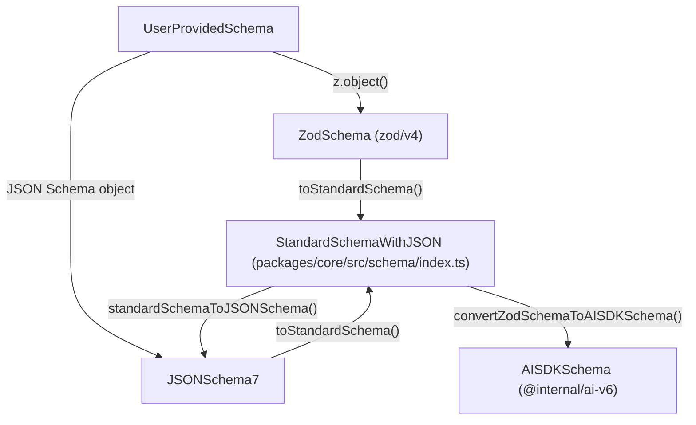
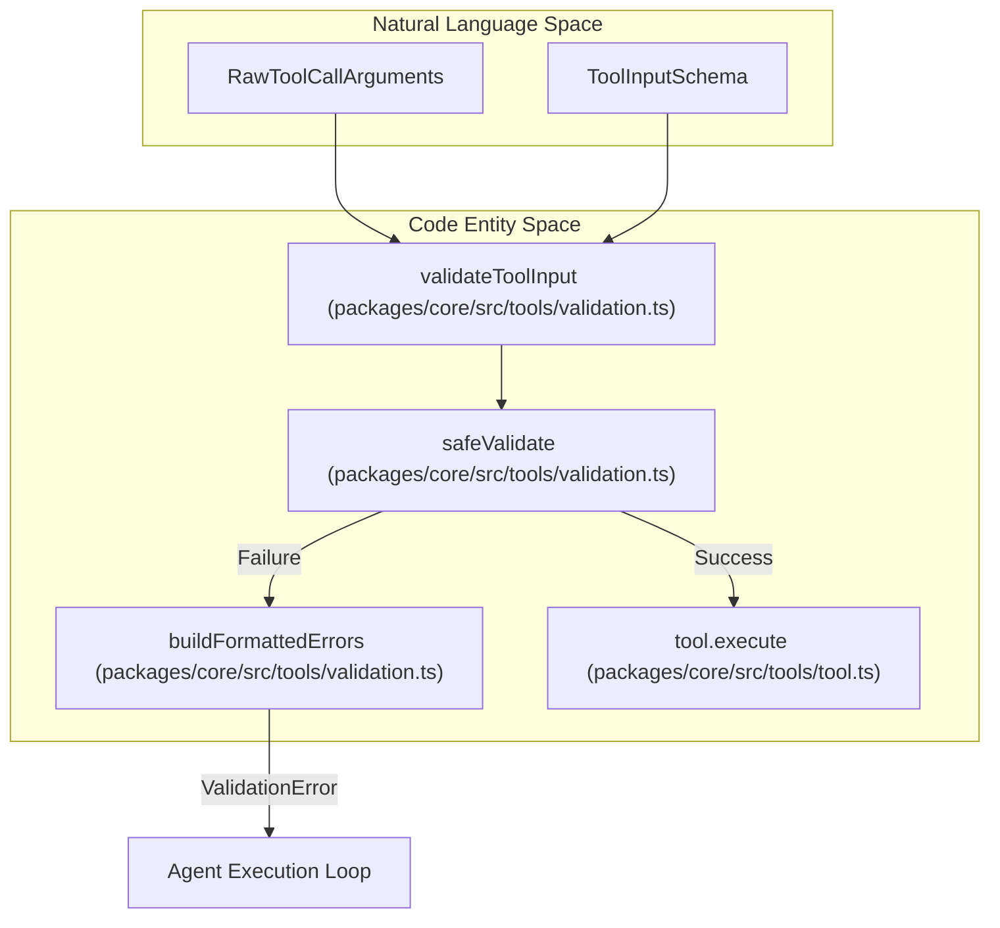
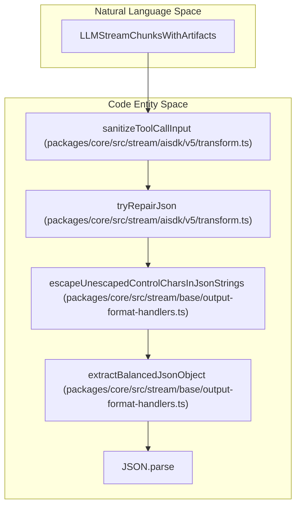

<!-- source: DeepWiki mcp.deepwiki.com · repo mastra-ai/mastra · page 3.6 Structured Output and Schema Validation · fetched 2026-10-27 -->

# Structured Output and Schema Validation

Relevant source files

The following files were used as context for generating this wiki page:

- [.changeset/fluffy-oranges-end.md](.changeset/fluffy-oranges-end.md)
- [client-sdks/ai-sdk/src/__tests__/background-task-stream.test.ts](client-sdks/ai-sdk/src/__tests__/background-task-stream.test.ts)
- [docs/src/content/en/reference/agents/agent.mdx](docs/src/content/en/reference/agents/agent.mdx)
- [docs/src/content/en/reference/tools/create-tool.mdx](docs/src/content/en/reference/tools/create-tool.mdx)
- [packages/core/src/agent/__tests__/tools.test.ts](packages/core/src/agent/__tests__/tools.test.ts)
- [packages/core/src/agent/__tests__/working-memory-context.test.ts](packages/core/src/agent/__tests__/working-memory-context.test.ts)
- [packages/core/src/agent/durable/__tests__/durable-agent-client-tool-pending.test.ts](packages/core/src/agent/durable/__tests__/durable-agent-client-tool-pending.test.ts)
- [packages/core/src/agent/durable/__tests__/durable-agent-tools.test.ts](packages/core/src/agent/durable/__tests__/durable-agent-tools.test.ts)
- [packages/core/src/agent/durable/workflows/steps/llm-mapping-pending-client-tool.test.ts](packages/core/src/agent/durable/workflows/steps/llm-mapping-pending-client-tool.test.ts)
- [packages/core/src/agent/message-list/adapters/AIV4Adapter.ts](packages/core/src/agent/message-list/adapters/AIV4Adapter.ts)
- [packages/core/src/agent/message-list/prompt/convert-to-mastra-v1.ts](packages/core/src/agent/message-list/prompt/convert-to-mastra-v1.ts)
- [packages/core/src/loop/__snapshots__/loop.test.ts.snap](packages/core/src/loop/__snapshots__/loop.test.ts.snap)
- [packages/core/src/loop/shared/auto-resume-system-message.test.ts](packages/core/src/loop/shared/auto-resume-system-message.test.ts)
- [packages/core/src/loop/shared/auto-resume-system-message.ts](packages/core/src/loop/shared/auto-resume-system-message.ts)
- [packages/core/src/loop/test-utils/aimock/scenarios/approval-conditional.scenario.test.ts](packages/core/src/loop/test-utils/aimock/scenarios/approval-conditional.scenario.test.ts)
- [packages/core/src/loop/test-utils/aimock/scenarios/approval-input-validation.scenario.test.ts](packages/core/src/loop/test-utils/aimock/scenarios/approval-input-validation.scenario.test.ts)
- [packages/core/src/loop/test-utils/aimock/scenarios/auto-resume-suspended-tools.scenario.test.ts](packages/core/src/loop/test-utils/aimock/scenarios/auto-resume-suspended-tools.scenario.test.ts)
- [packages/core/src/loop/test-utils/aimock/scenarios/background-task-agent-level.scenario.test.ts](packages/core/src/loop/test-utils/aimock/scenarios/background-task-agent-level.scenario.test.ts)
- [packages/core/src/loop/test-utils/aimock/scenarios/background-task-tool-level.scenario.test.ts](packages/core/src/loop/test-utils/aimock/scenarios/background-task-tool-level.scenario.test.ts)
- [packages/core/src/loop/test-utils/aimock/scenarios/client-tools.scenario.test.ts](packages/core/src/loop/test-utils/aimock/scenarios/client-tools.scenario.test.ts)
- [packages/core/src/loop/test-utils/aimock/scenarios/prepare-step.scenario.test.ts](packages/core/src/loop/test-utils/aimock/scenarios/prepare-step.scenario.test.ts)
- [packages/core/src/loop/test-utils/aimock/scenarios/supervisor-delegation-hooks.scenario.test.ts](packages/core/src/loop/test-utils/aimock/scenarios/supervisor-delegation-hooks.scenario.test.ts)
- [packages/core/src/loop/test-utils/aimock/scenarios/tool-lifecycle-hooks.scenario.test.ts](packages/core/src/loop/test-utils/aimock/scenarios/tool-lifecycle-hooks.scenario.test.ts)
- [packages/core/src/loop/test-utils/fullStream.ts](packages/core/src/loop/test-utils/fullStream.ts)
- [packages/core/src/loop/test-utils/generateText.ts](packages/core/src/loop/test-utils/generateText.ts)
- [packages/core/src/loop/test-utils/options.ts](packages/core/src/loop/test-utils/options.ts)
- [packages/core/src/loop/test-utils/resultObject.ts](packages/core/src/loop/test-utils/resultObject.ts)
- [packages/core/src/loop/test-utils/streamObject.ts](packages/core/src/loop/test-utils/streamObject.ts)
- [packages/core/src/loop/test-utils/tools.ts](packages/core/src/loop/test-utils/tools.ts)
- [packages/core/src/loop/workflows/agentic-execution/build-messages-from-chunks.test.ts](packages/core/src/loop/workflows/agentic-execution/build-messages-from-chunks.test.ts)
- [packages/core/src/loop/workflows/agentic-execution/build-messages-from-chunks.ts](packages/core/src/loop/workflows/agentic-execution/build-messages-from-chunks.ts)
- [packages/core/src/loop/workflows/agentic-execution/llm-execution-step.test.ts](packages/core/src/loop/workflows/agentic-execution/llm-execution-step.test.ts)
- [packages/core/src/loop/workflows/agentic-execution/llm-mapping-step.test.ts](packages/core/src/loop/workflows/agentic-execution/llm-mapping-step.test.ts)
- [packages/core/src/loop/workflows/agentic-execution/llm-mapping-step.ts](packages/core/src/loop/workflows/agentic-execution/llm-mapping-step.ts)
- [packages/core/src/loop/workflows/agentic-execution/tool-approval-verdict.ts](packages/core/src/loop/workflows/agentic-execution/tool-approval-verdict.ts)
- [packages/core/src/loop/workflows/agentic-execution/tool-call-step-before-approval.test.ts](packages/core/src/loop/workflows/agentic-execution/tool-call-step-before-approval.test.ts)
- [packages/core/src/loop/workflows/agentic-execution/tool-call-step.test.ts](packages/core/src/loop/workflows/agentic-execution/tool-call-step.test.ts)
- [packages/core/src/loop/workflows/agentic-execution/tool-call-step.ts](packages/core/src/loop/workflows/agentic-execution/tool-call-step.ts)
- [packages/core/src/processors/processor-tool-request-context.test.ts](packages/core/src/processors/processor-tool-request-context.test.ts)
- [packages/core/src/tools/builtin/web-fetch.test.ts](packages/core/src/tools/builtin/web-fetch.test.ts)
- [packages/core/src/tools/builtin/web-fetch.ts](packages/core/src/tools/builtin/web-fetch.ts)
- [packages/core/src/tools/index.ts](packages/core/src/tools/index.ts)
- [packages/core/src/tools/tool-builder/background-override-injection.test.ts](packages/core/src/tools/tool-builder/background-override-injection.test.ts)
- [packages/core/src/tools/tool-builder/builder.e2e.test.ts](packages/core/src/tools/tool-builder/builder.e2e.test.ts)
- [packages/core/src/tools/tool-builder/builder.test.ts](packages/core/src/tools/tool-builder/builder.test.ts)
- [packages/core/src/tools/tool-builder/builder.ts](packages/core/src/tools/tool-builder/builder.ts)
- [packages/core/src/tools/tool-builder/schema-compat-validation.test.ts](packages/core/src/tools/tool-builder/schema-compat-validation.test.ts)
- [packages/core/src/tools/tool-builder/validation-error-paths.test.ts](packages/core/src/tools/tool-builder/validation-error-paths.test.ts)
- [packages/core/src/tools/tool.test.ts](packages/core/src/tools/tool.test.ts)
- [packages/core/src/tools/tool.ts](packages/core/src/tools/tool.ts)
- [packages/core/src/tools/toolchecks.ts](packages/core/src/tools/toolchecks.ts)
- [packages/core/src/tools/types.ts](packages/core/src/tools/types.ts)
- [packages/core/src/tools/validation.test.ts](packages/core/src/tools/validation.test.ts)
- [packages/core/src/tools/validation.ts](packages/core/src/tools/validation.ts)
- [packages/core/src/utils.test.ts](packages/core/src/utils.test.ts)
- [packages/core/src/utils.ts](packages/core/src/utils.ts)

This page documents how Mastra handles structured output generation from language models, schema conversion across various specifications, Zod integration, tool input/output validation, and JSON repair mechanisms for tool calls and streams.

---

## Schema Type System & Conversion

Mastra accepts schemas in multiple formats—such as Zod, JSON Schema, and AI SDK schemas—and unifies them using the `StandardSchemaWithJSON` interface. This allows consistent runtime validation and schema extraction across different providers.

Title: Schema Format Conversion Flow

Key functions involved in schema conversion and inspection include:
- `toStandardSchema`: Normalizes public schema definitions [packages/core/src/schema/index.ts:3-3]().
- `standardSchemaToJSONSchema`: Converts standard schemas into JSON Schema format [packages/core/src/schema/index.ts:15-16]().
- `isZodV4Schema`: Detects Zod v4 schemas by inspecting the `_def.type` property [packages/core/src/tools/tool-builder/builder.ts:153-157]().

Sources: [packages/core/src/schema/index.ts:3-3](), [packages/core/src/schema/index.ts:15-16](), [packages/core/src/tools/tool-builder/builder.ts:153-157]()

---

## Tool Input and Output Validation

Every Mastra tool uses schema validation via `safeValidate` to guarantee data integrity before executing tool logic.

Title: Tool Input Validation Pipeline

Key behaviors in tool validation:
- **Input Normalization**: Handles missing arguments or optional objects sent by LLMs by normalizing against the schema [packages/core/src/tools/validation.ts:189-210]().
- **Safe Validation**: `safeValidate` intercepts internal Zod evaluation errors (such as uninstantiated union options) and returns descriptive error structures [packages/core/src/tools/validation.ts:39-68]().
- **Structured Error Reporting**: Generates `ValidationError` instances containing nested `FormattedValidationErrors` for field-level feedback [packages/core/src/tools/validation.ts:79-93]().
- **Output Validation**: `validateToolOutput` is used to validate the return value of a tool against its `outputSchema` [packages/core/src/tools/validation.ts:290-309](). The output schema can be registered using `registerToolOutputValidationSchema` [packages/core/src/tools/validation.ts:14-22]().

Sources: [packages/core/src/tools/validation.ts:14-22](), [packages/core/src/tools/validation.ts:39-93](), [packages/core/src/tools/validation.ts:189-210](), [packages/core/src/tools/validation.ts:290-309](), [packages/core/src/tools/tool.ts:155-162]()

---

## JSON Repair, Sanitization, and Streaming Handlers

LLMs frequently generate malformed JSON, unescaped control characters within string values, or extraneous token markers during streaming. Mastra implements multi-layered repair utilities to recover valid objects.

Title: JSON Repair and Sanitization Architecture

### Key Functions
- `sanitizeToolCallInput`: Strips out unexpected model tokens like `<|call|>` or `<|endoftext|>` from tool argument strings while preserving valid JSON payloads [packages/core/src/stream/aisdk/v5/transform.ts:31-44]().
- `tryRepairJson`: Applies sequential pattern fixes for unquoted property names, missing quotes after commas, single-quote string delimiters, and unquoted dates [packages/core/src/stream/aisdk/v5/transform.ts:62-99]().
- `escapeUnescapedControlCharsInJsonStrings`: Tracks string boundaries to escape raw newlines, carriage returns, and tabs inside JSON string values [packages/core/src/stream/base/output-format-handlers.ts:31-79]().
- `extractBalancedJsonObject`: Uses brace-counting algorithms to isolate complete JSON objects embedded within conversational LLM text [packages/core/src/stream/base/output-format-handlers.ts:81-126]().

Sources: [packages/core/src/stream/aisdk/v5/transform.ts:31-99](), [packages/core/src/stream/base/output-format-handlers.ts:31-126]()

---

## Provider Compatibility Layers

Different LLM providers enforce strict constraints on JSON Schema structures (such as requiring all object keys to be present in the `required` array for OpenAI strict mode). Mastra handles these adaptations through `CoreToolBuilder` and provider-specific mapping layers.

| Compatibility Layer | Target Provider / Feature | Role in Schema Handling |
| :--- | :--- | :--- |
| `OpenAISchemaCompatLayer` | OpenAI / Strict Mode | Ensures all properties are marked as required in JSON Schema output [packages/core/src/tools/tool-builder/builder.ts:5-5]() |
| `OpenAIReasoningSchemaCompatLayer` | OpenAI `o1`/`o3` models | Adjusts parameter bounds and strict configurations for reasoning endpoints [packages/core/src/tools/tool-builder/builder.ts:4-4]() |
| `GoogleSchemaCompatLayer` | Google Gemini | Translates constraints into Gemini-compatible schema definitions [packages/core/src/tools/tool-builder/builder.ts:6-6]() |
| `AnthropicSchemaCompatLayer` | Anthropic Claude | Adapts tool schemas for Anthropic tool calling and caching [packages/core/src/tools/tool-builder/builder.ts:7-7]() |
| `DeepSeekSchemaCompatLayer` | DeepSeek | Provides schema compatibility for DeepSeek models [packages/core/src/tools/tool-builder/builder.ts:8-8]() |
| `MetaSchemaCompatLayer` | Meta | Provides schema compatibility for Meta models [packages/core/src/tools/tool-builder/builder.ts:9-9]() |

These compatibility layers are applied via the `applyCompatLayer` function [packages/core/src/tools/tool-builder/builder.ts:10-10]().

Sources: [packages/core/src/tools/tool-builder/builder.ts:1-16](), [packages/core/src/tools/tool-builder/builder.ts:300-320]()

---

