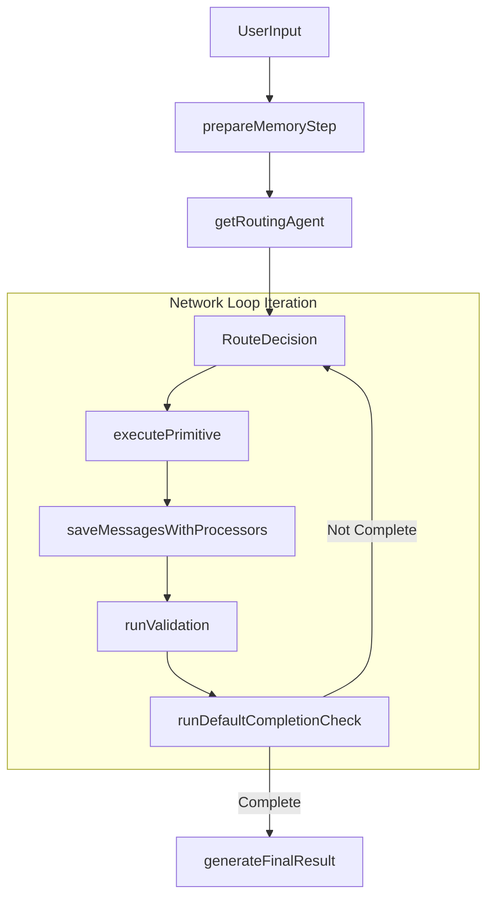
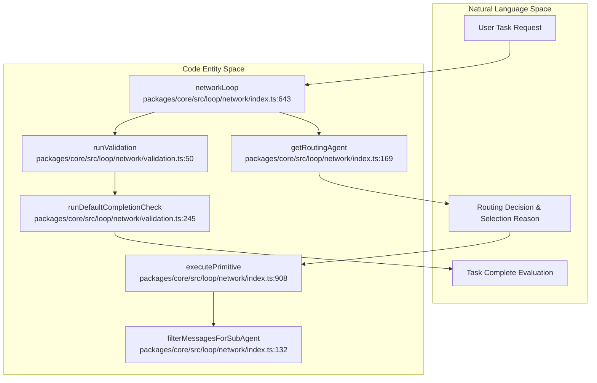

<!-- source: DeepWiki mcp.deepwiki.com · repo mastra-ai/mastra · page 3.7 Agent Networks and Multi-Agent Collaboration · fetched 2026-10-27 -->

# Agent Networks and Multi-Agent Collaboration

Relevant source files

The following files were used as context for generating this wiki page:

- [.changeset/peer-discovery-busy-caller.md](.changeset/peer-discovery-busy-caller.md)
- [.changeset/retake-lapsed-thread-lease.md](.changeset/retake-lapsed-thread-lease.md)
- [docs/src/content/en/docs/subagents.mdx](docs/src/content/en/docs/subagents.mdx)
- [mastracode/sdk/src/agent-connections/__tests__/cross-process-agent-signals.integration.test.ts](mastracode/sdk/src/agent-connections/__tests__/cross-process-agent-signals.integration.test.ts)
- [mastracode/sdk/src/agent-connections/__tests__/fixtures/cross-process-agent-signals-child.mts](mastracode/sdk/src/agent-connections/__tests__/fixtures/cross-process-agent-signals-child.mts)
- [observability/mastra/src/model-tracing.test.ts](observability/mastra/src/model-tracing.test.ts)
- [observability/mastra/src/model-tracing.ts](observability/mastra/src/model-tracing.ts)
- [packages/core/src/agent-controller/lease-lost-abort-reason.test.ts](packages/core/src/agent-controller/lease-lost-abort-reason.test.ts)
- [packages/core/src/agent/__tests__/delegation-thread-metadata.test.ts](packages/core/src/agent/__tests__/delegation-thread-metadata.test.ts)
- [packages/core/src/agent/__tests__/memory-metadata.test.ts](packages/core/src/agent/__tests__/memory-metadata.test.ts)
- [packages/core/src/agent/__tests__/signals-claimed-ownership.test.ts](packages/core/src/agent/__tests__/signals-claimed-ownership.test.ts)
- [packages/core/src/agent/__tests__/signals-idle-active-behavior.test.ts](packages/core/src/agent/__tests__/signals-idle-active-behavior.test.ts)
- [packages/core/src/agent/__tests__/stream.test.ts](packages/core/src/agent/__tests__/stream.test.ts)
- [packages/core/src/agent/__tests__/thread-lease-loss-abort.test.ts](packages/core/src/agent/__tests__/thread-lease-loss-abort.test.ts)
- [packages/core/src/agent/__tests__/tool-concurrency-called-strategy-resume.test.ts](packages/core/src/agent/__tests__/tool-concurrency-called-strategy-resume.test.ts)
- [packages/core/src/agent/__tests__/tool-concurrency-called-strategy.test.ts](packages/core/src/agent/__tests__/tool-concurrency-called-strategy.test.ts)
- [packages/core/src/agent/__tests__/tool-handling.test.ts](packages/core/src/agent/__tests__/tool-handling.test.ts)
- [packages/core/src/agent/agent-legacy.ts](packages/core/src/agent/agent-legacy.ts)
- [packages/core/src/agent/agent-types.test-d.ts](packages/core/src/agent/agent-types.test-d.ts)
- [packages/core/src/agent/agent.test.ts](packages/core/src/agent/agent.test.ts)
- [packages/core/src/agent/agent.ts](packages/core/src/agent/agent.ts)
- [packages/core/src/agent/agent.types.ts](packages/core/src/agent/agent.types.ts)
- [packages/core/src/agent/durable/durable-parity.test-d.ts](packages/core/src/agent/durable/durable-parity.test-d.ts)
- [packages/core/src/agent/subagent.ts](packages/core/src/agent/subagent.ts)
- [packages/core/src/agent/thread-stream-runtime.ts](packages/core/src/agent/thread-stream-runtime.ts)
- [packages/core/src/agent/types.ts](packages/core/src/agent/types.ts)
- [packages/core/src/agent/workflows/prepare-stream/index.ts](packages/core/src/agent/workflows/prepare-stream/index.ts)
- [packages/core/src/agent/workflows/prepare-stream/map-results-step.ts](packages/core/src/agent/workflows/prepare-stream/map-results-step.ts)
- [packages/core/src/agent/workflows/prepare-stream/prepare-memory-step.ts](packages/core/src/agent/workflows/prepare-stream/prepare-memory-step.ts)
- [packages/core/src/agent/workflows/prepare-stream/prepare-tools-step.ts](packages/core/src/agent/workflows/prepare-stream/prepare-tools-step.ts)
- [packages/core/src/agent/workflows/prepare-stream/run-scope-keys.ts](packages/core/src/agent/workflows/prepare-stream/run-scope-keys.ts)
- [packages/core/src/agent/workflows/prepare-stream/schema.ts](packages/core/src/agent/workflows/prepare-stream/schema.ts)
- [packages/core/src/agent/workflows/prepare-stream/stream-step.ts](packages/core/src/agent/workflows/prepare-stream/stream-step.ts)
- [packages/core/src/llm/model/model.loop.ts](packages/core/src/llm/model/model.loop.ts)
- [packages/core/src/loop/loop.ts](packages/core/src/loop/loop.ts)
- [packages/core/src/loop/network/index.ts](packages/core/src/loop/network/index.ts)
- [packages/core/src/loop/network/validation.test.ts](packages/core/src/loop/network/validation.test.ts)
- [packages/core/src/loop/network/validation.ts](packages/core/src/loop/network/validation.ts)
- [packages/core/src/loop/types.ts](packages/core/src/loop/types.ts)
- [packages/core/src/loop/workflows/agentic-execution/index.ts](packages/core/src/loop/workflows/agentic-execution/index.ts)
- [packages/core/src/loop/workflows/agentic-execution/tool-call-concurrency.test.ts](packages/core/src/loop/workflows/agentic-execution/tool-call-concurrency.test.ts)
- [packages/core/src/loop/workflows/agentic-execution/tool-call-concurrency.ts](packages/core/src/loop/workflows/agentic-execution/tool-call-concurrency.ts)
- [packages/core/src/loop/workflows/agentic-loop/index.ts](packages/core/src/loop/workflows/agentic-loop/index.ts)
- [packages/core/src/memory/index.ts](packages/core/src/memory/index.ts)
- [packages/core/src/memory/run-state.test.ts](packages/core/src/memory/run-state.test.ts)
- [packages/core/src/memory/run-state.ts](packages/core/src/memory/run-state.ts)
- [packages/core/src/tools/request-context-schema-types.test-d.ts](packages/core/src/tools/request-context-schema-types.test-d.ts)
- [packages/rag/src/document/validation.ts](packages/rag/src/document/validation.ts)

## Purpose and Scope

This document describes the **Agent Network** and multi-agent collaboration systems in Mastra, which enable multiple agents, workflows, and tools to collaborate on complex tasks through automatic coordination and routing. An agent network uses a routing agent to dynamically select and orchestrate primitives (`Agent`, `Workflow`, `CoreTool`) across multiple iterations until task completion.

For information about individual agent execution, see [Agent Configuration and Execution (3.1)](). For workflow orchestration patterns, see [Workflow System (4)](). For agent memory in single-agent scenarios, see [Agent Memory System (3.4)]().

Sources: [packages/core/src/loop/network/index.ts:22-180](), [packages/core/src/loop/network/validation.ts:50-367](), [packages/core/src/agent/agent.types.ts:31-42]()

## System Overview

The agent network system implements a **multi-agent coordination pattern** where a routing agent intelligently selects which primitive to execute at each step. Unlike traditional multi-agent systems with fixed orchestration, Mastra's network loop dynamically adapts based on task context and previous execution results.

**Core Capabilities:**
- **Dynamic Primitive Selection**: LLM-based routing using `getRoutingAgent` [packages/core/src/loop/network/index.ts:169-180]().
- **Automatic Iteration**: Continues until task completion or `maxSteps` reached [packages/core/src/loop/network/index.ts:643-906]().
- **Validation-Driven Completion**: Uses `runValidation` and `runDefaultCompletionCheck` to verify results [packages/core/src/loop/network/validation.ts:50-367]().
- **Context-Aware Memory**: Filters conversation history for sub-agents using `filterMessagesForSubAgent` [packages/core/src/loop/network/index.ts:132-166]().
- **Streaming Execution**: Provides real-time feedback via `MastraAgentNetworkStream` [packages/core/src/loop/network/index.ts:22]().

Sources: [packages/core/src/loop/network/index.ts:22-180](), [packages/core/src/loop/network/validation.ts:50-367](), [packages/core/src/agent/agent.types.ts:31-42]()

## Architecture: Network Execution Pipeline

### Network Execution Flow

Sources: [packages/core/src/loop/network/index.ts:643-906](), [packages/core/src/loop/network/validation.ts:50-434]()

**Pipeline Stages:**
1. **Memory Preparation**: Creates or loads thread via `prepareMemoryStep` [packages/core/src/agent/workflows/prepare-stream/prepare-memory-step.ts:23-50]().
2. **Routing Agent Setup**: Constructs an agent instance with available primitives using `getRoutingAgent` [packages/core/src/loop/network/index.ts:169-180]().
3. **Iteration Loop**: Repeats the execution cycle until completion [packages/core/src/loop/network/index.ts:643-906]().
4. **Validation**: Checks results against `CompletionConfig` validators [packages/core/src/loop/network/validation.ts:50-143]().
5. **Completion Check**: Evaluates if the task objective is met [packages/core/src/loop/network/validation.ts:245-367]().
6. **Final Result**: Generates the final output summary [packages/core/src/loop/network/validation.ts:369-434]().

Sources: [packages/core/src/loop/network/index.ts:643-906](), [packages/core/src/loop/network/validation.ts:50-434]()

## Key Components and Topology

### Routing Agent
The routing agent is a specialized `Agent` instance that analyzes task context to select the next primitive.
- **Construction**: Defined in `getRoutingAgent` [packages/core/src/loop/network/index.ts:169-180]().
- **Capabilities**: Introspects available agents, workflows, and tools; uses a system prompt including input schemas for all available primitives [packages/core/src/loop/network/index.ts:211-280](). Marked with `_agentNetworkAppend: true` [packages/core/src/loop/network/index.ts:211]().

Sources: [packages/core/src/loop/network/index.ts:169-280](), [packages/core/src/agent/agent.ts:200-220]()

### Primitives
Primitives are the units of work the network can invoke.

| Primitive Type | Code Entity | Execution Method |
| :--- | :--- | :--- |
| **Agent** | `Agent` class [packages/core/src/agent/agent.ts:11]() | `agent.generate()` or `agent.stream()` |
| **Workflow** | `Workflow` class [packages/core/src/workflows/workflow.ts:146]() | `workflow.execute()` |
| **Tool** | `CoreTool` [packages/core/src/tools/types.ts:126]() | `tool.execute()` |

The `executePrimitive` function [packages/core/src/loop/network/index.ts:908-1178]() unifies these calls, handling parameter parsing and response normalization.

Sources: [packages/core/src/loop/network/index.ts:908-1178](), [packages/core/src/agent/agent.types.ts:50-57]()

### Validation and Completion
Validation ensures individual steps meet quality bars, while completion checks if the overall goal is reached.
- `runValidation()` executes configured validators [packages/core/src/loop/network/validation.ts:50-143]().
- `formatCompletionFeedback()` converts failures into LLM-readable feedback [packages/core/src/loop/network/validation.ts:145-243]().
- `runDefaultCompletionCheck()` uses the routing agent to determine completion status [packages/core/src/loop/network/validation.ts:245-367]().

Sources: [packages/core/src/loop/network/validation.ts:50-367](), [packages/core/src/agent/agent.types.ts:31-42]()

## Bridging Natural Language Space to Code Entity Space

### Network Loop Code Mapping

Sources: [packages/core/src/loop/network/index.ts:132-906](), [packages/core/src/loop/network/validation.ts:50-367]()

**Key Code Entities:**
- `networkLoop`: Central coordination function managing iteration state [packages/core/src/loop/network/index.ts:643-906]().
- `filterMessagesForSubAgent`: Removes internal routing JSON before passing history to sub-agents [packages/core/src/loop/network/index.ts:132-166]().
- `safeParseLLMJson`: Utility handling truncated or malformed JSON from LLM outputs during routing [packages/core/src/loop/network/index.ts:100-117]().

Sources: [packages/core/src/loop/network/index.ts:100-166](), [packages/core/src/loop/network/index.ts:643-1178](), [packages/core/src/agent/agent.ts:2353-2479]()

## Memory and Context Management

### Observational Memory Restriction
Observational Memory (OM) is **not supported** in agent networks. This is enforced by `assertNetworkSupportsMemory` [packages/core/src/loop/network/index.ts:67-89]().
- **Reason**: Network loops do not propagate the specific thread/resource context required for OM's tier-based storage [packages/core/src/loop/network/index.ts:57-58]().
- **Error**: Throws `AGENT_NETWORK_OBSERVATIONAL_MEMORY_UNSUPPORTED` if OM is detected [packages/core/src/loop/network/index.ts:79-88]().

### Context Filtering
The `filterMessagesForSubAgent` function [packages/core/src/loop/network/index.ts:132-166]() ensures sub-agents only see relevant conversation history:
- **Includes**: All user messages and assistant messages that are not internal network JSON.
- **Excludes**: Internal routing JSON (`primitiveId`, `selectionReason`), completion feedback metadata (`metadata.mode === 'network'`), and network result markers (`isNetwork: true`).

Sources: [packages/core/src/loop/network/index.ts:57-89](), [packages/core/src/loop/network/index.ts:132-166](), [packages/core/src/agent/agent-network.test.ts:28-50]()

## Delegation Hooks

Mastra provides hooks to monitor and intercept agent-to-agent communication, configured via the `delegation` option in `Agent.generate()` or `Agent.stream()`.

### `DelegationConfig`
The `DelegationConfig` interface [packages/core/src/agent/agent.types.ts:204-220]() defines the available hooks:
- `onDelegationStart`: Triggered before calling a sub-agent. Receives a `DelegationStartContext` [packages/core/src/agent/agent.types.ts:80-118]() and can modify prompts, limit `maxSteps`, or reject delegation via `{ proceed: false, rejectionReason: '...' }` [packages/core/src/agent/agent.types.ts:123-134]().
- `onDelegationComplete`: Triggered after the sub-agent returns. Receives a `DelegationCompleteContext` [packages/core/src/agent/agent.types.ts:147-191]() containing results or errors.
- `messageFilter`: Custom callback of type `MessageFilterContext` [packages/core/src/agent/agent.types.ts:51-74]() to override default filtering logic.

Sources: [packages/core/src/agent/agent.types.ts:51-220](), [packages/core/src/agent/agent.ts:151-160]()

## Agent Approval, Suspension, and Loop Resumption

### Pre-execution Approval and Runtime Suspension
- `requireToolApproval: true` pauses every tool call for a request [packages/core/src/agent/agent.ts:1300-1310]().
- Tools can pause mid-execution by invoking `context.agent.suspend()`, emitting a `tool-call-suspended` chunk which can be resumed via `agent.resumeStream()` [packages/core/src/agent/agent.ts:2500-2550]().

### Agentic Loop Resumption
The `agentic-loop` workflow [packages/core/src/loop/workflows/agentic-loop/index.ts:10-14]() manages recursive agent execution.
- When resumed (e.g. after tool approval), `isResumeContinuationPending` is set to `true` [packages/core/src/loop/workflows/agentic-loop/index.ts:14]().
- The runtime seals the previously flushed assistant message and rotates to a fresh `messageId` for continuation, preventing corruption of signed model blocks [packages/core/src/loop/workflows/agentic-loop/index.ts:14]().

Sources: [packages/core/src/agent/workflows/prepare-stream/map-results-step.ts:93-115](), [packages/core/src/agent/agent.ts:2500-2550](), [packages/core/src/loop/workflows/agentic-loop/index.ts:10-14]()

---

