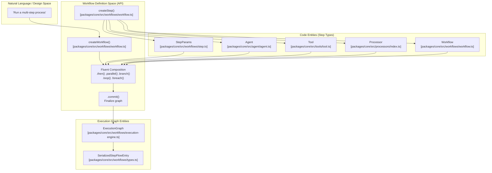
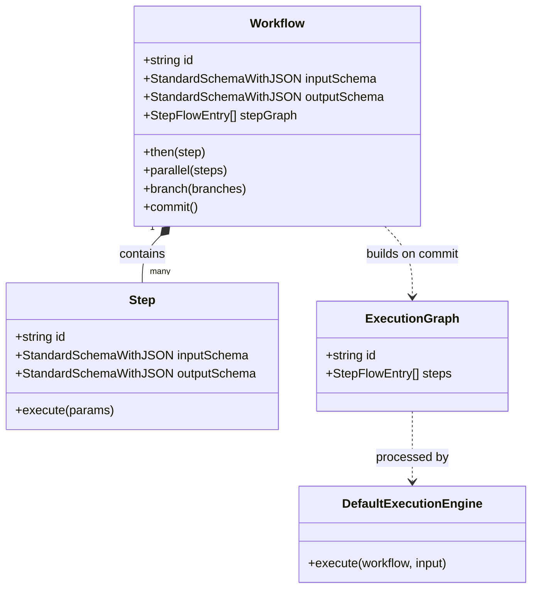

<!-- source: DeepWiki mcp.deepwiki.com · repo mastra-ai/mastra · page 4.1 Workflow Definition and Step Composition · fetched 2026-10-27 -->

# Workflow Definition and Step Composition

<details>
<summary>Relevant source files</summary>

The following files were used as context for generating this wiki page:

- [.changeset/evented-foreach-running-status.md](.changeset/evented-foreach-running-status.md)
- [.changeset/strong-gifts-smell.md](.changeset/strong-gifts-smell.md)
- [packages/core/src/processors/index.ts](packages/core/src/processors/index.ts)
- [packages/core/src/processors/processor-model-settings.test-d.ts](packages/core/src/processors/processor-model-settings.test-d.ts)
- [packages/core/src/processors/runner.test.ts](packages/core/src/processors/runner.test.ts)
- [packages/core/src/processors/runner.ts](packages/core/src/processors/runner.ts)
- [packages/core/src/processors/step-schema.ts](packages/core/src/processors/step-schema.ts)
- [packages/core/src/workflows/concurrent-resume.test.ts](packages/core/src/workflows/concurrent-resume.test.ts)
- [packages/core/src/workflows/default.test.ts](packages/core/src/workflows/default.test.ts)
- [packages/core/src/workflows/default.ts](packages/core/src/workflows/default.ts)
- [packages/core/src/workflows/evented/evented-workflow.test.ts](packages/core/src/workflows/evented/evented-workflow.test.ts)
- [packages/core/src/workflows/evented/foreach-running-status.test.ts](packages/core/src/workflows/evented/foreach-running-status.test.ts)
- [packages/core/src/workflows/evented/step-executor.test.ts](packages/core/src/workflows/evented/step-executor.test.ts)
- [packages/core/src/workflows/evented/step-executor.ts](packages/core/src/workflows/evented/step-executor.ts)
- [packages/core/src/workflows/evented/workflow-event-processor/index.ts](packages/core/src/workflows/evented/workflow-event-processor/index.ts)
- [packages/core/src/workflows/evented/workflow-event-processor/loop.ts](packages/core/src/workflows/evented/workflow-event-processor/loop.ts)
- [packages/core/src/workflows/evented/workflow.ts](packages/core/src/workflows/evented/workflow.ts)
- [packages/core/src/workflows/execution-engine.ts](packages/core/src/workflows/execution-engine.ts)
- [packages/core/src/workflows/foreach-nested-workflow.test.ts](packages/core/src/workflows/foreach-nested-workflow.test.ts)
- [packages/core/src/workflows/foreach-running-status.test.ts](packages/core/src/workflows/foreach-running-status.test.ts)
- [packages/core/src/workflows/handlers/control-flow.ts](packages/core/src/workflows/handlers/control-flow.ts)
- [packages/core/src/workflows/handlers/entry.ts](packages/core/src/workflows/handlers/entry.ts)
- [packages/core/src/workflows/handlers/sleep.ts](packages/core/src/workflows/handlers/sleep.ts)
- [packages/core/src/workflows/handlers/step.ts](packages/core/src/workflows/handlers/step.ts)
- [packages/core/src/workflows/types.ts](packages/core/src/workflows/types.ts)
- [packages/core/src/workflows/utils.ts](packages/core/src/workflows/utils.ts)
- [packages/core/src/workflows/workflow.test.ts](packages/core/src/workflows/workflow.test.ts)
- [packages/core/src/workflows/workflow.ts](packages/core/src/workflows/workflow.ts)
- [workflows/inngest/src/index.ts](workflows/inngest/src/index.ts)

</details>


This document covers the core APIs for defining workflows and composing steps in Mastra. It explains the `createWorkflow()` and `createStep()` functions, the fluent composition methods (`.then()`, `.parallel()`, `.branch()`, etc.), and how workflow execution graphs are constructed.

## Overview

Mastra workflows are created using a builder pattern that combines:
1.  **Workflow configuration** via `createWorkflow()` with schemas for input, output, and state.
2.  **Step creation** via `createStep()` supporting multiple step types (explicit params, agents, tools, processors, and nested workflows).
3.  **Fluent composition** via methods like `.then()`, `.parallel()`, `.branch()`, `.loop()`, `.foreach()`.
4.  **Graph finalization** via `.commit()` which validates and locks the execution graph.

The workflow system is engine-agnostic, supporting multiple execution engines (Default, Evented, Inngest, Temporal) through a consistent API.

### Workflow Definition Space to Code Entity Space

Sources: [packages/core/src/workflows/workflow.ts:1513-2148](), [packages/core/src/workflows/types.ts:460-543](), [packages/core/src/workflows/execution-engine.ts:23-27](), [packages/core/src/workflows/step.ts:150-177]()

## Workflow Creation with createWorkflow

The `createWorkflow()` function is the entry point for defining workflows. It accepts a `WorkflowConfig` object and returns a `Workflow` instance.

### WorkflowConfig Parameters

| Parameter | Type | Required | Description |
| :--- | :--- | :--- | :--- |
| `id` | `string` | Yes | Unique workflow identifier [packages/core/src/workflows/types.ts:743]() |
| `inputSchema` | `StandardSchemaWithJSON` | Yes | Zod schema for workflow input validation [packages/core/src/workflows/types.ts:745]() |
| `outputSchema` | `StandardSchemaWithJSON` | Yes | Zod schema defining final output structure [packages/core/src/workflows/types.ts:746]() |
| `stateSchema` | `StandardSchemaWithJSON` | No | Zod schema for shared workflow state [packages/core/src/workflows/types.ts:747]() |
| `options` | `WorkflowOptions` | No | Configuration for tracing, persistence, and lifecycle hooks [packages/core/src/workflows/types.ts:763]() |

Sources: [packages/core/src/workflows/types.ts:742-771](), [packages/core/src/workflows/workflow.ts:1266-1321]()

## Step Creation with createStep

The `createStep()` function uses overloads to handle different underlying entities. It acts as a factory that converts various components into a unified `Step` interface [packages/core/src/workflows/workflow.ts:167-253]().

### 1. Explicit StepParams
The primary method for defining custom logic. It requires an `execute` function and schemas.

```typescript
const step = createStep({
  id: 'my-step',
  inputSchema: z.object({ value: z.number() }),
  outputSchema: z.object({ result: z.string() }),
  execute: async ({ inputData }) => {
    return { result: `Value is ${inputData.value}` };
  }
});
```
Sources: [packages/core/src/workflows/workflow.ts:167-194](), [packages/core/src/workflows/step.ts:150-177]()

### 2. Agent Steps
Wraps an `Agent` instance. If `structuredOutput` is provided, the step output matches that schema. Otherwise, it defaults to `{ text: string }`. The implementation uses `createStepFromAgent` internally [packages/core/src/workflows/workflow.ts:355-526]().

```typescript
const agentStep = createStep(myAgent, {
  structuredOutput: { schema: myZodSchema }
});
```
Sources: [packages/core/src/workflows/workflow.ts:198-215](), [packages/core/src/workflows/workflow.ts:355-526]()

### 3. Tool Steps
Wraps a `Tool` instance. The tool's schemas are automatically mapped to the step's schemas using `createStepFromTool` [packages/core/src/workflows/workflow.ts:528-579]().

```typescript
const toolStep = createStep(myTool);
```
Sources: [packages/core/src/workflows/workflow.ts:217-231](), [packages/core/src/workflows/workflow.ts:528-579]()

### 4. Processor Steps
Wraps a `Processor` instance, enabling data transformation phases (e.g., `processInput`, `processOutputResult`) to be executed as a workflow step [packages/core/src/workflows/workflow.ts:581-1115]().

Sources: [packages/core/src/workflows/workflow.ts:236-253](), [packages/core/src/workflows/workflow.ts:581-1115]()

### 5. Nested Workflows
A workflow can be passed to `createStep` or directly to `.then()`. The inner workflow's `inputSchema` and `outputSchema` are used for validation [packages/core/src/workflows/workflow.ts:1117-1240]().

Sources: [packages/core/src/workflows/workflow.ts:1117-1240]()

## The Execute Function

The `execute` function is the core of a step. It receives an `ExecuteFunctionParams` object containing data, state, and control operations.

| Property | Description |
| :--- | :--- |
| `inputData` | The validated data passed from the previous step [packages/core/src/workflows/step.ts:39]() |
| `state` | The current workflow state [packages/core/src/workflows/step.ts:40]() |
| `setState` | Function to update the shared workflow state [packages/core/src/workflows/step.ts:41]() |
| `suspend` | Pauses execution and saves a snapshot [packages/core/src/workflows/step.ts:52-54]() |
| `resumeData` | Data provided when resuming a suspended step [packages/core/src/workflows/step.ts:42]() |
| `suspendData` | Data provided when the step was originally suspended [packages/core/src/workflows/step.ts:43]() |
| `bail` | Exits the workflow immediately with a result [packages/core/src/workflows/step.ts:55-58]() |
| `getInitData` | Accesses the original workflow input [packages/core/src/workflows/step.ts:45-47]() |
| `retryCount` | Number of times the step has been retried [packages/core/src/workflows/step.ts:44]() |

Sources: [packages/core/src/workflows/step.ts:24-72]()

## Fluent Composition API

Workflows are built by chaining methods on the `Workflow` instance.

### Sequential (`.then()`)
The standard way to chain steps. The output of one step becomes the input of the next [packages/core/src/workflows/workflow.ts:1513-1565]().

Sources: [packages/core/src/workflows/workflow.ts:1513-1565]()

### Parallel (`.parallel()`)
Executes an array of steps concurrently. The output is an object where keys are step IDs [packages/core/src/workflows/workflow.ts:1589-1643]().

Sources: [packages/core/src/workflows/workflow.ts:1589-1643]()

### Branching (`.branch()`)
Executes one step from a list of branches based on the first condition that returns `true` [packages/core/src/workflows/workflow.ts:1667-1737]().

Sources: [packages/core/src/workflows/workflow.ts:1667-1737]()

### Loops (`.loop()`)
Repeatedly executes a step. Supports `.doWhile()` and `.doUntil()` patterns [packages/core/src/workflows/workflow.ts:1761-1810](), [packages/core/src/workflows/workflow.ts:1934-2013]().

Sources: [packages/core/src/workflows/workflow.ts:1761-1810](), [packages/core/src/workflows/workflow.ts:1934-2013]()

### Iteration (`.foreach()`)
Iterates over an array input, running a step for each item. Supports a `concurrency` option [packages/core/src/workflows/workflow.ts:1835-1893]().

Sources: [packages/core/src/workflows/workflow.ts:1835-1893]()

## Commit and Execution Graph

The `.commit()` method is required to finalize the workflow. It validates the connections between steps and locks the definition [packages/core/src/workflows/workflow.ts:2093-2148]().

### Code Entity Relationship - Workflow Composition

Sources: [packages/core/src/workflows/workflow.ts:2093-2148](), [packages/core/src/workflows/execution-engine.ts:23-27](), [packages/core/src/workflows/types.ts:460-487]()

### Serialization
For persistence, the graph is converted into `SerializedStepFlowEntry[]`. This format replaces function references with metadata and identifiers suitable for storage [packages/core/src/workflows/types.ts:499-543]().

Sources: [packages/core/src/workflows/types.ts:499-543]()

## Engine Context and Durability

The `engine` property in the `execute` function provides platform-specific primitives.

*   **Default Engine:** Provides standard in-memory execution. It implements `executeSleepDuration` using standard `setTimeout` [packages/core/src/workflows/default.ts:157-159]().
*   **Inngest Engine:** Provides durable primitives like `engine.step.run`, `engine.step.sleep`, and `engine.step.waitForEvent` to ensure execution survives restarts and failures. The `InngestExecutionEngine` wraps operations to leverage Inngest's step durability [workflows/inngest/src/index.ts:21-34]().
*   **Evented Engine:** Utilizes an event-driven approach where steps emit events upon completion, triggering subsequent steps in the graph. The `EventedExecutionEngine` handles the dispatching of events to the `WorkflowEventProcessor` [packages/core/src/workflows/evented/workflow.ts:102-105](), [packages/core/src/workflows/evented/workflow-event-processor/index.ts:148-168]().

Sources: [workflows/inngest/src/index.ts:21-34](), [packages/core/src/workflows/default.ts:71-171](), [packages/core/src/workflows/evented/workflow.ts:102-105](), [packages/core/src/workflows/evented/workflow-event-processor/index.ts:148-168]()

---

