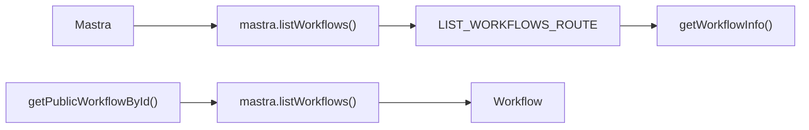
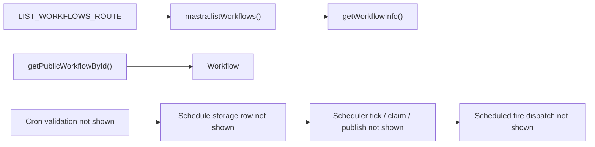

<!-- source: DeepWiki mcp.deepwiki.com · repo mastra-ai/mastra · page 4.10 Scheduling and Cron Triggers · fetched 2026-10-27 -->

# Scheduling and Cron Triggers

Relevant source files

The following files were used as context for generating this wiki page:

- [client-sdks/ai-sdk/src/__tests__/chat-route-credential-headers.test.ts](client-sdks/ai-sdk/src/__tests__/chat-route-credential-headers.test.ts)
- [deployers/cloud/src/utils/execa.ts](deployers/cloud/src/utils/execa.ts)
- [docs/src/content/en/docs/workflows/time-travel.mdx](docs/src/content/en/docs/workflows/time-travel.mdx)
- [docs/src/content/en/reference/client-js/workflows.mdx](docs/src/content/en/reference/client-js/workflows.mdx)
- [docs/src/content/en/reference/streaming/workflows/resumeStream.mdx](docs/src/content/en/reference/streaming/workflows/resumeStream.mdx)
- [docs/src/content/en/reference/workflows/run-methods/restart.mdx](docs/src/content/en/reference/workflows/run-methods/restart.mdx)
- [docs/src/content/en/reference/workflows/run-methods/resume.mdx](docs/src/content/en/reference/workflows/run-methods/resume.mdx)
- [docs/src/content/en/reference/workflows/run-methods/start.mdx](docs/src/content/en/reference/workflows/run-methods/start.mdx)
- [docs/src/content/en/reference/workflows/run-methods/timeTravel.mdx](docs/src/content/en/reference/workflows/run-methods/timeTravel.mdx)
- [docs/src/content/en/reference/workflows/workflow-methods/foreach.mdx](docs/src/content/en/reference/workflows/workflow-methods/foreach.mdx)
- [e2e-tests/deployers/template/cloudflare/src/mastra/index.ts](e2e-tests/deployers/template/cloudflare/src/mastra/index.ts)
- [packages/agent-builder/integration-tests/src/agent-template-behavior.test.ts](packages/agent-builder/integration-tests/src/agent-template-behavior.test.ts)
- [packages/agent-builder/integration-tests/src/workflow-builder-integration.test.ts](packages/agent-builder/integration-tests/src/workflow-builder-integration.test.ts)
- [packages/core/src/workflows/concurrent-time-travel.test.ts](packages/core/src/workflows/concurrent-time-travel.test.ts)
- [packages/core/src/workflows/evented/concurrent-time-travel.test.ts](packages/core/src/workflows/evented/concurrent-time-travel.test.ts)
- [packages/deployer/src/build/analyze/constants.ts](packages/deployer/src/build/analyze/constants.ts)
- [packages/deployer/src/deploy/log.ts](packages/deployer/src/deploy/log.ts)
- [packages/deployer/src/validator/custom-resolver.ts](packages/deployer/src/validator/custom-resolver.ts)
- [packages/deployer/src/validator/validate.test.ts](packages/deployer/src/validator/validate.test.ts)
- [packages/deployer/src/validator/validate.ts](packages/deployer/src/validator/validate.ts)
- [packages/server/src/server/agent-builder-ee-static-imports.test.ts](packages/server/src/server/agent-builder-ee-static-imports.test.ts)
- [packages/server/src/server/handlers/agent-builder.test.ts](packages/server/src/server/handlers/agent-builder.test.ts)
- [packages/server/src/server/handlers/authorship.ts](packages/server/src/server/handlers/authorship.ts)
- [packages/server/src/server/handlers/editor-builder.test.ts](packages/server/src/server/handlers/editor-builder.test.ts)
- [packages/server/src/server/handlers/editor-builder.ts](packages/server/src/server/handlers/editor-builder.ts)
- [packages/server/src/server/handlers/error.test.ts](packages/server/src/server/handlers/error.test.ts)
- [packages/server/src/server/handlers/error.ts](packages/server/src/server/handlers/error.ts)
- [packages/server/src/server/handlers/mcp.ts](packages/server/src/server/handlers/mcp.ts)
- [packages/server/src/server/handlers/tool-schema-overrides.ts](packages/server/src/server/handlers/tool-schema-overrides.ts)
- [packages/server/src/server/handlers/tools.test.ts](packages/server/src/server/handlers/tools.test.ts)
- [packages/server/src/server/handlers/tools.ts](packages/server/src/server/handlers/tools.ts)
- [packages/server/src/server/handlers/utils.test.ts](packages/server/src/server/handlers/utils.test.ts)
- [packages/server/src/server/handlers/utils.ts](packages/server/src/server/handlers/utils.ts)
- [packages/server/src/server/handlers/workflow-builder.test.ts](packages/server/src/server/handlers/workflow-builder.test.ts)
- [packages/server/src/server/handlers/workflow-builder.ts](packages/server/src/server/handlers/workflow-builder.ts)
- [packages/server/src/server/handlers/workflows.restart.test.ts](packages/server/src/server/handlers/workflows.restart.test.ts)
- [packages/server/src/server/handlers/workflows.test.ts](packages/server/src/server/handlers/workflows.test.ts)
- [packages/server/src/server/handlers/workflows.ts](packages/server/src/server/handlers/workflows.ts)
- [packages/server/src/server/schemas/editor-builder.ts](packages/server/src/server/schemas/editor-builder.ts)
- [packages/server/src/server/schemas/workflows.ts](packages/server/src/server/schemas/workflows.ts)
- [packages/server/src/server/server-adapter/mcp-auth.ts](packages/server/src/server/server-adapter/mcp-auth.ts)
- [packages/server/src/server/server-adapter/routes/editor-builder.ts](packages/server/src/server/server-adapter/routes/editor-builder.ts)
- [packages/server/src/server/utils.ts](packages/server/src/server/utils.ts)
- [packages/server/src/server/utils/resolve-builder-model-policy.ts](packages/server/src/server/utils/resolve-builder-model-policy.ts)

## Purpose and scope

This page covers workflow and agent scheduling, including cron validation, schedule storage, the scheduler tick/claim/publish loop, and dispatch of scheduled fires. **The supplied source excerpts do not include the scheduling implementation**, so those mechanics cannot be verified here. The available code does show how the server resolves public workflows and exposes workflow routes; it does not establish how schedules are validated, stored, claimed, or dispatched. [packages/server/src/server/handlers/utils.ts:10-22]()[packages/server/src/server/handlers/workflows.ts:158-176]()

Sources: [packages/server/src/server/handlers/utils.ts:10-22](), [packages/server/src/server/handlers/workflows.ts:158-176]()

## Overview and architecture

The available server code exposes workflow operations through route handlers and can resolve workflows from the public registry. `getPublicWorkflowById` looks up a workflow by its ID or registration key and excludes hidden internal workflows. The shown portion of `workflows.ts` defines a `GET /workflows` route that lists workflows from the `Mastra` instance. Neither excerpt shows a schedule registration path or a scheduler runtime. [packages/server/src/server/handlers/utils.ts:10-22]()[packages/server/src/server/handlers/workflows.ts:158-180]()

### Data flow diagram

This diagram maps only the workflow-resolution and listing entities visible in the supplied excerpts. It does **not** represent a verified scheduled-fire path.

Title: Workflow API Entities in the Available Source

Sources: [packages/server/src/server/handlers/workflows.ts:162-180](), [packages/server/src/server/handlers/utils.ts:10-22]()

## Cron validation and schedule storage

The supplied excerpts do not show a cron validator, a schedule configuration type, or a schedule storage row/schema. Consequently, the supported cron syntax, validation timing, persisted fields, and storage adapter behavior cannot be documented from this material. The visible workflow handler code concerns workflow lookup and listing rather than schedules. [packages/server/src/server/handlers/workflows.ts:158-180]()

| Requested detail | Evidence in supplied excerpts |
| --- | --- |
| Cron syntax and validation | No validator or cron schema is shown. |
| Schedule configuration | No schedule configuration type is shown. |
| Schedule storage row | No schedule table, row type, or storage operation is shown. |
| Scheduler tick/claim/publish loop | No scheduler implementation is shown. |
| Scheduled fire dispatch | No schedule event or dispatch handler is shown. |

Sources: [packages/server/src/server/handlers/workflows.ts:158-180]()

### Code entities and evidence boundary

The diagram associates the visible API-level workflow entities with the scheduling concepts requested for this page. Dashed connections mark concepts whose implementation is not present in the excerpts; they are not claims of an established code path.

Title: Visible Workflow API and Unverified Scheduling Entities

Sources: [packages/server/src/server/handlers/workflows.ts:162-180](), [packages/server/src/server/handlers/utils.ts:10-22]()

## Scheduler tick, claim, and publish loop

No scheduler class, tick function, claim operation, or publish call appears in the supplied implementation excerpts. The existence, ordering, locking strategy, retry behavior, and duplicate-fire guarantees of such a loop therefore cannot be verified here. [packages/server/src/server/handlers/workflows.ts:158-180]()

Sources: [packages/server/src/server/handlers/workflows.ts:158-180]()

## Scheduled fire dispatch

The shown workflow route code resolves workflows for API operations and lists workflows registered on `Mastra`; it does not show a scheduled-fire event or its consumer. The available material therefore does not establish whether a scheduled fire dispatches to an evented workflow engine, an agent, an external durable runtime, or another target. [packages/server/src/server/handlers/workflows.ts:115-155]()[packages/server/src/server/handlers/workflows.ts:162-180]()

Sources: [packages/server/src/server/handlers/workflows.ts:115-155](), [packages/server/src/server/handlers/workflows.ts:162-180]()

## Evidence needed to complete implementation details

A source-grounded description of scheduling requires the implementation files for cron validation, schedule persistence, the scheduler loop, and scheduled-fire handling. Those files are not included in the supplied excerpts, so this page intentionally does not assert their APIs or behavior.

Sources: [packages/server/src/server/handlers/workflows.ts:158-180]()

---

