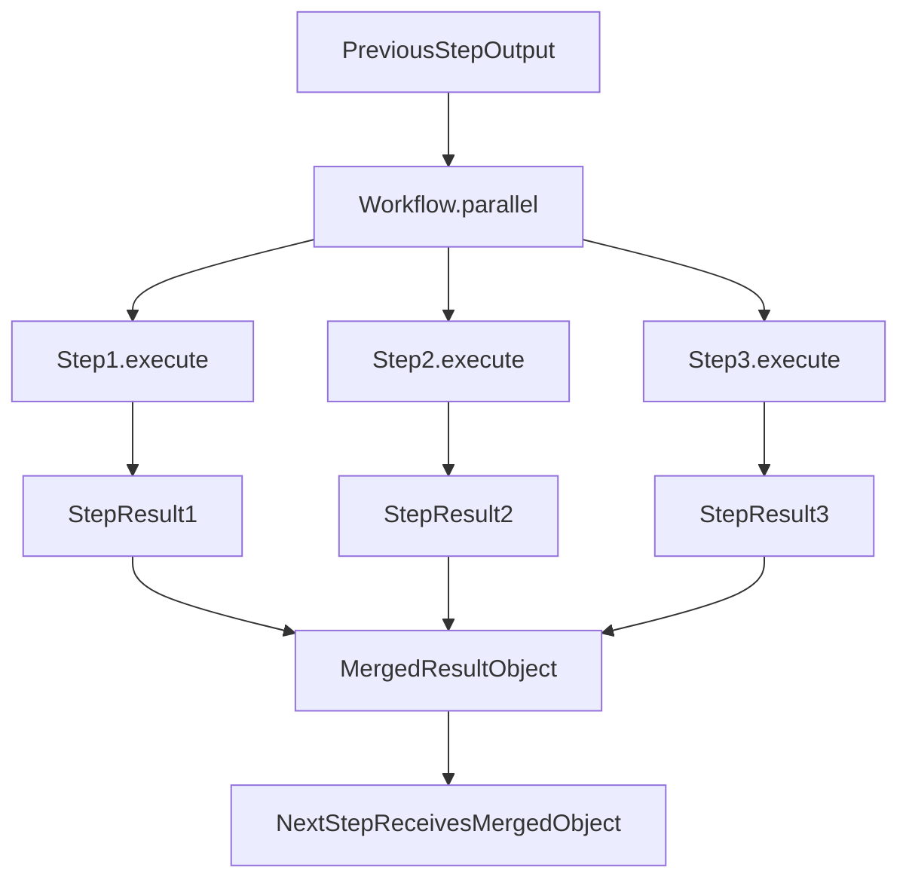
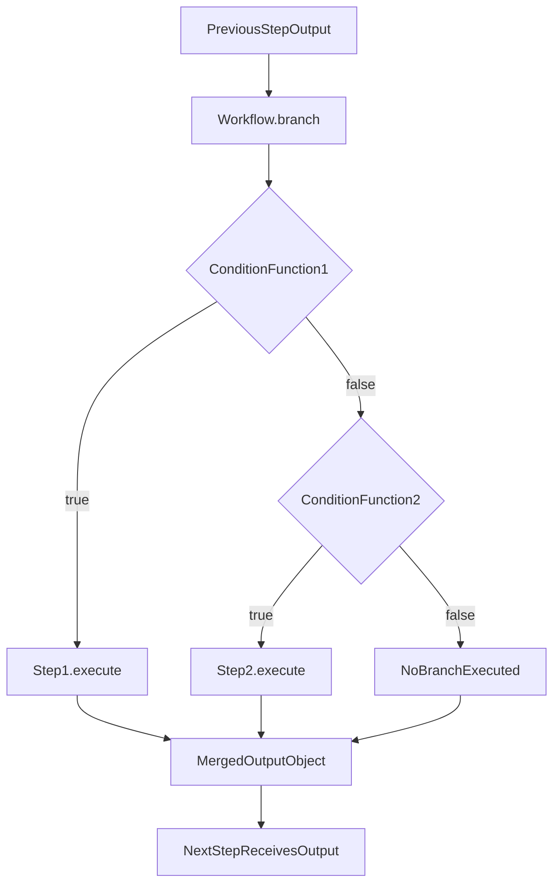
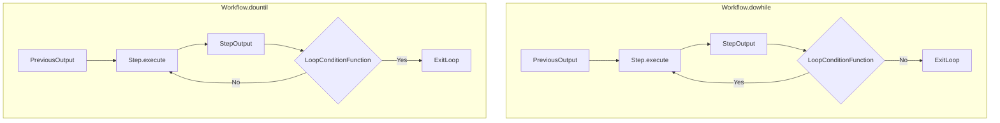
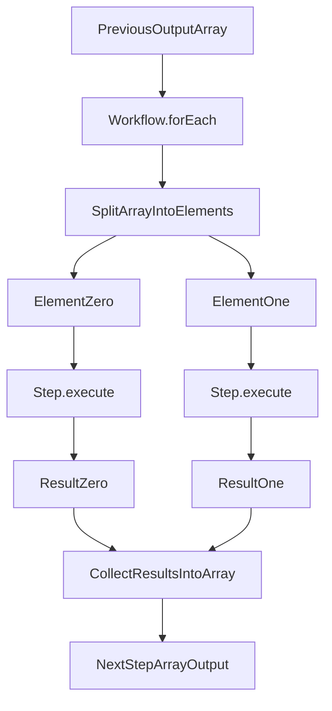
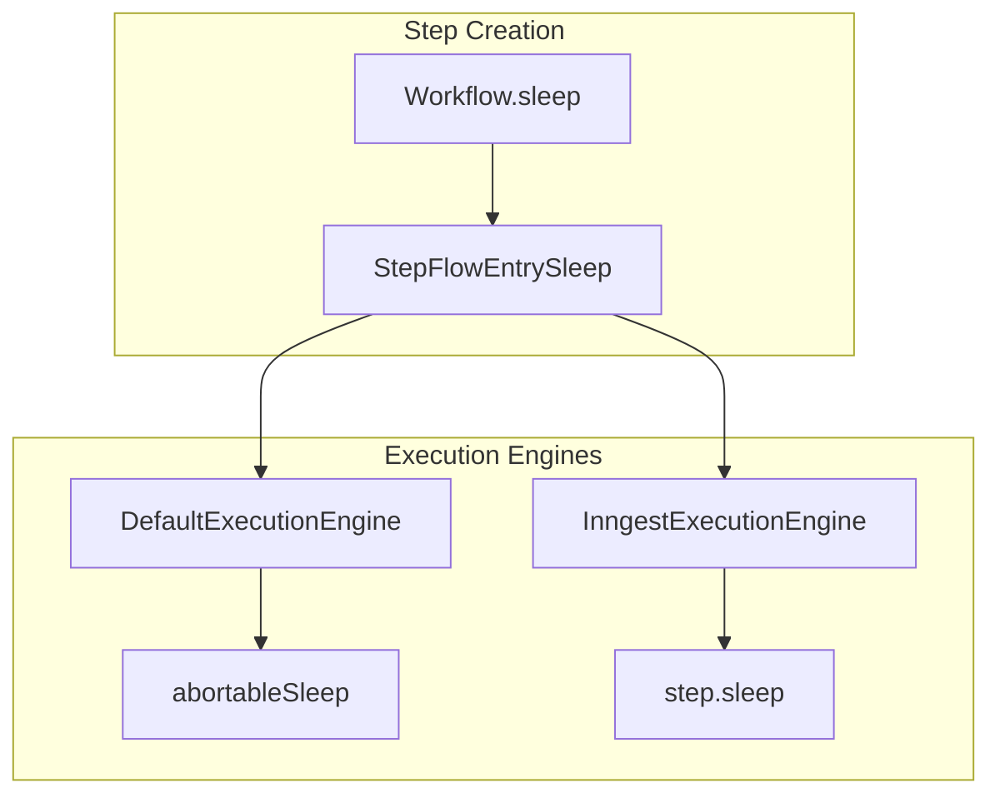
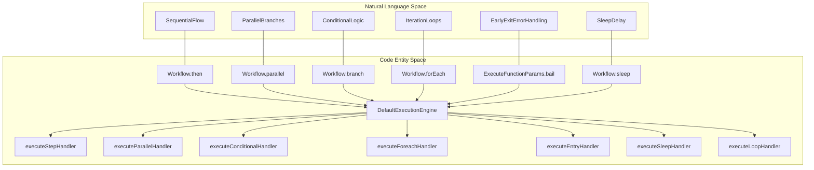

<!-- source: DeepWiki mcp.deepwiki.com · repo mastra-ai/mastra · page 4.5 Control Flow Patterns · fetched 2026-10-27 -->

# Control Flow Patterns

<details>
<summary>Relevant source files</summary>

The following files were used as context for generating this wiki page:

- [.changeset/evented-foreach-running-status.md](.changeset/evented-foreach-running-status.md)
- [.changeset/strong-gifts-smell.md](.changeset/strong-gifts-smell.md)
- [packages/core/src/processors/index.ts](packages/core/src/processors/index.ts)
- [packages/core/src/processors/processor-model-settings.test-d.ts](packages/core/src/processors/processor-model-settings.test-d.ts)
- [packages/core/src/processors/runner.test.ts](packages/core/src/processors/runner.test.ts)
- [packages/core/src/processors/runner.ts](packages/core/src/processors/runner.ts)
- [packages/core/src/processors/step-schema.ts](packages/core/src/processors/step-schema.ts)
- [packages/core/src/workflows/concurrent-resume.test.ts](packages/core/src/workflows/concurrent-resume.test.ts)
- [packages/core/src/workflows/default.test.ts](packages/core/src/workflows/default.test.ts)
- [packages/core/src/workflows/default.ts](packages/core/src/workflows/default.ts)
- [packages/core/src/workflows/evented/evented-workflow.test.ts](packages/core/src/workflows/evented/evented-workflow.test.ts)
- [packages/core/src/workflows/evented/foreach-running-status.test.ts](packages/core/src/workflows/evented/foreach-running-status.test.ts)
- [packages/core/src/workflows/evented/step-executor.test.ts](packages/core/src/workflows/evented/step-executor.test.ts)
- [packages/core/src/workflows/evented/step-executor.ts](packages/core/src/workflows/evented/step-executor.ts)
- [packages/core/src/workflows/evented/workflow-event-processor/index.ts](packages/core/src/workflows/evented/workflow-event-processor/index.ts)
- [packages/core/src/workflows/evented/workflow-event-processor/loop.ts](packages/core/src/workflows/evented/workflow-event-processor/loop.ts)
- [packages/core/src/workflows/evented/workflow.ts](packages/core/src/workflows/evented/workflow.ts)
- [packages/core/src/workflows/execution-engine.ts](packages/core/src/workflows/execution-engine.ts)
- [packages/core/src/workflows/foreach-nested-workflow.test.ts](packages/core/src/workflows/foreach-nested-workflow.test.ts)
- [packages/core/src/workflows/foreach-running-status.test.ts](packages/core/src/workflows/foreach-running-status.test.ts)
- [packages/core/src/workflows/handlers/control-flow.ts](packages/core/src/workflows/handlers/control-flow.ts)
- [packages/core/src/workflows/handlers/entry.ts](packages/core/src/workflows/handlers/entry.ts)
- [packages/core/src/workflows/handlers/sleep.ts](packages/core/src/workflows/handlers/sleep.ts)
- [packages/core/src/workflows/handlers/step.ts](packages/core/src/workflows/handlers/step.ts)
- [packages/core/src/workflows/types.ts](packages/core/src/workflows/types.ts)
- [packages/core/src/workflows/utils.ts](packages/core/src/workflows/utils.ts)
- [packages/core/src/workflows/workflow.test.ts](packages/core/src/workflows/workflow.test.ts)
- [packages/core/src/workflows/workflow.ts](packages/core/src/workflows/workflow.ts)
- [workflows/inngest/src/index.ts](workflows/inngest/src/index.ts)

</details>


This document describes the control flow patterns available in Mastra workflows for orchestrating multi-step execution. These patterns enable sequential, parallel, conditional, and iterative logic composition using a fluent API.

For information about workflow state management, see [Workflow State Management and Persistence](#4.3). For suspend/resume mechanics, see [Suspend and Resume Mechanism](#4.4). For workflow definition and step creation, see [Workflow Definition and Step Composition](#4.1).

## Overview of Control Flow Patterns

Workflows in Mastra support primary control flow patterns implemented as chainable methods on the `Workflow` class [packages/core/src/workflows/workflow.ts:511-967](). These patterns are represented by the `StepFlowEntry` type in `packages/core/src/workflows/types.ts` [packages/core/src/workflows/types.ts:290-373]().

| Pattern | Method | Purpose | Output Schema |
|---------|--------|---------|---------------|
| Sequential | `.then(step)` | Execute step after previous completes | Step's output schema |
| Parallel | `.parallel([steps])` | Execute multiple steps concurrently | Object with all step outputs |
| Conditional | `.branch([[cond, step]])` | Execute first step whose condition is true | Union of all branch outputs |
| Do-While Loop | `.dowhile(step, cond)` | Execute step, repeat while condition is true | Final iteration output |
| Do-Until Loop | `.dountil(step, cond)` | Execute step, repeat until condition is true | Final iteration output |
| ForEach | `.forEach(step, opts?)` | Execute step for each array element | Array of step outputs |
| Data Transform | `.map(config)` | Transform data between steps | Mapped object schema |

Each pattern is internally represented as a `StepFlowEntry` variant stored in the workflow's execution graph, which the execution engine traverses at runtime.

Sources: [packages/core/src/workflows/workflow.ts:511-967](), [packages/core/src/workflows/types.ts:290-373]()

## Sequential Execution with `.then()`

The `.then()` method chains steps sequentially, where each step receives the previous step's output as input. This is the fundamental building block of a Mastra workflow [packages/core/src/workflows/workflow.ts:511-540]().

```typescript
const workflow = createWorkflow({
  id: 'sequential-workflow',
  inputSchema: z.object({ value: z.string() }),
  outputSchema: z.object({ result: z.string() }),
})
  .then(step1)  // receives workflow input
  .then(step2)  // receives step1 output
  .then(step3)  // receives step2 output
  .commit();
```

The method signature enforces type safety by ensuring each step's `inputSchema` matches the previous step's `outputSchema` [packages/core/src/workflows/workflow.ts:511-525](). Internally, `.then()` creates a `StepFlowEntry` of type `'step'` and adds it to the workflow's execution graph [packages/core/src/workflows/workflow.ts:530-540]().

Sources: [packages/core/src/workflows/workflow.ts:511-540](), [packages/core/src/workflows/types.ts:291]()

## Parallel Execution with `.parallel()`

The `.parallel()` method executes multiple steps concurrently with the same input, returning an object containing all step outputs [packages/core/src/workflows/workflow.ts:756-803]().

### Parallel Execution Flow Diagram


Sources: [packages/core/src/workflows/workflow.ts:756-803]()

The output schema transforms into a `z.ZodObject` with each step's output as a property [packages/core/src/workflows/workflow.ts:767-772](). The `DefaultExecutionEngine` processes parallel steps via `executeParallelHandler()` [packages/core/src/workflows/default.ts:24](), which manages concurrent execution.

Sources: [packages/core/src/workflows/workflow.ts:756-803](), [packages/core/src/workflows/types.ts:294-297](), [packages/core/src/workflows/default.ts:24]()

## Conditional Branching with `.branch()`

The `.branch()` method evaluates conditions sequentially and executes the first step whose condition returns `true` [packages/core/src/workflows/workflow.ts:807-862]().

### Conditional Branching Diagram


Sources: [packages/core/src/workflows/workflow.ts:807-862]()

Conditions are `ConditionFunction` instances that receive execution context [packages/core/src/workflows/step.ts:107-125](). The execution engine evaluates conditions via `evaluatePredicate` [packages/core/src/workflows/workflow.ts:87]() or `executeConditionalHandler` [packages/core/src/workflows/default.ts:21](). Declarative predicates can also be used, which are wrapped via `predicateToCondition` [packages/core/src/workflows/workflow.ts:87]().

Sources: [packages/core/src/workflows/workflow.ts:807-862](), [packages/core/src/workflows/workflow.ts:87](), [packages/core/src/workflows/default.ts:21](), [packages/core/src/workflows/step.ts:107-125]()

## Loop Patterns: `.dowhile()` and `.dountil()`

Loop patterns execute a step repeatedly based on a condition evaluated after each iteration [packages/core/src/workflows/workflow.ts:864-928]().

### Loop Execution Flow Diagram


Sources: [packages/core/src/workflows/workflow.ts:864-928]()

Loop conditions are `LoopConditionFunction` instances that receive an `iterationCount` parameter [packages/core/src/workflows/step.ts:127-147](). The execution engine processes loops via `executeLoopHandler()` [packages/core/src/workflows/default.ts:23]().

Sources: [packages/core/src/workflows/workflow.ts:864-928](), [packages/core/src/workflows/types.ts:305-310](), [packages/core/src/workflows/default.ts:23](), [packages/core/src/workflows/step.ts:127-147]()

## ForEach Iteration with `.forEach()`

The `.forEach()` method executes a step for each element in an array from the previous step's output [packages/core/src/workflows/workflow.ts:930-967]().

### ForEach Execution Architecture Diagram


Sources: [packages/core/src/workflows/workflow.ts:930-967]()

The execution engine processes foreach via `executeForeachHandler()` [packages/core/src/workflows/default.ts:22](). In the `EventedExecutionEngine`, foreach is handled by `WorkflowEventProcessor` which tracks iterations via `forEachIndex` [packages/core/src/workflows/evented/workflow-event-processor/index.ts:76](). The state of foreach iterations is managed as a `ForeachStepResult` containing an array of iteration outputs [packages/core/src/workflows/evented/workflow-event-processor/index.ts:121-127]().

Sources: [packages/core/src/workflows/workflow.ts:930-967](), [packages/core/src/workflows/default.ts:22](), [packages/core/src/workflows/evented/workflow-event-processor/index.ts:76](), [packages/core/src/workflows/evented/workflow-event-processor/index.ts:121-127]()

## Sleep Operations: `.sleep()` and `.sleepUntil()`

Sleep operations pause workflow execution for a duration or until a specific time [packages/core/src/workflows/workflow.ts:547-599]().

### Sleep Implementation Architecture Diagram


Sources: [packages/core/src/workflows/workflow.ts:547-599]()

The execution engine provides hooks for platform-specific sleep implementation, such as `executeSleepDuration` and `executeSleepUntilDate` [packages/core/src/workflows/default.ts:141-162](). In the `DefaultExecutionEngine`, these use `abortableSleep` [packages/core/src/workflows/default.ts:58](). Durable engines like Inngest override these to use platform-native timers.

Sources: [packages/core/src/workflows/workflow.ts:547-599](), [packages/core/src/workflows/default.ts:141-162](), [packages/core/src/workflows/types.ts:292-293]()

## Data Transformation with `.map()`

The `.map()` method transforms data between steps by extracting values from previous steps, initial data, or static values [packages/core/src/workflows/workflow.ts:624-753]().

Internally, `.map()` creates a synthetic step via `createMappingStep` [packages/core/src/workflows/workflow.ts:101](). It uses a `MappingConfig` to define how the output object is constructed from paths in the existing workflow state [packages/core/src/workflows/types.ts:108]().

Sources: [packages/core/src/workflows/workflow.ts:624-753](), [packages/core/src/workflows/workflow.ts:101](), [packages/core/src/workflows/types.ts:108]()

## Error Handling and Flow Control

### Early Exit with `bail()`

Workflow steps can explicitly terminate the workflow execution using the `bail()` function provided in the `ExecuteFunctionParams` [packages/core/src/workflows/step.ts:55-58](). When `bail()` is called, the workflow stops immediately, and the provided `result` is returned as the final output.

### Step Retries

Steps can be configured with a specific number of retries via the `retries` property [packages/core/src/workflows/step.ts:174](). The `DefaultExecutionEngine` tracks these attempts using the `retryCountStorage` mechanism [packages/core/src/workflows/default.ts:76](). Non-retryable errors can be signaled using `MastraNonRetryableError` [packages/core/src/error/index.ts:10]().

Sources: [packages/core/src/workflows/step.ts:55-58](), [packages/core/src/workflows/step.ts:174](), [packages/core/src/workflows/default.ts:76](), [packages/core/src/error/index.ts:10]()

## Control Flow Execution Architecture

### Natural Language to Code Entity Mapping

The following diagram bridges natural language control flow concepts to the internal classes and functions responsible for their execution.


Sources: [packages/core/src/workflows/default.ts:20-31](), [packages/core/src/workflows/types.ts:290-373](), [packages/core/src/workflows/evented/step-executor.ts:84-250](), [packages/core/src/workflows/step.ts:55-58]()

---

