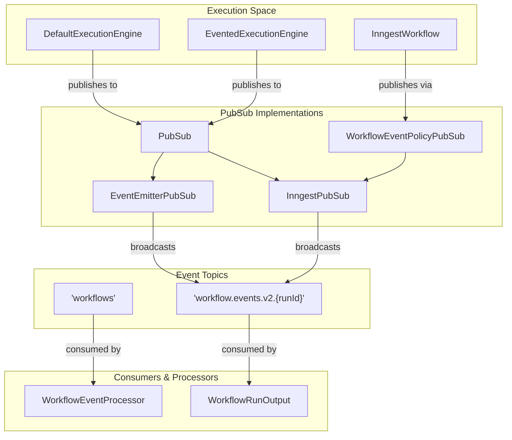
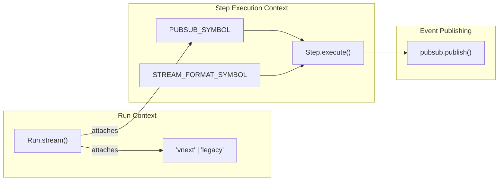
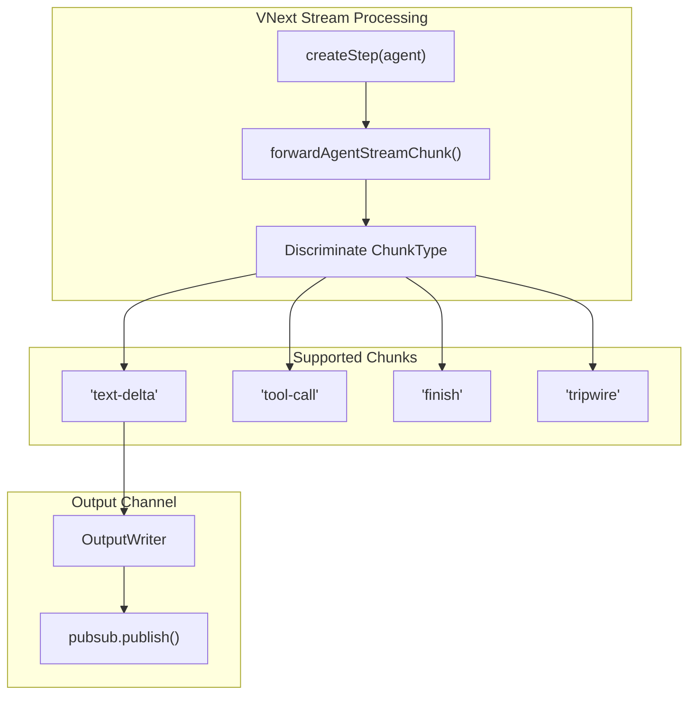

<!-- source: DeepWiki mcp.deepwiki.com · repo mastra-ai/mastra · page 4.6 Workflow Streaming and Events · fetched 2026-10-27 -->

# Workflow Streaming and Events

<details>
<summary>Relevant source files</summary>

The following files were used as context for generating this wiki page:

- [.changeset/evented-foreach-running-status.md](.changeset/evented-foreach-running-status.md)
- [.changeset/react-shows-accepted-steers.md](.changeset/react-shows-accepted-steers.md)
- [.changeset/steer-shows-when-accepted.md](.changeset/steer-shows-when-accepted.md)
- [.changeset/strong-gifts-smell.md](.changeset/strong-gifts-smell.md)
- [client-sdks/react/src/lib/mastra-db/accumulator.test.ts](client-sdks/react/src/lib/mastra-db/accumulator.test.ts)
- [client-sdks/react/src/lib/mastra-db/accumulator.ts](client-sdks/react/src/lib/mastra-db/accumulator.ts)
- [docs/src/content/en/reference/streaming/ChunkType.mdx](docs/src/content/en/reference/streaming/ChunkType.mdx)
- [observability/mastra/src/usage.test.ts](observability/mastra/src/usage.test.ts)
- [observability/mastra/src/usage.ts](observability/mastra/src/usage.ts)
- [packages/core/src/agent/__tests__/signals-pending-steer-chunk.test.ts](packages/core/src/agent/__tests__/signals-pending-steer-chunk.test.ts)
- [packages/core/src/loop/test-utils/aimock/scenarios/signal-queue-message.scenario.test.ts](packages/core/src/loop/test-utils/aimock/scenarios/signal-queue-message.scenario.test.ts)
- [packages/core/src/processors/index.ts](packages/core/src/processors/index.ts)
- [packages/core/src/processors/processor-model-settings.test-d.ts](packages/core/src/processors/processor-model-settings.test-d.ts)
- [packages/core/src/processors/runner.test.ts](packages/core/src/processors/runner.test.ts)
- [packages/core/src/processors/runner.ts](packages/core/src/processors/runner.ts)
- [packages/core/src/processors/step-schema.ts](packages/core/src/processors/step-schema.ts)
- [packages/core/src/stream/aisdk/v5/transform.test.ts](packages/core/src/stream/aisdk/v5/transform.test.ts)
- [packages/core/src/stream/aisdk/v5/transform.ts](packages/core/src/stream/aisdk/v5/transform.ts)
- [packages/core/src/stream/base/output.test.ts](packages/core/src/stream/base/output.test.ts)
- [packages/core/src/stream/base/output.ts](packages/core/src/stream/base/output.ts)
- [packages/core/src/stream/index.ts](packages/core/src/stream/index.ts)
- [packages/core/src/stream/signal-exclusions.ts](packages/core/src/stream/signal-exclusions.ts)
- [packages/core/src/stream/types.ts](packages/core/src/stream/types.ts)
- [packages/core/src/workflows/concurrent-resume.test.ts](packages/core/src/workflows/concurrent-resume.test.ts)
- [packages/core/src/workflows/default.test.ts](packages/core/src/workflows/default.test.ts)
- [packages/core/src/workflows/default.ts](packages/core/src/workflows/default.ts)
- [packages/core/src/workflows/evented/evented-workflow.test.ts](packages/core/src/workflows/evented/evented-workflow.test.ts)
- [packages/core/src/workflows/evented/foreach-running-status.test.ts](packages/core/src/workflows/evented/foreach-running-status.test.ts)
- [packages/core/src/workflows/evented/step-executor.test.ts](packages/core/src/workflows/evented/step-executor.test.ts)
- [packages/core/src/workflows/evented/step-executor.ts](packages/core/src/workflows/evented/step-executor.ts)
- [packages/core/src/workflows/evented/workflow-event-processor/index.ts](packages/core/src/workflows/evented/workflow-event-processor/index.ts)
- [packages/core/src/workflows/evented/workflow-event-processor/loop.ts](packages/core/src/workflows/evented/workflow-event-processor/loop.ts)
- [packages/core/src/workflows/evented/workflow.ts](packages/core/src/workflows/evented/workflow.ts)
- [packages/core/src/workflows/execution-engine.ts](packages/core/src/workflows/execution-engine.ts)
- [packages/core/src/workflows/foreach-nested-workflow.test.ts](packages/core/src/workflows/foreach-nested-workflow.test.ts)
- [packages/core/src/workflows/foreach-running-status.test.ts](packages/core/src/workflows/foreach-running-status.test.ts)
- [packages/core/src/workflows/handlers/control-flow.ts](packages/core/src/workflows/handlers/control-flow.ts)
- [packages/core/src/workflows/handlers/entry.ts](packages/core/src/workflows/handlers/entry.ts)
- [packages/core/src/workflows/handlers/sleep.ts](packages/core/src/workflows/handlers/sleep.ts)
- [packages/core/src/workflows/handlers/step.ts](packages/core/src/workflows/handlers/step.ts)
- [packages/core/src/workflows/types.ts](packages/core/src/workflows/types.ts)
- [packages/core/src/workflows/utils.ts](packages/core/src/workflows/utils.ts)
- [packages/core/src/workflows/workflow.test.ts](packages/core/src/workflows/workflow.test.ts)
- [packages/core/src/workflows/workflow.ts](packages/core/src/workflows/workflow.ts)
- [workflows/inngest/src/index.ts](workflows/inngest/src/index.ts)

</details>


This page documents how Mastra workflows publish execution events in real-time and how clients consume them via streaming APIs. It covers the event publishing architecture, PubSub integration, stream formats, chunk types, and engine-specific streaming behavior.

For workflow execution fundamentals, see [Workflow Definition and Step Composition (4.1)](). For workflow state persistence, see [Workflow State Management and Persistence (4.3)](). For client-side consumption of workflow streams, see [Client SDK and UI Components (10)]().

---

## 1. Event Publishing Architecture

Workflows publish execution events through a `PubSub` abstraction [packages/core/src/events/pubsub.ts]() that enables real-time observability of workflow progress. All workflow engines use this common event infrastructure, though they differ in implementation (e.g., local `EventEmitterPubSub` vs. `InngestPubSub` or `RedisStreamsPubSub`).

### PubSub System Overview

Title: Workflow Event Publishing Architecture (`PubSub` and Event Channels)

**Sources:** [packages/core/src/workflows/workflow.ts:19-21](), [packages/core/src/workflows/default.ts:8-8](), [packages/core/src/workflows/evented/workflow-event-processor/index.ts:4-7]()

### Event Symbols and Workflow Context

Workflows pass the `PubSub` instance and stream format to steps via special runtime symbols (`PUBSUB_SYMBOL` and `STREAM_FORMAT_SYMBOL`). This ensures that steps can access streaming primitives without polluting the standard input data object.

Title: Context Propagation via Symbols (`PUBSUB_SYMBOL`)

**Sources:** [packages/core/src/workflows/workflow.ts:81-81](), [packages/core/src/workflows/evented/workflow.ts:92-92]()

---

## 2. Stream Formats

Workflows support two stream formats: `legacy` (v1/v2 compatibility) and `vnext` (modern structured chunk format).

### Format Comparison

| Feature | Legacy Format | VNext Format |
|---------|---------------|--------------|
| **Event Types** | `tool-call-streaming-start`, `tool-call-delta`, `tool-call-streaming-finish` | `workflow-step-start`, `workflow-step-finish`, `text-delta`, `tool-call`, `data-*` |
| **Structure** | Flat event with `type` and `data` | Typed chunk objects via `ChunkType` union |
| **Agent Streaming** | Wrapped in tool-call events | Direct forwarding via `forwardAgentStreamChunk` |
| **Custom Data** | Not supported | `data-*` prefix for custom chunks |

**Sources:** [packages/core/src/stream/types.ts:32-38](), [packages/core/src/workflows/types.ts:39-39]()

### VNext Format Events

VNext format provides structured chunk types that align with the AI SDK streaming model. The `forwardAgentStreamChunk` utility translates agent-level streams into workflow-level events.

Title: VNext Stream Forwarding (`forwardAgentStreamChunk`)

**Sources:** [packages/core/src/workflows/evented/workflow.ts:98-98](), [packages/core/src/stream/types.ts:32-38]()

---

## 3. Event Types and Chunk Types

### Workflow-Level Events

Workflow execution engines publish lifecycle events to coordination channels (`workflows` and `workflow.events.v2.{runId}`).

- **`workflow.start`**: Published when workflow execution begins.
- **`workflow.step`**: Published for each step execution start and completion.
- **`workflow.end`**: Published on successful completion.
- **`workflow.fail`**: Published on unhandled or non-retryable error.

**Sources:** [packages/core/src/workflows/evented/workflow-event-processor/index.ts:132-168]()

### ChunkType Discriminated Union

The `ChunkType` defines the structure of data emitted during step execution (especially for Agent and Tool steps):

```typescript
export type ChunkType = 
  | { type: 'text-delta'; textDelta: string }
  | { type: 'tool-call'; toolCallId: string; toolName: string; args: any }
  | { type: 'tool-result'; toolCallId: string; result: any }
  | { type: 'finish'; finishReason: string; usage?: LanguageModelUsage }
  | { type: 'error'; error: Error }
  | { type: 'tripwire'; payload: StepTripwireInfo }
  | { type: `data-${string}`; [key: string]: any };
```
**Sources:** [packages/core/src/stream/types.ts:32-38](), [packages/core/src/workflows/types.ts:39-39]()

---

## 4. Engine-Specific Streaming Behavior

### Default Engine Streaming

The `DefaultExecutionEngine` [packages/core/src/workflows/default.ts:81]() manages retries and status persistence while executing steps. It uses an `OutputWriter` to send chunks directly to the underlying web stream.

- **Status Guards:** Uses `setLastPersistedStatus()` [packages/core/src/workflows/default.ts:103-105]() to guard against overwriting suspended states with running states mid-execution.
- **Retry Integration:** Tracks retry counts via `AsyncLocalStorage` in `getOrGenerateRetryCount()` [packages/core/src/workflows/default.ts:113-115]().

**Sources:** [packages/core/src/workflows/default.ts:81-115]()

### Evented Engine Streaming

The `EventedExecutionEngine` and `WorkflowEventProcessor` [packages/core/src/workflows/evented/workflow-event-processor/index.ts:148]() drive event-driven workflow execution. 

- **Consuming Events:** Listens to pubsub topics and routes events to handlers like `processWorkflowStart()` and `processWorkflowStepStart()`.
- **Cancellation:** Maintains an `abortControllers` map [packages/core/src/workflows/evented/workflow-event-processor/index.ts:152-152]() to support real-time workflow cancellation.
- **Delivery Guarantees:** Tracks retry attempts using `deliveryAttempts` [packages/core/src/workflows/evented/workflow-event-processor/index.ts:155-155]() to prevent poisoned events from looping indefinitely.

**Sources:** [packages/core/src/workflows/evented/workflow-event-processor/index.ts:148-168]()

### Inngest Engine Streaming

The Inngest integration [workflows/inngest/src/index.ts]() leverages Inngest's durable execution primitives. 

- **`InngestWorkflow`**: Extends base `Workflow` with Inngest step memoization and concurrency rules.
- **`WorkflowEventPolicyPubSub`**: Wraps the pubsub instance to conditionally filter or route events based on `emitWorkflowEvents` flags.

**Sources:** [workflows/inngest/src/index.ts]()

---

## 5. Client Consumption Patterns

### Run Stream APIs

The `Run` class provides primary streaming entry points for clients:

- **`run.stream()`**: Returns a `WorkflowRunOutput` containing `fullStream` (a `ReadableStream<WorkflowStreamEvent>`) and a promise resolving to the final `WorkflowResult` [packages/core/src/workflows/workflow.ts:74-74]().
- **`run.streamLegacy()`**: Provides backward-compatibility streaming for v1 clients [packages/core/src/workflows/workflow.test.ts:179-182]().

**Sources:** [packages/core/src/workflows/workflow.ts:74-74](), [packages/core/src/workflows/workflow.test.ts:179-182]()

### Custom Data Streaming

Steps can publish custom data payloads using the `outputWriter` function supplied inside `ExecuteFunctionParams`. Data written via this hook is wrapped into a `data-*` prefixed chunk type and broadcast to all active stream listeners.

**Sources:** [packages/core/src/workflows/types.ts:23-23](), [packages/core/src/processors/index.ts:45-53]()

---

