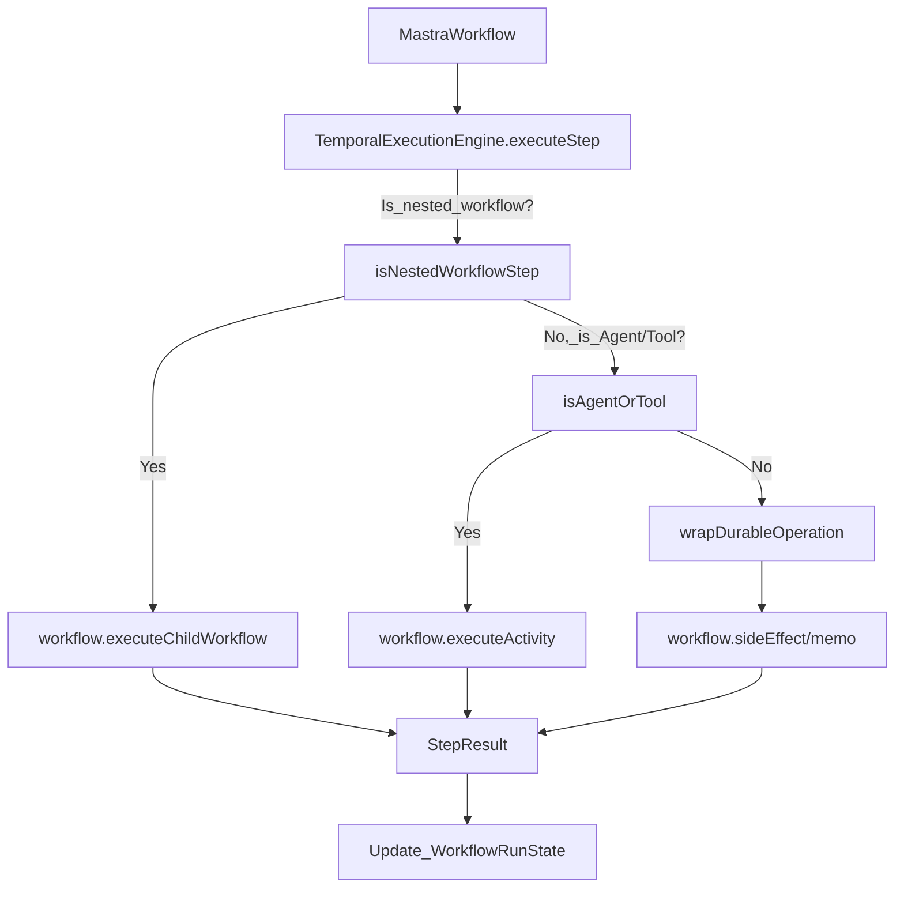
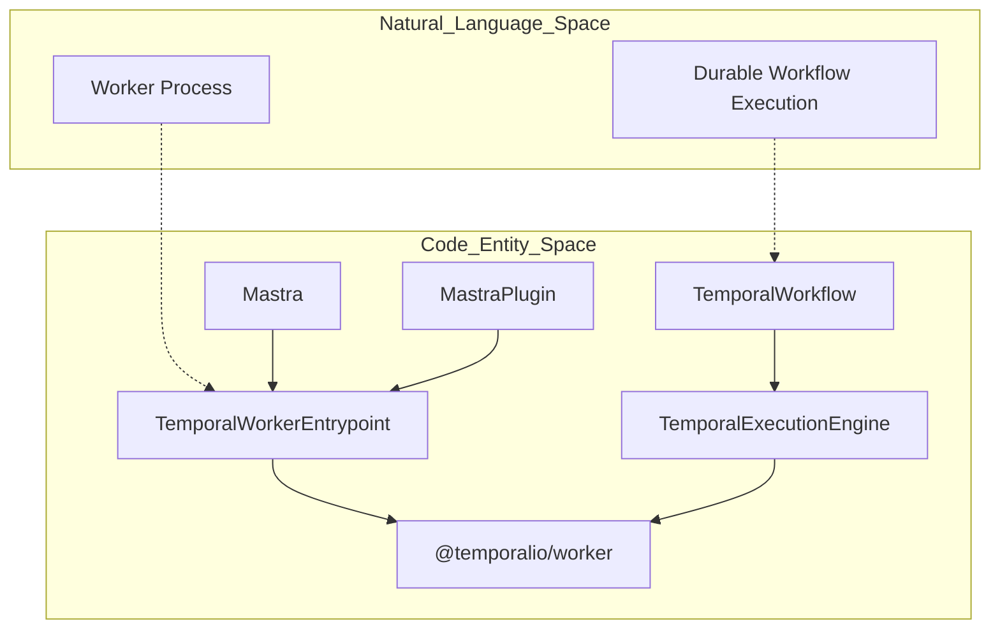
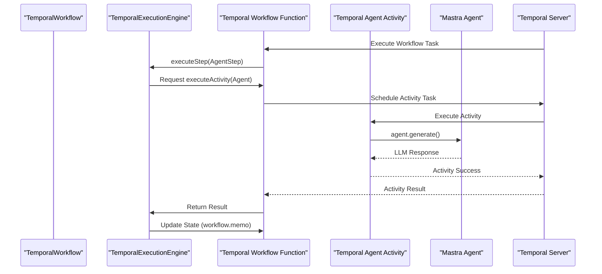

<!-- source: DeepWiki mcp.deepwiki.com · repo mastra-ai/mastra · page 4.9 Temporal Durability Integration · fetched 2026-10-27 -->

# Temporal Durability Integration

Relevant source files

The following files were used as context for generating this wiki page:

- [workflows/temporal/CHANGELOG.md](workflows/temporal/CHANGELOG.md)
- [workflows/temporal/package.json](workflows/temporal/package.json)

This page documents the integration of the Temporal workflow engine with Mastra, enabling durable execution of Mastra workflows. It covers the core components like `TemporalWorkflow` and `TemporalExecutionEngine`, worker configuration, activity and workflow transforms, and how to run durable Mastra workflows on Temporal clusters.

## Purpose and Scope

Mastra's workflow system provides a powerful way to orchestrate multi-step processes. While the default execution engines offer durability within a single Mastra instance or across a cluster via a PubSub system, Temporal provides a robust, fault-tolerant, and scalable platform for long-running, complex workflows.

The `@mastra/temporal` package translates Mastra workflows into Temporal workflows and activities, allowing them to run on standard Temporal clusters. This integration allows Mastra users to leverage Temporal's advanced durability features, including automatic retries, state persistence, and replayability, for their AI-powered workflows.

| Package | Purpose | Version |
| :--- | :--- | :--- |
| `@mastra/temporal` | Mastra Temporal workflows integration | `0.4.17` [workflows/temporal/package.json:2-4]() |

Sources:
- [workflows/temporal/package.json:1-4]()

## TemporalWorkflow and Step Definition

The `TemporalWorkflow` implementation (and the corresponding `createStep` in the `@mastra/temporal` ecosystem) ensures that Mastra's base workflow abstractions are compatible with Temporal's execution model. It manages the registration and execution within a Temporal environment.

Key aspects include:
*   **Step Creation**: Durable steps are created using a specialized `createStep` function that ensures compatibility with durable execution platforms.
*   **Activity Transforms**: When an `Agent` or `Tool` is used as a step, it is treated as a Temporal Activity. This allows the execution of these potentially long-running or external operations to be managed by Temporal's activity workers with independent retry policies [workflows/temporal/package.json:58-62]().
*   **Workflow Definition**: It manages the serialization and deserialization of workflow state, ensuring that Temporal can correctly checkpoint and resume execution.

Sources:
- [workflows/temporal/package.json:45-64]()

## TemporalExecutionEngine

The `TemporalExecutionEngine` is a specialized implementation of Mastra's execution logic designed to interact with the Temporal runtime. It leverages Temporal's durable primitives to replace standard in-memory or evented operations.

Key functionalities include:
*   **Durable Sleep**: Uses Temporal's durable sleep primitives, ensuring that sleep operations are durable and replayable without consuming worker resources.
*   **Side Effects**: Wraps operations that need to be replay-safe within Temporal's side-effect or memoization logic.
*   **Child Workflows**: Detects platform-specific workflow types to trigger Temporal's `executeChildWorkflow` logic.
*   **Cancellation**: Maps Mastra's workflow cancellation signals to Temporal's workflow cancellation mechanisms.

### Temporal Execution Flow

The following diagram illustrates how the `TemporalExecutionEngine` bridges Mastra workflow steps to Temporal primitives:

Sources:
- [workflows/temporal/package.json:58-64]()

## Worker Configuration

To run Mastra workflows on Temporal, a Temporal worker must be configured to host the workflow and activity implementations. The `@mastra/temporal` package utilizes standard Temporal SDK dependencies and provides a `MastraPlugin` to simplify worker setup.

### MastraPlugin and Prebuild
Recent updates have improved the Temporal worker setup. The `MastraPlugin` now automatically compiles the Mastra entry file when the worker is configured [workflows/temporal/CHANGELOG.md:3-43]().

| Dependency | Role |
| :--- | :--- |
| `@temporalio/workflow` | Core workflow logic and primitives [workflows/temporal/package.json:62-62]() |
| `@temporalio/activity` | Activity implementation and context [workflows/temporal/package.json:58-58]() |
| `@temporalio/worker` | Worker process management [workflows/temporal/package.json:61-61]() |
| `@temporalio/client` | Client for starting and querying workflows [workflows/temporal/package.json:59-59]() |

### Worker Architecture

This diagram shows the relationship between Mastra entities and the Temporal worker infrastructure, bridging natural language concepts to explicit code entities:

Sources:
- [workflows/temporal/package.json:58-64]()
- [workflows/temporal/CHANGELOG.md:3-43]()

## Activity and Workflow Transforms

Mastra converts declarative workflow steps into Temporal's imperative functions through a series of transforms.

### Agent and Tool Activity Mapping
Mastra converts agents and tools into activities to ensure their side-effect-heavy logic (like calling an LLM) is handled by Temporal's retry logic and history.

*   **Agent Step**: The `Agent`'s `generate` or `stream` methods are wrapped in a Temporal activity.
*   **Tool Step**: The `Tool`'s `execute` function is registered as a Temporal activity.

### Data Flow for Agent Step
When a workflow reaches an agent step, the execution follows this sequence:

Sources:
- [workflows/temporal/package.json:58-64]()

## Running Durable Mastra Workflows

To run a durable Mastra workflow on a Temporal cluster:

1.  **Define Workflow**: Use the `TemporalWorkflow` definitions provided by the package.
2.  **Initialize Integration**: Bind your Mastra instance to the Temporal client and worker using the `MastraPlugin` [workflows/temporal/CHANGELOG.md:3-43]().
3.  **Start Worker**: Run a Node.js process that starts the Temporal worker using `@temporalio/worker` [workflows/temporal/package.json:61-61]().
4.  **Execute**: Trigger the workflow using the Mastra client. The `TemporalExecutionEngine` handles the interaction with the Temporal Server to persist progress.

This ensures that even if the worker process crashes, the workflow will resume from the last successful step once the worker is back online, leveraging Temporal's event sourcing and replay capabilities.

Sources:
- [workflows/temporal/package.json:1-4]()
- [workflows/temporal/package.json:58-64]()
- [workflows/temporal/CHANGELOG.md:3-43]()

---

