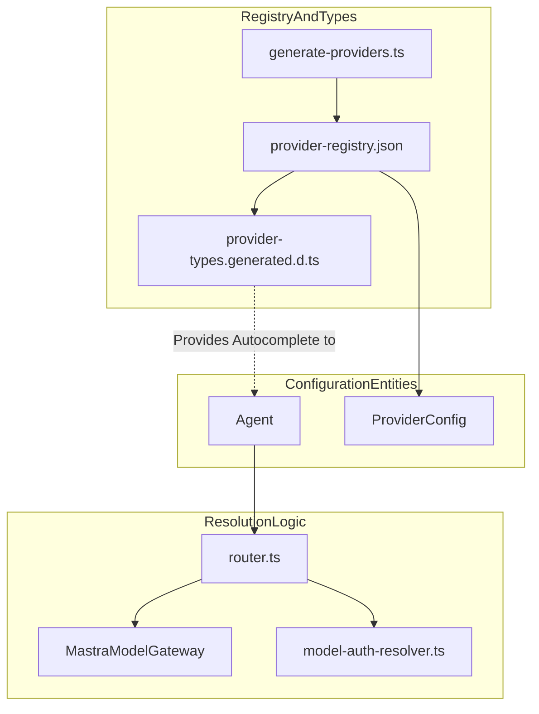
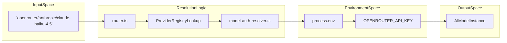

<!-- source: DeepWiki mcp.deepwiki.com · repo mastra-ai/mastra · page 5 Model Provider System · fetched 2026-10-27 -->

# Model Provider System

Relevant source files

The following files were used as context for generating this wiki page:

- [docs/src/content/en/models/gateways/index.mdx](docs/src/content/en/models/gateways/index.mdx)
- [docs/src/content/en/models/gateways/netlify.mdx](docs/src/content/en/models/gateways/netlify.mdx)
- [docs/src/content/en/models/gateways/openrouter.mdx](docs/src/content/en/models/gateways/openrouter.mdx)
- [docs/src/content/en/models/gateways/vercel.mdx](docs/src/content/en/models/gateways/vercel.mdx)
- [docs/src/content/en/models/index.mdx](docs/src/content/en/models/index.mdx)
- [docs/src/content/en/models/providers/edenai.mdx](docs/src/content/en/models/providers/edenai.mdx)
- [docs/src/content/en/models/providers/index.mdx](docs/src/content/en/models/providers/index.mdx)
- [docs/src/content/en/models/providers/kilo.mdx](docs/src/content/en/models/providers/kilo.mdx)
- [docs/src/content/en/models/providers/nano-gpt.mdx](docs/src/content/en/models/providers/nano-gpt.mdx)
- [docs/src/content/en/models/providers/opencode.mdx](docs/src/content/en/models/providers/opencode.mdx)
- [packages/core/src/llm/model/capabilities/edenai.json](packages/core/src/llm/model/capabilities/edenai.json)
- [packages/core/src/llm/model/capabilities/kilo.json](packages/core/src/llm/model/capabilities/kilo.json)
- [packages/core/src/llm/model/capabilities/nano-gpt.json](packages/core/src/llm/model/capabilities/nano-gpt.json)
- [packages/core/src/llm/model/capabilities/openrouter.json](packages/core/src/llm/model/capabilities/openrouter.json)
- [packages/core/src/llm/model/capabilities/vercel.json](packages/core/src/llm/model/capabilities/vercel.json)
- [packages/core/src/llm/model/provider-registry.json](packages/core/src/llm/model/provider-registry.json)
- [packages/core/src/llm/model/provider-types.generated.d.ts](packages/core/src/llm/model/provider-types.generated.d.ts)

The Model Provider System provides unified access to 218+ AI providers and 8174+ models through a centralized registry, auto-generated TypeScript types, and a string-based model identification scheme [docs/src/content/en/models/index.mdx:3-15](). This system abstracts away provider-specific configuration, enabling developers to switch between models and providers without changing application code.

For details on provider registry and auto-generated types, see [Provider Registry and Model Catalog](#5.1). For configuration patterns and environment variable management, see [Model Configuration Patterns](#5.2). For contrasting direct and gateway providers, see [Gateway vs Direct Providers](#5.3). For dynamic model switching via `RequestContext`, see [Dynamic Model Selection](#5.4). For fallbacks and error handling, see [Model Fallbacks and Error Handling](#5.5). For schema compatibility adaptations, see [Schema Compatibility Layers](#5.6).

---

## Architecture Overview

The Model Provider System consists of four primary components: `provider-registry.json` which defines all provider configurations, `provider-types.generated.d.ts` which produces TypeScript definitions for IDE support, `router.ts` (`resolveModel`) that translates string-based model IDs into executable configurations, and `model-auth-resolver.ts` that handles API key management from environment variables [packages/core/src/llm/model/provider-registry.json:1-20](), [packages/core/src/llm/model/provider-types.generated.d.ts:1-10](), [docs/src/content/en/models/index.mdx:13-32]().

### Natural Language to Code Entity Mapping

The following diagram bridges the high-level concepts to the specific code entities used in the Mastra provider system.

**Model Provider System Architecture**

Sources: [packages/core/src/llm/model/provider-registry.json:1-20](), [packages/core/src/llm/model/provider-types.generated.d.ts:1-10](), [docs/src/content/en/models/index.mdx:13-32]()

---

## Provider Registry Structure

The provider registry is stored in `provider-registry.json` and defines all available providers and their models. Each provider entry contains metadata required for API calls, such as endpoint URLs, authentication headers, and supported models [packages/core/src/llm/model/provider-registry.json:3-21]().

### Registry Schema

The registry uses a top-level `providers` object mapping provider identifiers to `ProviderConfig` structures.

| Field | Type | Required | Description |
|-------|------|----------|-------------|
| `url` | string | No | Base URL for API requests. |
| `apiKeyEnvVar` | string | Yes | Environment variable name containing the API key (e.g., `OPENAI_API_KEY`). |
| `apiKeyHeader` | string | No | HTTP header name for API key (defaults to "Authorization"). |
| `name` | string | Yes | Human-readable provider name. |
| `models` | string[] | Yes | Array of model identifiers. |
| `gateway` | string | No | Identifies gateway providers (e.g., "models.dev"). |

For a complete breakdown of registry file layouts and automated generation scripts, see [Provider Registry and Model Catalog](#5.1).
Sources: [packages/core/src/llm/model/provider-registry.json:3-21]()

---

## Model Catalog and Type Generation

Mastra provides type-safe access to 8174+ models from 218 providers through auto-generated TypeScript definitions (`provider-types.generated.d.ts`) [packages/core/src/llm/model/provider-types.generated.d.ts:1-10](), [docs/src/content/en/models/index.mdx:3-15](). These types drive IDE autocomplete and compile-time validation.

During development, local model lists are auto-refreshed hourly to keep autocomplete and Studio synchronized with upstream provider updates. This behavior can be toggled via `MASTRA_AUTO_REFRESH_PROVIDERS=false` and is disabled by default in production environments [docs/src/content/en/models/index.mdx:161-165]().

For further details on catalog generation and type safety, see [Provider Registry and Model Catalog](#5.1).
Sources: [packages/core/src/llm/model/provider-types.generated.d.ts:1-10](), [docs/src/content/en/models/index.mdx:161-165]()

---

## Model ID Format and Resolution

Models are referenced via the string format `"provider/model-name"`. The resolution engine (`router.ts` and `model-auth-resolver.ts`) splits this identifier, evaluates environment credentials, and constructs the appropriate model instance [docs/src/content/en/models/index.mdx:33-104]().

**Model ID Resolution Flow**

Sources: [docs/src/content/en/models/index.mdx:33-104](), [docs/src/content/en/models/gateways/openrouter.mdx:18-27]()

For pattern details, environment variable bindings, and edge cases, see [Model Configuration Patterns](#5.2).
Sources: [docs/src/content/en/models/index.mdx:33-104]()

---

## Gateway vs Direct Providers

Mastra partitions integrations into **direct providers** (connecting straight to first-party APIs like OpenAI or Anthropic) and **gateway providers** (aggregators like OpenRouter, Vercel, Netlify, or Kilo Gateway that proxy multiple underlying providers) [docs/src/content/en/models/gateways/index.mdx:11-68](), [docs/src/content/en/models/providers/index.mdx:10-205]().

For architectural trade-offs, use cases, and setup guides, see [Gateway vs Direct Providers](#5.3).
Sources: [docs/src/content/en/models/gateways/index.mdx:11-68](), [docs/src/content/en/models/providers/index.mdx:10-205]()

---

## Child Pages

- [Provider Registry and Model Catalog](#5.1) — Document provider-registry.json structure, providers, models, and auto-generated types
- [Model Configuration Patterns](#5.2) — Explain model ID strings (provider/model-name), configuration objects, and environment variable management
- [Gateway vs Direct Providers](#5.3) — Contrast gateway providers (OpenRouter, Vercel, Netlify, LLMGateway) with direct providers and explain use cases
- [Dynamic Model Selection](#5.4) — Document RequestContext-based model selection and runtime model switching
- [Model Fallbacks and Error Handling](#5.5) — Explain fallback chains, retry configuration, and model selection on failure
- [Schema Compatibility Layers](#5.6) — Document provider-specific schema adaptations (OpenAI strict mode, Anthropic caching, etc.) in @mastra/schema-compat
Sources: [docs/src/content/en/models/index.mdx:1-4](), [docs/src/content/en/models/gateways/index.mdx:1-15]()

---

