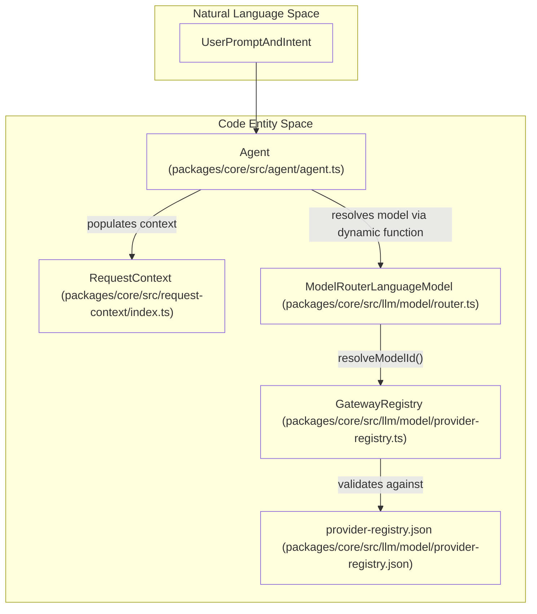
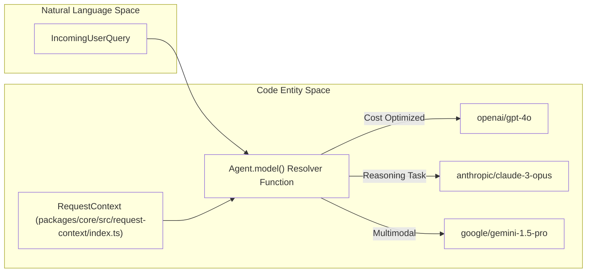

<!-- source: DeepWiki mcp.deepwiki.com · repo mastra-ai/mastra · page 5.4 Dynamic Model Selection · fetched 2026-10-27 -->

# Dynamic Model Selection

<details>
<summary>Relevant source files</summary>

The following files were used as context for generating this wiki page:

- [docs/src/content/en/models/gateways/custom-gateways.mdx](docs/src/content/en/models/gateways/custom-gateways.mdx)
- [docs/src/content/en/reference/core/mastra-model-gateway.mdx](docs/src/content/en/reference/core/mastra-model-gateway.mdx)
- [mastracode/sdk/src/agents/mastracode-gateway-thinking.test.ts](mastracode/sdk/src/agents/mastracode-gateway-thinking.test.ts)
- [mastracode/sdk/src/providers/thinking-request.ts](mastracode/sdk/src/providers/thinking-request.ts)
- [mastracode/sdk/src/thinking.test.ts](mastracode/sdk/src/thinking.test.ts)
- [mastracode/tui/e2e/tui/think-picker-per-model.ts](mastracode/tui/e2e/tui/think-picker-per-model.ts)
- [packages/core/scripts/generate-providers.ts](packages/core/scripts/generate-providers.ts)
- [packages/core/src/llm/index.ts](packages/core/src/llm/index.ts)
- [packages/core/src/llm/model/gateways/base.ts](packages/core/src/llm/model/gateways/base.ts)
- [packages/core/src/llm/model/gateways/index.ts](packages/core/src/llm/model/gateways/index.ts)
- [packages/core/src/llm/model/gateways/models-dev.e2e.test.ts](packages/core/src/llm/model/gateways/models-dev.e2e.test.ts)
- [packages/core/src/llm/model/gateways/models-dev.test.ts](packages/core/src/llm/model/gateways/models-dev.test.ts)
- [packages/core/src/llm/model/gateways/models-dev.ts](packages/core/src/llm/model/gateways/models-dev.ts)
- [packages/core/src/llm/model/index.ts](packages/core/src/llm/model/index.ts)
- [packages/core/src/llm/model/provider-options.ts](packages/core/src/llm/model/provider-options.ts)
- [packages/core/src/llm/model/provider-registry.test.ts](packages/core/src/llm/model/provider-registry.test.ts)
- [packages/core/src/llm/model/provider-registry.ts](packages/core/src/llm/model/provider-registry.ts)
- [packages/core/src/llm/model/registry-generator.test.ts](packages/core/src/llm/model/registry-generator.test.ts)
- [packages/core/src/llm/model/registry-generator.ts](packages/core/src/llm/model/registry-generator.ts)

</details>


This document covers function-based model selection in Mastra, enabling runtime model resolution based on `RequestContext`, user preferences, or execution environment. This system allows agents to resolve their model configuration dynamically instead of using a static string.

## Overview

Dynamic model selection allows the `Agent` class to defer model resolution until the moment of execution. By providing a function to the `model` property in the `Agent` constructor, developers can implement sophisticated routing logic that responds to the specific context of an incoming request. Mastra provides a unified interface for working with LLMs, leveraging a `ModelRouterLanguageModel` to resolve IDs against a comprehensive registry [packages/core/src/llm/model/router.ts:110-135]().

**Diagram: Request to Model Resolution**

*Sources: [packages/core/src/llm/model/router.ts:110-187](), [packages/core/src/llm/model/provider-registry.json:1-10](), [packages/core/src/request-context/index.ts:1-9]()*

## RequestContext Integration

The `RequestContext` is the primary vehicle for passing runtime data to the model selector. It typically contains tenant IDs, thread IDs, or custom user preferences. The `Agent` class uses this context to resolve execution parameters during `.generate()` or `.stream()` calls.

### Logic Flow for Multi-Tenant Selection

In multi-tenant environments, the `Agent` can use resource metadata from the context to look up which model provider the specific customer has configured.

**Diagram: Tenant-Based Model Routing**

*Sources: [packages/core/src/llm/model/router.ts:136-163](), [packages/core/src/request-context/index.ts:1-9]()*

## Interaction with the Provider Registry

All dynamic selections eventually resolve to a string or configuration object that must match the registry defined in `provider-registry.json` [packages/core/src/llm/model/provider-registry.json:1-10]().

*   **Validation:** The framework validates the resolved string using the `GatewayRegistry` which parses the model identifier [packages/core/src/llm/model/provider-registry.ts:10-16]().
*   **Gateway Routing:** If a gateway like `Netlify` or `Models.dev` is used, the resolved string follows the `gateway/provider/model` pattern [packages/core/src/llm/model/provider-registry.json:1-80]().
*   **Dynamic Sync:** Mastra can fetch and sync provider data at runtime, ensuring that dynamically added models are recognized by the runtime [packages/core/src/llm/model/provider-registry.ts:10-16](). The `ModelsDevGateway` [packages/core/src/llm/model/gateways/models-dev.ts:149-152]() is responsible for fetching provider configurations from `models.dev` and updating the registry.

*Sources: [packages/core/src/llm/model/provider-registry.ts:10-16](), [packages/core/src/llm/model/provider-registry.json:1-80](), [packages/core/src/llm/model/gateways/models-dev.ts:149-152]()*

## Implementation Patterns

### 1. User Preference Pattern
Users can select their preferred model through application settings. The `Agent` retrieves these from the `RequestContext`.

```typescript
const agent = new Agent({
  id: "personal-assistant",
  model: ({ requestContext }) => {
    // requestContext is injected at runtime
    const provider = requestContext?.get("preferred-provider");
    const modelName = requestContext?.get("preferred-model");
    return `${provider}/${modelName}` as any;
  }
});
```

### 2. Task-Based Routing
Mastra allows mixing and matching models for different tasks within the same application. The `ModelRouterLanguageModel` handles the underlying versioning and transport layers [packages/core/src/llm/index.ts:88]().

| Feature | Code Entity | Purpose |
|-----------|-------------------|-----------|
| Registry | `provider-registry.json` | Local structured definition of all known providers and models [packages/core/src/llm/model/provider-registry.json:1-10](). |
| Gateway | `GatewayRegistry` | Resolves gateway endpoints and fetches capabilities [packages/core/src/llm/model/provider-registry.ts:10-16](). |
| Resolver | `ModelRouterLanguageModel` | Parses strings into provider and model components during execution [packages/core/src/llm/index.ts:88](). |

*Sources: [packages/core/src/llm/index.ts:88](), [packages/core/src/llm/model/provider-registry.ts:10-16](), [packages/core/src/llm/model/provider-registry.json:1-10]()*

## Best Practices

1.  **Offline Resilience:** Rely on static registry configurations when operating in air-gapped or offline development environments. The `isOfflineMode()` function [packages/core/src/llm/model/provider-registry.ts:41-44]() checks for this.
2.  **Environment Variables:** Ensure provider API keys (e.g., `OPENAI_API_KEY`, `ANTHROPIC_API_KEY`) are properly populated corresponding to the dynamically resolved providers [packages/core/src/llm/model/provider-registry.json:1-80](). The `resolveApiKeyFromEnv` function [packages/core/src/llm/model/gateways/models-dev.ts:113-120]() handles API key resolution from environment variables.
3.  **Gateway Prefixes:** Always use the `gateway/provider/model` format for unambiguous routing when deploying across multiple aggregated gateways [packages/core/src/llm/index.ts:135]().

*Sources: [packages/core/src/llm/model/provider-registry.ts:41-44](), [packages/core/src/llm/model/gateways/models-dev.ts:113-120](), [packages/core/src/llm/model/provider-registry.json:1-80](), [packages/core/src/llm/index.ts:135]()*

---

