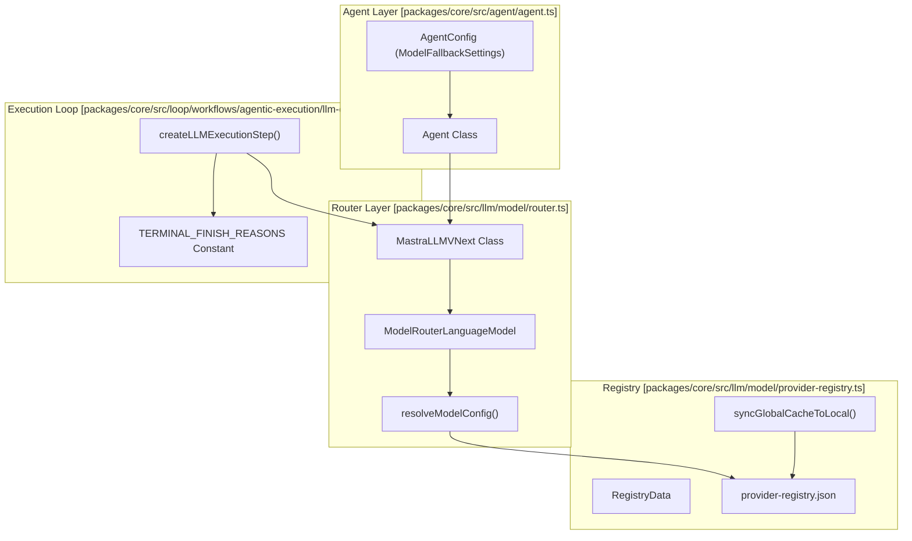
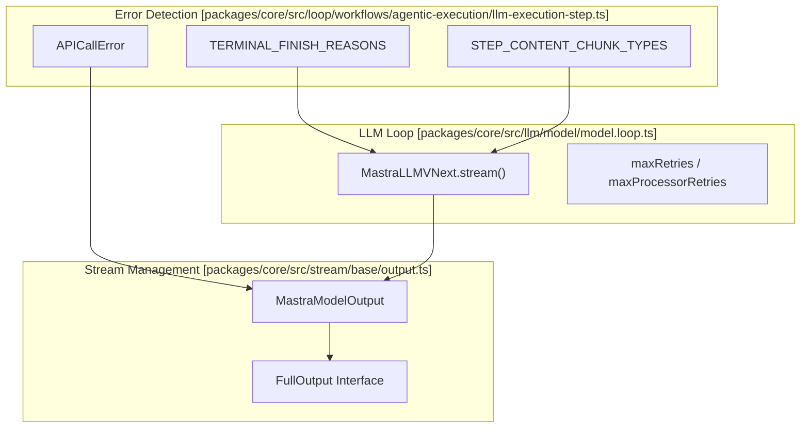

<!-- source: DeepWiki mcp.deepwiki.com · repo mastra-ai/mastra · page 5.5 Model Fallbacks and Error Handling · fetched 2026-10-27 -->

# Model Fallbacks and Error Handling

<details>
<summary>Relevant source files</summary>

The following files were used as context for generating this wiki page:

- [docs/src/content/en/reference/processors/provider-history-compat.mdx](docs/src/content/en/reference/processors/provider-history-compat.mdx)
- [docs/src/content/en/reference/processors/stream-error-retry-processor.mdx](docs/src/content/en/reference/processors/stream-error-retry-processor.mdx)
- [packages/core/src/agent/__tests__/memory-error-processors.test.ts](packages/core/src/agent/__tests__/memory-error-processors.test.ts)
- [packages/core/src/agent/__tests__/model-retry-after.test.ts](packages/core/src/agent/__tests__/model-retry-after.test.ts)
- [packages/core/src/agent/__tests__/user-first-turn.test.ts](packages/core/src/agent/__tests__/user-first-turn.test.ts)
- [packages/core/src/agent/durable/__tests__/durable-agent-error-processor-rotation.test.ts](packages/core/src/agent/durable/__tests__/durable-agent-error-processor-rotation.test.ts)
- [packages/core/src/agent/message-list/tests/anthropic-thinking-roundtrip.test.ts](packages/core/src/agent/message-list/tests/anthropic-thinking-roundtrip.test.ts)
- [packages/core/src/agent/message-list/tests/message-list-gemini.test.ts](packages/core/src/agent/message-list/tests/message-list-gemini.test.ts)
- [packages/core/src/processors/provider-history-compat.test.ts](packages/core/src/processors/provider-history-compat.test.ts)
- [packages/core/src/processors/provider-history-compat.ts](packages/core/src/processors/provider-history-compat.ts)
- [packages/core/src/processors/stream-error-retry-processor.test.ts](packages/core/src/processors/stream-error-retry-processor.test.ts)
- [packages/core/src/processors/stream-error-retry-processor.ts](packages/core/src/processors/stream-error-retry-processor.ts)
- [packages/core/src/utils/retry-after.test.ts](packages/core/src/utils/retry-after.test.ts)
- [packages/core/src/utils/retry-after.ts](packages/core/src/utils/retry-after.ts)
- [packages/memory/__recordings__/memory-integration-tests-src-working-memory-v4.json](packages/memory/__recordings__/memory-integration-tests-src-working-memory-v4.json)
- [packages/memory/__recordings__/memory-integration-tests-src-working-memory-v5.json](packages/memory/__recordings__/memory-integration-tests-src-working-memory-v5.json)
- [packages/memory/__recordings__/memory-integration-tests-src-working-memory-v6.json](packages/memory/__recordings__/memory-integration-tests-src-working-memory-v6.json)

</details>


This document covers the automatic failover, retry configuration, and error handling mechanisms in Mastra's model provider system.

## Purpose and Scope

Model fallbacks provide application-level automatic failover between language models and providers. When a primary model becomes unavailable due to outages, rate limits, or specific provider errors, Mastra can automatically switch to configured backup models. This creates resilient AI applications without requiring explicit error handling code for every model call.

The system operates at the model router level, independent of API gateways, minimizing latency by avoiding additional network hops while providing reliability benefits directly within the application logic.

Sources: [packages/core/src/llm/model/router.ts:13-14]()

## Fallback and Retry Architecture

The fallback logic is integrated into the `Agent` execution flow and the underlying `ModelRouterLanguageModel`. When an `Agent` is initialized, it can be configured with a fallback chain and retry settings. The `MastraLLMVNext` class acts as a wrapper around multiple `ModelManagerModelConfig` objects, managing the iteration through the model list during the agentic loop.

### Code Entity Space to Natural Language Space

The following diagram maps internal code entities to the fallback and routing process.



**Diagram: Code Entity Mapping for Model Routing and Fallback Execution**

Sources: [packages/core/src/llm/model/router.ts:13-14](), [packages/core/src/llm/model/model.loop.ts:20-58](), [packages/core/src/loop/workflows/agentic-execution/llm-execution-step.ts:109-127](), [packages/core/src/llm/model/provider-registry.ts:26-34](), [packages/core/src/llm/model/provider-registry.ts:119-121]()

## Configuration Syntax

### Model Fallback Settings
The `AgentConfig` accepts a `model` property which can be a simple string or a `ModelFallbackSettings` object. This object allows defining a primary model and an array of fallbacks. Internally, these are converted into a list of `ModelManagerModelConfig` which are passed to the `MastraLLMVNext` constructor.

```typescript
import { Agent } from "@mastra/core/agent";

const agent = new Agent({
  id: "resilient-agent",
  model: {
    provider: "openai",
    name: "gpt-4o",
    fallbacks: [
      { provider: "anthropic", name: "claude-3-7-sonnet-20250219" },
      { provider: "google", name: "gemini-2.0-flash" }
    ],
    retries: 3
  }
});
```

Sources: [packages/core/src/llm/model/model.loop.ts:26-58](), [packages/core/src/loop/types.ts:41-44]()

### Registry and Provider Mapping
The `provider-registry.json` contains metadata for thousands of models. The `ModelsDevGateway` dynamically fetches provider data from `https://models.dev/api.json` and updates the local registry.

| Provider Key | Base URL | API Key Env Var |
|--------------|-----|-----------------|
| `openai` | `https://api.openai.com/v1` | `OPENAI_API_KEY` |
| `anthropic` | `https://api.anthropic.com/v1` | `ANTHROPIC_API_KEY` |
| `mistral` | `https://api.mistral.ai/v1` | `MISTRAL_API_KEY` |
| `google` | `https://generativelanguage.googleapis.com/v1beta` | `GOOGLE_API_KEY` |

Sources: [packages/core/src/llm/model/gateways/models-dev.ts:96-116](), [packages/core/src/llm/model/gateways/models-dev.ts:133-138](), [packages/core/src/llm/model/provider-registry.ts:34-35]()

## Error Handling and Recovery

### Execution Step Error Handling
During the agentic execution loop, LLM calls are managed by the `LLMExecutionStep`. This layer handles errors from the `ModelRouterLanguageModel` and manages the stream state. The loop identifies terminal finish reasons where retrying would be futile, such as content filters or length limits.



**Diagram: Execution Error Handling and Stream Recovery Flow**

Mastra distinguishes between errors that should trigger a retry and those that fail fast. Terminal reasons include `stop`, `error`, `length`, and `content-filter`. The system also tracks `STEP_CONTENT_CHUNK_TYPES` to detect "zero-output" steps which could lead to infinite loops if not terminated.

Sources: [packages/core/src/loop/workflows/agentic-execution/llm-execution-step.ts:109-127](), [packages/core/src/loop/workflows/agentic-execution/llm-execution-step.ts:101-107](), [packages/core/src/stream/base/output.ts:109-165](), [packages/core/src/llm/model/model.loop.ts:107-148]()

### Error Processors

Mastra agents utilize `errorProcessors` to handle API errors and other issues during LLM calls. Two key processors for fallbacks and error handling are `ProviderHistoryCompat` and `StreamErrorRetryProcessor`.

#### `ProviderHistoryCompat`

The `ProviderHistoryCompat` processor handles provider-specific history incompatibilities. It can rewrite the outbound language model prompt before a provider call, or react to API errors and retry with repaired message history. This is crucial when an agent may switch between model providers or reuse message history across providers, especially when providers reject fields emitted by another provider.

It implements the `CompatRule` interface, which defines `errorPatterns` for reactive fixes and `applyToPrompt` for preemptive rewrites.
[packages/core/src/processors/provider-history-compat.ts:43-64]()

**Usage:**
`ProviderHistoryCompat` is added to every agent's `errorProcessors` by default. Custom instances can be provided to add `additionalRules`.
[docs/src/content/en/reference/processors/provider-history-compat.mdx:15-29]()

**Built-in Rules:**
The processor includes several built-in rules to address common provider incompatibilities:
*   `strip-foreign-provider-executed-tools`: Removes tool calls from different provider families.
*   `anthropic-tool-id-format`: Rewrites invalid Anthropic tool call IDs.
*   `cerebras-strip-reasoning-content`: Removes Cerebras-specific reasoning parts.
*   `anthropic-strip-empty-signed-reasoning-content`: Removes empty Anthropic reasoning parts with signatures.
*   `anthropic-strip-foreign-reasoning-content`: Removes non-Anthropic reasoning parts.
*   `anthropic-strip-foreign-signed-reasoning`: Drops signed thinking from different providers.
*   `azure-system-reminder-transform`: Renames system reminder wrappers for Azure OpenAI.

Sources: [packages/core/src/processors/provider-history-compat.ts:43-64](), [packages/core/src/processors/provider-history-compat.ts:99-159](), [packages/core/src/processors/provider-history-compat.ts:175-177](), [docs/src/content/en/reference/processors/provider-history-compat.mdx:15-29](), [docs/src/content/en/reference/processors/provider-history-compat.mdx:101-112]()

#### `StreamErrorRetryProcessor`

The `StreamErrorRetryProcessor` is an error processor that retries transient LLM API and stream failures. It includes built-in matching for OpenAI Responses stream errors and supports additional matchers for other provider-specific error shapes.
[docs/src/content/en/reference/processors/stream-error-retry-processor.mdx:10-12]()

**How it works:**
The processor checks the error and its cause chain for:
*   Provider retry metadata (`isRetryable === true`).
*   Built-in OpenAI Responses stream error matching (e.g., `isRetryableOpenAIResponsesStreamError`).
*   Custom matcher results.

If the error is retryable, it returns `{ retry: true }`. It can also introduce a `delayMs` before retrying, which can be a fixed number or a function for exponential backoff.
[docs/src/content/en/reference/processors/stream-error-retry-processor.mdx:36-40](), [docs/src/content/en/reference/processors/stream-error-retry-processor.mdx:44-47]()

**Configuration:**
The processor can be configured with `maxRetries`, `matchers`, `retryUnknownErrors`, `delayMs`, and `maxRetryAfterMs`.
[packages/core/src/processors/stream-error-retry-processor.ts:25-47]()

**Retry Limits:**
`maxRetries` defaults to `1` for this processor. The agent also has a `maxProcessorRetries` setting, which defaults to `3` if unset. Both should be considered for a unified retry budget.
[docs/src/content/en/reference/processors/stream-error-retry-processor.mdx:49-52]()

**`Retry-After` Handling:**
For retryable errors with a `Retry-After` response header, the processor reads the delay and waits for the longer of `delayMs` and the bounded server delay. `maxRetryAfterMs` (default `30_000`) caps provider-provided wait time.
[docs/src/content/en/reference/processors/stream-error-retry-processor.mdx:54-58]()

**Example:**
```typescript title="src/mastra/agents/resilient-agent.ts"
import { Agent } from '@mastra/core/agent'
import { StreamErrorRetryProcessor } from '@mastra/core/processors'

const isECONNRESET = (error: unknown) => {
  if (!error || typeof error !== 'object') return false
  const code = (error as { code?: unknown }).code
  if (typeof code === 'string' && code.toUpperCase() === 'ECONNRESET') return true
  const message = error instanceof Error ? error.message : undefined
  return typeof message === 'string' && /econnreset|socket hang up/i.test(message)
}

export const agent = new Agent({
  id: 'resilient-agent',
  name: 'resilient-agent',
  instructions: 'You are a helpful assistant.',
  model: '__GATEWAY_OPENAI_MODEL_BASE__',
  errorProcessors: [
    new StreamErrorRetryProcessor({
      maxRetries: 2,
      delayMs: ({ retryCount }) => Math.min(1000 * 2 ** retryCount, 30000),
      matchers: [isECONNRESET],
    }),
  ],
})
```
Sources: [packages/core/src/processors/stream-error-retry-processor.ts:25-47](), [packages/core/src/processors/stream-error-retry-processor.ts:122-129](), [packages/core/src/processors/stream-error-retry-processor.ts:138-145](), [docs/src/content/en/reference/processors/stream-error-retry-processor.mdx:10-12](), [docs/src/content/en/reference/processors/stream-error-retry-processor.mdx:36-40](), [docs/src/content/en/reference/processors/stream-error-retry-processor.mdx:44-47](), [docs/src/content/en/reference/processors/stream-error-retry-processor.mdx:49-52](), [docs/src/content/en/reference/processors/stream-error-retry-processor.mdx:54-58](), [docs/src/content/en/reference/processors/stream-error-retry-processor.mdx:89-113]()

## Gateway-Level Error Handling

Mastra supports specialized gateways that aggregate multiple providers and handle their own internal failover, caching, and rate limiting. The `ModelsDevGateway` handles the resolution of API keys and URL templates for these providers.

| Gateway | Description | Implementation |
|---------|-------------|----------------|
| `ModelsDev` | Fetches provider metadata and capabilities dynamically. | `ModelsDevGateway` |
| `Netlify` | Netlify AI Gateway for unified provider access. | `NetlifyGateway` |
| `Mastra` | Built-in gateway for Observational Memory and internal routing. | `MastraGateway` |

Sources: [packages/core/src/llm/model/gateways/models-dev.ts:118-126](), [packages/core/src/llm/model/provider-registry.ts:12-16]()

## Best Practices for Resilience

1.  **Mix and Match Providers**: Use models from different providers (e.g., OpenAI and Anthropic) to protect against single-provider outages.
2.  **Offline Mode**: Use `MASTRA_OFFLINE=true` to skip network fetches for provider data in air-gapped environments.
3.  **Terminal Reason Checks**: The execution loop prevents infinite spinning by checking `TERMINAL_FINISH_REASONS` before re-sending requests.
4.  **Atomic Registry Updates**: Mastra uses `atomicWriteFileSync` to prevent file corruption when multiple processes update the provider registry cache concurrently.
5.  **Capability Validation**: Use the global cache to sync model capabilities, ensuring that fallback models support the required features (e.g., structured output).

Sources: [packages/core/src/llm/model/provider-registry.ts:40-43](), [packages/core/src/llm/model/provider-registry.ts:96-112](), [packages/core/src/loop/workflows/agentic-execution/llm-execution-step.ts:109-127](), [packages/core/src/llm/model/provider-registry.ts:119-138]()

---

