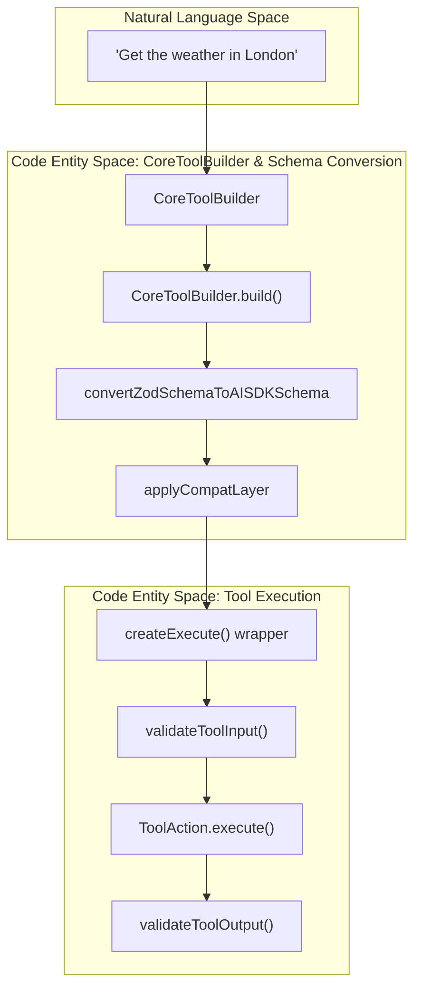
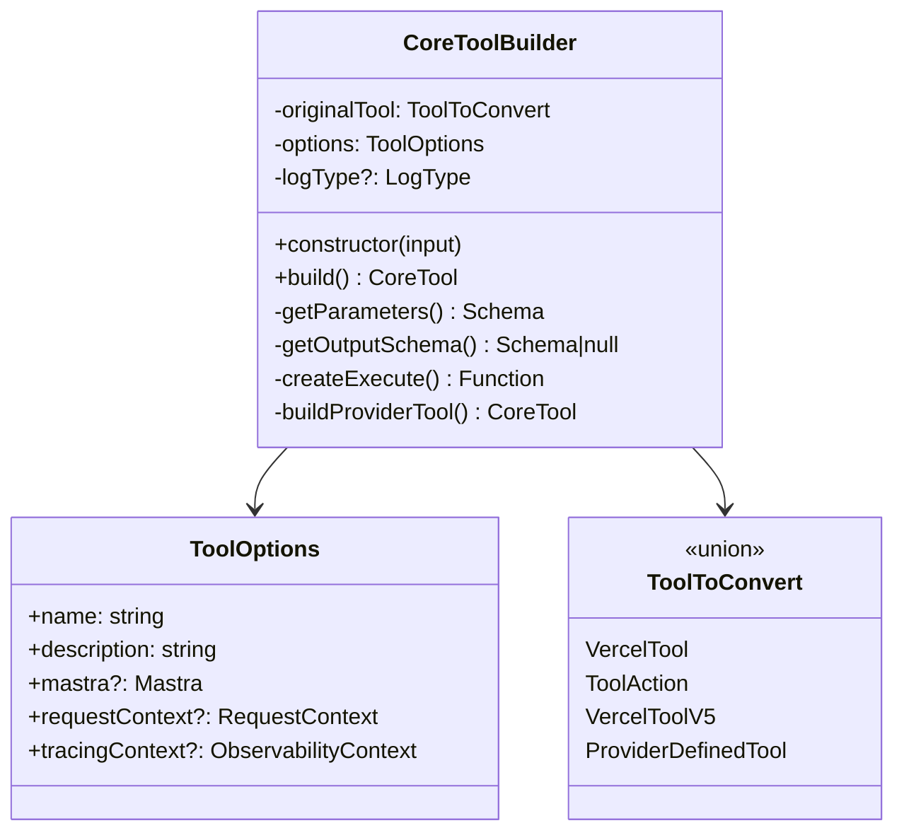
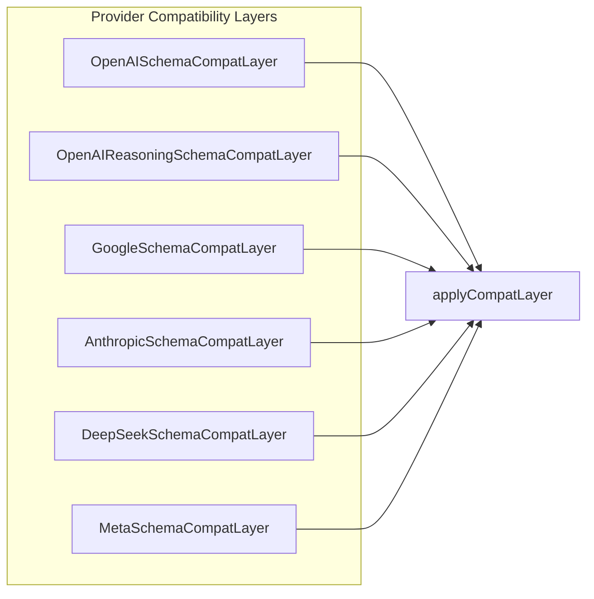
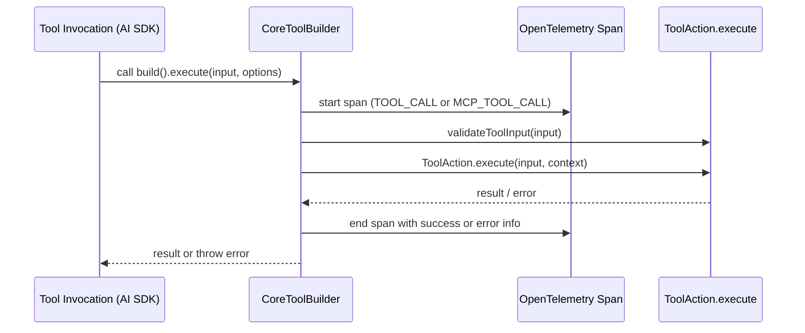

<!-- source: DeepWiki mcp.deepwiki.com · repo mastra-ai/mastra · page 6.2 Tool Builder and Schema Conversion · fetched 2026-10-27 -->

# Tool Builder and Schema Conversion

Relevant source files

The following files were used as context for generating this wiki page:

- [.changeset/fluffy-oranges-end.md](.changeset/fluffy-oranges-end.md)
- [client-sdks/ai-sdk/src/__tests__/background-task-stream.test.ts](client-sdks/ai-sdk/src/__tests__/background-task-stream.test.ts)
- [docs/src/content/en/reference/agents/agent.mdx](docs/src/content/en/reference/agents/agent.mdx)
- [docs/src/content/en/reference/tools/create-tool.mdx](docs/src/content/en/reference/tools/create-tool.mdx)
- [packages/core/src/agent/__tests__/tools.test.ts](packages/core/src/agent/__tests__/tools.test.ts)
- [packages/core/src/agent/__tests__/working-memory-context.test.ts](packages/core/src/agent/__tests__/working-memory-context.test.ts)
- [packages/core/src/agent/durable/__tests__/durable-agent-client-tool-pending.test.ts](packages/core/src/agent/durable/__tests__/durable-agent-client-tool-pending.test.ts)
- [packages/core/src/agent/durable/__tests__/durable-agent-tools.test.ts](packages/core/src/agent/durable/__tests__/durable-agent-tools.test.ts)
- [packages/core/src/agent/durable/workflows/steps/llm-mapping-pending-client-tool.test.ts](packages/core/src/agent/durable/workflows/steps/llm-mapping-pending-client-tool.test.ts)
- [packages/core/src/loop/shared/auto-resume-system-message.test.ts](packages/core/src/loop/shared/auto-resume-system-message.test.ts)
- [packages/core/src/loop/shared/auto-resume-system-message.ts](packages/core/src/loop/shared/auto-resume-system-message.ts)
- [packages/core/src/loop/test-utils/aimock/scenarios/approval-conditional.scenario.test.ts](packages/core/src/loop/test-utils/aimock/scenarios/approval-conditional.scenario.test.ts)
- [packages/core/src/loop/test-utils/aimock/scenarios/approval-input-validation.scenario.test.ts](packages/core/src/loop/test-utils/aimock/scenarios/approval-input-validation.scenario.test.ts)
- [packages/core/src/loop/test-utils/aimock/scenarios/auto-resume-suspended-tools.scenario.test.ts](packages/core/src/loop/test-utils/aimock/scenarios/auto-resume-suspended-tools.scenario.test.ts)
- [packages/core/src/loop/test-utils/aimock/scenarios/background-task-agent-level.scenario.test.ts](packages/core/src/loop/test-utils/aimock/scenarios/background-task-agent-level.scenario.test.ts)
- [packages/core/src/loop/test-utils/aimock/scenarios/background-task-tool-level.scenario.test.ts](packages/core/src/loop/test-utils/aimock/scenarios/background-task-tool-level.scenario.test.ts)
- [packages/core/src/loop/test-utils/aimock/scenarios/client-tools.scenario.test.ts](packages/core/src/loop/test-utils/aimock/scenarios/client-tools.scenario.test.ts)
- [packages/core/src/loop/test-utils/aimock/scenarios/prepare-step.scenario.test.ts](packages/core/src/loop/test-utils/aimock/scenarios/prepare-step.scenario.test.ts)
- [packages/core/src/loop/test-utils/aimock/scenarios/supervisor-delegation-hooks.scenario.test.ts](packages/core/src/loop/test-utils/aimock/scenarios/supervisor-delegation-hooks.scenario.test.ts)
- [packages/core/src/loop/test-utils/aimock/scenarios/tool-lifecycle-hooks.scenario.test.ts](packages/core/src/loop/test-utils/aimock/scenarios/tool-lifecycle-hooks.scenario.test.ts)
- [packages/core/src/loop/workflows/agentic-execution/tool-approval-verdict.ts](packages/core/src/loop/workflows/agentic-execution/tool-approval-verdict.ts)
- [packages/core/src/loop/workflows/agentic-execution/tool-call-step-before-approval.test.ts](packages/core/src/loop/workflows/agentic-execution/tool-call-step-before-approval.test.ts)
- [packages/core/src/loop/workflows/agentic-execution/tool-call-step.test.ts](packages/core/src/loop/workflows/agentic-execution/tool-call-step.test.ts)
- [packages/core/src/loop/workflows/agentic-execution/tool-call-step.ts](packages/core/src/loop/workflows/agentic-execution/tool-call-step.ts)
- [packages/core/src/processors/processor-tool-request-context.test.ts](packages/core/src/processors/processor-tool-request-context.test.ts)
- [packages/core/src/tools/builtin/web-fetch.test.ts](packages/core/src/tools/builtin/web-fetch.test.ts)
- [packages/core/src/tools/builtin/web-fetch.ts](packages/core/src/tools/builtin/web-fetch.ts)
- [packages/core/src/tools/index.ts](packages/core/src/tools/index.ts)
- [packages/core/src/tools/tool-builder/background-override-injection.test.ts](packages/core/src/tools/tool-builder/background-override-injection.test.ts)
- [packages/core/src/tools/tool-builder/builder.e2e.test.ts](packages/core/src/tools/tool-builder/builder.e2e.test.ts)
- [packages/core/src/tools/tool-builder/builder.test.ts](packages/core/src/tools/tool-builder/builder.test.ts)
- [packages/core/src/tools/tool-builder/builder.ts](packages/core/src/tools/tool-builder/builder.ts)
- [packages/core/src/tools/tool-builder/schema-compat-validation.test.ts](packages/core/src/tools/tool-builder/schema-compat-validation.test.ts)
- [packages/core/src/tools/tool-builder/validation-error-paths.test.ts](packages/core/src/tools/tool-builder/validation-error-paths.test.ts)
- [packages/core/src/tools/tool.test.ts](packages/core/src/tools/tool.test.ts)
- [packages/core/src/tools/tool.ts](packages/core/src/tools/tool.ts)
- [packages/core/src/tools/toolchecks.ts](packages/core/src/tools/toolchecks.ts)
- [packages/core/src/tools/types.ts](packages/core/src/tools/types.ts)
- [packages/core/src/tools/validation.test.ts](packages/core/src/tools/validation.test.ts)
- [packages/core/src/tools/validation.ts](packages/core/src/tools/validation.ts)

This document covers the tool builder system that normalizes tools from multiple formats into a unified AI SDK-compatible format. The `CoreToolBuilder` class and related utilities handle schema conversion, provider compatibility, and execution context transformation.

For information about tool definition and execution contexts, see [Tool Definition and Execution Context (6.1)](). For general tool system overview, see [Tool System (6)]().

## Purpose and Scope

The tool builder system serves as an adapter layer between Mastra's tool definitions and the AI SDK's expected tool format. It handles:

- Converting between tool formats, including Mastra `ToolAction`, AI SDK `VercelTool`, and external `ProviderDefinedTool` [packages/core/src/tools/tool-builder/builder.ts:128-132]().
- Transforming schemas from Zod, JSON Schema, or StandardSchema to the AI SDK `Schema` type [packages/core/src/tools/tool-builder/builder.ts:11-13](), [packages/core/src/tools/tool-builder/builder.ts:158-171]().
- Applying provider-specific schema compatibility layers for OpenAI, Anthropic, Google, Meta, DeepSeek, etc., ensuring schema compliance and runtime compatibility [packages/core/src/tools/tool-builder/builder.ts:4-10]().
- Bridging the execution signature from the AI SDK `Tool` call to Mastra's internal `ToolExecutionContext` abstractions [packages/core/src/tools/types.ts:14-16]().
- Handling tool suspension and resume schema extensions transparently for Human-In-The-Loop (HITL) and background task support [packages/core/src/tools/tool-builder/builder.ts:70-74]().
- Emitting observability spans with OpenTelemetry integration during tool execution for tracing and monitoring [packages/core/src/tools/tool-builder/builder.ts:28]().

Sources: [packages/core/src/tools/tool-builder/builder.ts:1-171](), [packages/core/src/tools/types.ts:1-181]()

---

## Tool Conversion Pipeline

### From Natural Language Intent to Code Entities

Tools are typically invoked in natural language contexts (e.g., an agent requesting weather data). The pipeline converts these calls into code entities responsible for schema validation, compatibility transformation, and execution.

**Tool Call Lifecycle**

This sequence shows how inputs flow from the natural language request through the `CoreToolBuilder`, undergo schema conversion, compatibility application, and finally tool execution with input and output validation.

Sources: [packages/core/src/tools/tool-builder/builder.ts:1-171](), [packages/core/src/tools/validation.ts:34-68]()

---

## CoreToolBuilder Architecture

### Class and Responsibility Overview

The `CoreToolBuilder` class is the heart of the tool conversion system. It encapsulates the logic to accept various tool formats and adapt them to Mastra's runtime requirements.

**Tool Builder Class Structure**

Sources: [packages/core/src/tools/tool-builder/builder.ts:128-132](), [packages/core/src/tools/tool.ts:193-197]()

---

### Key Methods

#### `getParameters()`

Extracts and normalizes the input schema from the original tool, handling differences between Vercel tool versions and Mastra tools [packages/core/src/tools/tool-builder/builder.ts:1-171]().

- For Vercel Tools, supports parameters and input schemas [packages/core/src/tools/toolchecks.ts:36-39]().
- Detects if schema is a Zod object, a `StandardSchemaWithJSON`, or a function returning schema [packages/core/src/tools/tool-builder/builder.ts:32-33]().
- Injected override keys (`_background`, `suspendedToolRunId`, `resumeData`) are merged into the schema to ensure LLMs see these fields for background/HITL runs [packages/core/src/tools/tool-builder/builder.ts:70-74]().

#### `createExecute()`

Returns a wrapped `execute` function for the built tool that converts the AI SDK style tool invocation into Mastra’s expected `ToolExecutionContext` [packages/core/src/tools/tool-builder/builder.ts:1-171](). Responsibilities include:

- Creating observability spans based on whether the tool has MCP metadata (`MCP_TOOL_CALL`) or not (`TOOL_CALL`) [packages/core/src/tools/tool-builder/builder.ts:28]().
- Merging `RequestContext` from the closure and the execution to preserve non-serializable keys like `controller` [packages/core/src/tools/tool-builder/builder.ts:106-126]().
- Validating tool input before execution via `validateToolInput()` and output afterward via `validateToolOutput()` [packages/core/src/tools/validation.ts:639-643](), [packages/core/src/tools/validation.ts:670-674]().
- Handling tool suspension via an async `suspend` function passed into the context [packages/core/src/tools/tool-builder/builder.ts:43]().
- Checking Fine-Grained Authorization (FGA) permissions before execution via `MastraFGAPermissions` [packages/core/src/tools/tool-builder/builder.ts:18]().

Sources: [packages/core/src/tools/tool-builder/builder.ts:70-74](), [packages/core/src/tools/tool-builder/builder.ts:106-126](), [packages/core/src/tools/types.ts:14-16](), [packages/core/src/tools/tool-builder/builder.test.ts:13-67](), [packages/core/src/tools/validation.ts:639-643](), [packages/core/src/tools/validation.ts:670-674]()

---

## Schema Conversion Process

Mastra supports multiple schema types and normalizes them for LLM providers:

| Format | Detection | Conversion to AI SDK Schema |
| :--- | :--- | :--- |
| **Zod** | `isZodObject(schema)` [packages/core/src/utils/zod-utils.ts:34]() | `convertZodSchemaToAISDKSchema` [packages/core/src/tools/tool-builder/builder.ts:11-13]() |
| **StandardSchema** | `isStandardSchemaWithJSON(schema)` [packages/core/src/tools/tool-builder/builder.ts:32]() | `standardSchemaToJSONSchema` [packages/core/src/tools/tool-builder/builder.ts:32]() |
| **JSON Schema** | Raw object check | `toStandardSchema` [packages/core/src/tools/tool-builder/builder.ts:32]() |

The builder intelligently handles schemas that may be functions returning schemas, or already standardized `StandardSchemaWithJSON` types.

Sources: [packages/core/src/tools/tool-builder/builder.ts:11-33](), [packages/core/src/utils/zod-utils.ts:34]()

---

## Provider Compatibility Layers

To ensure schemas conform to provider-specific constraints (e.g., OpenAI's Strict Mode or Gemini's null handling), compatibility layers are applied to transformed schemas.

**Compatibility Layer Routing**

### Provider-Specific Notes

- **OpenAI**: Converts optional Zod properties into nullable types with transforms to satisfy OpenAI's strict mode [packages/core/src/tools/tool-builder/builder.ts:5]().
- **OpenAI Reasoning**: Applies specific transformations via `OpenAIReasoningSchemaCompatLayer` to handle reasoning model constraints [packages/core/src/tools/tool-builder/builder.ts:4]().
- **Google Gemini**: Handles schema adaptations via `GoogleSchemaCompatLayer` [packages/core/src/tools/tool-builder/builder.ts:6]().
- **Anthropic/Meta/DeepSeek**: Apply specific adjustments via their respective layers to handle unique JSON Schema requirements [packages/core/src/tools/tool-builder/builder.ts:7-9]().

Sources: [packages/core/src/tools/tool-builder/builder.ts:4-10]()

---

## Execution Flow and Contexts

Tools can be executed in different runtime contexts within Mastra. The `CoreToolBuilder` wraps the execution to provide the correct `ToolExecutionContext` [packages/core/src/tools/types.ts:14-16]().

| Context Environment | Provided Execution Context | Key Properties |
| :--- | :--- | :--- |
| **Agent Tool Call** | `ToolExecutionContext` | `toolCallId`, `messages`, `mastra`, `requestContext` [packages/core/src/tools/types.ts:14-16]() |
| **Workflow Execution** | `WorkflowToolExecutionContext` | `runId`, `workflowId`, `state`, `suspend()` [packages/core/src/tools/types.ts:14-16]() |
| **MCP** | `MCPToolExecutionContext` | MCP metadata and client elicitation APIs [packages/core/src/tools/types.ts:22-23]() |

Sources: [packages/core/src/tools/types.ts:14-23]()

---

## Tool Suspension and Auto-Resume Support

To enable Human-In-The-Loop (HITL) scenarios and background task support, `CoreToolBuilder` augments tool schemas transparently:

- **Background Tasks**: Adds `_background` field (using `backgroundOverrideZodSchema`) for background-eligible tools [packages/core/src/tools/tool-builder/builder.ts:21-23]().
- **HITL Suspension**: Adds `suspendedToolRunId` and `resumeData` fields to input schemas [packages/core/src/tools/tool-builder/builder.ts:70-74]().
- **Validation**: Uses `buildJsonOverrideSchema` to ensure that injected keys are validated but the runtime `validate` delegates to the original schema for custom transforms/refinements [packages/core/src/tools/tool-builder/builder.ts:167-171]().

Sources: [packages/core/src/tools/tool-builder/builder.ts:21-23](), [packages/core/src/tools/tool-builder/builder.ts:70-74](), [packages/core/src/tools/tool-builder/builder.ts:167-171]()

---

## Tracing and Observability

Tools built with `CoreToolBuilder` emit OpenTelemetry spans via observability context wrappers [packages/core/src/tools/tool-builder/builder.ts:28]().

- **Regular Tools**: Emit spans of type `SpanType.TOOL_CALL`.
- **MCP Tools**: Tools with `mcpMetadata` emit spans of type `SpanType.MCP_TOOL_CALL` with attributes like `mcpServer` and `serverVersion` [packages/core/src/tools/tool-builder/builder.test.ts:204-214]().

**Tool Execution Tracing**

Sources: [packages/core/src/tools/tool-builder/builder.ts:28](), [packages/core/src/tools/tool-builder/builder.test.ts:203-218]()

---

