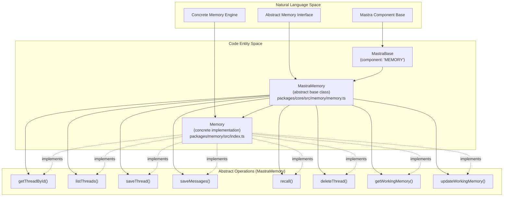
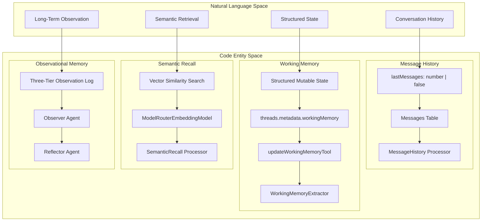

<!-- source: DeepWiki mcp.deepwiki.com · repo mastra-ai/mastra · page 7.1 Memory System Architecture · fetched 2026-10-27 -->

# Memory System Architecture

Relevant source files

The following files were used as context for generating this wiki page:

- [.changeset/silent-steaks-yell.md](.changeset/silent-steaks-yell.md)
- [docs/src/content/en/docs/memory/message-history.mdx](docs/src/content/en/docs/memory/message-history.mdx)
- [docs/src/content/en/docs/memory/observational-memory.mdx](docs/src/content/en/docs/memory/observational-memory.mdx)
- [docs/src/content/en/docs/memory/overview.mdx](docs/src/content/en/docs/memory/overview.mdx)
- [docs/src/content/en/docs/memory/semantic-recall.mdx](docs/src/content/en/docs/memory/semantic-recall.mdx)
- [docs/src/content/en/reference/memory/memory-class.mdx](docs/src/content/en/reference/memory/memory-class.mdx)
- [docs/src/content/en/reference/memory/observational-memory.mdx](docs/src/content/en/reference/memory/observational-memory.mdx)
- [packages/core/src/loop/test-utils/aimock/scenarios/working-memory-gemini-thought-signature.scenario.test.ts](packages/core/src/loop/test-utils/aimock/scenarios/working-memory-gemini-thought-signature.scenario.test.ts)
- [packages/core/src/memory/memory.ts](packages/core/src/memory/memory.ts)
- [packages/core/src/memory/mock-working-memory-merge.test.ts](packages/core/src/memory/mock-working-memory-merge.test.ts)
- [packages/core/src/memory/mock.ts](packages/core/src/memory/mock.ts)
- [packages/core/src/memory/types.ts](packages/core/src/memory/types.ts)
- [packages/core/src/memory/working-memory-utils.test.ts](packages/core/src/memory/working-memory-utils.test.ts)
- [packages/core/src/memory/working-memory-utils.ts](packages/core/src/memory/working-memory-utils.ts)
- [packages/core/src/processors/memory/message-history.test.ts](packages/core/src/processors/memory/message-history.test.ts)
- [packages/core/src/processors/memory/message-history.ts](packages/core/src/processors/memory/message-history.ts)
- [packages/memory/src/index.test.ts](packages/memory/src/index.test.ts)
- [packages/memory/src/index.ts](packages/memory/src/index.ts)
- [packages/memory/src/processors/observational-memory/__tests__/idle-buffering.test.ts](packages/memory/src/processors/observational-memory/__tests__/idle-buffering.test.ts)
- [packages/memory/src/processors/observational-memory/__tests__/message-utils.test.ts](packages/memory/src/processors/observational-memory/__tests__/message-utils.test.ts)
- [packages/memory/src/processors/observational-memory/__tests__/mid-loop-observation.test.ts](packages/memory/src/processors/observational-memory/__tests__/mid-loop-observation.test.ts)
- [packages/memory/src/processors/observational-memory/__tests__/mock-om-agent.test.ts](packages/memory/src/processors/observational-memory/__tests__/mock-om-agent.test.ts)
- [packages/memory/src/processors/observational-memory/__tests__/observation-groups.test.ts](packages/memory/src/processors/observational-memory/__tests__/observation-groups.test.ts)
- [packages/memory/src/processors/observational-memory/__tests__/observational-memory-api.test.ts](packages/memory/src/processors/observational-memory/__tests__/observational-memory-api.test.ts)
- [packages/memory/src/processors/observational-memory/__tests__/observational-memory.test.ts](packages/memory/src/processors/observational-memory/__tests__/observational-memory.test.ts)
- [packages/memory/src/processors/observational-memory/index.ts](packages/memory/src/processors/observational-memory/index.ts)
- [packages/memory/src/processors/observational-memory/message-utils.ts](packages/memory/src/processors/observational-memory/message-utils.ts)
- [packages/memory/src/processors/observational-memory/observation-groups.ts](packages/memory/src/processors/observational-memory/observation-groups.ts)
- [packages/memory/src/processors/observational-memory/observation-strategies/async-buffer.ts](packages/memory/src/processors/observational-memory/observation-strategies/async-buffer.ts)
- [packages/memory/src/processors/observational-memory/observation-strategies/base.ts](packages/memory/src/processors/observational-memory/observation-strategies/base.ts)
- [packages/memory/src/processors/observational-memory/observation-strategies/resource-scoped.ts](packages/memory/src/processors/observational-memory/observation-strategies/resource-scoped.ts)
- [packages/memory/src/processors/observational-memory/observation-strategies/sync.ts](packages/memory/src/processors/observational-memory/observation-strategies/sync.ts)
- [packages/memory/src/processors/observational-memory/observation-strategies/types.ts](packages/memory/src/processors/observational-memory/observation-strategies/types.ts)
- [packages/memory/src/processors/observational-memory/observation-turn/step.ts](packages/memory/src/processors/observational-memory/observation-turn/step.ts)
- [packages/memory/src/processors/observational-memory/observation-turn/turn.ts](packages/memory/src/processors/observational-memory/observation-turn/turn.ts)
- [packages/memory/src/processors/observational-memory/observational-memory.ts](packages/memory/src/processors/observational-memory/observational-memory.ts)
- [packages/memory/src/processors/observational-memory/observer-agent.ts](packages/memory/src/processors/observational-memory/observer-agent.ts)
- [packages/memory/src/processors/observational-memory/observer-runner.ts](packages/memory/src/processors/observational-memory/observer-runner.ts)
- [packages/memory/src/processors/observational-memory/processor.ts](packages/memory/src/processors/observational-memory/processor.ts)
- [packages/memory/src/processors/observational-memory/reflector-agent.ts](packages/memory/src/processors/observational-memory/reflector-agent.ts)
- [packages/memory/src/processors/observational-memory/reflector-runner.ts](packages/memory/src/processors/observational-memory/reflector-runner.ts)
- [packages/memory/src/processors/observational-memory/types.ts](packages/memory/src/processors/observational-memory/types.ts)
- [packages/memory/src/tools/working-memory.test.ts](packages/memory/src/tools/working-memory.test.ts)
- [packages/memory/src/tools/working-memory.ts](packages/memory/src/tools/working-memory.ts)

## Purpose and Scope

This document details the architectural foundations of Mastra's memory system. It covers the core abstractions (`MastraMemory`, `Memory`), memory types (Working Memory, Message History, Semantic Recall, and Observational Memory), configuration patterns (`MemoryConfigInternal`), tag-stripping behavior, and integration with storage/vector backends.

Sources:
- [packages/core/src/memory/memory.ts:71-114]()
- [packages/memory/src/index.ts:182-220]()

---

## Class Hierarchy and Abstraction Layers

The memory system implements a two-tier class hierarchy that separates abstract interfaces from concrete storage and search logic.

### Diagram: Class Hierarchy and Code Entities

Sources:
- [packages/core/src/memory/memory.ts:71-114]()
- [packages/memory/src/index.ts:182-220]()

### MastraMemory Base Class

`MastraMemory` acts as the abstract base class defining the standard memory contract across Mastra applications.

- **Storage & Vector Integration**: Manages `_storage` (`MastraCompositeStore`) and vector search instances (`MastraVector`) [packages/core/src/memory/memory.ts:133-134]().
- **Configuration Management**: Merges user options with defaults using `getMergedThreadConfig()` [packages/core/src/memory/memory.ts:350-372]().
- **Processor Factory Methods**: Dynamically generates pipeline processors via `getInputProcessors()` and `getOutputProcessors()` [packages/core/src/memory/memory.ts:608-851]().

Sources:
- [packages/core/src/memory/memory.ts:124-138]()
- [packages/core/src/memory/memory.ts:608-743]()

### Memory Concrete Implementation

The `Memory` class in `@mastra/memory` extends `MastraMemory` to supply runtime persistence, vector indexing, working memory tool registration, and observational memory processing.

- **Observational Memory Integration**: Hooks into background Observer and Reflector agents with configurable retries (`maxRetries`) and failure policies (`failurePolicy: 'continue' | 'abort'`) [packages/memory/src/index.test.ts:70-81]().
- **Mutex Protection**: Protects concurrent updates to working memory using `async-mutex` inside `updateWorkingMemory()` [packages/memory/src/index.ts:62](), [packages/memory/src/index.ts:652]().
- **AI SDK Compatibility**: Works across Vercel AI SDK versions with embedding routers like `ModelRouterEmbeddingModel` [packages/core/src/llm/model/embedding-router.ts:114-125]().

Sources:
- [packages/memory/src/index.ts:182-220]()
- [packages/core/src/memory/types.ts:191-205]()
- [packages/memory/src/index.test.ts:70-81]()

---

## Memory Types and Their Purposes

Mastra supports four distinct memory tiers to balance context window constraints, structural persistence, and semantic retrieval.

### Diagram: Memory Architecture and Data Flow

Sources:
- [packages/core/src/memory/types.ts:180-205]()
- [packages/core/src/memory/memory.ts:82-101]()
- [packages/memory/src/tools/working-memory.ts:69-160]()
- [packages/memory/src/processors/observational-memory/working-memory-extractor.ts]()

### Message History (Conversation Context)
Controlled via `lastMessages` or `messageHistory` token budgets [packages/core/src/memory/memory.ts:74-87](). Automatically loads recent messages and strips working memory tags before persistence [packages/memory/src/index.ts:157-162]().

Sources:
- [packages/core/src/memory/memory.ts:74-87]()
- [packages/memory/src/index.ts:157-162]()

### Working Memory (Structured State)
Maintains persistent user data across threads (`resource` scope) or specific conversations (`thread` scope) [packages/core/src/memory/types.ts:180-205](). Updated via the `updateWorkingMemory` tool using template replacement or deep schema merging [packages/memory/src/tools/working-memory.ts:69-160](). The `WorkingMemoryExtractor` can also manage working memory as part of Observational Memory [packages/memory/src/index.ts:78]().

Sources:
- [packages/core/src/memory/types.ts:180-205]()
- [packages/memory/src/tools/working-memory.ts:69-160]()
- [packages/memory/src/index.ts:78]()

### Semantic Recall (Vector-Based Retrieval)
Performs RAG-style similarity searches over historical messages [docs/src/content/en/docs/memory/semantic-recall.mdx:27-33](). Utilizes `ModelRouterEmbeddingModel` to generate embeddings and query vector collections [packages/core/src/llm/model/embedding-router.ts:114-125]().

Sources:
- [docs/src/content/en/docs/memory/semantic-recall.mdx:27-33]()
- [packages/core/src/llm/model/embedding-router.ts:114-125]()

### Observational Memory (Three-Tier Context)
Compresses aging conversations into observation logs and reflections via dedicated background agents [docs/src/content/en/docs/memory/observational-memory.mdx:13-16](). It uses an **Observer** to watch conversations and create observations, and a **Reflector** to restructure these observations [docs/src/content/en/reference/memory/observational-memory.mdx:13-14](). Includes error handling, `maxRetries`, and `failurePolicy` options [packages/memory/src/processors/observational-memory/types.ts:133-136](). Temporal gap markers can be enabled to insert reminders for long pauses in conversation [docs/src/content/en/docs/memory/observational-memory.mdx:130-133]().

Sources:
- [docs/src/content/en/docs/memory/observational-memory.mdx:13-16]()
- [docs/src/content/en/reference/memory/observational-memory.mdx:13-14]()
- [packages/memory/src/processors/observational-memory/types.ts:133-136]()
- [docs/src/content/en/docs/memory/observational-memory.mdx:130-133]()

---

## Configuration System

The memory configuration schema (`MemoryConfigInternal`) manages options across all storage, vector, and processor subsystems.

```mermaid
graph TB
    MemoryConfigInternal["MemoryConfigInternal"]
    
    subgraph "History Options"
        lastMessages["lastMessages: number | false"]
        readOnly["readOnly: boolean"]
        retainFullInput["retainFullInput: boolean"]
    end
    
    subgraph "Working Memory Options"
        WM_enabled["enabled: boolean"]
        WM_scope["scope: 'thread' | 'resource'"]
        WM_template["template: string"]
        WM_schema["schema: PublicSchema"]
        WM_version["version: 'v1' | 'vnext'"]
        WM_useStateSignals["useStateSignals: boolean"]
    end
    
    subgraph "Semantic Recall Options"
        SR_config["semanticRecall: boolean | Object"]
        SR_topK["topK: number"]
        SR_range["messageRange: number | Object"]
    end
    
    subgraph "Observational Memory Options"
        OM_config["observationalMemory: boolean | Object"]
        OM_model["model: 'auto' | string | LanguageModel | DynamicModel | ModelByInputTokens | ModelWithRetries[]"]
        OM_autoModels["autoModels: Record<string, string>"]
        OM_resolveModel["resolveModel: (modelId, context) => MastraModelConfig"]
        OM_scope["scope: 'resource' | 'thread'"]
        OM_activateAfterIdle["activateAfterIdle: number | string | false | 'auto' | Record<string, ...>"]
        OM_activateOnProviderChange["activateOnProviderChange: boolean"]
        OM_shareTokenBudget["shareTokenBudget: boolean"]
        OM_temporalMarkers["temporalMarkers: boolean"]
        OM_retrieval["retrieval: boolean | { vector?: boolean; scope?: 'thread' | 'resource'; instructions?: string }"]
        OM_observation["observation: ObservationConfig"]
        OM_reflection["reflection: ReflectionConfig"]
    end
    
    MemoryConfigInternal --> lastMessages
    MemoryConfigInternal --> readOnly
    MemoryConfigInternal --> retainFullInput
    MemoryConfigInternal --> WM_enabled
    WM_enabled --> WM_scope
    WM_enabled --> WM_template
    WM_enabled --> WM_schema
    WM_enabled --> WM_version
    WM_enabled --> WM_useStateSignals
    MemoryConfigInternal --> SR_config
    SR_config --> SR_topK
    SR_config --> SR_range
    MemoryConfigInternal --> OM_config
    OM_config --> OM_model
    OM_config --> OM_autoModels
    OM_config --> OM_resolveModel
    OM_config --> OM_scope
    OM_config --> OM_activateAfterIdle
    OM_config --> OM_activateOnProviderChange
    OM_config --> OM_shareTokenBudget
    OM_config --> OM_temporalMarkers
    OM_config --> OM_retrieval
    OM_config --> OM_observation
    OM_config --> OM_reflection
```

Sources:
- [packages/core/src/memory/memory.ts:82-101]()
- [packages/core/src/memory/types.ts:180-205]()
- [packages/memory/src/index.test.ts:48-63]()
- [docs/src/content/en/reference/memory/observational-memory.mdx:43-116]()
- [packages/memory/src/processors/observational-memory/types.ts:113-190]()

---

## Working Memory Tag Stripping and Internal Message Handling

To prevent exposing internal state mutations or `updateWorkingMemory` tool executions in user-facing message history, the memory subsystem intercepts saved messages.

- **Tag Removal**: Uses helper functions to strip `<working_memory>` blocks before persisting messages [packages/memory/src/index.ts:157-180]().
- **Tool Call Filtering**: Methods like `updateMessageToHideWorkingMemoryV2` remove working memory tool calls from stored conversation transcripts [packages/memory/src/index.ts:1042-1085]().

Sources:
- [packages/memory/src/index.ts:157-180]()
- [packages/memory/src/index.ts:1042-1085]()

---

