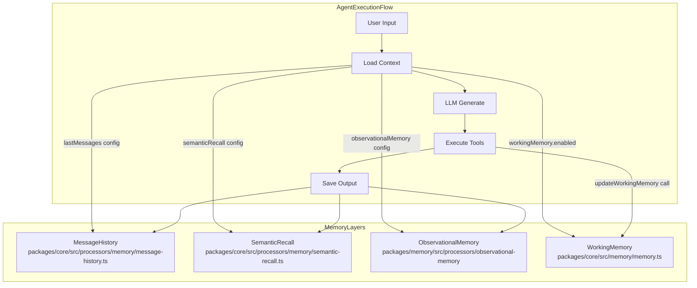
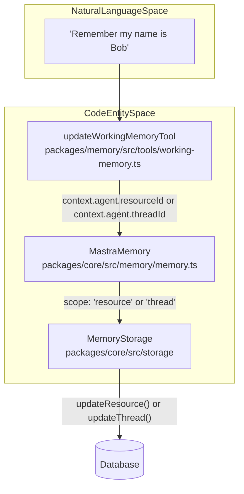
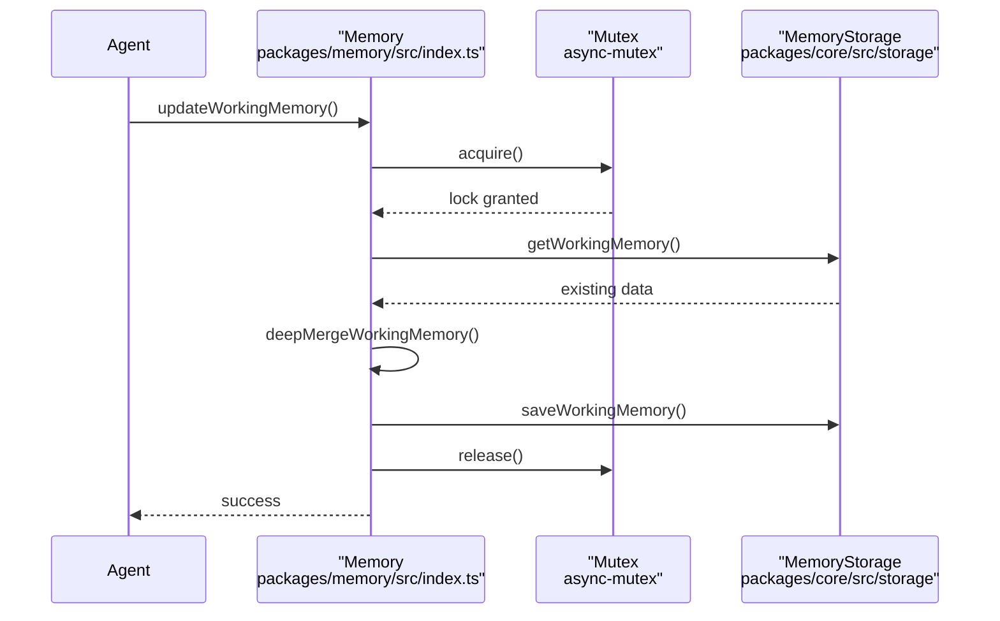

<!-- source: DeepWiki mcp.deepwiki.com · repo mastra-ai/mastra · page 7.10 Working Memory and Tool Integration · fetched 2026-10-27 -->

# Working Memory and Tool Integration

<details>
<summary>Relevant source files</summary>

The following files were used as context for generating this wiki page:

- [.changeset/silent-steaks-yell.md](.changeset/silent-steaks-yell.md)
- [docs/src/content/en/docs/memory/message-history.mdx](docs/src/content/en/docs/memory/message-history.mdx)
- [docs/src/content/en/docs/memory/observational-memory.mdx](docs/src/content/en/docs/memory/observational-memory.mdx)
- [docs/src/content/en/docs/memory/overview.mdx](docs/src/content/en/docs/memory/overview.mdx)
- [docs/src/content/en/docs/memory/semantic-recall.mdx](docs/src/content/en/docs/memory/semantic-recall.mdx)
- [docs/src/content/en/reference/memory/memory-class.mdx](docs/src/content/en/reference/memory/memory-class.mdx)
- [docs/src/content/en/reference/memory/observational-memory.mdx](docs/src/content/en/reference/memory/observational-memory.mdx)
- [packages/core/src/loop/test-utils/aimock/scenarios/working-memory-gemini-thought-signature.scenario.test.ts](packages/core/src/loop/test-utils/aimock/scenarios/working-memory-gemini-thought-signature.scenario.test.ts)
- [packages/core/src/memory/memory.ts](packages/core/src/memory/memory.ts)
- [packages/core/src/memory/mock-working-memory-merge.test.ts](packages/core/src/memory/mock-working-memory-merge.test.ts)
- [packages/core/src/memory/mock.ts](packages/core/src/memory/mock.ts)
- [packages/core/src/memory/types.ts](packages/core/src/memory/types.ts)
- [packages/core/src/memory/working-memory-utils.test.ts](packages/core/src/memory/working-memory-utils.test.ts)
- [packages/core/src/memory/working-memory-utils.ts](packages/core/src/memory/working-memory-utils.ts)
- [packages/core/src/processors/memory/message-history.test.ts](packages/core/src/processors/memory/message-history.test.ts)
- [packages/core/src/processors/memory/message-history.ts](packages/core/src/processors/memory/message-history.ts)
- [packages/memory/src/index.test.ts](packages/memory/src/index.test.ts)
- [packages/memory/src/index.ts](packages/memory/src/index.ts)
- [packages/memory/src/processors/observational-memory/__tests__/idle-buffering.test.ts](packages/memory/src/processors/observational-memory/__tests__/idle-buffering.test.ts)
- [packages/memory/src/processors/observational-memory/__tests__/message-utils.test.ts](packages/memory/src/processors/observational-memory/__tests__/message-utils.test.ts)
- [packages/memory/src/processors/observational-memory/__tests__/mid-loop-observation.test.ts](packages/memory/src/processors/observational-memory/__tests__/mid-loop-observation.test.ts)
- [packages/memory/src/processors/observational-memory/__tests__/mock-om-agent.test.ts](packages/memory/src/processors/observational-memory/__tests__/mock-om-agent.test.ts)
- [packages/memory/src/processors/observational-memory/__tests__/observation-groups.test.ts](packages/memory/src/processors/observational-memory/__tests__/observation-groups.test.ts)
- [packages/memory/src/processors/observational-memory/__tests__/observational-memory-api.test.ts](packages/memory/src/processors/observational-memory/__tests__/observational-memory-api.test.ts)
- [packages/memory/src/processors/observational-memory/__tests__/observational-memory.test.ts](packages/memory/src/processors/observational-memory/__tests__/observational-memory.test.ts)
- [packages/memory/src/processors/observational-memory/index.ts](packages/memory/src/processors/observational-memory/index.ts)
- [packages/memory/src/processors/observational-memory/message-utils.ts](packages/memory/src/processors/observational-memory/message-utils.ts)
- [packages/memory/src/processors/observational-memory/observation-groups.ts](packages/memory/src/processors/observational-memory/observation-groups.ts)
- [packages/memory/src/processors/observational-memory/observation-strategies/async-buffer.ts](packages/memory/src/processors/observational-memory/observation-strategies/async-buffer.ts)
- [packages/memory/src/processors/observational-memory/observation-strategies/base.ts](packages/memory/src/processors/observational-memory/observation-strategies/base.ts)
- [packages/memory/src/processors/observational-memory/observation-strategies/resource-scoped.ts](packages/memory/src/processors/observational-memory/observation-strategies/resource-scoped.ts)
- [packages/memory/src/processors/observational-memory/observation-strategies/sync.ts](packages/memory/src/processors/observational-memory/observation-strategies/sync.ts)
- [packages/memory/src/processors/observational-memory/observation-strategies/types.ts](packages/memory/src/processors/observational-memory/observation-strategies/types.ts)
- [packages/memory/src/processors/observational-memory/observation-turn/step.ts](packages/memory/src/processors/observational-memory/observation-turn/step.ts)
- [packages/memory/src/processors/observational-memory/observation-turn/turn.ts](packages/memory/src/processors/observational-memory/observation-turn/turn.ts)
- [packages/memory/src/processors/observational-memory/observational-memory.ts](packages/memory/src/processors/observational-memory/observational-memory.ts)
- [packages/memory/src/processors/observational-memory/observer-agent.ts](packages/memory/src/processors/observational-memory/observer-agent.ts)
- [packages/memory/src/processors/observational-memory/observer-runner.ts](packages/memory/src/processors/observational-memory/observer-runner.ts)
- [packages/memory/src/processors/observational-memory/processor.ts](packages/memory/src/processors/observational-memory/processor.ts)
- [packages/memory/src/processors/observational-memory/reflector-agent.ts](packages/memory/src/processors/observational-memory/reflector-agent.ts)
- [packages/memory/src/processors/observational-memory/reflector-runner.ts](packages/memory/src/processors/observational-memory/reflector-runner.ts)
- [packages/memory/src/processors/observational-memory/types.ts](packages/memory/src/processors/observational-memory/types.ts)
- [packages/memory/src/tools/working-memory.test.ts](packages/memory/src/tools/working-memory.test.ts)
- [packages/memory/src/tools/working-memory.ts](packages/memory/src/tools/working-memory.ts)

</details>


Working Memory provides agents with a persistent, structured scratchpad for maintaining conversation-relevant state across turns. Unlike message history (which records dialogue) or semantic recall (which retrieves past context via vector search), working memory is actively updated by agents through the `updateWorkingMemory` tool.

This document covers:
- Configuration modes (template-based Markdown vs schema-based JSON)
- Scoping strategies (resource-level vs thread-level)
- The `updateWorkingMemory` tool and how agents interact with it
- Update semantics (replace vs deep merge)
- Mutex protection and concurrency control

---

## Working Memory in the Memory Stack

Working memory is one of the core memory layers in the Mastra memory system. It allows the agent to maintain a "mental model" of the user or task that persists and evolves. It is integrated into the agent execution loop as both an input (providing context) and an output (via tool calls).

### Memory Layer Comparison

Title: "MastraMemoryLayersAndExecutionFlow"

Sources: [packages/core/src/memory/memory.ts:82-108](), [packages/core/src/processors/memory/message-history.ts:18-18](), [packages/core/src/processors/memory/semantic-recall.ts:18-18](), [packages/memory/src/processors/observational-memory/observational-memory.ts:16-16]()

| Layer | Persistence | Write Mechanism | Typical Use Case |
|-------|-------------|-----------------|------------------|
| **Message History** | Automatic | System-controlled | Recent dialogue context [packages/core/src/processors/memory/message-history.ts:18-18]() |
| **Semantic Recall** | Automatic | System-controlled | RAG-style retrieval [packages/core/src/processors/memory/semantic-recall.ts:18-18]() |
| **Observational Memory** | Automatic (Background Agents) | System-controlled | Long-term pattern compression [packages/memory/src/processors/observational-memory/observational-memory.ts:16-16]() |
| **Working Memory** | Manual (Tool Call) | Agent-controlled | Structured user profile, facts [packages/core/src/memory/memory.ts:114-118]() |

---

## Configuration Modes

Working memory supports two configuration modes: **template-based** (Markdown) for freeform text, and **schema-based** (JSON) for structured data with validation.

### Template Mode: Markdown Scratchpad

Template mode uses a Markdown template with predefined sections. Updates **replace** the entire content for the specific `memory` field.

**Type Definition:**
`[packages/core/src/memory/types.ts:189-193]()`
```typescript
type TemplateWorkingMemory = BaseWorkingMemory & {
  template: string;
  schema?: never;
  version?: 'stable' | 'vnext';
};
```

**Default Template:**
The framework provides a default template if none is specified:
`[packages/core/src/memory/memory.ts:88-106]()`
```markdown
# User Information
- **First Name**: 
- **Last Name**: 
- **Location**: 
- **Occupation**: 
- **Interests**: 
- **Goals**: 
- **Events**: 
- **Facts**: 
- **Projects**: 
```

### Schema Mode: Structured JSON

Schema mode uses a Zod schema or JSON Schema. Updates **merge** with existing data, supporting partial updates via deep merging.

**Type Definition:**
`[packages/core/src/memory/types.ts:195-198]()`
```typescript
type SchemaWorkingMemory = BaseWorkingMemory & {
  schema: PublicSchema;
  template?: never;
};
```

**Key Differences:**

| Aspect | Template Mode | Schema Mode |
|--------|---------------|-------------|
| **Format** | Markdown string | JSON object |
| **Validation** | None | Zod/StandardSchema validation |
| **Update Semantics** | Replace content | Deep merge with existing |
| **Tool Parameter** | `memory: string` | `memory: object` |

Sources: [packages/core/src/memory/types.ts:189-202](), [packages/memory/src/tools/working-memory.ts:89-161]()

---

## Scoping: Resource vs Thread

Working memory can be scoped at two levels, controlling how data is shared across conversations.

### Scope Architecture

**Resource Scope (Default):**
Memory persists across all threads for the same resource (e.g., a specific User ID). This is configured via `scope: 'resource'`.
`[packages/core/src/memory/types.ts:186-189]()`

**Thread Scope:**
Memory is isolated per conversation thread via `scope: 'thread'`.
`[packages/core/src/memory/types.ts:186-189]()`

Title: "NaturalLanguageIntentToCodeLevelStorageScoping"

Sources: [packages/core/src/memory/memory.ts:121-144](), [packages/core/src/memory/types.ts:186-189](), [packages/memory/src/tools/working-memory.ts:89-184]()

### Scope Validation

The system enforces scope requirements at runtime. If `scope: 'resource'` is used, a `resourceId` must be provided. If `scope: 'thread'` is used, a `threadId` is required. This is resolved via `MemoryRequestContext` which is parsed from the global `RequestContext`.
`[packages/core/src/memory/types.ts:139-173]()`, `[packages/memory/src/tools/working-memory.ts:176-184]()`

Sources: [packages/core/src/memory/types.ts:139-173](), [packages/core/src/memory/types.ts:186-189](), [packages/memory/src/tools/working-memory.ts:176-184]()

---

## The updateWorkingMemory Tool

The `updateWorkingMemory` tool is the primary interface for agents to modify their working memory.

### Implementation Details

The tool is dynamically generated based on the `MemoryConfig`. If a `schema` is provided, the tool's `inputSchema` is derived from that schema to ensure the LLM provides valid JSON.
`[packages/memory/src/tools/working-memory.ts:95-163]()`

```typescript
export const createWorkingMemoryTool = (memoryConfig?: MemoryConfigInternal) => {
  const schema = memoryConfig?.workingMemory?.schema;
  // ... logic to derive inputSchema from template or schema ...
  return createTool({
    id: 'update-working-memory',
    execute: async (inputData: { memory: any }, context) => {
       // Logic for merging or replacing memory
    }
  });
}
```

### Deep Merge Logic

For schema-based memory, the framework uses `deepMergeWorkingMemory` to combine the LLM's update with existing data.

**Merge Rules:**
1. **Objects**: Recursively merged.
2. **Arrays**: Replaced entirely (not merged element-by-element).
3. **Null Values**: If the update value is `null`, the property is deleted from the result.
4. **Primitives**: Overwritten.

`[packages/memory/src/tools/working-memory.ts:21-68]()`
```typescript
export function deepMergeWorkingMemory(
  existing: Record<string, unknown> | null | undefined,
  update: Record<string, unknown> | null | undefined,
): Record<string, unknown> {
  // ...
  if (updateValue === null) {
    delete result[key];
  } else if (Array.isArray(updateValue)) {
    result[key] = updateValue;
  }
  // ... recursive object merge ...
}
```

Sources: [packages/memory/src/tools/working-memory.ts:21-68](), [packages/memory/src/tools/working-memory.ts:89-161]()

---

## Mutex Protection

To prevent race conditions during concurrent tool calls (e.g., an agent calling `updateWorkingMemory` multiple times in parallel), Mastra uses a `Mutex` from `async-mutex`.
`[packages/memory/src/index.ts:62]()`

### Concurrency Control Flow

The `Memory` class (exported from `@mastra/memory`) utilizes a mutex to serialize operations on the same resource or thread to ensure data consistency during the read-merge-write cycle. This prevents "lost updates" when two turns try to modify memory at the same time.

Title: "SerializedToolExecutionViaMutexProtection"

Sources: [packages/memory/src/index.ts:62-62](), [packages/memory/src/tools/working-memory.ts:175-184]()

---

## Message Post-Processing

Mastra includes utilities to clean up messages containing working memory tags before they are presented to users or stored.

### Stripping Tags and Tool Calls
The extraction and cleanup helpers locate working memory boundaries and prevent internal prompt artifacts from leaking into public histories.
`[packages/memory/src/index.ts:81-82]()`

The system also identifies internal memory messages using `isSystemReminderMessage` to ensure they are handled correctly by memory processors and not shown to users.
`[packages/memory/src/system-reminders.ts:1-1]()`

Sources: [packages/memory/src/system-reminders.ts:1-1](), [packages/memory/src/index.ts:81-82]()

---

