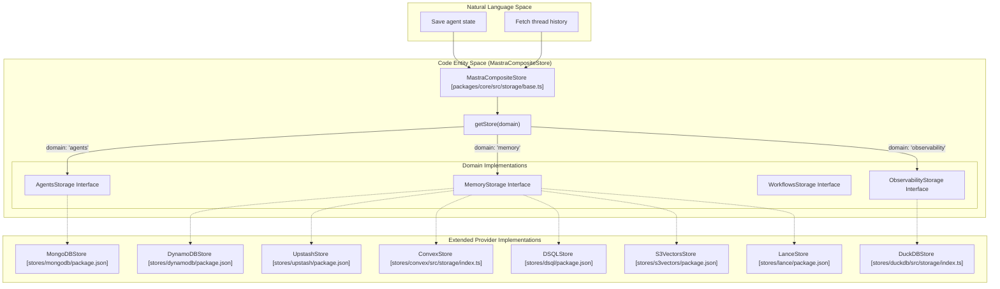
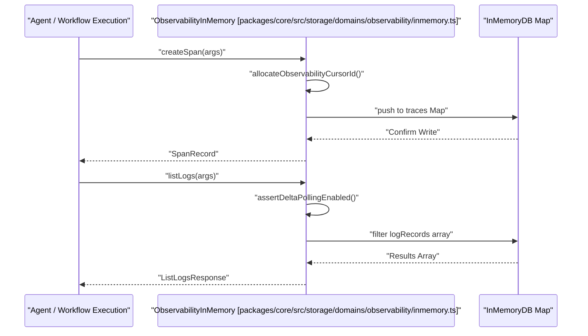

<!-- source: DeepWiki mcp.deepwiki.com · repo mastra-ai/mastra · page 7.11 Extended Storage Providers · fetched 2026-10-27 -->

# Extended Storage Providers

Relevant source files

The following files were used as context for generating this wiki page:

- [.changeset/tidy-pumas-invite.md](.changeset/tidy-pumas-invite.md)
- [.github/scripts/validate-pkg-json.mjs](.github/scripts/validate-pkg-json.mjs)
- [packages/_external-types/package.json](packages/_external-types/package.json)
- [packages/_vendored/ai_v4/package.json](packages/_vendored/ai_v4/package.json)
- [packages/_vendored/ai_v5/package.json](packages/_vendored/ai_v5/package.json)
- [packages/_vendored/ai_v6/package.json](packages/_vendored/ai_v6/package.json)
- [packages/core/src/storage/domains/observability/base.test.ts](packages/core/src/storage/domains/observability/base.test.ts)
- [packages/core/src/storage/domains/observability/base.ts](packages/core/src/storage/domains/observability/base.ts)
- [packages/core/src/storage/domains/observability/inmemory.ts](packages/core/src/storage/domains/observability/inmemory.ts)
- [packages/core/src/storage/domains/observability/trace-query.test.ts](packages/core/src/storage/domains/observability/trace-query.test.ts)
- [packages/core/src/storage/domains/observability/trace-query.ts](packages/core/src/storage/domains/observability/trace-query.ts)
- [packages/core/src/storage/domains/observability/tracing.test.ts](packages/core/src/storage/domains/observability/tracing.test.ts)
- [packages/core/src/storage/domains/observability/tracing.ts](packages/core/src/storage/domains/observability/tracing.ts)
- [packages/core/src/storage/workflow-snapshot.test.ts](packages/core/src/storage/workflow-snapshot.test.ts)
- [packages/core/src/storage/workflow-snapshot.ts](packages/core/src/storage/workflow-snapshot.ts)
- [packages/core/src/workflows/evented/workflow-event-processor/foreach-concurrency.test.ts](packages/core/src/workflows/evented/workflow-event-processor/foreach-concurrency.test.ts)
- [packages/core/src/workflows/evented/workflow-event-processor/foreach-stale-write.test.ts](packages/core/src/workflows/evented/workflow-event-processor/foreach-stale-write.test.ts)
- [packages/core/src/workflows/utils.test.ts](packages/core/src/workflows/utils.test.ts)
- [packages/server/src/server/handlers/observability-trace-query.test.ts](packages/server/src/server/handlers/observability-trace-query.test.ts)
- [pubsub/google-cloud-pubsub/package.json](pubsub/google-cloud-pubsub/package.json)
- [pubsub/redis-streams/package.json](pubsub/redis-streams/package.json)
- [pubsub/valkey-streams/package.json](pubsub/valkey-streams/package.json)
- [stores/_test-utils/src/domains/observability-vnext/index.ts](stores/_test-utils/src/domains/observability-vnext/index.ts)
- [stores/_test-utils/src/domains/observability-vnext/span-query.ts](stores/_test-utils/src/domains/observability-vnext/span-query.ts)
- [stores/_test-utils/src/domains/observability-vnext/trace-query.ts](stores/_test-utils/src/domains/observability-vnext/trace-query.ts)
- [stores/clickhouse/src/storage/domains/observability/v-next/ddl.ts](stores/clickhouse/src/storage/domains/observability/v-next/ddl.ts)
- [stores/clickhouse/src/storage/domains/observability/v-next/deletion.test.ts](stores/clickhouse/src/storage/domains/observability/v-next/deletion.test.ts)
- [stores/clickhouse/src/storage/domains/observability/v-next/feedback-deletion-races.test.ts](stores/clickhouse/src/storage/domains/observability/v-next/feedback-deletion-races.test.ts)
- [stores/clickhouse/src/storage/domains/observability/v-next/feedback-review-latency.test.ts](stores/clickhouse/src/storage/domains/observability/v-next/feedback-review-latency.test.ts)
- [stores/clickhouse/src/storage/domains/observability/v-next/feedback.ts](stores/clickhouse/src/storage/domains/observability/v-next/feedback.ts)
- [stores/clickhouse/src/storage/domains/observability/v-next/helpers.ts](stores/clickhouse/src/storage/domains/observability/v-next/helpers.ts)
- [stores/clickhouse/src/storage/domains/observability/v-next/index.test.ts](stores/clickhouse/src/storage/domains/observability/v-next/index.test.ts)
- [stores/clickhouse/src/storage/domains/observability/v-next/index.ts](stores/clickhouse/src/storage/domains/observability/v-next/index.ts)
- [stores/clickhouse/src/storage/domains/observability/v-next/logs.ts](stores/clickhouse/src/storage/domains/observability/v-next/logs.ts)
- [stores/clickhouse/src/storage/domains/observability/v-next/metrics.ts](stores/clickhouse/src/storage/domains/observability/v-next/metrics.ts)
- [stores/clickhouse/src/storage/domains/observability/v-next/polling.ts](stores/clickhouse/src/storage/domains/observability/v-next/polling.ts)
- [stores/clickhouse/src/storage/domains/observability/v-next/scores.ts](stores/clickhouse/src/storage/domains/observability/v-next/scores.ts)
- [stores/clickhouse/src/storage/domains/observability/v-next/trace-query.test.ts](stores/clickhouse/src/storage/domains/observability/v-next/trace-query.test.ts)
- [stores/clickhouse/src/storage/domains/observability/v-next/trace-query.ts](stores/clickhouse/src/storage/domains/observability/v-next/trace-query.ts)
- [stores/clickhouse/src/storage/domains/observability/v-next/trace-roots.ts](stores/clickhouse/src/storage/domains/observability/v-next/trace-roots.ts)
- [stores/clickhouse/src/storage/domains/observability/v-next/tracing.ts](stores/clickhouse/src/storage/domains/observability/v-next/tracing.ts)
- [stores/cloudflare-d1/package.json](stores/cloudflare-d1/package.json)
- [stores/cloudflare/package.json](stores/cloudflare/package.json)
- [stores/convex/README.md](stores/convex/README.md)
- [stores/convex/src/schema.ts](stores/convex/src/schema.ts)
- [stores/convex/src/server/index-map.test.ts](stores/convex/src/server/index-map.test.ts)
- [stores/convex/src/server/index-map.ts](stores/convex/src/server/index-map.ts)
- [stores/convex/src/server/index.ts](stores/convex/src/server/index.ts)
- [stores/convex/src/server/observational-memory.test.ts](stores/convex/src/server/observational-memory.test.ts)
- [stores/convex/src/server/observational-memory.ts](stores/convex/src/server/observational-memory.ts)
- [stores/convex/src/server/storage.test.ts](stores/convex/src/server/storage.test.ts)
- [stores/convex/src/server/storage.ts](stores/convex/src/server/storage.ts)
- [stores/convex/src/server/workflow-snapshot.ts](stores/convex/src/server/workflow-snapshot.ts)
- [stores/convex/src/storage/db/index.ts](stores/convex/src/storage/db/index.ts)
- [stores/convex/src/storage/domains/memory/index.ts](stores/convex/src/storage/domains/memory/index.ts)
- [stores/convex/src/storage/domains/memory/memory.test.ts](stores/convex/src/storage/domains/memory/memory.test.ts)
- [stores/convex/src/storage/domains/workflows/index.ts](stores/convex/src/storage/domains/workflows/index.ts)
- [stores/convex/src/storage/domains/workflows/workflows.test.ts](stores/convex/src/storage/domains/workflows/workflows.test.ts)
- [stores/convex/src/storage/index.test.ts](stores/convex/src/storage/index.test.ts)
- [stores/convex/src/storage/index.ts](stores/convex/src/storage/index.ts)
- [stores/convex/src/storage/types.ts](stores/convex/src/storage/types.ts)
- [stores/couchbase/package.json](stores/couchbase/package.json)
- [stores/dsql/package.json](stores/dsql/package.json)
- [stores/duckdb/src/storage/domains/observability/ddl.ts](stores/duckdb/src/storage/domains/observability/ddl.ts)
- [stores/duckdb/src/storage/domains/observability/feedback.ts](stores/duckdb/src/storage/domains/observability/feedback.ts)
- [stores/duckdb/src/storage/domains/observability/index.test.ts](stores/duckdb/src/storage/domains/observability/index.test.ts)
- [stores/duckdb/src/storage/domains/observability/index.ts](stores/duckdb/src/storage/domains/observability/index.ts)
- [stores/duckdb/src/storage/domains/observability/logs.ts](stores/duckdb/src/storage/domains/observability/logs.ts)
- [stores/duckdb/src/storage/domains/observability/metrics.ts](stores/duckdb/src/storage/domains/observability/metrics.ts)
- [stores/duckdb/src/storage/domains/observability/migration.ts](stores/duckdb/src/storage/domains/observability/migration.ts)
- [stores/duckdb/src/storage/domains/observability/scores.ts](stores/duckdb/src/storage/domains/observability/scores.ts)
- [stores/duckdb/src/storage/domains/observability/span-query.test.ts](stores/duckdb/src/storage/domains/observability/span-query.test.ts)
- [stores/duckdb/src/storage/domains/observability/span-query.ts](stores/duckdb/src/storage/domains/observability/span-query.ts)
- [stores/duckdb/src/storage/domains/observability/trace-query.test.ts](stores/duckdb/src/storage/domains/observability/trace-query.test.ts)
- [stores/duckdb/src/storage/domains/observability/trace-query.ts](stores/duckdb/src/storage/domains/observability/trace-query.ts)
- [stores/duckdb/src/storage/domains/observability/tracing.ts](stores/duckdb/src/storage/domains/observability/tracing.ts)
- [stores/duckdb/src/storage/features.ts](stores/duckdb/src/storage/features.ts)
- [stores/duckdb/src/storage/index.ts](stores/duckdb/src/storage/index.ts)
- [stores/dynamodb/package.json](stores/dynamodb/package.json)
- [stores/elasticsearch/package.json](stores/elasticsearch/package.json)
- [stores/lance/package.json](stores/lance/package.json)
- [stores/opensearch/package.json](stores/opensearch/package.json)
- [stores/pg/src/storage/domains/observability/v-next/index.ts](stores/pg/src/storage/domains/observability/v-next/index.ts)
- [stores/pg/src/storage/domains/observability/v-next/span-query.ts](stores/pg/src/storage/domains/observability/v-next/span-query.ts)
- [stores/pg/src/storage/domains/observability/v-next/trace-query.test.ts](stores/pg/src/storage/domains/observability/v-next/trace-query.test.ts)
- [stores/pg/src/storage/domains/observability/v-next/trace-query.ts](stores/pg/src/storage/domains/observability/v-next/trace-query.ts)
- [stores/pg/src/storage/index.vnext.test.ts](stores/pg/src/storage/index.vnext.test.ts)
- [stores/redis/CHANGELOG.md](stores/redis/CHANGELOG.md)
- [stores/redis/package.json](stores/redis/package.json)
- [stores/vectorize/package.json](stores/vectorize/package.json)
- [voice/cloudflare/package.json](voice/cloudflare/package.json)

Mastra provides a robust suite of extended storage adapters beyond the primary PostgreSQL and LibSQL implementations. These adapters allow Mastra to integrate with diverse infrastructure stacks, ranging from NoSQL databases like MongoDB and DynamoDB to specialized analytical stores like ClickHouse, distributed SQL like Amazon Aurora DSQL, vector stores like S3 Vectors and Lance, and cloud-native solutions like Upstash and Cloudflare D1.

All extended providers implement the `MastraCompositeStore` abstraction [packages/core/src/storage/base.ts:203-205](), which organizes data into specific domains such as `memory`, `workflows`, `observability`, and `agents` [packages/core/src/storage/base.ts:30-53]().

## System Architecture: Storage Domain Routing

Mastra uses a composite pattern where a single "Store" instance routes requests to specific domain implementations. This allows for mixing and matching different databases for different data types (e.g., using Redis for memory and PostgreSQL for configuration).

### Code-to-Entity Mapping
The following diagram illustrates how the `MastraCompositeStore` maps high-level storage requests to specific code entities across different provider packages, bridging natural language intent to concrete runtime classes.

Title: Storage Domain Routing Architecture

Sources: [packages/core/src/storage/base.ts:30-53](), [packages/core/src/storage/base.ts:203-205](), [stores/mongodb/package.json:2-4](), [stores/dynamodb/package.json:2-4](), [stores/upstash/package.json:2-4](), [stores/duckdb/src/storage/index.ts:10-11](), [stores/convex/src/storage/index.ts:10-12](), [stores/dsql/package.json:2-4](), [stores/s3vectors/package.json:2-4](), [stores/lance/package.json:2-4]()

---

## Provider Support Matrix

| Provider | Package | Supported Domains | Best Use Case |
| :--- | :--- | :--- | :--- |
| **MongoDB** | `@mastra/mongodb` | Memory, Workflows, Agents, Observability, Vector | Document-oriented storage, flexible schemas. |
| **DynamoDB** | `@mastra/dynamodb` | Memory, Workflows, Scores, Background Tasks | Serverless AWS stacks, high-scale key-value needs. |
| **Upstash** | `@mastra/upstash` | Memory, Workflows, Scores, Background Tasks, Vector | Edge-compatible, serverless Redis and Vector storage. |
| **ClickHouse** | `@mastra/clickhouse` | Memory, Workflows, Observability, Scores | High-performance telemetry and analytical logs. |
| **Cloudflare D1** | `@mastra/cloudflare-d1` | All domains (via SQLite compatibility) | Cloudflare Workers/Pages native storage. |
| **Amazon Aurora DSQL**| `@mastra/dsql` | Memory, Workflows, Agents, Observability | Distributed, serverless relational database workloads. |
| **S3 Vectors** | `@mastra/s3vectors` | Vector Storage | Scalable vector search backed by Amazon S3 infrastructure. |
| **LanceDB** | `@mastra/lance` | Memory, Vector Storage | Embedded vector database using Apache Arrow format. |
| **Couchbase** | `@mastra/couchbase` | Vector Storage | Enterprise-grade NoSQL with vector search. |
| **OpenSearch** | `@mastra/opensearch` | Vector Storage | Distributed search and analytics engine. |
| **DuckDB** | `@mastra/duckdb` | Observability | Embedded analytical database for local telemetry. |
| **Convex** | `@mastra/convex` | Memory, Workflows, DB | Real-time backend with built-in persistence. |
| **Chroma** | `@mastra/chroma` | Vector Storage | Open-source vector database for local embeddings. |
| **Qdrant** | `@mastra/qdrant` | Vector Storage | High-performance vector similarity search engine. |
| **MySQL** | `@mastra/mysql` | Memory, Workflows, Experiments | Standard relational workloads. |
| **Spanner** | `@mastra/spanner` | Memory, Workflows, Experiments | Globally distributed relational storage. |
| **TurboPuffer** | `@mastra/turbopuffer` | Vector Storage | Lightweight, low-latency vector database. |
| **Redis** | `@mastra/redis` | Memory, PubSub | High-performance caching and message brokering. |
| **MSSQL** | `@mastra/mssql` | Memory, Workflows, Experiments | Microsoft SQL Server integration for enterprise environments. |

Sources: [stores/mongodb/package.json:2-4](), [stores/dynamodb/package.json:2-4](), [stores/upstash/package.json:2-4](), [stores/cloudflare-d1/package.json:2-4](), [stores/duckdb/src/storage/index.ts:10-11](), [stores/convex/src/storage/index.ts:10-12](), [stores/dsql/package.json:2-4](), [stores/s3vectors/package.json:2-4](), [stores/lance/package.json:2-4](), [stores/redis/package.json:2-4](), [stores/mssql/package.json:2-4]()

---

## Key Provider Implementations

### ClickHouse Observability
The ClickHouse provider implements the `ObservabilityStorage` interface using a "v-next" model that leverages `ReplacingMergeTree` engines for deduplication and analytical performance [stores/clickhouse/src/storage/domains/observability/v-next/index.ts:4-5]().

**Implementation Details:**
- **Signal Handling**: Supports logs, metrics, and scores.
- **Migration System**: Includes a manual migration path (`npx mastra migrate`) to transition legacy signal tables to the signal-ID dedupe key schema [stores/clickhouse/src/storage/domains/observability/v-next/index.ts:162-167]().
- **Retention**: Configurable per-signal TTL (Time-To-Live) using ClickHouse `MODIFY TTL` expressions [stores/clickhouse/src/storage/domains/observability/v-next/index.ts:217-219]().
- **Trace Query**: Supports advanced trace querying with features like `timeToFirstChunkMs` [stores/clickhouse/src/storage/domains/observability/v-next/trace-query.ts:51-60]().
- **Discovery**: Leverages materialized views (`MV_DISCOVERY_VALUES`, `MV_DISCOVERY_PAIRS`) for efficient discovery of entity types, names, and tags [stores/clickhouse/src/storage/domains/observability/v-next/index.test.ts:140-158]().

Sources: [stores/clickhouse/src/storage/domains/observability/v-next/index.ts:4-173](), [stores/clickhouse/src/storage/domains/observability/v-next/trace-query.ts:51-60](), [stores/clickhouse/src/storage/domains/observability/v-next/index.test.ts:140-158]()

### Convex Storage
The `@mastra/convex` adapter integrates Mastra with the Convex real-time platform. It uses `GenericMutationCtx` to perform database operations within the Convex environment [stores/convex/src/server/storage.ts:13-14]().

**Key Features:**
- **Table Aliasing**: Maps Mastra core table names (e.g., `TABLE_THREADS`) to Convex-specific strings like `mastra_threads` [stores/convex/src/server/storage.ts:1-12]().
- **Batching**: Implements `mapInBatches` to handle mutation limits, defaulting to a batch size of 25 [stores/convex/src/server/storage.ts:32-100]().
- **Background Tasks**: Includes specific field aliasing for background task records to ensure compatibility between CamelCase and snake_case [stores/convex/src/server/storage.ts:41-62]().
- **Observational Memory**: Handles observational memory operations through `handleObservationalMemoryOperation` [stores/convex/src/server/storage.ts:19]().
- **Run Claiming**: Manages run claims via `handleRunClaimOperation` for workflow execution [stores/convex/src/server/storage.ts:20]().

Sources: [stores/convex/src/server/storage.ts:1-152](), [stores/convex/src/schema.ts:1-50](), [stores/convex/src/server/storage.ts:19-20]()

### DuckDB Observability
`ObservabilityStorageDuckDB` provides an embedded analytical storage layer. It defaults to an `event-sourced` tracing strategy [stores/duckdb/src/storage/domains/observability/index.ts:97-101]().

**Implementation Details:**
- **DDL Management**: Automatically executes a batch of DDL and migration statements during initialization [stores/duckdb/src/storage/domains/observability/index.ts:191-194]().
- **Delta Polling**: Supports delta polling for logs and metrics when feature flags are enabled [stores/duckdb/src/storage/domains/observability/index.ts:115]().
- **In-Memory Support**: Can be initialized with `:memory:` for ephemeral testing environments [stores/duckdb/src/storage/domains/observability/index.test.ts:56]().
- **Tracing Strategy**: Reports `event-sourced` as its preferred strategy [stores/duckdb/src/storage/domains/observability/index.test.ts:130-134]().
- **Feature Gates**: Gates delta polling based on `coreFeatures` while always advertising metrics and logs [stores/duckdb/src/storage/domains/observability/index.test.ts:137-205]().

Sources: [stores/duckdb/src/storage/domains/observability/index.ts:1-120](), [stores/duckdb/src/storage/domains/observability/index.test.ts:56](), [stores/duckdb/src/storage/domains/observability/index.test.ts:130-205]()

### DynamoDB Storage
`DynamoDBStore` leverages `electrodb` internally to provide a structured entity model over DynamoDB's key-value structure [stores/dynamodb/package.json:43]().

**Configuration Pattern:**
- **AWS SDK Integration**: Uses `@aws-sdk/client-dynamodb` and `@aws-sdk/lib-dynamodb` [stores/dynamodb/package.json:41-42]().
- **Serverless Scaling**: Optimized for AWS Lambda environments where connections are short-lived.

Sources: [stores/dynamodb/package.json:41-43]()

### Amazon Aurora DSQL (`@mastra/dsql`)
`@mastra/dsql` integrates AWS Aurora DSQL—a serverless, distributed relational database built on PostgreSQL-compatible protocols. It utilizes the official Aurora DSQL Node.js Postgres connector (`@aws/aurora-dsql-node-postgres-connector`) paired with standard `pg` driver bindings [stores/dsql/package.json:31-34]().

**Implementation Details:**
- **Authentication**: Supports IAM token-based connection authorization required by DSQL clusters.
- **Relational Mapping**: Maps core storage domains into distributed tables seamlessly while maintaining transaction safety across availability zones.

Sources: [stores/dsql/package.json:1-68]()

### S3 Vectors and LanceDB
Specialized storage adapters for vector embeddings and high-performance querying:
- **S3 Vectors (`@mastra/s3vectors`)**: Integrates with Amazon S3 Vectors client (`@aws-sdk/client-s3vectors`) to manage vector indexes and similarity searches directly within object storage buckets [stores/s3vectors/package.json:33-36]().
- **LanceDB (`@mastra/lance`)**: Combines `@lancedb/lancedb` and `apache-arrow` to deliver embedded vector storage and relational tables over local or cloud object paths [stores/lance/package.json:30-33]().

Sources: [stores/s3vectors/package.json:30-36](), [stores/lance/package.json:30-33]()

### Cloudflare & Upstash
Designed for edge and serverless runtimes:
- **Cloudflare**: The `@mastra/cloudflare` and `@mastra/cloudflare-d1` packages provide KV, Durable Objects (DO), and D1 SQLite storage integration [stores/cloudflare/package.json:23-42](), [stores/cloudflare-d1/package.json:2-34]().
- **Upstash**: Combines `@upstash/redis` for state/caching and `@upstash/vector` for serverless vector similarity search [stores/upstash/package.json:32-36]().

Sources: [stores/cloudflare/package.json:2-42](), [stores/cloudflare-d1/package.json:2-34](), [stores/upstash/package.json:32-36]()

### Redis Storage
The `@mastra/redis` package provides a Redis storage adapter, primarily for memory and PubSub functionalities. It leverages the `ioredis` client for high-performance Redis interactions [stores/redis/package.json:30-33]().

**Key Features:**
- **Memory Storage**: Implements `MemoryStorage` for session and thread management.
- **PubSub Integration**: Can be used as a PubSub provider for event-driven architectures.

Sources: [stores/redis/package.json:30-33]()

### MSSQL Storage
The `@mastra/mssql` package integrates with Microsoft SQL Server, providing relational storage for various Mastra domains. It uses the `mssql` package for database connectivity [stores/mssql/package.json:30-33]().

**Key Features:**
- **Relational Data**: Suitable for traditional enterprise environments requiring SQL Server.
- **Domain Support**: Supports Memory, Workflows, and Experiments domains.

Sources: [stores/mssql/package.json:30-33]()

---

## Data Flow: Observability In-Memory

For local development and testing, Mastra provides `ObservabilityInMemory`, which simulates a full observability store using a simple `InMemoryDB` object [packages/core/src/storage/domains/observability/inmemory.ts:126-132]().

### Code-to-Entity Mapping
The following diagram connects high-level telemetry and persistence requests from agents and workflows to the underlying in-memory storage data structures.

Title: In-Memory Observability Data Flow

Sources: [packages/core/src/storage/domains/observability/inmemory.ts:126-215](), [packages/core/src/storage/domains/observability/inmemory.ts:174-178]()

---

## Choosing a Provider

| Use Case | Recommended Provider |
| :--- | :--- |
| **Edge / Serverless** | `UpstashStore`, `CloudflareD1Store`, `LibSQLStore` |
| **Real-time / Full-stack** | `ConvexStore` |
| **Analytical / Telemetry** | `ClickhouseStore`, `DuckDBStore` |
| **AWS Stacks** | `DynamoDBStore`, `DSQLStore`, `S3VectorsStore` |
| **Local Vector Search** | `ChromaStore`, `LanceStore` |
| **Enterprise Vector Search** | `CouchbaseStore`, `OpenSearchStore`, `ElasticsearchStore` |
| **Caching / PubSub** | `RedisStore` |
| **Microsoft Enterprise** | `MSSQLStore` |

Sources: [stores/upstash/package.json:2-4](), [stores/duckdb/src/storage/index.ts:10-11](), [stores/dynamodb/package.json:2-4](), [stores/lance/package.json:2-4](), [stores/couchbase/package.json:2-4](), [stores/convex/src/storage/index.ts](), [stores/redis/package.json:2-4](), [stores/mssql/package.json:2-4]()

---

