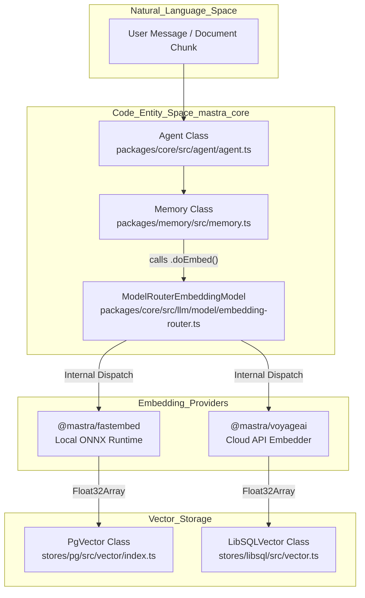
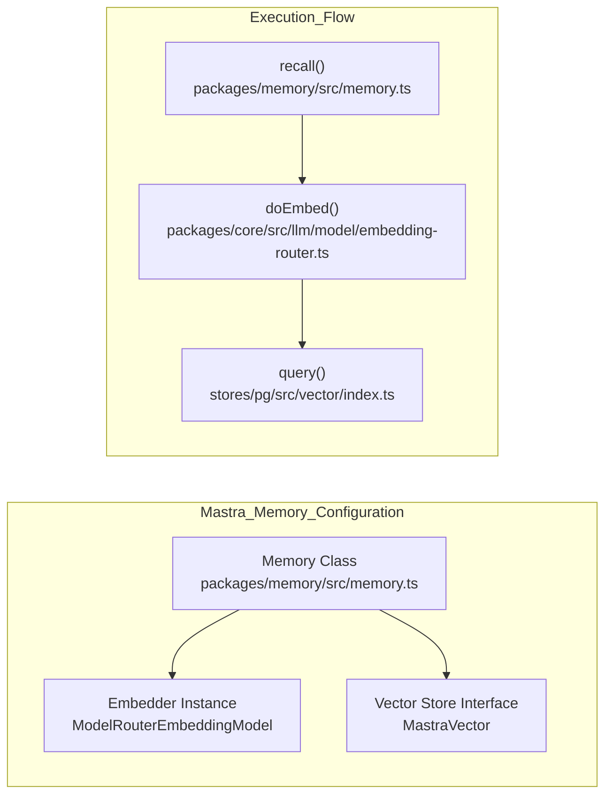

<!-- source: DeepWiki mcp.deepwiki.com · repo mastra-ai/mastra · page 7.12 Embedders and Embedding Providers (FastEmbed, VoyageAI) · fetched 2026-10-27 -->

# Embedders and Embedding Providers (FastEmbed, VoyageAI)

Relevant source files

The following files were used as context for generating this wiki page:

- [.changeset/tidy-pumas-invite.md](.changeset/tidy-pumas-invite.md)
- [.github/scripts/validate-pkg-json.mjs](.github/scripts/validate-pkg-json.mjs)
- [packages/_external-types/package.json](packages/_external-types/package.json)
- [packages/_vendored/ai_v4/package.json](packages/_vendored/ai_v4/package.json)
- [packages/_vendored/ai_v5/package.json](packages/_vendored/ai_v5/package.json)
- [packages/_vendored/ai_v6/package.json](packages/_vendored/ai_v6/package.json)
- [pubsub/google-cloud-pubsub/package.json](pubsub/google-cloud-pubsub/package.json)
- [pubsub/redis-streams/package.json](pubsub/redis-streams/package.json)
- [pubsub/valkey-streams/package.json](pubsub/valkey-streams/package.json)
- [stores/cloudflare-d1/package.json](stores/cloudflare-d1/package.json)
- [stores/cloudflare/package.json](stores/cloudflare/package.json)
- [stores/couchbase/package.json](stores/couchbase/package.json)
- [stores/dsql/package.json](stores/dsql/package.json)
- [stores/dynamodb/package.json](stores/dynamodb/package.json)
- [stores/elasticsearch/package.json](stores/elasticsearch/package.json)
- [stores/lance/package.json](stores/lance/package.json)
- [stores/opensearch/package.json](stores/opensearch/package.json)
- [stores/redis/CHANGELOG.md](stores/redis/CHANGELOG.md)
- [stores/redis/package.json](stores/redis/package.json)
- [stores/vectorize/package.json](stores/vectorize/package.json)
- [voice/cloudflare/package.json](voice/cloudflare/package.json)

Embedders are the core components responsible for transforming natural language text (and sometimes images) into high-dimensional numerical vectors. These vectors enable **semantic recall** and **Retrieval-Augmented Generation (RAG)** by allowing the system to perform similarity searches in vector databases based on meaning rather than keyword matching [docs/src/content/en/docs/memory/semantic-recall.mdx:27-38]().

## System Overview

Mastra provides a unified interface for embedding models through the `ModelRouterEmbeddingModel` [packages/core/src/llm/model/embedding-router.ts:114-120]() and model router abstractions. This abstraction allows you to swap between local providers like FastEmbed and cloud-based providers like VoyageAI or OpenAI by simply changing a configuration string.

### Data Flow: Text to Vector Space

The following diagram illustrates how an embedder sits between the Agent's memory system and the physical vector storage, bridging natural language spaces with code entities.

**Embedder Integration Architecture**

Sources: `docs/src/content/en/docs/memory/semantic-recall.mdx:33-38]`, `packages/core/src/llm/model/embedding-router.ts:114-120]`, `stores/pg/src/vector/index.ts:136-150]`

---

## VoyageAI Provider

VoyageAI offers specialized models optimized for specific domains like finance, law, and code retrieval. It is integrated via the `@mastra/voyageai` package [docs/src/content/en/docs/memory/semantic-recall.mdx:1-12]().

### Supported Models and Capabilities
VoyageAI supports varying dimensions and specialized retrieval tasks:
- **General Purpose:** `voyage-4-large`, `voyage-4`.
- **Domain Specific:** `voyage-code-3` (Code), `voyage-finance-2` (Finance), `voyage-law-2` (Legal).
- **Multimodal:** `voyage-multimodal-3.5` (Text + Images).

### Implementation Detail: Multimodal Embeddings
The multimodal embedder accepts a mixed content array of text and image URLs, producing a unified vector representation via the underlying API client.

Sources: `docs/src/content/en/docs/memory/semantic-recall.mdx:1-12]`

---

## FastEmbed Integration

FastEmbed (provided via `@mastra/fastembed`) allows for local embedding generation using ONNX-backed models. This is ideal for edge environments or scenarios requiring high privacy and zero API costs.

### Local Model Execution
FastEmbed executes models locally, bypassing the need for external API calls. It uses the `FastEmbed` class to manage model loading and execution.
- **Model Support:** Includes models optimized for dense retrieval and classification.
- **Lifecycle Management:** Supports explicit initialization hooks for loading ONNX runtimes.

### Warmup and Cache Patterns
Local embedders like FastEmbed often require a "warmup" phase where the ONNX runtime loads the model into memory. Mastra handles this via internal promises (such as cache warmup utilities in vector stores) to ensure that vector operations do not fail during the initial load [stores/pg/src/vector/index.ts:159-160](). Singleton caching mechanisms provide access to loaded models to prevent redundant memory overhead.

Sources: `packages/fastembed/package.json:2-4]`, `stores/pg/src/vector/index.ts:159-160]`

---

## Wiring Embedders into Memory and RAG

To enable semantic recall, an embedder must be provided to the `Memory` class along with a compatible `vector` store [docs/src/content/en/reference/memory/memory-class.mdx:47-64]().

### Configuration Pattern
When `semanticRecall` is enabled, the `Memory` instance uses the `embedder` to transform incoming messages into vectors before upserting them into the `vector` store [docs/src/content/en/docs/memory/semantic-recall.mdx:41-43](), [docs/src/content/en/docs/memory/semantic-recall.mdx:61-65]().

**Entity Mapping: Memory to Vector Store**

Sources: `docs/src/content/en/docs/memory/semantic-recall.mdx:107-128]`, `docs/src/content/en/docs/memory/semantic-recall.mdx:134-154]`, `stores/pg/src/vector/index.ts:136-150]`

### Vector Precision and Types
Different providers and models output different vector dimensions. When using storage adapters like `PgVector`, you can configure the `vectorType` to match the model's output for storage optimization:
- `vector`: Full precision (4 bytes/dim) [stores/pg/src/vector/index.ts:34]().
- `halfvec`: Half precision (2 bytes/dim), useful for large models like `text-embedding-3-large` [stores/pg/src/vector/index.ts:35](), [stores/pg/src/vector/index.ts:91]().
- `bit`: Binary vectors (1 bit/dim) for maximum speed [stores/pg/src/vector/index.ts:36]().

Sources: `stores/pg/src/vector/index.ts:30-46]`, `stores/pg/src/vector/index.ts:85-95]`

---

## Technical Reference: Embedding Model IDs

Mastra uses a `provider/model` string format for model identification, providing full TypeScript autocomplete for supported models [packages/core/src/llm/model/embedding-router.ts:84-88]().

| Provider | Example Model ID | Dimensions |
| :--- | :--- | :--- |
| OpenAI | `openai/text-embedding-3-small` | 1536 [packages/core/src/llm/model/embedding-router.ts:51-53]() |
| OpenAI | `openai/text-embedding-3-large` | 3072 [packages/core/src/llm/model/embedding-router.ts:58-60]() |
| Google | `google/gemini-embedding-001` | 768 [packages/core/src/llm/model/embedding-router.ts:73-75]() |
| VoyageAI | `voyage-4-large` | 1024 (default) |
| FastEmbed | `fastembed/mle5large` | Varies |

Sources: `packages/core/src/llm/model/embedding-router.ts:48-79]`

---

