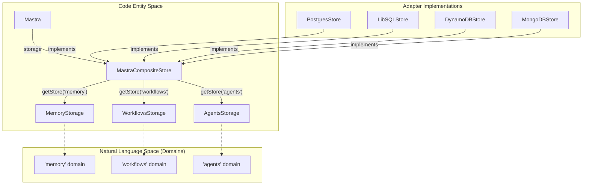
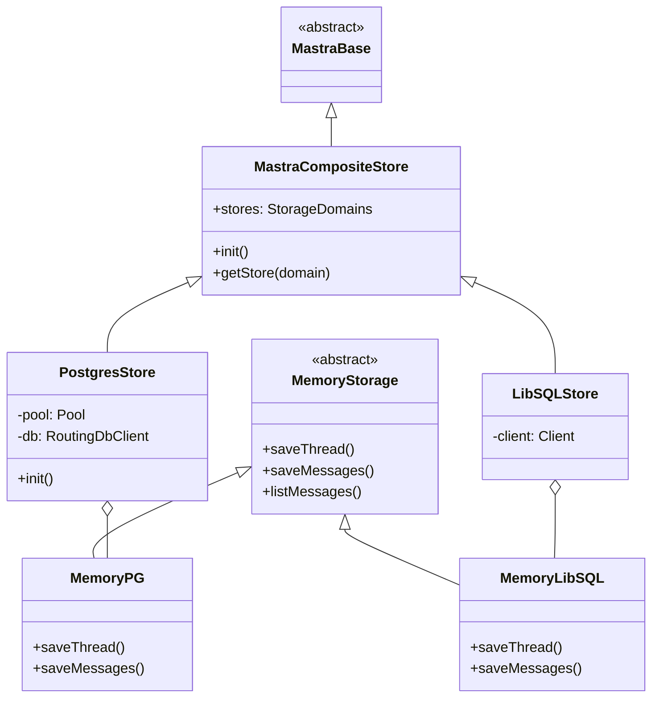

<!-- source: DeepWiki mcp.deepwiki.com · repo mastra-ai/mastra · page 7.3 Storage Domain Architecture · fetched 2026-10-27 -->

# Storage Domain Architecture

Relevant source files

The following files were used as context for generating this wiki page:

- [.changeset/dynamodb-consistent-snapshot-reads.md](.changeset/dynamodb-consistent-snapshot-reads.md)
- [docs/src/content/en/integrations/databases/cloudflare-kv.mdx](docs/src/content/en/integrations/databases/cloudflare-kv.mdx)
- [docs/src/content/en/integrations/databases/postgresql.mdx](docs/src/content/en/integrations/databases/postgresql.mdx)
- [packages/core/src/agent/__tests__/suspended-run-discovery.test.ts](packages/core/src/agent/__tests__/suspended-run-discovery.test.ts)
- [packages/core/src/storage/domains/memory/base.ts](packages/core/src/storage/domains/memory/base.ts)
- [packages/core/src/storage/domains/memory/inmemory.ts](packages/core/src/storage/domains/memory/inmemory.ts)
- [packages/core/src/storage/domains/workflows/inmemory-get-by-id.test.ts](packages/core/src/storage/domains/workflows/inmemory-get-by-id.test.ts)
- [packages/core/src/storage/domains/workflows/inmemory.ts](packages/core/src/storage/domains/workflows/inmemory.ts)
- [packages/core/src/storage/types.ts](packages/core/src/storage/types.ts)
- [packages/server/src/server/handlers/memory.test.ts](packages/server/src/server/handlers/memory.test.ts)
- [packages/server/src/server/handlers/memory.ts](packages/server/src/server/handlers/memory.ts)
- [packages/server/src/server/schemas/memory.test.ts](packages/server/src/server/schemas/memory.test.ts)
- [packages/server/src/server/schemas/memory.ts](packages/server/src/server/schemas/memory.ts)
- [stores/_test-utils/src/domains/workflows/index.ts](stores/_test-utils/src/domains/workflows/index.ts)
- [stores/dsql/src/storage/client.ts](stores/dsql/src/storage/client.ts)
- [stores/dsql/src/storage/client.tx-serialize.test.ts](stores/dsql/src/storage/client.tx-serialize.test.ts)
- [stores/dsql/src/storage/domains/memory/index.ts](stores/dsql/src/storage/domains/memory/index.ts)
- [stores/dsql/src/storage/domains/memory/save-timestamps.test.ts](stores/dsql/src/storage/domains/memory/save-timestamps.test.ts)
- [stores/dsql/src/storage/domains/observability/index.ts](stores/dsql/src/storage/domains/observability/index.ts)
- [stores/dsql/src/storage/domains/workflows/index.ts](stores/dsql/src/storage/domains/workflows/index.ts)
- [stores/dynamodb/src/storage/domains/workflows/consistent-reads.test.ts](stores/dynamodb/src/storage/domains/workflows/consistent-reads.test.ts)
- [stores/dynamodb/src/storage/domains/workflows/index.ts](stores/dynamodb/src/storage/domains/workflows/index.ts)
- [stores/libsql/src/storage/db/index.ts](stores/libsql/src/storage/db/index.ts)
- [stores/libsql/src/storage/db/safe-stringify.test.ts](stores/libsql/src/storage/db/safe-stringify.test.ts)
- [stores/libsql/src/storage/db/spans-read-indexes.test.ts](stores/libsql/src/storage/db/spans-read-indexes.test.ts)
- [stores/libsql/src/storage/db/utils.ts](stores/libsql/src/storage/db/utils.ts)
- [stores/libsql/src/storage/domains/memory/index.ts](stores/libsql/src/storage/domains/memory/index.ts)
- [stores/libsql/src/storage/domains/workflows/index.test.ts](stores/libsql/src/storage/domains/workflows/index.test.ts)
- [stores/libsql/src/storage/domains/workflows/index.ts](stores/libsql/src/storage/domains/workflows/index.ts)
- [stores/libsql/src/storage/remote-init.unit.test.ts](stores/libsql/src/storage/remote-init.unit.test.ts)
- [stores/mongodb/src/storage/domains/memory/index.ts](stores/mongodb/src/storage/domains/memory/index.ts)
- [stores/mssql/src/storage/domains/workflows/index.ts](stores/mssql/src/storage/domains/workflows/index.ts)
- [stores/mysql/src/storage/db/schema-snapshot.test.ts](stores/mysql/src/storage/db/schema-snapshot.test.ts)
- [stores/mysql/src/storage/db/schema-snapshot.ts](stores/mysql/src/storage/db/schema-snapshot.ts)
- [stores/mysql/src/storage/domains/memory/index.ts](stores/mysql/src/storage/domains/memory/index.ts)
- [stores/mysql/src/storage/domains/observability/index.ts](stores/mysql/src/storage/domains/observability/index.ts)
- [stores/mysql/src/storage/domains/operations/alter-table.unit.test.ts](stores/mysql/src/storage/domains/operations/alter-table.unit.test.ts)
- [stores/mysql/src/storage/domains/operations/index.ts](stores/mysql/src/storage/domains/operations/index.ts)
- [stores/mysql/src/storage/domains/workflows/index.ts](stores/mysql/src/storage/domains/workflows/index.ts)
- [stores/mysql/src/storage/index.ts](stores/mysql/src/storage/index.ts)
- [stores/oracledb/src/storage/domains/workflows/index.ts](stores/oracledb/src/storage/domains/workflows/index.ts)
- [stores/pg/docker-compose.benchmark.yaml](stores/pg/docker-compose.benchmark.yaml)
- [stores/pg/scripts/init-benchmark.ts](stores/pg/scripts/init-benchmark.ts)
- [stores/pg/src/storage/client.ts](stores/pg/src/storage/client.ts)
- [stores/pg/src/storage/client.tx-serialize.test.ts](stores/pg/src/storage/client.tx-serialize.test.ts)
- [stores/pg/src/storage/db/constraint-utils.test.ts](stores/pg/src/storage/db/constraint-utils.test.ts)
- [stores/pg/src/storage/db/constraint-utils.ts](stores/pg/src/storage/db/constraint-utils.ts)
- [stores/pg/src/storage/db/index.ts](stores/pg/src/storage/db/index.ts)
- [stores/pg/src/storage/db/schema-snapshot.stress.test.ts](stores/pg/src/storage/db/schema-snapshot.stress.test.ts)
- [stores/pg/src/storage/db/schema-snapshot.test.ts](stores/pg/src/storage/db/schema-snapshot.test.ts)
- [stores/pg/src/storage/db/schema-snapshot.ts](stores/pg/src/storage/db/schema-snapshot.ts)
- [stores/pg/src/storage/db/timestamp-trigger.test.ts](stores/pg/src/storage/db/timestamp-trigger.test.ts)
- [stores/pg/src/storage/db/transaction-client.test.ts](stores/pg/src/storage/db/transaction-client.test.ts)
- [stores/pg/src/storage/domains/experiments/relax-not-null.test.ts](stores/pg/src/storage/domains/experiments/relax-not-null.test.ts)
- [stores/pg/src/storage/domains/favorites/index.ts](stores/pg/src/storage/domains/favorites/index.ts)
- [stores/pg/src/storage/domains/memory/index.ts](stores/pg/src/storage/domains/memory/index.ts)
- [stores/pg/src/storage/domains/memory/save-messages.test.ts](stores/pg/src/storage/domains/memory/save-messages.test.ts)
- [stores/pg/src/storage/domains/memory/test-utils.ts](stores/pg/src/storage/domains/memory/test-utils.ts)
- [stores/pg/src/storage/domains/observability/v-next/integration.test.ts](stores/pg/src/storage/domains/observability/v-next/integration.test.ts)
- [stores/pg/src/storage/domains/workflows/concurrent-index-build.test.ts](stores/pg/src/storage/domains/workflows/concurrent-index-build.test.ts)
- [stores/pg/src/storage/domains/workflows/index.ts](stores/pg/src/storage/domains/workflows/index.ts)
- [stores/pg/src/storage/domains/workflows/sanitize-json.test.ts](stores/pg/src/storage/domains/workflows/sanitize-json.test.ts)
- [stores/pg/src/storage/domains/workflows/status-index.test.ts](stores/pg/src/storage/domains/workflows/status-index.test.ts)
- [stores/pg/src/storage/index.test.ts](stores/pg/src/storage/index.test.ts)
- [stores/pg/src/storage/index.ts](stores/pg/src/storage/index.ts)
- [stores/pg/src/storage/performance-indexes/performance-indexes.test.ts](stores/pg/src/storage/performance-indexes/performance-indexes.test.ts)
- [stores/pg/src/storage/pooler-init.pooler.test.ts](stores/pg/src/storage/pooler-init.pooler.test.ts)
- [stores/pg/src/storage/test-utils.ts](stores/pg/src/storage/test-utils.ts)
- [stores/pg/tsconfig.json](stores/pg/tsconfig.json)
- [stores/pg/vitest.config.ts](stores/pg/vitest.config.ts)
- [stores/spanner/src/storage/domains/memory/index.ts](stores/spanner/src/storage/domains/memory/index.ts)
- [stores/spanner/src/storage/domains/memory/list-messages-where.test.ts](stores/spanner/src/storage/domains/memory/list-messages-where.test.ts)
- [stores/spanner/src/storage/domains/workflows/index.ts](stores/spanner/src/storage/domains/workflows/index.ts)
- [stores/spanner/src/storage/domains/workflows/update-workflow-state.test.ts](stores/spanner/src/storage/domains/workflows/update-workflow-state.test.ts)
- [stores/upstash/src/storage/domains/workflows/index.ts](stores/upstash/src/storage/domains/workflows/index.ts)

## Purpose and Scope

This document details Mastra's storage domain architecture, focusing on the `MastraCompositeStore` coordinator, the `MemoryStorage` interface, and the storage adapter pattern [packages/core/src/storage/domains/memory/base.ts:1-5](). The system uses a provider-agnostic interface organized into distinct domain classes (e.g., Memory, Agents, Workflows, Datasets, Workspaces) that enable unified data persistence across relational databases, document stores, and edge-compatible key-value or SQLite engines [packages/core/src/storage/types.ts:27-30]().

---

## Composite Store Architecture (`MastraCompositeStore`)

The `MastraCompositeStore` class is the central coordinator for all storage operations across Mastra [packages/core/src/storage/index.ts:3-3](). It aggregates domain-specific storage implementations and exposes a unified `getStore()` routing method that allows developers to direct specific data domains to different physical database backends [packages/core/src/storage/index.ts:3-3]().

### Data Flow and Entity Mapping

Sources: [packages/core/src/storage/index.ts:3-3](), [stores/pg/src/storage/index.ts:199-205](), [stores/libsql/src/storage/index.ts:160-166](), [stores/dynamodb/src/storage/domains/workflows/index.ts:1-1](), [stores/mongodb/src/storage/domains/memory/index.ts:1-1]()

### Configuration and Composition Priority
The configuration system allows fine-grained control over multi-store routing through the composite configuration object:

| Property | Role | Priority |
| :--- | :--- | :--- |
| `default` | Fallback storage adapter used for any unmapped domain | 3 (Lowest) |
| `editor` | Shorthand grouping for all editor-related domains (agents, prompts, etc.) | 2 |
| `domains` | Explicit per-domain overrides | 1 (Highest) |

Sources: [packages/core/src/storage/index.ts:3-3]()

---

## Storage Adapter Pattern and `MemoryStorage` Interface

Mastra standardizes storage backends through a modular adapter pattern. Each storage package extends `MastraCompositeStore` and initializes domain-specific managers like `MemoryPG`, `MemoryLibSQL`, or `MemoryMongoDB` which inherit from the abstract `MemoryStorage` class [stores/pg/src/storage/index.ts:98-98](), [stores/libsql/src/storage/domains/memory/index.ts:140-140](), [stores/mongodb/src/storage/domains/memory/index.ts:1-1]()

### Implementation Hierarchy

Sources: [packages/core/src/storage/index.ts:3-3](), [stores/pg/src/storage/index.ts:98-98](), [stores/libsql/src/storage/domains/memory/index.ts:140-140]()

### Key Adapter Components
1.  **Client Drivers**: Underlying database connections (`pg.Pool`, `libsql.Client`, `MongoDBConnector`, etc.) wrapped to expose uniform query structures [stores/pg/src/storage/db/index.ts:23-23](), [stores/libsql/src/storage/db/index.ts:1-1](), [stores/mongodb/src/storage/domains/memory/index.ts:66-66]().
2.  **Domain Managers**: Concrete implementations of domain interfaces (e.g., `MemoryStorage`, `WorkflowsStorage`) handling CRUD logic, query filtering, and data sanitization [stores/pg/src/storage/domains/memory/index.ts:174-181](), [stores/libsql/src/storage/domains/memory/index.ts:161-171]().
3.  **Migration & Initialization**: The `init()` lifecycle method provisions schema tables, constraints, and indexes [stores/pg/src/storage/index.ts:241-243](), [stores/libsql/src/storage/db/index.ts:1-1]().

Sources: [packages/core/src/storage/index.ts:3-3](), [stores/pg/src/storage/index.ts:192-230]()

---

## Memory Storage Domain

The `memory` domain manages threads, individual messages, resources, and observational memory states [packages/core/src/storage/types.ts:5-5]().

### Core Tables and Entities
*   `TABLE_THREADS` (`mastra_threads`): Groups message turns into logical conversational threads scoped to a `resourceId` [packages/core/src/storage/types.ts:5-5]().
*   `TABLE_MESSAGES` (`mastra_messages`): Stores individual prompt and response records with metadata [packages/core/src/storage/types.ts:5-5]().
*   `TABLE_RESOURCES` (`mastra_resources`): Represents entities (users, documents) owning threads [packages/core/src/storage/types.ts:5-5]().
*   `TABLE_OBSERVATIONAL_MEMORY` (`mastra_observational_memory`): Persists compressed summaries and reflection history for long-running agent contexts [stores/pg/src/storage/domains/memory/index.ts:37-37]().

Sources: [packages/core/src/storage/types.ts:5-5](), [stores/pg/src/storage/domains/memory/index.ts:37-37]()

### Data Retention and Pruning
Adapters support configurable age-based retention policies through `prune()` and `retentionTables` descriptors, which identify timestamp columns (such as `createdAt` or `createdAtZ`) for batch cleanup [stores/pg/src/storage/domains/memory/index.ts:114-118](), [stores/libsql/src/storage/domains/memory/index.ts:154-159]().

Sources: [stores/pg/src/storage/domains/memory/index.ts:114-118](), [stores/libsql/src/storage/domains/memory/index.ts:154-159]()

### Pagination and Normalization Helpers
Mastra provides internal helper utilities to handle query boundaries:
*   `normalizePerPage`: Converts input limits (`false` to max integer representation, or numeric values) into safe execution bounds [packages/core/src/storage/types.ts:53-62]().
*   `calculatePagination`: Computes SQL/NoSQL offsets and page state metadata [packages/core/src/storage/types.ts:53-62]().

Sources: [packages/core/src/storage/types.ts:53-62]()

---

## Available Storage Adapters

| Package | Backend | Characteristics |
| :--- | :--- | :--- |
| `@mastra/pg` | PostgreSQL | Production-grade, supports schemas and DDL export [stores/pg/src/storage/index.ts:128-142](). |
| `@mastra/libsql` | LibSQL / Turso | Edge-compatible, supports local files, in-memory, and remote Turso sync [stores/libsql/src/storage/domains/memory/index.ts:168-171](). |
| `@mastra/dynamodb` | DynamoDB | Single-table design via ElectroDB [stores/dynamodb/src/storage/domains/workflows/index.ts:1-1](). |
| `@mastra/mongodb` | MongoDB | Document-based persistence with index orchestration [stores/mongodb/src/storage/domains/memory/index.ts:1-1](). |

Sources: [stores/pg/src/storage/index.ts:128-142](), [stores/libsql/src/storage/domains/memory/index.ts:168-171](), [stores/dynamodb/src/storage/domains/workflows/index.ts:1-1](), [stores/mongodb/src/storage/domains/memory/index.ts:1-1]()

---

## Database Schema Management

Mastra manages database bootstrapping automatically unless disabled by setting `disableInit: true` in the storage config [stores/libsql/src/storage/db/index.ts:1-1](). For relational stores like PostgreSQL, the framework can export complete DDL initialization scripts statically without an active database connection using `exportSchemas()` [stores/pg/src/storage/index.ts:128-142]().

Sources: [stores/pg/src/storage/index.ts:128-142](), [stores/libsql/src/storage/db/index.ts:1-1]()

---

