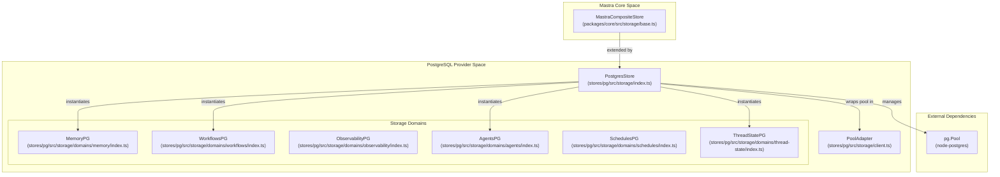
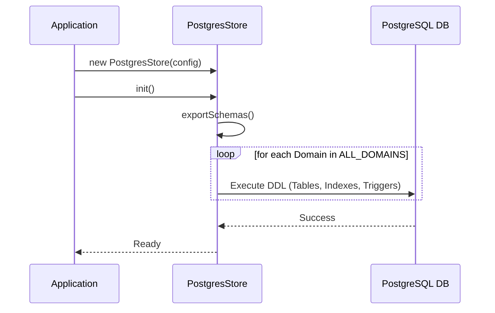

<!-- source: DeepWiki mcp.deepwiki.com · repo mastra-ai/mastra · page 7.4 PostgreSQL Storage Provider · fetched 2026-10-27 -->

# PostgreSQL Storage Provider

Relevant source files

The following files were used as context for generating this wiki page:

- [.changeset/dynamodb-consistent-snapshot-reads.md](.changeset/dynamodb-consistent-snapshot-reads.md)
- [docs/src/content/en/integrations/databases/cloudflare-kv.mdx](docs/src/content/en/integrations/databases/cloudflare-kv.mdx)
- [docs/src/content/en/integrations/databases/postgresql.mdx](docs/src/content/en/integrations/databases/postgresql.mdx)
- [packages/core/src/agent/__tests__/suspended-run-discovery.test.ts](packages/core/src/agent/__tests__/suspended-run-discovery.test.ts)
- [packages/core/src/storage/domains/workflows/inmemory-get-by-id.test.ts](packages/core/src/storage/domains/workflows/inmemory-get-by-id.test.ts)
- [packages/core/src/storage/domains/workflows/inmemory.ts](packages/core/src/storage/domains/workflows/inmemory.ts)
- [stores/_test-utils/src/domains/workflows/index.ts](stores/_test-utils/src/domains/workflows/index.ts)
- [stores/dsql/src/storage/client.ts](stores/dsql/src/storage/client.ts)
- [stores/dsql/src/storage/client.tx-serialize.test.ts](stores/dsql/src/storage/client.tx-serialize.test.ts)
- [stores/dsql/src/storage/domains/observability/index.ts](stores/dsql/src/storage/domains/observability/index.ts)
- [stores/dynamodb/src/storage/domains/workflows/consistent-reads.test.ts](stores/dynamodb/src/storage/domains/workflows/consistent-reads.test.ts)
- [stores/dynamodb/src/storage/domains/workflows/index.ts](stores/dynamodb/src/storage/domains/workflows/index.ts)
- [stores/libsql/src/storage/db/index.ts](stores/libsql/src/storage/db/index.ts)
- [stores/libsql/src/storage/db/safe-stringify.test.ts](stores/libsql/src/storage/db/safe-stringify.test.ts)
- [stores/libsql/src/storage/db/spans-read-indexes.test.ts](stores/libsql/src/storage/db/spans-read-indexes.test.ts)
- [stores/libsql/src/storage/db/utils.ts](stores/libsql/src/storage/db/utils.ts)
- [stores/libsql/src/storage/domains/workflows/index.test.ts](stores/libsql/src/storage/domains/workflows/index.test.ts)
- [stores/libsql/src/storage/domains/workflows/index.ts](stores/libsql/src/storage/domains/workflows/index.ts)
- [stores/libsql/src/storage/remote-init.unit.test.ts](stores/libsql/src/storage/remote-init.unit.test.ts)
- [stores/mysql/src/storage/db/schema-snapshot.test.ts](stores/mysql/src/storage/db/schema-snapshot.test.ts)
- [stores/mysql/src/storage/db/schema-snapshot.ts](stores/mysql/src/storage/db/schema-snapshot.ts)
- [stores/mysql/src/storage/domains/observability/index.ts](stores/mysql/src/storage/domains/observability/index.ts)
- [stores/mysql/src/storage/domains/operations/alter-table.unit.test.ts](stores/mysql/src/storage/domains/operations/alter-table.unit.test.ts)
- [stores/mysql/src/storage/domains/operations/index.ts](stores/mysql/src/storage/domains/operations/index.ts)
- [stores/mysql/src/storage/domains/workflows/index.ts](stores/mysql/src/storage/domains/workflows/index.ts)
- [stores/mysql/src/storage/index.ts](stores/mysql/src/storage/index.ts)
- [stores/pg/CHANGELOG.md](stores/pg/CHANGELOG.md)
- [stores/pg/docker-compose.benchmark.yaml](stores/pg/docker-compose.benchmark.yaml)
- [stores/pg/package.json](stores/pg/package.json)
- [stores/pg/scripts/init-benchmark.ts](stores/pg/scripts/init-benchmark.ts)
- [stores/pg/src/storage/client.ts](stores/pg/src/storage/client.ts)
- [stores/pg/src/storage/client.tx-serialize.test.ts](stores/pg/src/storage/client.tx-serialize.test.ts)
- [stores/pg/src/storage/db/constraint-utils.test.ts](stores/pg/src/storage/db/constraint-utils.test.ts)
- [stores/pg/src/storage/db/constraint-utils.ts](stores/pg/src/storage/db/constraint-utils.ts)
- [stores/pg/src/storage/db/index.ts](stores/pg/src/storage/db/index.ts)
- [stores/pg/src/storage/db/schema-snapshot.stress.test.ts](stores/pg/src/storage/db/schema-snapshot.stress.test.ts)
- [stores/pg/src/storage/db/schema-snapshot.test.ts](stores/pg/src/storage/db/schema-snapshot.test.ts)
- [stores/pg/src/storage/db/schema-snapshot.ts](stores/pg/src/storage/db/schema-snapshot.ts)
- [stores/pg/src/storage/db/timestamp-trigger.test.ts](stores/pg/src/storage/db/timestamp-trigger.test.ts)
- [stores/pg/src/storage/db/transaction-client.test.ts](stores/pg/src/storage/db/transaction-client.test.ts)
- [stores/pg/src/storage/domains/experiments/relax-not-null.test.ts](stores/pg/src/storage/domains/experiments/relax-not-null.test.ts)
- [stores/pg/src/storage/domains/favorites/index.ts](stores/pg/src/storage/domains/favorites/index.ts)
- [stores/pg/src/storage/domains/memory/save-messages.test.ts](stores/pg/src/storage/domains/memory/save-messages.test.ts)
- [stores/pg/src/storage/domains/memory/test-utils.ts](stores/pg/src/storage/domains/memory/test-utils.ts)
- [stores/pg/src/storage/domains/observability/v-next/integration.test.ts](stores/pg/src/storage/domains/observability/v-next/integration.test.ts)
- [stores/pg/src/storage/domains/workflows/concurrent-index-build.test.ts](stores/pg/src/storage/domains/workflows/concurrent-index-build.test.ts)
- [stores/pg/src/storage/domains/workflows/index.ts](stores/pg/src/storage/domains/workflows/index.ts)
- [stores/pg/src/storage/domains/workflows/sanitize-json.test.ts](stores/pg/src/storage/domains/workflows/sanitize-json.test.ts)
- [stores/pg/src/storage/domains/workflows/status-index.test.ts](stores/pg/src/storage/domains/workflows/status-index.test.ts)
- [stores/pg/src/storage/index.test.ts](stores/pg/src/storage/index.test.ts)
- [stores/pg/src/storage/index.ts](stores/pg/src/storage/index.ts)
- [stores/pg/src/storage/performance-indexes/performance-indexes.test.ts](stores/pg/src/storage/performance-indexes/performance-indexes.test.ts)
- [stores/pg/src/storage/pooler-init.pooler.test.ts](stores/pg/src/storage/pooler-init.pooler.test.ts)
- [stores/pg/src/storage/test-utils.ts](stores/pg/src/storage/test-utils.ts)
- [stores/pg/tsconfig.json](stores/pg/tsconfig.json)
- [stores/pg/vitest.config.ts](stores/pg/vitest.config.ts)
- [stores/upstash/src/storage/domains/workflows/index.ts](stores/upstash/src/storage/domains/workflows/index.ts)

The PostgreSQL Storage Provider (`@mastra/pg`) is Mastra's primary relational storage adapter. It implements the unified storage abstraction layer for all Mastra domains—including memory, workflows, observability, and agents—leveraging PostgreSQL's robust relational features, connection pooling, and vector search capabilities [stores/pg/package.json:2-4]().

---

## Package Overview

The `@mastra/pg` package provides a PostgreSQL-backed implementation of the `MastraCompositeStore` interface [stores/pg/package.json:2-4]().

**Core Characteristics:**

- **Modular Domain Implementations:** Each data domain (e.g., memory, workflows, observability) is a distinct class encapsulating SQL operations and schema management [stores/pg/src/storage/index.ts:97-121]().
- **Connection Pooling:** Built on the `pg` client with customizable `max` connections and `idleTimeoutMillis` [stores/pg/src/storage/index.ts:48-91]().
- **Schema Management:** Provides utilities to export consolidated DDL statements across all domains, supporting custom schema names and ensuring a single source of truth for the schema [stores/pg/src/storage/index.ts:127-142]().
- **Vector Search:** Integrated support for high-dimensional vector storage and similarity search within the same database infrastructure [stores/pg/package.json:2-4]().
- **Retention Policies:** Supports table-granular, age-based retention policies for automatic data pruning via the `prune()` method [packages/core/src/storage/base.ts:30-31]().

Sources: [stores/pg/package.json:1-84](), [stores/pg/src/storage/index.ts:97-142](), [packages/core/src/storage/base.ts:30-58]()

---

## Architecture and Class Structure

The PostgreSQL provider uses a composite architecture where the main `PostgresStore` class aggregates domain-specific implementations.

### Main Components

- **PostgresStore:** The primary adapter extending `MastraCompositeStore` [stores/pg/src/storage/index.ts:199-205](). It manages the `pg.Pool`, schema usage, and lifecycle.
- **PoolAdapter:** Wraps the `pg.Pool` to provide a unified query and transaction interface to domain clients [stores/pg/src/storage/client.ts:17-18,171-172]().
- **Domain Clients:** Classes like `MemoryPG`, `WorkflowsPG`, and `AgentsPG` that implement domain-specific logic [stores/pg/src/storage/index.ts:22-46]().
- **ThreadStatePG:** A persistent domain for storing durable task and goal state as JSONB, keyed by `(threadId, type)` [stores/pg/src/storage/index.ts:42,120]().

### Natural Language to Code Entity Space

Sources: [stores/pg/src/storage/index.ts:22-46,171-205](), [packages/core/src/storage/base.ts:33-58]()

---

## Configuration and Initialization

`PostgresStore` supports multiple connection patterns: connection strings, host-based objects, or pre-existing `pg.Pool` instances [stores/pg/src/storage/index.ts:179-205](), [stores/pg/src/storage/db/index.ts:36-99]().

### Supported Configurations

| Pattern | Required Fields | Source |
| :--- | :--- | :--- |
| **Connection String** | `id`, `connectionString` | [stores/pg/src/storage/index.ts:182-185]() |
| **Host-Based / Pool Config** | `id`, `pool` or host parameters | [stores/pg/src/storage/index.ts:187-190](), [stores/pg/src/storage/db/index.ts:62-98]() |

### Initialization Flow

When `init()` is called, the store iterates through all registered domains to ensure the schema is up to date. Concurrent calls to `init()` are managed to prevent multiple initialization attempts [stores/pg/src/storage/index.ts:127-142]().

Sources: [stores/pg/src/storage/index.ts:127-142,179-205](), [stores/pg/src/storage/db/index.ts:36-98]()

---

## Domain Implementations

The PostgreSQL provider maps the generic `StorageDomains` interface to specific SQL-backed classes [stores/pg/src/storage/index.ts:97-121]():

| Domain | PostgreSQL Implementation | Purpose |
| :--- | :--- | :--- |
| `memory` | `MemoryPG` | Chat threads and message persistence [stores/pg/src/storage/index.ts:98](). |
| `workflows` | `WorkflowsPG` | Workflow execution snapshots and states [stores/pg/src/storage/index.ts:112](). |
| `observability`| `ObservabilityPG` | Traces, spans, and evaluation logs [stores/pg/src/storage/index.ts:101](). |
| `agents` | `AgentsPG` | Agent configuration and version storage [stores/pg/src/storage/index.ts:105](). |
| `schedules` | `SchedulesPG` | Background task and cron scheduling [stores/pg/src/storage/index.ts:119](). |
| `threadState` | `ThreadStatePG` | Durable task/goal state keyed by thread [stores/pg/src/storage/index.ts:120](). |

Each domain provides a static `getExportDDL` method that returns the complete SQL schema (tables, constraints, indexes) required for that domain [stores/pg/src/storage/index.ts:127-142]().

Sources: [stores/pg/src/storage/index.ts:97-121,127-142]()

---

## Performance and Robustness

- **Batch Processing:** `MemoryPG` and `PgDB` support chunked multi-row inserts and handle batches larger than the PostgreSQL bind-parameter limit (65,535) [stores/pg/src/storage/test-utils.ts:77-104,143-162]().
- **Conflict Handling:** Uses upsert patterns and `ON CONFLICT` clauses for reliable idempotency in spans and domain tables [stores/pg/src/storage/test-utils.ts:106-141,164-170]().
- **Read/Write Pooling:** Supports split read and write pools (`readPool` and `writePool`), allowing plain reads to be routed to replicas while read-modify-write and mutation paths stay anchored to the writer [stores/pg/src/storage/index.test.ts:36-70]().

Sources: [stores/pg/src/storage/test-utils.ts:76-170](), [stores/pg/src/storage/index.test.ts:36-70]()

---

